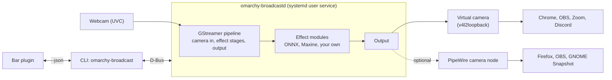

# omarchy-broadcast

**A virtual camera and a virtual microphone with live effects for Omarchy and Arch Linux.** Blur or replace your background, remove noise, fix the light and look into the lens, in any application that reads a camera or a microphone.

The daemon, `omarchy-broadcastd`, reads your webcam, applies the effects you choose and writes the result to a virtual camera. Chrome, OBS, Zoom and Discord select it like any other camera. Any UVC webcam works. UVC is the standard USB camera class.

**Install:** `yay -S omarchy-broadcast-bin omarchy-broadcast-onnx-bin`, then follow [INSTALL.md](INSTALL.md). An NVIDIA GPU is optional.

## What you get

**On any machine** (CPU, or an Intel GPU or NPU through ONNX Runtime):

- Background blur and background replacement with open Apache-2.0 models. A replacement can be an image, an animated image or a video; two loops and a set of backgrounds are bundled.
- Camera passthrough with the camera's own image settings: brightness, contrast, saturation, exposure, white balance, focus and zoom, set per camera.
- A choice of the camera's resolution and frame rate and of the virtual camera's size and rate.
- A virtual microphone, **Omarchy Broadcast Mic**, with noise removal on the CPU (DeepFilterNet by default, or RNNoise).

**With an NVIDIA RTX GPU** (the optional NVIDIA Maxine modules, with an SDK you obtain yourself):

- Background blur and replacement on the GPU, with a hardened mask edge.
- Video noise removal, which clears the grain a webcam shows in dim rooms.
- Relighting of the person with a warm, neutral or cool key light. You adjust its direction and brightness. The background is never relit.
- Enhancement, which upscales a camera that captures well below the output size.
- Eye contact and auto-framing. Eye contact redirects your eyes towards the camera. Auto-framing pans and zooms digitally to keep your face in frame. Both are off by default.
- Frame generation: an output at twice the camera's rate, for example 60 fps from a 30 fps camera.
- Room echo removal and studio voice for the microphone.

Each effect is a **module**: a manifest and a shared library that the daemon discovers at run time. With no module installed, the daemon passes the camera image through. You can [write your own module](docs/modules.md).

## Why use it

- **It runs on your machine.** The daemon processes video and audio locally. The open-model path needs no NVIDIA SDK.
- **It works in any application.** The virtual camera is a [v4l2loopback](https://github.com/v4l2loopback/v4l2loopback) device. An optional PipeWire camera node, "Omarchy Broadcast", serves several applications at once.
- **It leaves the GPU alone when you do not use it.** The camera and GPU start when an application opens the virtual camera. Idle means no CUDA context. On a battery, the daemon can keep the frames in system memory and not wake the NVIDIA GPU.
- **You control it from the Omarchy bar.** The [bar plugin](#the-bar-plugin) shows the camera's state and opens a panel with a live preview, the effects, the camera's settings and the microphone.
- **It fails safe.** If the daemon stops, applications keep receiving your microphone, unprocessed. If an effect cannot run, the virtual camera shows the camera as it is. Turn privacy on to show black frames, an away image or the last frame instead.

## How it works

The daemon, `omarchy-broadcastd`, is a systemd user service. It reads the camera through a GStreamer pipeline, runs the effect modules you installed and writes the result to the virtual camera. The CLI and the bar plugin control it over D-Bus while it runs, so you change effects with no restart.



Each design point below links to the decision record that explains it.

| Design point | What it means | Decision |
|---|---|---|
| **Two outputs** | The virtual camera (v4l2loopback) works in Chrome, Zoom, Discord and OBS, one application at a time. The optional PipeWire camera node serves several applications at once, next to the virtual camera. | [ADR-0004](docs/adr/0004-v4l2loopback-first.md), [ADR-0016](docs/adr/0016-pipewire-output.md) |
| **GStreamer** | Stages compose like shell pipes, and the capture, loopback, PipeWire and CUDA elements already exist, so none is rebuilt. Passthrough keeps 1080p60 ([benchmark](docs/benchmarks/passthrough.md)). | [ADR-0002](docs/adr/0002-gstreamer-engine.md) |
| **Controlled over D-Bus** | The CLI, the bar plugin and scripts change effects while the daemon runs, with no restart. A stopped daemon starts on demand ([D-Bus reference](docs/dbus-api.md)). | [ADR-0005](docs/adr/0005-dbus-zbus-control-plane.md), [ADR-0011](docs/adr/0011-daemon-lifecycle-and-dbus-api.md) |
| **Pluggable modules** | Install only the modules that fit your hardware, or write your own in Rust or C ([module guide](docs/modules.md), [examples](examples/module-hello/README.md)). A broken module shows as unavailable and the daemon runs on. | [ADR-0025](docs/adr/0025-loadable-modules.md), [ADR-0039](docs/adr/0039-self-applied-sdk-environment-and-module-packages.md) |
| **Self-describing settings** | The CLI and the bar panel draw the settings the daemon describes. A new module's settings appear with no change to them. | [ADR-0023](docs/adr/0023-settings-schema.md), [ADR-0024](docs/adr/0024-stackable-stages-and-effects-in-the-settings-schema.md) |
| **Rust** | Per-frame latency stays predictable, with no garbage-collector pauses. The NVIDIA SDKs are reached through FFI. | [ADR-0001](docs/adr/0001-rust.md) |
| **The GPU sleeps when unused** | With no application using the camera, the daemon holds no CUDA context and the NVIDIA GPU can suspend. Without an NVIDIA GPU, a system-memory pipeline needs no CUDA. | [ADR-0006](docs/adr/0006-on-demand-gpu-lifecycle.md), [ADR-0017](docs/adr/0017-cuda-checkpoint-parking.md), [ADR-0033](docs/adr/0033-system-memory-pipeline.md) |
| **A headless service with plain configuration** | The daemon needs no window, and `config.toml` stays yours to edit and version. The daemon writes its own changes to a separate file. | [ADR-0007](docs/adr/0007-headless-daemon-toml-config.md), [ADR-0026](docs/adr/0026-config-d-and-managed-config.md) |
| **Crash recovery for applications** | If the daemon crashes, applications keep the virtual camera and the daemon restarts quickly. | [ADR-0011](docs/adr/0011-daemon-lifecycle-and-dbus-api.md), [ADR-0022](docs/adr/0022-crash-recovery-for-consumers.md) |
| **Privacy fallback** | When an effect cannot run, the camera shows as it is. Turn privacy on to show black, an away image or the last frame instead. | [ADR-0037](docs/adr/0037-privacy-as-an-option.md), [ADR-0034](docs/adr/0034-away-image.md) |
| **A microphone that survives** | The virtual microphone runs apart from the video daemon. If its worker stops, applications keep receiving your microphone, unprocessed. | [ADR-0029](docs/adr/0029-audio-modules-mic-host-and-worker.md) |

[docs/architecture.md](docs/architecture.md) has the full diagrams: the components, the stages and caps, the lifecycle and the threads.

## Install

```sh
yay -S omarchy-broadcast-bin omarchy-broadcast-onnx-bin     # prebuilt; use -git in place of -bin to build from source
```

Without an NVIDIA GPU, add `onnxruntime-cpu`. With one, add `cuda`. Then create the virtual camera device once and start the daemon with `systemctl --user enable --now omarchy-broadcastd`.

[INSTALL.md](INSTALL.md) has every step: choosing `-bin` or `-git`, the modules (ONNX, NVIDIA Maxine, the microphone), the check that it works, the bar plugin, building from source and uninstalling.

## Requirements

- GStreamer 1.x with the base, good and bad plugin sets (`videoconvert`, `jpegdec`).
- v4l2loopback, configured as in [docs/setup/loopback.md](docs/setup/loopback.md).
- A systemd user session with a D-Bus session bus.
- **Without an NVIDIA GPU:** nothing more. The daemon runs its system-memory pipeline ([ADR-0033](docs/adr/0033-system-memory-pipeline.md)): camera passthrough, the open-model cut-out on the CPU, an Intel GPU or an NPU through ONNX Runtime, and the CPU microphone module need no CUDA.
- **With an NVIDIA GPU:** the proprietary driver, the CUDA toolkit (for `nvrtc`) and GStreamer's `nvcodec` plugin (`cudaupload`, `cudaconvert`, `cudadownload`). Without the CUDA toolkit, the default `[video] memory = "auto"` runs the system-memory pipeline and says why in the log and in `omarchy-broadcast settings`. Install `cuda` for the GPU path.
- **For the open-model cut-out:** the package `omarchy-broadcast-onnx-git` (or `-bin`, or `scripts/install-user.sh`), a model package (`omarchy-onnx-model-mediapipe-landscape` by default) and ONNX Runtime 1.29 or newer from an Arch `onnxruntime-*` package. Related repositories: [omarchy-onnxruntime](https://github.com/rsd/omarchy-onnxruntime) and [omarchy-onnx-models](https://github.com/rsd/omarchy-onnx-models). See [docs/setup/onnx.md](docs/setup/onnx.md) and [ADR-0031](docs/adr/0031-onnx-cutout-module.md).
- **For the Maxine video effects:** an NVIDIA RTX GPU, the package `omarchy-broadcast-maxine-vfx-git` and the SDK package `maxine-vfx-sdk-local`. The module finds the SDK in `/opt/nvidia/maxine/videofx` or at `sdk_root` in `[module."br.com.dias.maxine-vfx"]` (`[effect] maxine_root` is an alias). See [docs/setup/maxine.md](docs/setup/maxine.md).
- **For eye contact and auto-framing:** an NVIDIA RTX GPU, the package `omarchy-broadcast-maxine-ar-git` and the SDK package `maxine-ar-sdk-local`. The module finds the SDK in `/opt/nvidia/maxine/arsdk` or at `sdk_root` in `[module."br.com.dias.maxine-ar"]`. See [docs/setup/maxine.md](docs/setup/maxine.md#the-maxine-ar-module).
- **For the microphone's noise removal on the CPU:** nothing more. The Arch package installs the CPU module with the mic host and the audio worker ([docs/setup/microphone.md](docs/setup/microphone.md)).
- **For the microphone on an NVIDIA RTX GPU:** the package `omarchy-broadcast-maxine-afx-git` and the SDK package `maxine-afx-sdk-local`, whose environment the worker applies itself ([docs/setup/microphone.md](docs/setup/microphone.md#on-an-nvidia-gpu-maxine-audio-effects)). Only the older filter-chain units need `deepfilternet-ladspa` or `noise-suppression-for-voice`.
- **For video backgrounds:** `ffmpeg` is optional. It imports animated GIF, WebP and APNG files, makes the posters of imported videos and, on a machine without an NVIDIA GPU, runs the command that converts a video the CPU cannot play. VP9 profile 0 in WebM, at most 1920x1080 and 30 fps, plays as it is. Any other video shows its poster as a still until you convert it. The two bundled loops need none of this. See [docs/setup/daemon.md](docs/setup/daemon.md#playing-a-video-without-an-nvidia-gpu), [docs/dbus-api.md](docs/dbus-api.md#video-backgrounds-revision-18) and [docs/adr/0035-video-backgrounds.md](docs/adr/0035-video-backgrounds.md).
- **For the native PipeWire camera output:** a build with the cargo feature `omarchy-broadcastd/pipewire` (libpipewire headers and clang at build time; the Arch package has it) and `[pipewire] enabled = true` in the configuration.
- **To build from source:** the Rust toolchain. The Arch package is built with it and installed without it ([INSTALL.md](INSTALL.md#build-from-source)).

## Limitations

- **One application streams from the virtual camera at a time.** From v4l2loopback 0.14, a loopback device lets one process stream from its capture side. A second application that tries to stream gets "device busy" (`EBUSY`), even for the same format. No module option changes that. One application can still share the camera inside itself: Chrome and Chromium share one capture among their tabs. To run several applications at once, enable the PipeWire camera node with `[pipewire] enabled = true` ([docs/setup/daemon.md](docs/setup/daemon.md#the-pipewire-output)). Chrome and Chromium then need the `WebRtcPipeWireCamera` flag (`chrome://flags`), and OBS Studio has a "Video Capture Device (PipeWire)" source. Applications without PipeWire camera support, such as Zoom and Discord, keep using the loopback device ([docs/setup/loopback.md](docs/setup/loopback.md#one-application-at-a-time)).
- **The PipeWire node and mixed formats.** Consumers of the PipeWire node that ask for different formats (one for YUY2, another that accepts only NV12) can stall it until every consumer has disconnected. The node is optional for that reason.
- **A daemon crash.** Applications that hold the virtual camera keep it. The daemon leaves a black timeout image and a `timeout` on the loopback, so Chromium-based applications get black frames until the restarted daemon writes again. The unit restarts the daemon after 250 ms. Consumers of the PipeWire node do not reconnect: use the loopback device where that matters ([docs/adr/0022-crash-recovery-for-consumers.md](docs/adr/0022-crash-recovery-for-consumers.md), [docs/setup/daemon.md](docs/setup/daemon.md#restarts-and-crashes)).
- **TensorRT of the ONNX module after a Maxine effect.** The Maxine SDKs load their own TensorRT into the daemon. Once one has run, ONNX Runtime's TensorRT engine would call the wrong library, so the module refuses it and uses CUDA until the daemon restarts ([docs/setup/onnx.md](docs/setup/onnx.md#tensorrts-library-path)).
- **OpenVINO needs the device to be there.** The Intel GPU engine needs an Intel GPU present in the running system (on a laptop with a GPU switch, not in discrete-only mode). The NPU engine needs access to `/dev/accel/accel0`, normally through the `render` group ([docs/setup/onnx.md](docs/setup/onnx.md#8-troubleshooting)).
- **Eye contact runs without the SDK's CUDA graphs,** which are the SDK's default. With them on, a capture on one thread could make another thread's CUDA call fail and abort the daemon ([docs/adr/0028-maxine-ar-module.md](docs/adr/0028-maxine-ar-module.md)).
- **Maxine performance figures are not published,** per the NVIDIA Maxine SDK licence. Reproduce them locally with `obc-bench` ([docs/testing.md](docs/testing.md)). Other measurements are in [docs/benchmarks/](docs/benchmarks/passthrough.md).
- **Status: early development.** Passthrough from camera to virtual camera sustains 1080p60 on the reference machine.

## The bar plugin

The Omarchy bar plugin is a separate project, the [omarchy-broadcast-plugin](https://github.com/rsd/omarchy-broadcast-plugin) repository, and the package does not install it. It shows the virtual camera's state in the bar and opens a panel with a live preview, the effects, the camera's settings, the microphone and a Details view, and a setup dialog for the modules and the configuration.

- It is a client of the daemon through `omarchy-broadcast watch --json` and the commands of the CLI. It runs no `systemctl`: when the daemon is not running, its Start button runs `omarchy-broadcast start`.
- Its camera settings need omarchy-broadcast 0.22.0 or newer, the first release with the settings channel ([ADR-0023](docs/adr/0023-settings-schema.md)). Its effect settings need 0.23.0 or newer. Against an older daemon it keeps what the daemon supports and says what needs an update.
- For its live preview, it runs `omarchy-broadcast preview --json`, which holds a preview lease and prints a line per frame the daemon writes to a small JPEG file under `$XDG_RUNTIME_DIR` ([docs/cli-json.md](docs/cli-json.md#preview)). A preview counts as a user of the camera, so it starts it.

## Documentation

[INSTALL.md](INSTALL.md) installs the software. [docs/README.md](docs/README.md) routes you to the right page by task. It also indexes the architecture, the decision records, the setup guides and the benchmarks. [docs/modules.md](docs/modules.md) covers writing and installing modules.

## Affiliation

omarchy-broadcast is not affiliated with or endorsed by NVIDIA. NVIDIA, Maxine and TensorRT are trademarks of NVIDIA Corporation.

## Licence

Licensed under either of [MIT](LICENSE-MIT) or [Apache-2.0](LICENSE-APACHE), at your option.
