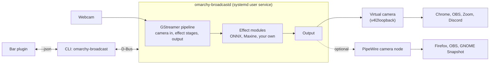

# omarchy-broadcast

**Live camera and microphone effects for your Linux desktop.** Blur or replace your background, remove noise, fix the light and look into the lens, in any application that reads a camera or a microphone.

Omarchy Broadcast is a daemon for Linux, written in Rust on GStreamer. It turns your webcam into a virtual camera (v4l2loopback and PipeWire) and your microphone into a virtual microphone. Effects are pluggable modules, and you control it over D-Bus. It was built for Omarchy and works out of the box on Omarchy and Arch Linux. It probably works on any modern Linux distribution. Any standard webcam works, USB or built-in. Chrome, OBS, Zoom and Discord select the virtual camera like any other camera.

## What you get

**On any machine** (CPU, or an Intel GPU or NPU through ONNX Runtime; [omarchy-onnxruntime](https://github.com/rsd/omarchy-onnxruntime) packages its engines):

- Background blur and background replacement with open Apache-2.0 models. A replacement can be an image, an animated image or a video; two loops and a set of backgrounds are bundled.
- Camera passthrough with the camera's own image settings: brightness, contrast, saturation, exposure, white balance, focus and zoom, set per camera.
- A choice of the camera's resolution and frame rate and of the virtual camera's size and rate.
- A virtual microphone, **Omarchy Broadcast Mic**, with noise removal on the CPU (DeepFilterNet by default, or RNNoise).

**With an NVIDIA RTX GPU** (the optional NVIDIA Maxine modules, with an SDK you obtain yourself):

- Background blur and replacement on the GPU, with a hardened mask edge.
- Video noise removal, which clears the grain a webcam shows in dim rooms.
- Relighting of the person with a warm, neutral or cool key light. You adjust its direction and brightness. The background is never relit.
- Enhancement, which upscales a camera that captures well below the output size.
- Eye contact and auto-framing. Eye contact redirects your eyes towards the camera. Auto-framing pans and zooms digitally to keep your face in frame. Both are off by default.
- Frame generation: an output at twice the camera's rate, for example 60 fps from a 30 fps camera.
- Room echo removal and studio voice for the microphone.

Each effect is a **module**: a manifest and a shared library that the daemon discovers at run time. With no module installed, the daemon passes the camera image through. You can [write your own module](docs/modules.md).

## Why use it

- **It runs on your machine.** The daemon processes video and audio locally. The open-model path needs no NVIDIA SDK.
- **It works in any application.** The virtual camera is a standard [v4l2loopback](https://github.com/v4l2loopback/v4l2loopback) device, and an optional PipeWire camera node serves applications that use PipeWire.
- **It leaves the GPU alone when you do not use it.** The camera and the GPU start only when an application opens the virtual camera. On a battery, the daemon can keep the frames in system memory and not wake the NVIDIA GPU.
- **It fails safe.** A stopped daemon or an effect that cannot run does not leave your applications without a camera or a microphone ([How it works](#how-it-works) says what each failure does).
- **You control it from the Omarchy bar, or from the CLI.** The [bar plugin](#the-bar-plugin) is the one Omarchy-specific part. It shows the camera's state and opens a panel with a live preview, the effects, the camera's settings and the microphone. On other desktops, the `omarchy-broadcast` CLI is the control.

## Quick start

On Omarchy or Arch Linux. Install the packages (prebuilt; use `-git` in place of `-bin` to build from source):

```sh
yay -S omarchy-broadcast-bin omarchy-broadcast-onnx-bin
```

Without an NVIDIA GPU, add `onnxruntime-cpu`. With one, add `cuda`:

```sh
yay -S onnxruntime-cpu     # no NVIDIA GPU
yay -S cuda                # NVIDIA GPU
```

Create the virtual camera device once. This needs root:

```sh
sudo install -Dm644 /usr/share/doc/omarchy-broadcast/examples/modprobe.d/omarchy-broadcast.conf /etc/modprobe.d/omarchy-broadcast.conf
echo v4l2loopback | sudo tee /etc/modules-load.d/v4l2loopback.conf
sudo modprobe -r v4l2loopback && sudo modprobe v4l2loopback
```

Start the daemon at every login:

```sh
systemctl --user enable --now omarchy-broadcastd
```

Check that it runs. The output lists your camera:

```sh
omarchy-broadcast start
```

Then select **Omarchy Broadcast** as the camera in your application and pick an effect. [INSTALL.md](INSTALL.md) has every step and the requirements: choosing `-bin` or `-git`, the modules (ONNX, NVIDIA Maxine, the microphone), other Linux distributions, the bar plugin, building from source and uninstalling.

## How it works

The daemon, `omarchy-broadcastd`, is a systemd user service. It reads the camera through a GStreamer pipeline, runs the effect modules you installed and writes the result to the virtual camera. The CLI and the bar plugin control it over D-Bus while it runs, so you change effects with no restart.



Each design point below says what it means for you and why.

| Design point | What it means |
|---|---|
| **Two outputs** | The virtual camera (v4l2loopback) works in Chrome, Zoom, Discord and OBS, one application at a time ([why](LIMITATIONS.md#one-application-streams-from-the-virtual-camera-at-a-time)). The PipeWire camera node serves several applications at once, next to the virtual camera. |
| **GStreamer** | Stages compose like shell pipes, and the capture, loopback, PipeWire and CUDA elements already exist, so none is rebuilt. Passthrough keeps 1080p60 ([benchmark](docs/benchmarks/passthrough.md)). |
| **Controlled over D-Bus** | The CLI, the bar plugin and scripts change effects while the daemon runs, with no restart. A stopped daemon starts on demand ([D-Bus reference](docs/dbus-api.md)). |
| **Pluggable modules** | Install only the modules that fit your hardware, or write your own in Rust or C ([module guide](docs/modules.md), [examples](examples/module-hello/README.md)). A broken module shows as unavailable and the daemon runs on. |
| **Self-describing settings** | The CLI and the bar panel draw the settings the daemon describes. A new module's settings appear with no change to them. |
| **Rust** | Per-frame latency stays predictable, with no garbage-collector pauses. The NVIDIA SDKs are reached through FFI. |
| **The GPU sleeps when unused** | With no application using the camera, the daemon holds no CUDA context, so the NVIDIA GPU can suspend. Without an NVIDIA GPU, a system-memory pipeline needs no CUDA. |
| **A headless service with plain configuration** | The daemon needs no window, and `config.toml` stays yours to edit and version. The daemon writes its own changes to a separate file. |
| **Crash recovery for applications** | If the daemon crashes, applications keep the virtual camera and the daemon restarts quickly ([what applications see](LIMITATIONS.md#a-daemon-crash)). |
| **Privacy fallback** | Privacy is an option, off by default. When an effect cannot run, the camera shows as it is. Turn privacy on to show black, an away image or the last frame instead. |
| **A microphone that survives** | The virtual microphone runs apart from the video daemon. If its worker stops, applications keep receiving your microphone, unprocessed. |

[docs/architecture.md](docs/architecture.md) has the full diagrams: the components, the stages and caps, the lifecycle and the threads.

## The bar plugin

The bar plugin is the one Omarchy-specific part. On other desktops, the CLI is the control. The plugin is a separate project, the [omarchy-broadcast-plugin](https://github.com/rsd/omarchy-broadcast-plugin) repository, and the package does not install it. It shows the virtual camera's state in the bar and opens a panel with a live preview, the effects, the camera's settings, the microphone and a Details view, and a setup dialog for the modules and the configuration.

- It is a client of the daemon through `omarchy-broadcast watch --json` and the commands of the CLI. It runs no `systemctl`: when the daemon is not running, its Start button runs `omarchy-broadcast start`.
- Its camera settings need omarchy-broadcast 0.22.0 or newer, the first release with the settings channel. Its effect settings need 0.23.0 or newer. Against an older daemon it keeps what the daemon supports and says what needs an update.
- For its live preview, it runs `omarchy-broadcast preview --json`, which holds a preview lease and prints a line per frame the daemon writes to a small JPEG file under `$XDG_RUNTIME_DIR` ([docs/cli-json.md](docs/cli-json.md#preview)). A preview counts as a user of the camera, so it starts it.

## Learn more

- [INSTALL.md](INSTALL.md): the install steps, the requirements, other distributions, building from source and uninstalling.
- [LIMITATIONS.md](LIMITATIONS.md): what the software cannot do, why, and what to do about it.
- [docs/README.md](docs/README.md): the documentation, by task. It indexes the architecture, the setup guides and the benchmarks. [docs/modules.md](docs/modules.md) covers writing and installing modules.

## Affiliation

omarchy-broadcast is not affiliated with or endorsed by NVIDIA. NVIDIA, Maxine and TensorRT are trademarks of NVIDIA Corporation.

## Licence

Licensed under either of [MIT](LICENSE-MIT) or [Apache-2.0](LICENSE-APACHE), at your option.
