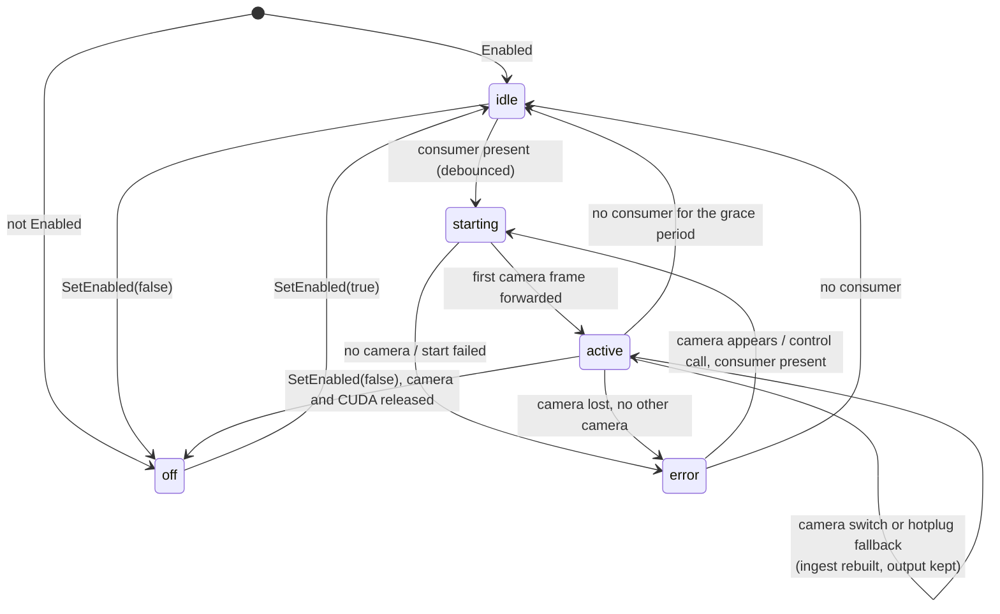

# ADR-0011: Daemon lifecycle, persistent loopback writer, consumer detection and the D-Bus v1 API

- **Status:** Accepted. Amends [ADR-0006](0006-on-demand-gpu-lifecycle.md) (lifecycle states, what runs while idle) and [ADR-0007](0007-headless-daemon-toml-config.md) (how runtime changes persist, how the config is reloaded). Implements [ADR-0005](0005-dbus-zbus-control-plane.md).

## Context
- `oma-broadcastd` turns the pipeline of [ADR-0009](0009-ingest-process-output.md) and [ADR-0010](0010-phase-locked-output-clock.md) into a product: a headless user service that the CLI, the Omarchy bar and scripts control over D-Bus.
- The loopback is created with `exclusive_caps=1`. With that option v4l2loopback advertises the device as a capture device only while a writer is streaming into it. With no writer, applications do not list the virtual camera at all, so they can never open it, and opening it is what would start the stream.
- While any consumer holds the device, v4l2loopback keeps the format of the stream that fed it and refuses every other ([ADR-0009](0009-ingest-process-output.md)). A writer that closes and reopens the device while a consumer holds it leaves that consumer without frames for the gap, and risks a refused format.
- [ADR-0006](0006-on-demand-gpu-lifecycle.md) requires zero CUDA contexts and a closed camera while nobody watches. Its measurement ([../benchmarks/dgpu-idle.md](../benchmarks/dgpu-idle.md)) shows that tearing a CUDA pipeline down in-process releases the context; 7 driver handles from `cuInit` stay until the process exits.
- Consumers include short-lived openers: browsers and PipeWire open video devices to enumerate them and close them again within milliseconds.
- Measured on the reference machine (v4l2loopback 0.15.4, kernel 7.2): inotify delivers `IN_OPEN` and `IN_CLOSE_WRITE`/`IN_CLOSE_NOWRITE` for a v4l2loopback device node (`/dev/video11`) on every open and close by another process, including `v4l2-ctl --info`.
- WirePlumber probes video nodes when it starts and records a v4l2loopback device that no writer is streaming into as output-only (`device.capabilities = ":video_output:"`). The device sends no udev event when a writer starts, so WirePlumber does not probe it again: PipeWire then lists no camera for it, and neither do clients that discover cameras through PipeWire (the camera portal, OBS's PipeWire source, `gst-device-monitor-1.0` with the PipeWire provider). PipeWire never holds the node open on its own.

## Decision

### Process and service
- One process, `oma-broadcastd`, run as a systemd user service. The unit file ships in `dist/systemd/oma-broadcastd.service`, and a D-Bus activation file in `dist/dbus-1/services/br.com.dias.OmaBroadcast.service`. Nothing is installed by the build. The unit is `Type=dbus` and `WantedBy=default.target`.
- **The bus name is requested after the loopback writer has started** (or has failed in a way the `error` state reports). With `Type=dbus`, the service is therefore ready only once the loopback is a capture device, so a WirePlumber ordered after it probes a capture device. An optional drop-in, `dist/systemd/wireplumber.service.d/oma-broadcast.conf`, orders WirePlumber after the daemon; the manual alternative is `systemctl --user restart wireplumber` once the daemon runs. A second instance finds the name owned and exits with status 3 before touching the loopback.
- GPU work runs in-process and is torn down to release the CUDA context. The handles that survive `cuInit` are accepted for now; if they are shown to block runtime suspend, the GPU work moves to a worker process that exits at teardown ([ADR-0006](0006-on-demand-gpu-lifecycle.md), fallback). Before the first activation the daemon never calls into CUDA and never loads the `nvcodec` plugin.

### A persistent loopback writer
- The daemon owns one **loopback writer** for its whole life: a CPU-only GStreamer pipeline, `appsrc` → `v4l2sink`, with the output contract's caps (default NV12 1920x1080@30, limited range, labelled as the loopback requires). It opens the device once and never renegotiates.
- Frames reach it from one of two producers:
  - the **placeholder**: a black frame of the contract, pushed by the writer itself at the contract rate whenever no forwarded frame has arrived for two contract periods;
  - the **active output**: the CUDA output pipeline of [ADR-0009](0009-ingest-process-output.md) ends, in the daemon, in an `appsink` instead of `v4l2sink`, and every buffer it emits is forwarded to the writer by reference (no copy). Its caps are identical to the writer's.
- The writer stamps every buffer it pushes on its own monotonic timeline, so the hand-over between producers is invisible downstream: one caps negotiation for the life of the daemon, whatever the state. This is the core invariant: **a consumer that holds the device across Idle → Active → Idle sees one format and an uninterrupted stream**, black, then camera frames, then black.
- The output mode is part of the writer. Changing it rebuilds the writer, which only happens while no consumer holds the device; a change requested while one does is applied when the last consumer closes.

### Lifecycle
States, exposed as lower-case strings:

| State | Camera | CUDA context | Loopback |
|---|---|---|---|
| `off` | closed | none | placeholder |
| `idle` | closed | none | placeholder |
| `starting` | opening | being created | placeholder |
| `active` | streaming | held | camera frames (output pipeline) |
| `error` | closed | none | placeholder |

- **`active` includes the grace period** of [ADR-0006](0006-on-demand-gpu-lifecycle.md) (its "Draining"): after the last consumer closes, the stream keeps running for `idle_grace` (default 5 s), with `Consumers` = 0, and a consumer that returns in that time finds it running.
- **`off` is the privacy state** (`Enabled` = false): the camera is closed, so its LED is off, and the CUDA context is released. The placeholder keeps flowing, so a consumer holding the device keeps a valid, black stream. `Enabled` persists across restarts.
- **`error`** is a lifecycle failure: no loopback device with the configured label, a loopback held in another format, no camera, or a camera that failed and had no replacement. The placeholder flows wherever a loopback exists. The daemon leaves `error` when the cause can have changed: the camera set changes, a control method is called, or the config is reloaded; a missing or held loopback is retried every 2 s. A start that delivers no camera frame within 10 s counts as a failed camera and the next camera is tried; once every available camera has failed, the state is `error` and the session is stopped (camera and CUDA released) rather than cycling between cameras.
- The `Error` property carries the text of the latest error, lifecycle or config, and is cleared by the next successful start or reload. An invalid config sets `Error` but not the `error` state, since the previous config stays in force.

### Consumer detection
- A watcher thread holds an inotify watch on the loopback node for `IN_OPEN`, `IN_CLOSE_WRITE` and `IN_CLOSE_NOWRITE`. Each event is only a hint: the watcher then counts the processes other than the daemon that hold the node open, from `/proc/<pid>/fd`. The daemon's own writer holds the device and is excluded by pid.
- **Debounce:** a consumer must be present for 300 ms before `starting`, so enumeration opens do not open the camera; the grace period covers the other direction.
- **Fallback:** if the watch cannot be set, the watcher counts every second.
- A process whose `/proc/<pid>/fd` cannot be read (another user's) is not counted. Consumers of a user's virtual camera run as that user.

### Cameras and hotplug
- Camera order: the config's preference list (each entry a card-name substring, `vid:pid` or `/dev/videoN`, as `CameraSelector`), then every other colour camera in discovery order. `SelectCamera` and `NextCamera` set a runtime selection that persists across restarts and overrides the preference while that camera is present.
- The camera list is rescanned when video nodes appear in or disappear from `/dev` (inotify on `/dev`, `IN_CREATE` / `IN_DELETE` of `video*`).
- If the streaming camera fails or disappears, the session switches to the next camera in order, with the hold of [ADR-0010](0010-phase-locked-output-clock.md). With no other camera, the ingest stops, the output falls back to placeholders and the state is `error`. A camera that appears while another one streams does not take over: the daemon fills a gap, it does not interrupt a working stream.
- Nothing in the daemon is specific to a camera model.

### Configuration and state
- `$XDG_CONFIG_HOME/oma-broadcast/config.toml` (default `~/.config/oma-broadcast/config.toml`) holds what the user decides: camera preference and mode request, output mode and format, aspect policy, hold timeout, idle grace, and the loopback card label (default "Omarchy Broadcast"). A missing file means the defaults. The schema is versioned (`version = 1`) and validated in `obc-core`.
- Reload on `ReloadConfig()` or `SIGHUP`. An invalid file is rejected as a whole: the previous config stays in force and the reason is reported through `Error` and the method's D-Bus error.
- **Runtime changes go to a separate state file**, `$XDG_STATE_HOME/oma-broadcast/state.toml` (default `~/.local/state/oma-broadcast/state.toml`): `Enabled` and the selected camera. It is written atomically (temporary file, then rename). A state file that cannot be read or parsed is treated as `Enabled` = false, with the reason in `Error`, and is left untouched until `SetEnabled` is called: privacy fails closed. The config file is never rewritten by the daemon, so it keeps the user's comments and layout. This replaces the write-back and inotify hot reload of [ADR-0007](0007-headless-daemon-toml-config.md).

### D-Bus API v1
- Session bus, well-known name `br.com.dias.OmaBroadcast`, object `/br/com/dias/OmaBroadcast`, interface `br.com.dias.OmaBroadcast1`. Breaking changes add `br.com.dias.OmaBroadcast2`; additions within v1 raise the `InterfaceRevision` property.
- **Properties** (read-only, all emit `org.freedesktop.DBus.Properties.PropertiesChanged`): `State` (s), `Error` (s), `Enabled` (b), `Cameras` (a(sss): id, name, `vid:pid`), `ActiveCamera` (s, the id of the camera that streams or would stream; empty if none), `OutputMode` (s, e.g. `NV12 1920x1080@30`), `Effect` (s, reserved, always `none` in this version), `Consumers` (u), `InterfaceRevision` (u).
- **Methods:** `SetEnabled(b)`, `SelectCamera(s)` (an id, a card-name substring, a `vid:pid` or a `/dev/videoN`), `NextCamera()`, `ReloadConfig()`. Failures are D-Bus errors under `br.com.dias.OmaBroadcast1.Error`.
- **Signal** `Stats(d fps, d latency_p50_ms, d cpu_percent, d gpu_percent)`, about once per second while `active`; a value that cannot be measured is `-1`.
- The interface types, names and a client proxy live in `obc-ipc`, shared by the CLI and the bar client. The reference is [../dbus-api.md](../dbus-api.md).

### CLI
- `oma-broadcast status | on | off | cameras | camera next | camera <name|vid:pid> | watch`, through the `obc-ipc` proxy. `status`, `cameras` and `watch` take `--json` for clients that cannot speak D-Bus (the QML bar): one object, or for `watch` one object per line with a schema version. The reference is [../cli-json.md](../cli-json.md).

## Consequences
- Applications always see the virtual camera while the daemon runs, at the cost of a CPU placeholder writer while idle (measured in the daemon's acceptance figures, [../testing.md](../testing.md)).
- Clients that discover cameras through PipeWire depend on WirePlumber probing the device while the daemon's writer streams (start order, the optional drop-in, or a WirePlumber restart).
- The first open still pays camera start, CUDA initialisation and pipeline build; the consumer sees black until then.
- Changing the output mode while a consumer holds the device is deferred, not refused.
- The 7 `cuInit` handles survive the first activation until the daemon exits; the runtime-suspend question of [../benchmarks/dgpu-idle.md](../benchmarks/dgpu-idle.md) still decides whether a worker process is needed.
- An unplug cannot be produced on demand without root; it is covered by tests on simulated failures and by the same switch path a manual camera change uses.

## Alternatives considered
- **No writer while idle** (ADR-0006 as first written): with `exclusive_caps=1` the device is invisible to applications with no writer, so no consumer could ever open it and start the stream.
- **Two outputs that each open the loopback** (a CPU placeholder output, then the CUDA output): the device is closed and reopened at each hand-over, so a consumer holding it loses frames and the format must be renegotiated.
- **Ordering the unit `Before=wireplumber.service`**: ordering applies only within one start-up transaction, WirePlumber normally starts with PipeWire before the graphical session, and it does nothing when the daemon restarts; ordering WirePlumber after the daemon's readiness (the drop-in) addresses the probe directly.
- **`exclusive_caps=0`**: the device is always listed, but Chrome and other WebRTC clients do not list a device that also advertises video output.
- **Writing runtime changes back to `config.toml`**: rewrites a hand-edited file, loses comments, and races an editor.
- **Counting opens and closes from inotify alone**: a process that exits without closing, or opened before the daemon started, would skew the count; `/proc` is the ground truth, inotify only says when to look.
- **Stats only while a client subscribes**: D-Bus offers no reliable count of signal subscribers; a 1 Hz signal while `active` is negligible.
