# ADR-0029: Audio modules: the microphone as a stable host, a worker and the daemon's façade

- **Status:** Accepted (2026-11-11), implemented as D-Bus revision 13 and module ABI 1.2. Amends [ADR-0025](0025-loadable-modules.md) (the `audio-filter` kind is no longer reserved: it has an ABI, and a host of its own, the audio worker), [ADR-0026](0026-config-d-and-managed-config.md) (the daemon writes a second file, the audio settings snapshot, and the `[mic]` table joins the config schema) and [ADR-0014](0014-mic-noise-removal-filter-chain.md) (the filter-chain units are kept, as a lightweight alternative that excludes the new microphone; the deferral of a GPU engine no longer stands as the only route). Builds on [ADR-0023](0023-settings-schema.md) and [ADR-0024](0024-stackable-stages-and-effects-in-the-settings-schema.md) (the settings tree and stage ids), [ADR-0016](0016-pipewire-output.md) (PipeWire from Rust) and [ADR-0022](0022-crash-recovery-for-consumers.md) (consumers keep the feed across a crash). Author guide: [../modules.md](../modules.md#audio-modules). Setup: [../setup/microphone.md](../setup/microphone.md).

## Context
- The camera has modules, a settings tree and a panel. The microphone had one static filter-chain with one fixed engine per unit and no settings ([ADR-0014](0014-mic-noise-removal-filter-chain.md)). People want the microphone to be a first-class feature: noise removal (and room echo removal, which is dereverberation, not acoustic echo cancellation) with a choice of engine, a strength they can change, and room for other engines, among them GPU engines, from other vendors or contributors, without a change to the core.
- **The feed stays on, applied to audio.** An application that chose "Omarchy Broadcast Mic" must keep receiving the microphone whatever stops: the video daemon, a module, a vendor library, the GPU. Raw audio is acceptable in that case; silence, a vanished source or a different default microphone is not.
- The effects need a different host from video. A GPU audio engine owns its GPU runtime and may create its own context ([ADR-0014](0014-mic-noise-removal-filter-chain.md) records that running such a runtime in a PipeWire real-time thread was rejected), and a daemon that parks its process for the GPU at idle ([ADR-0017](0017-cuda-checkpoint-parking.md)) cannot also host an engine that creates a context behind its back. Parking is process wide, so two independent lifecycles in one process would couple the camera's GPU idle to the microphone's use. A strike in the crash ledger for an audio module would count against the camera, and a crash in either would take the other down.
- The module ABI reserved an `audio-filter` kind ([ADR-0025](0025-loadable-modules.md)) and the stage ids are one namespace, in which `denoise` already belongs to video.
- A microphone is selected by applications by name. The capture side of a filter-chain follows the default source, and two USB microphones may have the same session priority, so "the best microphone" is ambiguous: with the new node as the default, the capture side needs a deliberate target.
- Clients carry no list of effects: they draw the settings tree. A microphone page needs to know which groups belong to it.
- D-Bus policy ([../dbus-api.md](../dbus-api.md#versioning)): additive changes stay on `…OmarchyBroadcast1` and raise the revision.

## Decision
**Three processes. The microphone node is a stable PipeWire filter-chain that never runs an effect: a small real-time forwarding plugin hands each block of audio to a worker over shared memory and plays the result back, or the microphone's own audio when the result is not there. The worker hosts the audio modules in-process through the module C ABI, extended with an audio kind. The daemon stays the façade and the single writer of every setting, and neither loads nor runs any audio code.**

```mermaid
flowchart LR
    APP["Applications<br/>(Omarchy Broadcast Mic)"]
    HW[("Hardware microphone")]
    subgraph MIC["omarchy-broadcast-mic.service<br/>pipewire -c (filter-chain)"]
        SHIM["Forwarding plugin<br/>libomarchy_broadcast_mic.so (LADSPA)<br/>real-time safe, no vendor code"]
    end
    subgraph WORK["omarchy-broadcast-audiod.service"]
        ENG["Processing thread"]
        MODS["Audio modules<br/>(C ABI 1.2, in-process)"]
        PWC["PipeWire control:<br/>default source, pinning, devices, consumers"]
    end
    subgraph DAE["omarchy-broadcastd"]
        FAC["Facade: mic.* settings,<br/>Mic* properties, SetMicHost"]
    end
    CLI["CLI, bar plugin"]

    HW --> SHIM --> APP
    SHIM <-- "memfd rings + wake socket<br/>(raw if the result is late or absent)" --> ENG
    ENG --> MODS
    FAC -- "internal D-Bus: ApplySnapshot,<br/>GetModules, GetSettings, MakeDefault" --> WORK
    FAC -- "audio-settings.json" --> WORK
    CLI -- "D-Bus revision 13" --> FAC
    PWC -.-> MIC
```

### The microphone node: the stable host
- A `pipewire -c omarchy-broadcast-mic.conf` process (the user unit `omarchy-broadcast-mic.service`) runs one filter-chain with one LADSPA node, the **forwarding plugin**. It keeps ADR 0014's node: `node.name = omarchy-broadcast-mic`, a passive capture side that opens the microphone only while something records, one `node.link-group` so that the node is safe as the default, mono at 48 kHz, a 10 ms quantum requested by the capture side.
- The plugin is the one part of the design that runs in a real-time thread, and it does not allocate, lock or block. It splits the audio into blocks of 480 samples (10 ms), copies each into a shared-memory ring and plays back, a constant **transport delay** later, the block the worker returned for it. When the processed block is not there at its playout time (no worker, a crash, a stall, a load in progress, a refusal, a bypass) it plays the microphone's own audio, delayed by the same amount, with a 5 ms crossfade at every switch. The delay is the same either way, so a switch never steps and the output is never silence.
- It loads no module, no model and no vendor library. A fault in an engine therefore cannot remove the node or move the applications.

### The transport
Internal and unstable; both ends ship together. The first bytes of every message (magic, version) are fixed, so two versions refuse each other cleanly.
- The plugin connects to `$XDG_RUNTIME_DIR/omarchy-broadcast/audio.sock` (a `SOCK_SEQPACKET` socket that systemd holds, so a connect starts the worker) and sends a hello with two descriptors: a sealed `memfd` that holds a header and two single-producer single-consumer rings (the input and the output, in blocks of 480 mono floats, each with a sequence number and flags), and the worker's end of a wake socket.
- The worker answers every input block with an output block of the same sequence number, in order. A block flagged `RAW` means "no processed audio for this one, play the microphone": the worker flags its warm-up and loading blocks so that the plugin plays raw audio instead of mistaking unprocessed audio for processed.
- **The wake is a socket pair, not an eventfd** (protocol version 2). The plugin's real-time thread sends one byte with `MSG_DONTWAIT | MSG_NOSIGNAL` per callback. The two ends of a pair are separate open files, so whatever the worker does with its end (clear its non-blocking flag, never read, close it) the plugin can only get `EAGAIN` or `EPIPE`, which it ignores. A shared eventfd is one open file, and a worker that cleared its flag and filled the counter would make the plugin's write block the audio thread.
- **The plugin publishes the transport delay it plays out with** (a field of the shared header, which was reserved space, so no new protocol version). The delay depends on the graph's quantum, which only the plugin knows (`480 - gcd(480, Q) + Q * ceil(480 * depth / Q)` samples for a quantum Q and a pipeline depth in blocks), and the worker needs it for the latency it reports.
- **A connection only while sound flows.** A non-real-time helper thread of the plugin connects and reconnects; the real-time side wakes it only when audio flows and no worker is connected, so an idle microphone host never starts an exited worker. After a refusal the plugin stays in passthrough and tries again only after a long back-off.
- The pipeline depth (blocks between the microphone and the processed audio) is negotiated at connect: 1 when every stage of the chain runs on the CPU, 2 when one runs on a GPU, or the `[mic] pipeline_depth` override. A deeper pipeline tolerates a late block at the cost of 10 ms.

### The worker: the host of audio modules
- `omarchy-broadcast-audiod` is a user unit of its own, started by a connection to its socket or by a call to its internal D-Bus name, `BindsTo=` PipeWire, `Restart=on-failure`, and not part of the daemon's unit: a daemon restart does not stop it, and its crash does not stop the daemon or the microphone. It exits by itself after `[mic] idle_exit_s` seconds (30 by default) with no sound and no call. The process exit releases everything a GPU module held, with no checkpointing, which is why a GPU module may create its own context here.
- It discovers modules exactly as the daemon does ([../modules.md](../modules.md#discovery-and-installation)) and opens only `audio-filter` modules; the daemon opens only `video-stage` modules and lists the others without opening their libraries.
- **The chain.** Every audio stage that the enabled modules offer runs in the registry's order (slot `clean`, then `shape`, then position) when its switch is on and a module can run it, chosen by rank, pin and profile as for video. Consecutive stages of one module form one request, so that a module that has one model for two stages (noise and room echo together) can run them as one. A stage that declares a conflict turns the other off, unless `[mic] force_conflicts` is set.
- **The processing thread** is not real time. It answers one 480-sample block at a time with a deadline of one block. A chain loads on a loader thread, runs on the processing thread and unloads on a retire thread; a switch (a new stage, a new engine) warms the new chain up while the old one keeps processing, and crossfades one block. The call of a module's load, process and unload for one instance may therefore run on different threads.
- **Fail open, at every level.** A stage that fails alone is dropped by its module and the block passes on. A group that panics, loses its last stage, or exceeds the deadline for 50 blocks in a row (half a second) is failed open and reported. A module call that does not return in 2 s aborts the worker (a **watchdog**): the module's crash-ledger marker stays, so it counts as a strike, systemd starts the worker again, and the plugin plays raw meanwhile. A module that was running when the worker died twice in a row is disabled, with the reason, until the user enables it (`audio-modules-crash.json`, the same ledger as the daemon's, in the worker's own file so that a strike never counts against the camera).
- **The GPU.** `[mic] gpu_policy` (`always`, `with-camera`, `never`) and a real consumer decide whether a GPU stage is planned. A level meter is not a consumer: the worker reads the PipeWire registry and ignores links of monitor streams, with a debounce. A stage that the GPU may not run runs on the best CPU or NPU module that offers it, or not at all, and says why.
- **PipeWire access lives in the worker only.** The device list, the default source, pinning, the consumer count and the node's latency all go through pipewire-rs in the worker; the daemon gets no libpipewire for the microphone.

### Latency is reported by the worker
The plugin has a `latency` output control port. PipeWire 1.6.9's filter-graph reads it when the graph starts and does not follow later changes, which is exactly when the plugin cannot yet know the delay (it depends on the worker's chain and the quantum). The worker therefore sets the node's `ProcessLatency` itself whenever the delay changes (the transport delay the plugin publishes, plus the chain's algorithmic delay), and again if the node resets it. The daemon shows the same figure as `MicLatencyMs`.

### The daemon: façade and single writer
- The daemon keeps ADR 0026's single-writer rule. It publishes the `mic.*` settings, the `Mic*` properties and `SetMicHost`, and forwards nothing else. The worker's interface (`br.com.dias.OmarchyBroadcast.AudioWorker`, interface `…AudioWorker1`, JSON strings) is **internal and unstable**; only the daemon calls it.
- The daemon asks the worker (starting it by bus activation) for what only it knows: the modules, their settings groups, the hardware sources. It calls the worker with `NO_AUTO_START` for everything else (a snapshot, a status), so it never keeps an idle worker alive or starts one that has just exited.
- Every change of the audio settings produces one **snapshot** (the `[mic]` values, the module settings, the pins and profile, the disabled modules, whether the camera is active) which the daemon writes atomically to `$XDG_STATE_HOME/omarchy-broadcast/audio-settings.json` and pushes with `ApplySnapshot`. The worker reads the file at start, so it runs as the user set it with the daemon down; it never writes it. A missing or damaged file gives the defaults, and a bad field keeps the others.
- `GetModules` lists an audio module with the worker's view of it (status, reason, stages, attribution), and the settings tree shows the groups the worker describes after the daemon's own `mic.input` group. The settings ids are `mic.<group>.<name>`, `scope` `global`, in groups with `surface: "mic"`: a client that does not know the key shows them with the effects, and the CLI draws them unchanged.
- **One noise removal control.** `mic.noise.enabled` and `mic.noise.strength` are shared by every provider of the `mic-denoise` stage, with the strength mapped per engine, not a separate control per module. The daemon shows one group per id, the active provider's.
- **`mic on` and `mic off`.** `SetMicHost(true)` enables and starts `omarchy-broadcast-mic.service` (so the microphone returns at the next login). `SetMicHost(false)` first makes the previous default microphone the default again if the Omarchy Broadcast Mic is the default, then stops and disables the unit, so the applications move to a live microphone as it goes.
- A daemon that stops or crashes changes nothing for the microphone.

### Explicit default, with restore
- The new microphone never becomes the default by itself. The action `mic.input.make_default` ("Use as default microphone") writes WirePlumber's `default.configured.audio.source` in the `default` metadata and remembers the previous default (in the daemon's state file); `mic.input.restore_default` writes it back. A restore that finds the Omarchy Broadcast Mic is not the default does nothing.
- **The capture side is pinned.** With the new node as the default, the capture side would choose between microphones of equal priority. The worker sets `target.object` on the capture node, valued with the target's `object.serial`, and WirePlumber's restore-stream saves it under the stream's key and sets it again on every new capture node. The pin survives a restart of the mic host, of the worker and of WirePlumber, and no node is created or removed for it. It is stored only when the value is a serial (a name links but is not remembered) and is forgotten by deleting the key (setting it to `-1` would mean "link to nothing"). The pin is the `[mic] device` the user chose, else the previous default microphone; the choice is read when the action runs, so choosing another microphone while the new one is the default takes effect when the action is run again (it then changes the pin only).
- The microphone choice is `mic.input.device`, an enum of `default` and the hardware sources. A source's option value is a short token (`pw-` and 12 hexadecimal characters of an FNV-1a hash of its `node.name`), with its description as the label, because the CLI's JSON caps an option value at 32 bytes and node names are longer; the configuration key `[mic] device` stores the `node.name`. The own nodes of the microphone are never listed, at most 16 options. A configured microphone that is not present stays in the list as `Unavailable: <name>`.

### Module ABI 1.2: an audio kind, additive
- The vtable gains two entries, `audio_instance_load` and `audio_instance_process`, with three structures (`obc_audio_request`, `obc_audio_load_report`, `obc_audio_buffer`: planar `float` planes, rate, channels, samples, flags `NEW_SOURCE` and `DISCONT`, an output-only `voice_probability`). The existing `instance_create`, `unload`, `reset_temporal`, `timings`, `last_error` and `destroy` entries serve both kinds. A module of ABI 1.0 or 1.1 loads unchanged and simply has the new entries unset.
- The manifest `kind = "audio-filter"` has audio `[[stage]]` keys (`rates`, `frame_samples`, `channels`, `frames = ["host"]`) and the slots `clean` and `shape`. Each key and each vocabulary is checked per kind. The stage ids of audio start with `mic-` (`mic-denoise`, `mic-dereverb`, `mic-enhance`) and video ids may not.
- The rules of the kind are in the header and in [../modules.md](../modules.md#audio-modules): the processing thread is not real time and the deadline is one block; a module may create a GPU context of its own, only inside `audio_instance_load` and `instance_unload`; a stage that fails fails open; the host fails a stage open after 50 consecutive overruns.
- The SDK adds an `AudioInstance` trait and the `audio` form of `export_module!`; `examples/module-hello-audio` is built outside the workspace as a third-party module is.

### The CPU module
`br.com.dias.voice-cpu` (crate `obc-module-voice-cpu`) provides `mic-denoise` on the CPU with no model files and no ONNX runtime: DeepFilterNet 3, the default, and RNNoise, selected by `mic.cpu.engine`. Their licences are reproduced in `dist/licenses/THIRD-PARTY-NOTICES`, which the packages install.
- DeepFilterNet is a **git dependency** on the upstream repository, pinned by commit (a release tag): the crates.io release is older and has no tract runtime. The Arch package therefore needs network access to fetch it.
- libDF skips stages of its processing for frames below its default thresholds, and with them so many frames that its output was no better than the input. The module sets the thresholds so that no frame is skipped. A block of digital silence is answered with zeros by libDF without running the model, which would leave frames in flight and make the delay vary; the module adds a dither below -60 dBFS so that every block runs, and gates the result to zeros when the input was silent.
- The strength is the attenuation limit for DeepFilterNet (evenly in dB on a logarithmic scale, 100 % meaning no limit) and a wet/dry mix with a delay-matched dry signal for RNNoise. It applies live, with no step in the output.
- A GPU module for the microphone is another provider of the same stages, with a higher rank, and needs no change in the host, the daemon or the clients.

### The ADR 0014 units stay
`omarchy-broadcast-mic@rnnoise.service` and `@deepfilter.service` remain supported, as the lightweight alternative (no worker, no D-Bus, no settings). They create the same `node.name`, so they exclude the new host: both unit files declare `Conflicts=` with each other, and `mic on` refuses, with an error that names the unit, while one of them runs. Packaging installs everything and enables nothing.

## Consequences
- Whatever stops, the microphone keeps working. The daemon, the worker and a module can be killed, and a GPU can disappear: the applications keep the same node and get the microphone raw, with at most one crossfaded block, then processed audio again when the worker is back. Turning the feature off restores the default first.
- A cost in latency, always stated: the transport delay (one pipeline depth of 10 ms blocks, two with a GPU stage) plus the algorithmic delay of the engines. The panel and `MicLatencyMs` show the total. With no worker the plugin is a fixed 10 ms delay.
- One more process and unit, one more crash ledger, one more internal interface and one more file the daemon writes. The internal interface and the transport are unstable by design, and are not a client API.
- The worker holds no GPU between uses and exits on idle, so a GPU module costs the GPU only while an application records. A level meter does not wake it.
- A video crash leaves the microphone processed, and an audio crash leaves the camera running. The two ledgers and the two GPU lifecycles are independent.
- The module ABI is still not declared stable. Audio is a minor version of ABI 1.x, which a 1.0 or 1.1 module is unaffected by.
- Known limitations: one microphone stream at a time (a second plugin is refused while one is connected); mono at 48 kHz only; no acoustic echo cancellation (the far end coming back through the speakers: PipeWire's own echo-cancel module is the route if it is wanted); no room echo removal on the CPU (a module for it can be added); the audio stage order is fixed by slot and position (there is no `SetStageOrder` for audio); the pin names a PipeWire object by its serial, and it is not guaranteed to follow a microphone that is unplugged and plugged again (running the default action again re-pins it).

## Alternatives considered

| Alternative | Why rejected |
|---|---|
| **A. A virtual `Audio/Source` owned by the processing process** (a pipewire-rs node, as the video node of [ADR-0016](0016-pipewire-output.md)) | The node lives and dies with the process that runs the engine: a crash in a module or a vendor library removes the source, and applications that chose it by name move to some other default or lose the track. It fails the feed-always-on rule, and it needs a real-time ring and drift handling that filter-chain already has |
| **B1. An effect hosted by the filter-chain, in the PipeWire process** (ADR 0014's design, extended to a GPU engine) | A GPU runtime would run in a real-time thread of a PipeWire process ([ADR-0014](0014-mic-noise-removal-filter-chain.md) rejects that), and a crash in the plugin removes the node. LADSPA has only float control ports, so there is no channel for rich settings. Fine for a CPU plugin, which is why the ADR 0014 units stay |
| **C. GStreamer `pipewiresrc ! effect ! pipewiresink`** | The node dies with the process, as in A; extra buffering from the queue and the elements; not real-time aware; the behaviour of a source in provider mode with no consumer is not established |
| **D. A stable `module-loopback` source in its own process, capturing the worker's processed source** | The worker's node would be a second visible microphone in every picker. The fallback depends on WirePlumber relinking, which takes 100 ms or more, and with equal priorities the fallback microphone is ambiguous; re-targeting after a worker restart is not established |
| **The effects in the daemon, next to video** | A video crash kills the microphone and the other way round; an engine that creates its own GPU context breaks the rule that lets the daemon park its process; parking is process wide, so the GPU could park only when camera and microphone are both idle; a crash-ledger strike on an audio module would count against the camera |
| **One sidecar process per module** | The protocol per module and the supervision are the costs [ADR-0025](0025-loadable-modules.md) declined. The worker is the isolation boundary for the whole audio kind, so a per-module process adds the cost and no isolation the worker lacks |
| **Reusing `obc_frame` for audio** (width = samples, height = 1, a new format) | No new structures, but the fields are wrong (pitch, colour matrix, CUDA handles) and there is no place for the rate, the channels or the algorithmic latency |
| **A second entry symbol with its own audio vtable** | Clean, but it duplicates init, probe, settings and error entries, and the SDK's export macro. Appending two entries to the vtable, which a reader already treats as growable by `struct_size`, costs nothing |
| **A namespace of stage ids per kind** | It needs registry changes for little gain. The `mic-` prefix in the shared namespace needs none, and cannot collide with a video id (the host checks the prefix in both directions) |
| **Making the new microphone the default automatically** | It changes what every application records without being asked, and the restore on turn-off would have to guess what the user wanted. An explicit action with a recorded previous default does the same thing on request |
| **A stable constant delay for the worst case, so that PipeWire's latency is always right** | Adds delay for every engine to cover the slowest. The worker sets the real figure instead |
| **Retiring the ADR 0014 units** | They remain the simplest correct microphone for someone who wants a fixed engine and no extra processes. They are mutually exclusive with the new host and documented as such |

## What would change this decision
- A PipeWire release in which filter-graph follows runtime changes of a plugin's latency port: the worker would no longer need to set `ProcessLatency` itself.
- A need for more than one microphone stream, stereo or multichannel processing, or other sample rates: the transport and the plugin are mono 48 kHz, and a second stream needs a protocol that serves several plugins.
- A module that must analyse the audio and not change it (live captions, the reserved `analyser` kind): it would tap the same worker and the same blocks, with an ABI of its own.
- Audio-side module isolation that matters in practice (a module that cannot be trusted in the worker's process): an out-of-process host wrapping the same ABI, as for video.
