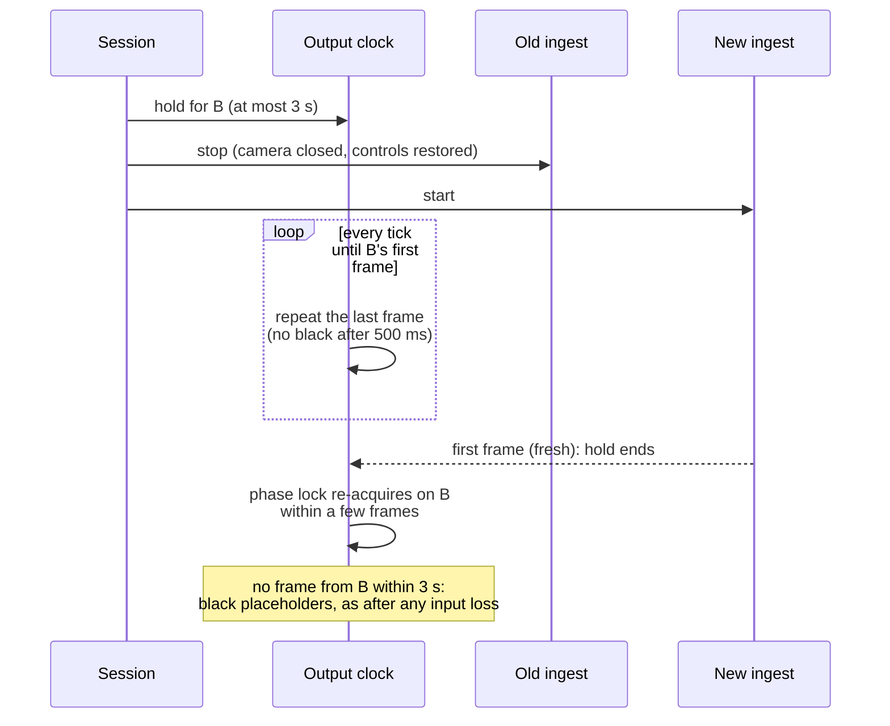
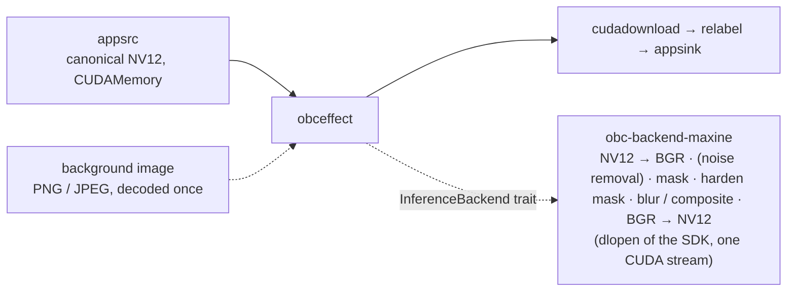
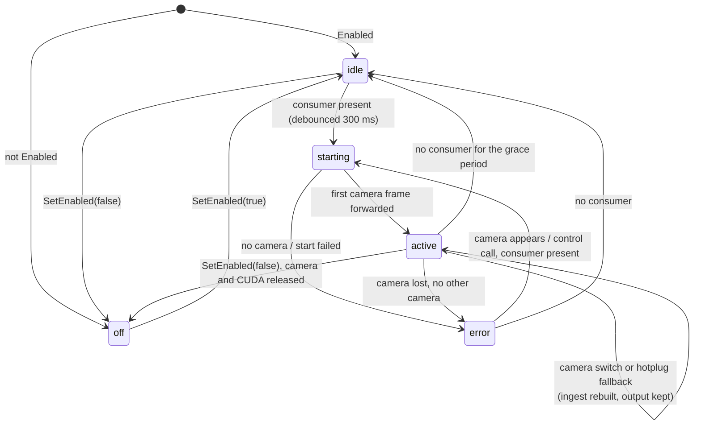

# omarchy-broadcast: architecture

The rationale behind each design decision is recorded in [adr/](adr/). The D-Bus namespace is `br.com.dias` (bus name `br.com.dias.OmarchyBroadcast`, interface `br.com.dias.OmarchyBroadcast1`); see [ADR-0005](adr/0005-dbus-zbus-control-plane.md), the API reference [dbus-api.md](dbus-api.md) and the lifecycle decision [ADR-0011](adr/0011-daemon-lifecycle-and-dbus-api.md). The command-line client and its JSON mode are in [cli-json.md](cli-json.md); installing the service is in [setup/daemon.md](setup/daemon.md).

The source is any UVC webcam. The pipeline queries the camera's advertised formats and picks a mode from its capabilities (section 2); nothing in the design is specific to one camera model. Where measured figures are quoted, they come from the reference test cameras (a Logitech MX Brio and a laptop-integrated FHD camera).

## 1. Component overview

```mermaid
flowchart LR
    subgraph Clients["Clients (optional, replaceable)"]
        CLI["omarchy-broadcast CLI<br/>(--json for the bar plugin)"]
        BAR["Omarchy bar plugin<br/>(omarchy-broadcast-plugin repository)"]
        SH["scripts via busctl / gdbus"]
    end

    subgraph Daemon["omarchy-broadcastd (systemd user service)"]
        IPC["D-Bus interface<br/>zbus · br.com.dias.OmarchyBroadcast1"]
        CTL["Controller thread<br/>lifecycle state machine"]
        CFG["Config (read-only)<br/>~/.config/omarchy-broadcast/config.toml<br/>reload on SIGHUP / ReloadConfig"]
        ST["Runtime state<br/>~/.local/state/omarchy-broadcast/state.toml<br/>Enabled, selected camera,<br/>effect settings,<br/>per-camera image controls"]
        WATCH["Consumer watcher<br/>inotify on the loopback node<br/>+ /proc/PID/fd count"]
        PWT["obc-pipewire thread (optional)<br/>PipeWire main loop, output stream,<br/>registry listener: links to the node"]
        PRV["obc-preview thread (while a lease is held)<br/>scale to 480 px, RGB, JPEG"]
        HOT["Hotplug watcher<br/>inotify on /dev"]
        subgraph WR["Loopback writer (lives as long as the daemon, CPU only)"]
            PH["black placeholder<br/>at the contract rate"]
            FWD["forwarded frames<br/>(by reference, restamped)"]
            WSRC["appsrc"] --> WSINK["v4l2sink"]
            PH --> WSRC
            FWD --> WSRC
            TAP["frame tap<br/>(every pushed buffer, restamped)"]
            WSRC --> TAP
        end
        subgraph GST["GStreamer pipelines (exist only while the state is starting or active)"]
            subgraph ING["Ingest pipeline (per source, rebuilt on switch)"]
                SRC["v4l2src<br/>any UVC webcam"] --> UP["adapter + cudaupload<br/>→ CUDA"] --> CS["crop + scale<br/>→ canonical NV12"]
            end
            SLOT[("latest-frame slot")]
            subgraph OUTP["Output pipeline (fixed contract, own clock)"]
                FX["Process: obceffect<br/>none / blur / replace"] --> DOWN["convert → contract format<br/>download + relabel"] --> OSINK["appsink"]
            end
            CS --> SLOT --> FX
        end
        BE["InferenceBackend trait"]
        MX["obc-backend-maxine<br/>(dlopen, user-installed SDK)"]
    end

    LB[("v4l2loopback<br/>/dev/videoN")]
    PJ[("$XDG_RUNTIME_DIR/omarchy-broadcast/<br/>preview.jpg")]
    PWN[("PipeWire node<br/>omarchy-broadcast, Video/Source<br/>(optional)")]

    CLI & BAR & SH -- "methods / properties" --> IPC
    IPC -- "PropertiesChanged, Stats, PreviewFrame" --> BAR & CLI
    IPC <--> CTL
    CFG --> CTL
    CTL <--> ST
    WATCH --> CTL
    PWT -- "PipeWire consumers, output state" --> CTL
    IPC -- "preview leases" --> CTL
    HOT --> CTL
    CTL --> GST
    CTL --> WR
    OSINK -- "every buffer" --> FWD
    FX --> BE --> MX
    WSINK --> LB
    TAP --> PWT --> PWN
    TAP --> PRV --> PJ
    PRV -- "frame written" --> IPC
    PJ -. "read on PreviewFrame" .-> BAR
    LB -. "virtual camera" .-> APPS["Browser / Zoom / OBS"]
    PWN -. "native camera" .-> APPS
    APPS -. "open / close" .-> WATCH
    APPS -. "link" .-> PWT
```



The daemon owns one **loopback writer** for its whole life ([ADR-0011](adr/0011-daemon-lifecycle-and-dbus-api.md)): a CPU-only `appsrc` → `v4l2sink` pipeline with the output contract's caps (colour label included). It opens the device once and never renegotiates. While no camera is streaming it pushes a black frame at the contract rate, whenever no forwarded frame has arrived for two contract periods. While the state is `active`, the CUDA output pipeline ends in an `appsink` (instead of the `v4l2sink` that `obc-bench` still uses to write to the loopback directly) and forwards each buffer to the writer by reference, without a copy. The writer stamps every buffer on its own monotonic timeline, so an application that holds the virtual camera sees one format and one uninterrupted stream (black, camera frames, black) across the states. The writer is needed because with `exclusive_caps=1` the device is listed as a capture device only while a writer streams into it, so an idle daemon must still have one for any application to find, and open, the camera.

**Optional PipeWire output** ([ADR-0016](adr/0016-pipewire-output.md)). When the daemon is built with the `pipewire` feature and `[pipewire] enabled = true`, a frame tap on the writer also hands every buffer it pushes (placeholder or camera frame, after restamping) to a native PipeWire `Video/Source` node, `omarchy-broadcast` ("Omarchy Broadcast"). Both outputs therefore carry the same stream: the same contract, pacing, timestamps and Idle behaviour. Nothing is sent while no PipeWire consumer streams. The node offers three formats at the contract's size and rate (in the order YUY2, NV12, I420; `[pipewire] offer_nv12 = false` drops NV12), and converts on the CPU inside the single copy into the PipeWire buffer, because the format is the consumer's choice at run time and idle placeholders never touch the GPU. A consumer that asks for another format or size fails its own link only. The node exists while the loopback writer runs; its failure is reported as `PipeWireOutput` = `failed`, retried every 2 s, and never puts the daemon in `error`.

**Live preview** ([ADR-0019](adr/0019-live-preview.md)). While a client holds a preview lease and the loopback writer runs, a second part of the writer's tap hands each buffer to the preview encoder. The writer has one tap slot, so the backend installs one composed tap that calls the PipeWire output's part and the preview's part, whichever run, and installs it anew when one of them starts or stops; each outlives the other, and a new writer (a new output contract) gets a new encoder. The encoder sees what the loopback carries (black placeholders at `off`, `idle` and `error`, black while an effect loads, the processed camera image when `active`), so the preview shows what applications see. It never opens the loopback device, never blocks the writer, and makes no CUDA call. The tap decimates by the writer's timestamps to the highest rate among the leases (15 or 30 fps) and keeps only the latest frame, so a slow encoder drops frames instead of delaying the writer. The encoder thread scales the frame to 480 pixels wide (keeping the aspect, 480x270 for 16:9), converts it to RGB, so that the full-range JPEG gets the levels of the limited-range frame right, and encodes it. Each JPEG goes to `$XDG_RUNTIME_DIR/omarchy-broadcast/preview.jpg.tmp` and is renamed over `preview.jpg`; the encoder then reports the frame's sequence number, which the D-Bus side emits as `PreviewFrame(seq)`, without passing through the controller.

*The frame files.* The directory is created mode 0700 on `AcquirePreview`, or, if present, must be a real directory owned by the daemon's user, whose mode is forced to 0700; otherwise the call fails. The files are created mode 0600 without following links; a symbolic link, hard link, FIFO or other non-regular file in their way is removed and the file is created anew. Both files are removed when the last lease ends, when the writer stops, at shutdown and at start-up (a crashed daemon may have left them).

*The lease is a consumer.* It is the third kind, next to the loopback holders and the PipeWire links, keyed by the caller's unique bus name; it ends on `ReleasePreview`, when the name leaves the bus (the daemon follows `NameOwnerChanged`), and at shutdown. The lifecycle keys off the total: debounce, idle grace, the deferred writer rebuild and the CUDA parking at `idle` are unchanged, so a lease alone starts the camera and its end lets the grace run out. `Consumers` is the total; `PreviewConsumers` counts the leases.

**Camera image controls** ([ADR-0020](adr/0020-camera-image-controls.md)). Each camera has its own brightness, contrast, saturation, sharpness and backlight compensation, which the user can set and reset over D-Bus (`SetCameraControl`, `ResetCameraControls`) and which the daemon writes to the camera whenever it opens. Three places hold the design:
- `obc-pipeline::controls` is the V4L2 side. `IMAGE_CONTROLS` is the allowlist, as data and the same for every camera. `ImageControls` opens a camera node once and queries the controls it has (range, step, default and value, from `VIDIOC_QUERYCTRL` and `VIDIOC_G_CTRL`), skipping one that cannot be read; a control is exposed only when it is not disabled, read-only or inactive and is an integer or a boolean. `check_value` validates a value against range and step.
- The backend seam has a `ControlNode` (`MediaBackend::open_camera_controls`): the controller never touches a device node itself, and the fake backend replaces it in tests with an in-memory device whose controls can be made to fail.
- The controller owns the policy. The values live in the runtime state, by camera id (`[camera_controls."<id>"]` in `state.toml`: `values`, and `reset_pending`), and nothing else is stored. A session records that the ingest's switch to its camera succeeded; only then, in `starting` or `active`, do the methods write to the device. At every successful switch to a camera (and when the open camera is renamed to an id with stored values) the controller opens the node once, writes the defaults if a reset is pending, then each stored value, and rebuilds the `CameraControls` view from what the device reports. A failing control never fails the session. Reads are allowed in any state and start no stream.

The `CameraControls` property is the view of `ActiveCamera` and is queried again only on events, never polled: when `ActiveCamera` changes, on a rescan, at a camera's open, once at its first frame (a camera may change controls as it starts streaming) and after a set or reset. Closing a camera restores nothing. The user's values stay on the device, because restoring what was there would bring back what other software had left; the exposure pin of section 2 (`UVC controls`), which the daemon does restore, is not one of these controls.

### Threads

| Thread | Does |
|---|---|
| D-Bus (a current-thread async runtime) | The zbus connection and object, the publisher of `PropertiesChanged` and `Stats`, and `SIGHUP` / `SIGTERM` / `SIGINT` |
| Controller (`obc-controller`) | The only owner of the configuration, the runtime state, the writer and the session. D-Bus methods, watcher events and timers reach it as commands; it replies to a method only after it has published the resulting snapshot. Time is passed into the state machine explicitly, so it is testable with a fake backend and a fake clock |
| Consumer watcher (`obc-consumers`) | An inotify watch on the loopback node, and the `/proc` count below |
| PipeWire output (`obc-pipewire`, only with the feature and `[pipewire] enabled`) | Its own PipeWire main loop with the output stream (the node's driver) and a registry listener that counts the links to the node. Frames arrive from the writer's tap; link and state changes reach the controller as commands. Panics in PipeWire callbacks are contained: the output fails and reconnects |
| Preview encoder (`obc-preview`, only while a lease is held and the writer runs) | Scales, converts and JPEG-encodes the latest frame the writer's tap kept, writes the frame file and reports its sequence number. The tap itself runs on the writer's thread and only decimates and swaps a reference |
| Hotplug watcher (`obc-hotplug`) | An inotify watch on `/dev` for `video*` nodes appearing or disappearing |
| GStreamer threads | The writer's streaming and placeholder threads for the life of the daemon; the ingest and output pipelines' while a session runs |

**Start-up order.** The daemon serves the object (from the files only, with no device touched), requests the bus name with no queueing and no replacement, and only then lets the controller touch devices; if another instance owns the name it exits with status 3 before any device is used. The controller starts the loopback writer, and the bus name is requested after that first writer attempt, so a `Type=dbus` unit is ready only when the virtual camera is already a capture device.

**Consumer detection.** The watcher gets `IN_OPEN` and `IN_CLOSE_*` events for the loopback node, but treats each only as a hint: it then counts the processes other than the daemon holding the node open, from `/proc/<pid>/fd`. A consumer must be present for 300 ms (the start debounce) before the camera starts, so the short opens that browsers and PipeWire make to enumerate devices do nothing. If the watch cannot be set, it counts every second.

With the PipeWire output, the registry listener of the `obc-pipewire` thread counts the `Link` objects whose output node is ours; each is followed, and a link in the error state is not counted. The node's `running` state is not a consumer signal (it means linked, not producing). The lifecycle keys off the total of the loopback holders and the PipeWire links, with the same debounce, grace period and states, so a PipeWire consumer starts the camera exactly as a loopback consumer does. `Consumers` is that total, together with the preview leases below; `LoopbackConsumers` and `PipeWireConsumers` give the split.

**Hotplug.** Video nodes appearing in or disappearing from `/dev` trigger a rescan of the camera list. If the streaming camera fails or disappears, the session switches to the next camera in order, with the hold of ADR-0010; if none is left, the state is `error`. A camera that appears while another one streams does not take over.

**Configuration and state.** `config.toml` holds what the user decides and is never written by the daemon; it is re-read on `SIGHUP` or `ReloadConfig()`, and an invalid file is rejected as a whole (the previous one stays in force and `Error` says why). Changes made at run time (`Enabled`, the selected camera, and the effect with its blur strength and background image) go to a separate `state.toml`, written atomically. A state file that cannot be parsed starts the daemon `off` (privacy fails closed). The keys are in [config.example.toml](config.example.toml).

## 2. Stage and caps model

Every stage declares its input and output caps: format, size, and memory type. GStreamer negotiates them, and the pipeline builder inserts adapters only where adjacent caps differ.

**Capability-driven mode selection.** The source is not hard-coded to a format. The builder enumerates the camera's modes (format, size, frame rate) from V4L2 (`VIDIOC_ENUM_FMT`, `VIDIOC_ENUM_FRAMESIZES`, `VIDIOC_ENUM_FRAMEINTERVALS`), with GStreamer device caps as the fallback. It then selects one mode for the requested `WxH@FPS` (or `FORMAT:WxH@FPS`; the benchmark default is `1920x1080@60`, any format). The rule is strictly size, then frame rate, then format:
- **Size:** the requested size if offered. Otherwise the largest size that fits within both requested dimensions, preferring the same aspect ratio (within 1 %). Only if nothing fits, the smallest size above the request.
- **Frame rate:** the exact rate, otherwise the highest rate not above the request (0.2 % tolerance, so 30 serves 30000/1001). Only if every rate is above the request, the lowest.
- **Format:** the requested format, then NV12 > YUY2 > other raw formats (GPU-direct before CPU-convert) > MJPEG.

For example, a camera offering only MJPEG 1080p30 and YUYV up to 960x540@15, asked for 1080p60, gets MJPEG 1080p30 (a degraded match) with CPU decode.

**Ingest adapters.** The builder inserts one of three adapters in front of the CUDA stages. The guarantee that every link carries `memory:CUDAMemory` starts at `cudaupload`.

| Path | Camera format | Chain |
|---|---|---|
| GPU-direct | NV12, and any raw format `cudaconvert` accepts | `v4l2src` → `cudaupload` → CUDA |
| CPU convert | YUYV, UYVY | `v4l2src` → `videoconvert` → NV12 → `cudaupload` |
| CPU decode | MJPEG | `v4l2src` → `jpegdec` → `cudaupload` |

`cudaconvert`, `cudaconvertscale` and `cudascale` accept no YUY2/UYVY input, hence the CPU convert step. The colour label (colorimetry) is preserved on the convert path. Decoded MJPEG is full-range BT.601 (`1:4:0:0`); the canonical caps fix the label of the contract, and `cudaconvertscale` (the crop and scale step of the ingest pipeline) converts to it in the same pass as the scale. For the default limited-range contract that is `2:4:5:1`, which matters because many consumer apps ignore the range flag and would otherwise crush blacks and clip whites. After the ingest pipeline, every source looks the same to the rest of the stream. Measured cost per path is in [benchmarks/ingest-paths.md](benchmarks/ingest-paths.md) and [benchmarks/io-split.md](benchmarks/io-split.md); the rationale is in [ADR-0008](adr/0008-cpu-ingest-adapters.md).

**Ingest, Process, Output.** The stream is split into three stages ([ADR-0009](adr/0009-ingest-process-output.md)):
- **Ingest** (per source) crops and scales every camera to the **canonical frame**: `video/x-raw(memory:CUDAMemory), format=NV12` at the processing size (the output size for now), with the colour label of the contract's range (`2:4:5:1` limited, `1:4:5:1` full). The default aspect policy is a centre crop to fill the frame; letterbox is an option.
- **Process** holds one element, `obceffect`, which applies the video effect (`none`, `blur` or `replace`), and optionally video noise removal before it, to canonical frames. It is always present in the daemon's output pipeline, with the canonical caps on both pads, so choosing another effect never renegotiates caps or relinks the pipeline. With `none` it is in passthrough: the buffer goes on untouched, with no copy and no CUDA call. It does not know which source fed it or which sink it feeds. The element is described below ([Effects](#effects)) and decided in [ADR-0012](adr/0012-video-effects-and-maxine-backend.md).
- **Output** (per sink) holds a fixed contract of format (NV12 or I420), size, frame rate and colour range (default NV12 1920x1080@30, limited range) and runs on its own clock: it repeats the latest frame when the source is slower, drops frames when it is faster, and sends a black placeholder after a gap without input (default 500 ms). The clock's timestamps sit on an exact grid of the contract rate, while the instant each tick is emitted is locked to the camera's frames, a small margin after each expected arrival and never later than the timestamp ([ADR-0010](adr/0010-phase-locked-output-clock.md)), so a frame waits in the slot only that margin plus the camera's arrival jitter. The source can be switched while the output keeps running: the output holds the previous camera's last frame until the new camera's first frame (at most 3 s), so a switch shows no black frame ([benchmarks/io-split.md](benchmarks/io-split.md)). The output's `appsrc` queues at most 3 frames, so a slow consumer gets recent frames, not a backlog.
- **v4l2loopback constraints.** In the daemon the persistent loopback writer ([section 1](#1-component-overview)) owns the device and the output ends in an `appsink` whose caps equal the writer's; the constraints below apply to the writer and to `obc-bench`, which writes to the device directly. The device carries no colour description: it reports every stream as BT.601 (`2:4:5:4`) and, while a consumer holds it, refuses any other label. The output therefore relabels frames `2:4:5:4` after download (labels only, no pixel change), and a **full-range contract is refused** for a loopback sink, because consumers would read it as limited. At start the output compares the device's accepted caps with the contract: if the device is held by a consumer in another format, size or rate (its caps are fixed), the error says so (`LoopbackFormatHeld`); a colour label is compared by meaning. Any other mismatch is a generic refusal.

**UVC controls.** `exposure_auto_priority` (`exposure_dynamic_framerate`) is probed and used only if the camera exposes it. `--camera-fixed-framerate` pins it to 0 while a camera streams and restores it when that camera's ingest stops (on a source switch and on exit, including Ctrl-C and SIGTERM, but not SIGKILL). No per-camera quirks are needed.

```mermaid
flowchart LR
    subgraph Ingest["Ingest pipeline — per source, rebuilt on source switch"]
        S1["v4l2src (raw mode)<br/>NV12, or YUYV/UYVY<br/>(YUYV/UYVY: videoconvert → NV12 on the CPU)"]
        S2["v4l2src (MJPEG mode)<br/>jpegdec on the CPU"]
        UP["cudaupload<br/>→ CUDAMemory"]
        CROP["videocrop<br/>(crop region only, no copy;<br/>skipped for letterbox)"]
        SCALE["cudaconvertscale<br/>→ canonical frame:<br/>CUDAMemory NV12, processing size,<br/>contract colour label"]
        AS["appsink<br/>(newest frame only)"]
        S1 --> UP
        S2 --> UP
        UP --> CROP --> SCALE --> AS
    end

    SLOT[("latest-frame slot<br/>buffer reference + sequence")]

    subgraph Output["Output pipeline — fixed contract, lives for the whole stream"]
        CLK["output clock<br/>one tick per contract period,<br/>phase locked to the camera:<br/>fresh / repeat / placeholder;<br/>holds the last frame during a switch"]
        SRC["appsrc<br/>canonical caps, at most 3 queued<br/>(oldest dropped)"]
        subgraph Process["Process — one element, always present"]
            E1["obceffect<br/>none: passthrough<br/>blur / replace / noise removal:<br/>new buffer, own CUDA stream"]
        end
        CONV["cudaconvert<br/>(only if the contract format is not NV12)"]
        DL["cudadownload<br/>(the only GPU→CPU copy)"]
        RL["capssetter<br/>relabel 2:4:5:4 (loopback)"]
        K1["appsink in the daemon → loopback writer<br/>(obc-bench: v4l2sink → v4l2loopback directly,<br/>contract caps, sync=false)"]
        CLK --> SRC --> E1 --> CONV --> DL --> RL --> K1
    end

    AS --> SLOT --> CLK
    PWK["PipeWire node (optional):<br/>frame tap on the loopback writer,<br/>CPU conversion into the PipeWire buffer"]
    K1 -.-> PWK
```



A source switch, as the output sees it ([ADR-0010](adr/0010-phase-locked-output-clock.md)):



These are the extension points, and each is a trait or element boundary:
- **New source:** another camera or a screen capture. It is a new source element, and adapters cover format gaps (for example the MJPEG decode adapter).
- **New effect:** a new effect kind in `obceffect`, which accepts and produces canonical CUDAMemory NV12 and talks only to the `InferenceBackend` trait.
- **New backend:** TensorRT, CPU, or another vendor. It is a new `InferenceBackend` impl, and the `obceffect` element is unchanged. A backend that does not run on CUDA would add a host-memory frame variant to the trait, around which the element downloads and uploads ([ADR-0012](adr/0012-video-effects-and-maxine-backend.md)).
- **New sink:** recording, say. It is a new output with its own contract, fed after the Process stage. The PipeWire node of [ADR-0016](adr/0016-pipewire-output.md) is the model for an output that shares the writer's stream: it attaches to the writer's tap and needs no pipeline of its own. An output with an independent contract or timeline would be a separate pipeline.

### Effects

The Process stage is the `obceffect` element (crate `gst-obc`, registered in-process). The effect, the blur strength and the background image are element properties that can change while the pipeline plays.



- **The seam.** `obceffect` talks to the `InferenceBackend` trait of the crate `obc-backend`, never to Maxine. A backend factory says whether the backend is available without loading anything; a backend instance loads the models for one effect, processes one NV12 device frame into another NV12 device frame, and unloads. `obc-backend-maxine` is the first implementation. It opens the SDK, the CUDA driver library and GStreamer's CUDA library with `dlopen` at run time, so the workspace builds, and its default tests pass, on a machine without the SDK; the backend then reports itself unavailable with the reason.
- **Frames.** With an effect, the element reads the input and writes a new buffer from a CUDA pool, never modifying the input: the output clock pushes the same slot buffer again when the camera is slower than the contract. All the GPU work (colour conversion to BGR, the green-screen mask, its hardening by a small CUDA kernel ([ADR-0013](adr/0013-mask-hardening-cuda-kernel.md)), the blur or the composite over the background image, conversion back to NV12) runs on one CUDA stream the element owns, in the CUDA context that GStreamer's CUDA elements share. The element waits for its stream before it pushes, so the input can go back to the ingest pool.
- **Noise removal.** A boolean stage that stacks with the effect ([ADR-0018](adr/0018-video-noise-removal.md)), not a fourth effect. Off, the chain above is unchanged. On, the colour conversion writes into a separate input image, the denoising feature writes the cleaned frame into the frame image that the green screen, blur and composite already read, and the rest runs as before; with `none`, there is no mask and the frame image is converted back to NV12. The stage runs on the same stream and context. Its temporal state is cleared when the input switches to another source: the output clock marks the first fresh frame of a new source with a buffer flag (the `GST_VIDEO_BUFFER_FLAG_LAST` bit, the first free for custom use on video buffers), and the element then calls the backend's `reset_temporal`, which also resets the green screen's temporal state. `DISCONT` cannot carry this, because the pacer sets it on every skip. If the output queue drops the flagged buffer itself, the reset is skipped and the state blends for a few frames. Unlike the effects, the stage fails open: a failure leaves the stream running without it.
- **Model lifecycle.** Models are loaded only while an effect other than `none`, or noise removal, is requested and the stream is `starting` or `active`; they live in the element, the element in the output pipeline, and that pipeline exists only in those states. Entering `idle`, `off` or `error` stops the pipeline, which unloads the models before the CUDA context is released, so the GPU holds nothing then (section 3). Selecting `none` while streaming unloads them as well. A load runs on a worker thread of the element, so the streaming thread never waits for it; switching between `blur` and `replace` keeps the green-screen model loaded and takes milliseconds.
- **Warm-up and privacy.** The raw camera image is never shown while an effect is requested (noise removal hides nothing and is not covered by this rule: from `none`, the camera image shows until the stage is ready). From `none` to an effect, the element outputs black canonical frames until the effect is ready (a fraction of a second, up to a few seconds on a cold cache). From one effect to another, the previous effect keeps running until the new one is ready. From an effect to `none`, the raw image is shown at once. If the effect cannot run, the daemon either stops the stream and shows black (`on_failure = "black"`, the default) or lets the raw image through (`"none"`); see [dbus-api.md](dbus-api.md#video-effects).
- **The SDK is an external package the user builds.** The Maxine SDK may not be distributed with this project. Users build the Arch package `maxine-vfx-sdk-local` from the omarchy-nvidia-sdks repository and install it themselves ([setup/maxine.md](setup/maxine.md)); the SDK is then in `/opt/nvidia/maxine/videofx`, which the daemon uses as its default root when `MAXINE_VFX_ROOT` is unset. On a distribution the SDK does not list, the daemon runs with the package's small `LD_PRELOAD` library that shows it a replacement `/etc/os-release` (ADR-0012 gives the reasons for this mechanism and for not using a namespace; [ADR-0021](adr/0021-nvidia-sdk-handover.md) records the move of the shim and its packaging to omarchy-nvidia-sdks).
- **Cost.** A small amount of GPU time and added latency per frame; none of the Process stage's cost applies with `none`. Performance figures for the Maxine backend are not published, per the NVIDIA Maxine SDK licence; reproduce locally with `obc-bench` (see [testing.md](testing.md)).

## 3. Lifecycle

Defined in [ADR-0011](adr/0011-daemon-lifecycle-and-dbus-api.md), which amends [ADR-0006](adr/0006-on-demand-gpu-lifecycle.md). Whenever the state holds no camera (`off`, `idle`, `error`), there is **no CUDA context** and the camera is closed, so the dGPU can runtime-suspend; only the CPU writer runs. Before the first activation the daemon never calls into CUDA, and afterwards the process is **parked** (see below).



| State | Camera | CUDA context | What runs | Outputs carry |
|---|---|---|---|---|
| `off` | closed | none | D-Bus, watchers, the writer | placeholder on both outputs |
| `idle` | closed | none | D-Bus, watchers, the writer | placeholder on both outputs |
| `starting` | opening | being created | the above, plus the output pipeline and the ingest being built | placeholder on both outputs |
| `active` | streaming | held | the above, plus ingest and output pipelines, 1 Hz `Stats` | camera frames on both outputs |
| `error` | closed | none | D-Bus, watchers, the writer (retried every 2 s if the loopback is missing or held) | placeholder on both outputs |

The second output exists only with the PipeWire output enabled; it carries what the loopback carries, and consumers of either kind keep the state `active`. A preview lease is a consumer too, and is granted in every state; the preview frames carry what the loopback carries.

- **Grace period.** `active` includes the time after the last consumer closes: the stream keeps running for `idle_grace` (default 5 s) with `Consumers` = 0, and a consumer that returns in that time finds it running. This replaces ADR-0006's separate "Draining" state.
- **Camera image controls** are written at the points where the camera opens, so they follow the lifecycle: a camera that is closed (`off`, `idle`, `error`) is never written, a `SetCameraControl` or `ResetCameraControls` then only changes what is stored (or marks a reset pending), and the next switch to the camera applies it. They take no part in the consumers, the grace period or the parking.
- **Source changes** (`SelectCamera`, `NextCamera`, a camera failure) rebuild only the ingest pipeline; the output keeps its contract and clock and holds the last frame meanwhile (section 2). The state stays `active`.
- **`off`** is the privacy state: the camera is closed, so its LED is off. The writer keeps feeding black frames to any application that holds the device.
- **Effects** follow the same lifecycle: the models exist only in `starting` and `active`, and are unloaded before the CUDA context goes. An effect that cannot run puts the daemon in `error` with the reason (or, with `on_failure = "none"`, leaves it `active` with the reason in `Error`). The noise-removal stage lives in the same backend instance: its model handle and state buffer are released at unload, before the context, so the park at Idle covers it. A noise-removal failure never enters `error`.
- **Parking** ([ADR-0017](adr/0017-cuda-checkpoint-parking.md)). `cuInit` leaves 7 `/dev/nvidia*` fds and a GPU registration in `nvidia-uvm` that keep the dGPU awake until the process exits. When a session has fully stopped (NVML stopped, CUDA elements at NULL, effect worker joined, Maxine instances destroyed), the daemon checkpoints its own process with the CUDA checkpoint API (`obc-gpu::checkpoint`, driven by the `Parker` in `omarchy-broadcastd/src/backend/park.rs`). The process then holds no `/dev/nvidia*` fds or mappings and the GPU is unregistered. The next session start restores it before anything touches CUDA. A park failure keeps the GPU awake with a warning. A teardown that leaves a pipeline outside NULL (a session stop, a restart's stop of the previous session, a failed start's cleanup, a camera switch) disables parking until the daemon restarts, with one warning, because a CUDA user still alive would block once parked; a later clean stop does not clear it, and unparking still works. An unpark failure fails the start (`error`, the loopback keeps sending placeholders). While parked, any CUDA call blocks until the unpark, so `obc-gpu`'s `driver()` refuses with an error instead and nothing at Idle may call CUDA. A driver without the API behaves as before. An actual runtime suspend also needs the dGPU to drive no display.
- **`error`** has a cause in the `Error` property. The daemon leaves it when the cause can have changed (camera set change, a control method, a reload).

## 4. D-Bus sequence: an application opens the virtual camera

The Omarchy bar client follows the daemon with `PropertiesChanged` and `Stats` (through the CLI's `watch --json`, or directly). The sequence below is an application opening the virtual camera, then the user switching the camera off. The details of each member are in [dbus-api.md](dbus-api.md).

```mermaid
sequenceDiagram
    autonumber
    participant App as Application (browser)
    participant K as v4l2loopback node
    participant W as Consumer watcher
    participant C as Controller
    participant D as D-Bus object
    participant Bar as Bar client
    participant P as Ingest + output pipelines
    participant LW as Loopback writer

    Note over LW,K: idle: the writer pushes black frames
    Bar->>D: subscribe PropertiesChanged / Stats
    App->>K: open
    K-->>W: inotify IN_OPEN
    W->>W: count /proc/PID/fd (other than the daemon)
    W->>C: consumers = 1
    C->>D: publish Consumers = 1
    D-->>Bar: PropertiesChanged(Consumers=1)
    Note over C: debounce 300 ms, still present
    C->>D: publish State = starting
    D-->>Bar: PropertiesChanged(State="starting")
    C->>P: open camera, create CUDA context, build pipelines
    P-->>LW: first output buffer (by reference)
    C->>D: publish State = active
    D-->>Bar: PropertiesChanged(State="active")
    loop about once per second while active
        D-->>Bar: Stats(fps, latency_p50_ms, cpu, gpu)
    end
    Bar->>D: SetEnabled(false)
    D->>C: SetEnabled(false)
    C->>P: stop, release camera and CUDA context
    C->>C: write Enabled = false to state.toml
    C->>D: publish State = off, Enabled = false
    D-->>Bar: PropertiesChanged(Enabled=false, State="off")
    D-->>Bar: return
    Note over LW,App: the writer resumes black frames; the application keeps one open stream
    App->>K: close
    K-->>W: inotify IN_CLOSE
```

When the application closes the camera instead of the user disabling it, the controller waits for the grace period with `Consumers` = 0 and then moves `active` → `idle`, releasing the camera and the CUDA context, then parking the process.

## Reference camera formats

Measured on the reference test camera (Logitech MX Brio, USB 3, `uvcvideo`): maximum frame rate per format for modes at least 1280 pixels wide.

| Format | 1280x720 | 1600x896 | 1920x1080 | 2560x1440 | 3840x2160 |
|---|---|---|---|---|---|
| NV12 | 60 | — | 60 | 30 | — |
| YUYV | 60 | 60 | 60 | 24 | 15 |
| MJPEG | 60 | 60 | 60 | 30 | 30 |

Raw 4K tops out at 15 fps; 4K at 30 fps is only available as MJPEG, which is what the decode adapter is for.

## Known limitations / future work

- **MJPEG is decoded on the CPU.** GStreamer's `nvjpegdec` (NVDEC) is not used: on the reference machine it rejects the 4:2:2 MJPEG that typical UVC webcams send (`unhandled chroma format 2`). The cost is CPU time that scales with resolution and frame rate (see [benchmarks/ingest-paths.md](benchmarks/ingest-paths.md)). GPU JPEG decode, for example through an element built on the nvJPEG library, is future work. See [ADR-0008](adr/0008-cpu-ingest-adapters.md).
- **YUYV/UYVY are converted on the CPU.** A custom CUDA kernel for these formats is deferred.
