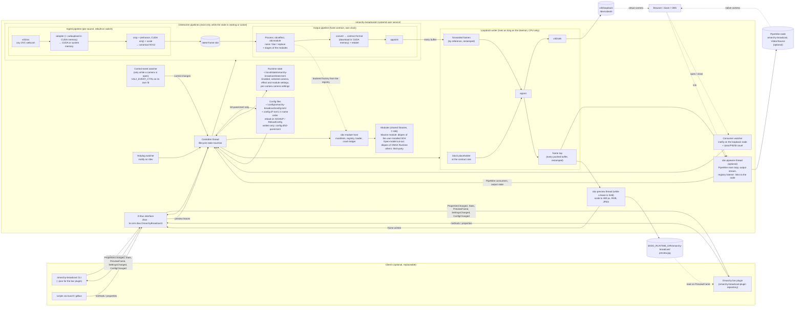
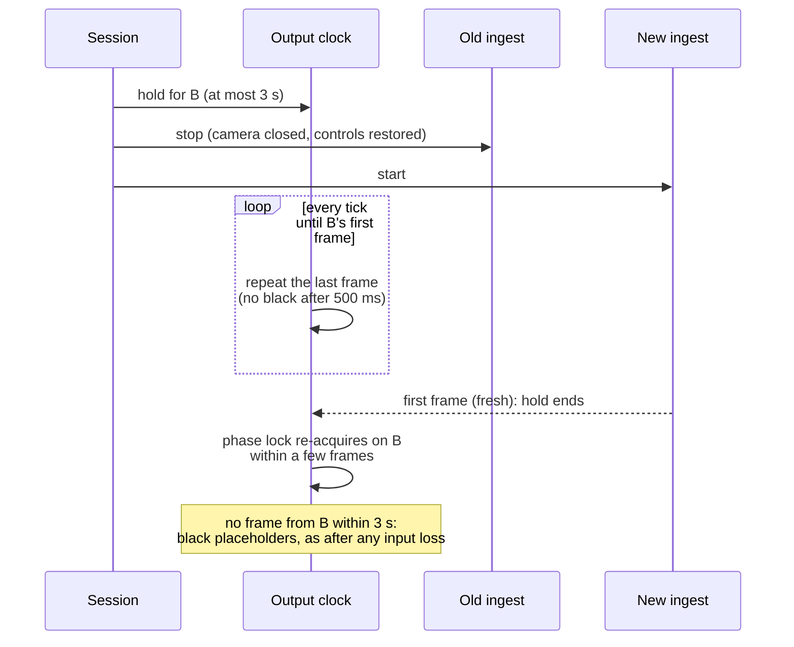
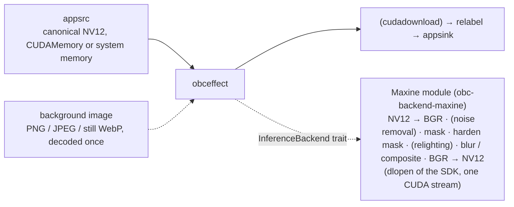
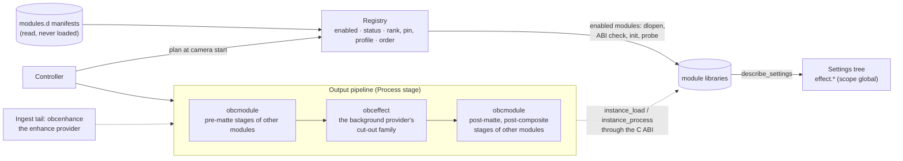
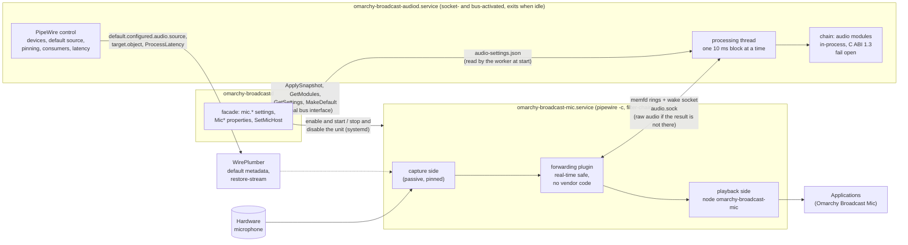
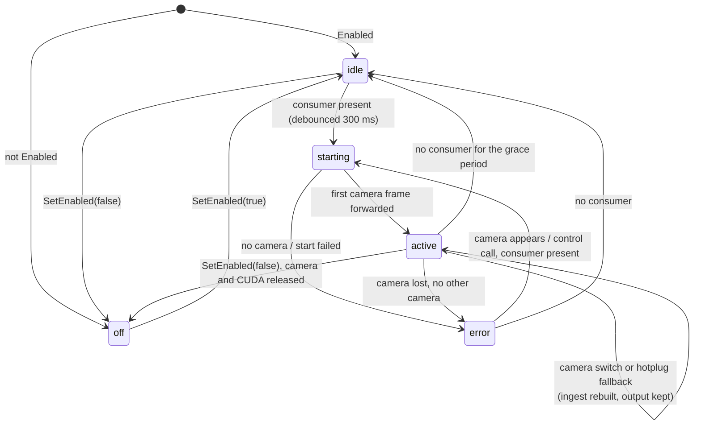

# omarchy-broadcast: architecture

The rationale behind each design decision is recorded in [adr/](adr/). The D-Bus namespace is `br.com.dias` (bus name `br.com.dias.OmarchyBroadcast`, interface `br.com.dias.OmarchyBroadcast1`); see [ADR-0005](adr/0005-dbus-zbus-control-plane.md), the API reference [dbus-api.md](dbus-api.md) and the lifecycle decision [ADR-0011](adr/0011-daemon-lifecycle-and-dbus-api.md). The command-line client and its JSON mode are in [cli-json.md](cli-json.md); installing the service is in [setup/daemon.md](setup/daemon.md).

The source is any UVC webcam. The pipeline queries the camera's advertised formats and picks a mode from its capabilities (section 2); nothing in the design is specific to one camera model. Where measured figures are quoted, they come from the reference test cameras (a Logitech MX Brio and a laptop-integrated FHD camera).

## 1. Component overview



The daemon owns one **loopback writer** for its whole life ([ADR-0011](adr/0011-daemon-lifecycle-and-dbus-api.md)): a CPU-only `appsrc` → `v4l2sink` pipeline with the output contract's caps (colour label included). It opens the device once and never renegotiates. While no camera is streaming it pushes a black frame at the contract rate, whenever no forwarded frame has arrived for two contract periods. While the state is `active`, the output pipeline ends in an `appsink` (instead of the `v4l2sink` that `obc-bench` still uses to write to the loopback directly) and forwards each buffer to the writer by reference, without a copy. The writer stamps every buffer on its own timeline, which is `CLOCK_MONOTONIC` time (strictly increasing, and continuing forward when a new daemon process starts after a restart or a crash; [ADR-0022](adr/0022-crash-recovery-for-consumers.md)), so an application that holds the virtual camera sees one format and one uninterrupted stream (black, camera frames, black) across the states. **Crash cover** ([ADR-0022](adr/0022-crash-recovery-for-consumers.md)). Once its `v4l2sink` has set the device's format, at every start the writer has a helper thread upload a black timeout image to the loopback and set the driver's `timeout` (250 ms at the default contract; never fails the writer, outcome logged). If the daemon dies, the driver keeps serving black frames to the readers of the node, so a Chromium-based application keeps its camera until the new process writes again. Nothing is reset when the writer stops. PipeWire consumers do not survive a daemon crash. The packaged unit restarts the daemon after 250 ms and stops a crash loop after 5 starts in 60 s.

The writer is needed because with `exclusive_caps=1` the device is listed as a capture device only while a writer streams into it, so an idle daemon must still have one for any application to find, and open, the camera.

**Optional PipeWire output** ([ADR-0016](adr/0016-pipewire-output.md)). When the daemon is built with the `pipewire` feature and `[pipewire] enabled = true`, a frame tap on the writer also hands every buffer it pushes (placeholder or camera frame, after restamping) to a native PipeWire `Video/Source` node, `omarchy-broadcast` ("Omarchy Broadcast"). Both outputs therefore carry the same stream: the same contract, pacing, timestamps and Idle behaviour. Nothing is sent while no PipeWire consumer streams. The node offers three formats at the contract's size and rate (in the order YUY2, NV12, I420; `[pipewire] offer_nv12 = false` drops NV12), and converts on the CPU inside the single copy into the PipeWire buffer, because the format is the consumer's choice at run time and idle placeholders never touch the GPU. A consumer that asks for another format or size fails its own link only. The node exists while the loopback writer runs; its failure is reported as `PipeWireOutput` = `failed`, retried every 2 s, and never puts the daemon in `error`.

**Live preview** ([ADR-0019](adr/0019-live-preview.md)). While a client holds a preview lease and the loopback writer runs, a second part of the writer's tap hands each buffer to the preview encoder. The writer has one tap slot, so the backend installs one composed tap that calls the PipeWire output's part and the preview's part, whichever run, and installs it anew when one of them starts or stops; each outlives the other, and a new writer (a new output contract) gets a new encoder. The encoder sees what the loopback carries (black placeholders at `off`, `idle` and `error`, black while an effect loads, the processed camera image when `active`), so the preview shows what applications see. It never opens the loopback device, never blocks the writer, and makes no CUDA call. The tap decimates by the writer's timestamps to the highest rate among the leases (15 or 30 fps) and keeps only the latest frame, so a slow encoder drops frames instead of delaying the writer. The encoder thread scales the frame to 480 pixels wide (keeping the aspect, 480x270 for 16:9), converts it to RGB, so that the full-range JPEG gets the levels of the limited-range frame right, and encodes it. Each JPEG goes to `$XDG_RUNTIME_DIR/omarchy-broadcast/preview.jpg.tmp` and is renamed over `preview.jpg`; the encoder then reports the frame's sequence number, which the D-Bus side emits as `PreviewFrame(seq)`, without passing through the controller.

*The frame files.* The directory is created mode 0700 on `AcquirePreview`, or, if present, must be a real directory owned by the daemon's user, whose mode is forced to 0700; otherwise the call fails. The files are created mode 0600 without following links; a symbolic link, hard link, FIFO or other non-regular file in their way is removed and the file is created anew. Both files are removed when the last lease ends, when the writer stops, at shutdown and at start-up (a crashed daemon may have left them).

*The lease is a consumer.* It is the third kind, next to the loopback holders and the PipeWire links, keyed by the caller's unique bus name; it ends on `ReleasePreview`, when the name leaves the bus (the daemon follows `NameOwnerChanged`), and at shutdown. The lifecycle keys off the total: debounce, idle grace, the deferred writer rebuild and the CUDA parking at `idle` are unchanged, so a lease alone starts the camera and its end lets the grace run out. `Consumers` is the total; `PreviewConsumers` counts the leases.

**Camera image controls** ([ADR-0020](adr/0020-camera-image-controls.md)). Each camera has its own brightness, contrast, saturation, sharpness and backlight compensation, which the user can set and reset over D-Bus (`SetCameraControl`, `ResetCameraControls`) and which the daemon writes to the camera whenever it opens. This is the base of the settings model, which [Camera settings](#camera-settings) describes and which extends it to every standard control. Three places hold the design:
- `obc-pipeline::controls` is the V4L2 side. `IMAGE_CONTROLS` is the allowlist, as data and the same for every camera. `ImageControls` opens a camera node once and queries the controls it has (range, step, default and value, from `VIDIOC_QUERYCTRL` and `VIDIOC_G_CTRL`), skipping one that cannot be read; a control is exposed only when it is not disabled, read-only or inactive and is an integer or a boolean. `check_value` validates a value against range and step.
- The backend seam has a `ControlNode` (`MediaBackend::open_camera_controls`): the controller never touches a device node itself, and the fake backend replaces it in tests with an in-memory device whose controls can be made to fail.
- The controller owns the policy. The values live in the runtime state, by camera id (`[camera_controls."<id>"]` in `state.toml`: `values`, and `reset_all` or `reset_names` for a reset that waits), and nothing else is stored. A session records that the ingest's switch to its camera succeeded; only then, in `starting` or `active`, do the methods write to the device. At every successful switch to a camera (and when the open camera is renamed to an id with stored values) the controller opens the node once, writes the defaults if a reset is pending, then each stored value, and rebuilds the `CameraControls` view from what the device reports. A failing control never fails the session. Reads are allowed in any state and start no stream.

The `CameraControls` property is the view of `ActiveCamera` and is queried again only on events, never polled: when `ActiveCamera` changes, on a rescan, at a camera's open, once at its first frame (a camera may change controls as it starts streaming), after a set or reset and, while the camera is open, when it reports a control change (see [Camera settings](#camera-settings)). Closing a camera restores nothing. The user's values stay on the device, because restoring what was there would bring back what other software had left; the exposure pin of section 2 (`UVC controls`), which the daemon does restore, is not one of these controls.

### Camera settings

([ADR-0023](adr/0023-settings-schema.md), extending [ADR-0020](adr/0020-camera-image-controls.md).) The settings model is a description of what a camera offers, computed by the daemon and published as data, so that no client carries a list of controls or the rules between them. It lives in four places (from revision 8 the tree also holds the video effects as global settings, which are not a camera's and are described under [Effects](#effects)):

- **The device side** (`obc-pipeline`). `control_node` opens a camera node once and enumerates *every* control of the user and camera classes with a type the model can show (integer, boolean, menu, integer menu, button), reading each value and each menu's items, and writes, queries and reads controls by id; it refuses the privacy switch and the motion controls (relative, continuous, speed) before any ioctl. `ctrl_events` is the V4L2 control-event watcher. `xu` reaches vendor settings that the camera keeps in a UVC Extension Unit, from data rows (below). The seam to the controller is the backend, as for the image controls, with a fake device in the tests.
- **The catalogue** (`omarchy-broadcastd::settings::catalogue`) is data: the groups in order and, for each known standard control, its group, label, unit, the stable ids and labels of its menu items and the rule that makes it depend on another control (`exposure_time_absolute` on `auto_exposure`, the white balance values on `white_balance_automatic`, `focus_absolute` on `focus_automatic_continuous`, `hue` on `hue_automatic`). A control that the catalogue does not know goes to a group `other` with the device's own name, so a camera's extra controls show up without a code change, and the catalogue never names a camera model.
- **The model** (`settings::build`) is a pure function, with no device, clock or I/O: from the controls the node reported, the Extension Unit rows, what the user stored and whether the session has the camera open, it makes the tree. It computes **`enabled`** and the human reason, from the rule over the *effective* values of the master controls (the device's while the camera is open, the stored ones, else the default after a pending reset, while it is closed) and from the device's flags (disabled, read-only, grabbed, and while open, inactive). The device marks a manual control inactive while its automatic mode is on, but not declaratively and not while the camera is closed; the declared rule gives the closed camera the same answer as the open one and gives the reason a sentence. It also orders writes (masters before the settings that depend on them at an open, dependents first at a reset) and diffs two trees into a structural change or a delta.
- **The controller** owns the policy, as for the image controls: it holds the last read of the active camera, builds the tree at each refresh, bumps `SettingsRevision` for every change and `SettingsSchemaSerial` for a structural one, and publishes one `SettingsChanged` per operation. It coalesces writes (50 ms per setting, 100 a second over all) and keeps the held replies, applies the stored values at each open, saves the state file write-behind (300 ms) and answers the rev-6 members from the same model.

**Control events.** While the session has a camera open, the controller asks the backend to start a watcher: one extra read-only file descriptor on the camera node, subscribed to `V4L2_EVENT_CTRL` for the published controls, waited on in `poll()` on its own thread together with an eventfd that stops it at once; there is no timed wake-up. Each event goes to the controller as a command tagged with the watcher's generation (a stale watcher's events are ignored), the controller reads the camera again 50 ms after the first event of a burst and publishes the delta. An event that only reports what the last read shows (the echo of the daemon's own write) causes no read. The watcher stops when the camera closes or changes: an open descriptor keeps a UVC camera out of autosuspend and a closed camera is left untouched. It is the only thing the model adds to the lifecycle, and it takes no part in the consumers, the grace period or the parking.

**Quirks as data.** Behaviour that belongs to one camera model is a data row keyed by the camera's USB vendor and product ids, never a branch in the code, and the rest of the design stays model-independent. The one such row today is the Logitech field of view (`obc_pipeline::xu::FIELD_OF_VIEW`, for `046d:0944` and `046d:085e`): the Extension Unit's GUID, the selector, the size of the value and the menu `90`, `78`, `65` with the bytes the camera takes. Resolving it needs no camera-specific code: the node's USB device is found in sysfs by the node's device number, the rows are looked up by vendor and product, the unit id of the row's GUID is found in the descriptors of the device's *active* configuration (inside the VideoControl interface only: the same descriptor subtype in a VideoStreaming interface is something else), and the row is offered only if the device agrees (`GET_LEN` equals the size, `GET_INFO` says read and write). The queries are held to an allowlist: only `SET_CUR`, `GET_CUR`, `GET_LEN`, `GET_INFO` and `GET_DEF`, only on a row's own unit and selector, and a write only of a value in the row's menu; no other unit or selector can be reached, and the camera's LED (which the kernel guards as a privacy control) never is. A write is checked against the capture format read before and after, and undone if the format moved. Adding another camera's setting is adding a row, and the model, the tree and the clients need no change. The `exposure_dynamic_framerate` pin ([section 2](#2-stage-and-caps-model)) is not keyed by model at all: it is a configuration flag that applies to every camera that has the control; [ADR-0023](adr/0023-settings-schema.md) records how the user's stored choice and the pin are reconciled.

### Threads

| Thread | Does |
|---|---|
| D-Bus (a current-thread async runtime) | The zbus connection and object, the publisher of `PropertiesChanged` and `Stats`, and `SIGHUP` / `SIGTERM` / `SIGINT` |
| Controller (`obc-controller`) | The only owner of the configuration, the runtime state, the writer and the session. D-Bus methods, watcher events and timers reach it as commands; it replies to a method only after it has published the resulting snapshot. Time is passed into the state machine explicitly, so it is testable with a fake backend and a fake clock |
| Consumer watcher (`obc-consumers`) | An inotify watch on the loopback node, and the `/proc` count below |
| PipeWire output (`obc-pipewire`, only with the feature and `[pipewire] enabled`) | Its own PipeWire main loop with the output stream (the node's driver) and a registry listener that counts the links to the node. Frames arrive from the writer's tap; link and state changes reach the controller as commands. Panics in PipeWire callbacks are contained: the output fails and reconnects |
| Preview encoder (`obc-preview`, only while a lease is held and the writer runs) | Scales, converts and JPEG-encodes the latest frame the writer's tap kept, writes the frame file and reports its sequence number. The tap itself runs on the writer's thread and only decimates and swaps a reference |
| Hotplug watcher (`obc-hotplug`) | An inotify watch on `/dev` for `video*` nodes appearing or disappearing |
| Control-event watcher (only while a camera is open) | `poll()` on an extra read-only descriptor of the camera node and a stop eventfd; each V4L2 control event is a command to the controller. Started and stopped by the controller, joined at once, never timed. See [Camera settings](#camera-settings) |
| GStreamer threads | The writer's streaming and placeholder threads for the life of the daemon; the ingest and output pipelines' while a session runs |

**Start-up order.** The daemon serves the object (from the files only, with no device touched), requests the bus name with no queueing and no replacement, and only then lets the controller touch devices; if another instance owns the name it exits with status 3 before any device is used. The controller starts the loopback writer, and the bus name is requested after that first writer attempt, so a `Type=dbus` unit is ready only when the virtual camera is already a capture device.

**Consumer detection.** The watcher gets `IN_OPEN` and `IN_CLOSE_*` events for the loopback node, but treats each only as a hint: it then counts the processes other than the daemon holding the node open, from `/proc/<pid>/fd`. A consumer must be present for 300 ms (the start debounce) before the camera starts, so the short opens that browsers and PipeWire make to enumerate devices do nothing. If the watch cannot be set, it counts every second.

With the PipeWire output, the registry listener of the `obc-pipewire` thread counts the `Link` objects whose output node is ours; each is followed, and a link in the error state is not counted. The node's `running` state is not a consumer signal (it means linked, not producing). The lifecycle keys off the total of the loopback holders and the PipeWire links, with the same debounce, grace period and states, so a PipeWire consumer starts the camera exactly as a loopback consumer does. `Consumers` is that total, together with the preview leases below; `LoopbackConsumers` and `PipeWireConsumers` give the split.

**Hotplug.** Video nodes appearing in or disappearing from `/dev` trigger a rescan of the camera list. If the streaming camera fails or disappears, the session switches to the next camera in order, with the hold of ADR-0010; if none is left, the state is `error`. A camera that appears while another one streams does not take over.

**Configuration and state.** The configuration is `config.toml` followed by the files of `config.d/` in name order, merged key by key ([ADR-0026](adr/0026-config-d-and-managed-config.md)); it holds what the user decides. The daemon never writes `config.toml`. It writes one drop-in, `config.d/50-panel.toml`, atomically, for the changes asked through D-Bus (`SetConfig` and the module setters: the enabled modules, the stage order, the backend profile and the pins), and refuses to change a key that a file after it sets. The files are re-read on `SIGHUP` or `ReloadConfig()`, and an invalid file is rejected as a whole (the previous set stays in force and `Error` says why). The daemon describes the keys to clients as a config schema (value, source file, editable, when a change applies). Changes made at run time (`Enabled`, the selected camera, the effect with its blur strength and background image, a module's settings) go to a separate `state.toml`, written atomically. A state file that cannot be parsed starts the daemon `off` (privacy fails closed). The keys are in [config.example.toml](config.example.toml).

## 2. Stage and caps model

Every stage declares its input and output caps: format, size, and memory type. GStreamer negotiates them, and the pipeline builder inserts adapters only where adjacent caps differ.

**Capability-driven mode selection.** The source is not hard-coded to a format. The builder enumerates the camera's modes (format, size, frame rate) from V4L2 (`VIDIOC_ENUM_FMT`, `VIDIOC_ENUM_FRAMESIZES`, `VIDIOC_ENUM_FRAMEINTERVALS`), with GStreamer device caps as the fallback. It then selects one mode for the requested `WxH@FPS` (or `FORMAT:WxH@FPS`; the benchmark default is `1920x1080@60`, any format). The rule is strictly size, then frame rate, then format:
- **Size:** the requested size if offered. Otherwise the largest size that fits within both requested dimensions, preferring the same aspect ratio (within 1 %). Only if nothing fits, the smallest size above the request.
- **Frame rate:** the exact rate, otherwise the highest rate not above the request (0.2 % tolerance, so 30 serves 30000/1001). Only if every rate is above the request, the lowest.
- **Format:** the requested format, then NV12 > YUY2 > other raw formats (GPU-direct before CPU-convert) > MJPEG.

For example, a camera offering only MJPEG 1080p30 and YUYV up to 960x540@15, asked for 1080p60, gets MJPEG 1080p30 (a degraded match) with CPU decode.

**Frame memory.** A camera session keeps its frames in GPU memory (CUDA) or in system memory, chosen by `[video] memory` (`auto`, `cuda` or `system`; [ADR-0033](adr/0033-system-memory-pipeline.md)). Under `auto` the daemon asks a probe whether CUDA is usable, with no CUDA context and no wake of the GPU: `CUDA_VISIBLE_DEVICES` does not hide every GPU, the kernel driver lists a GPU in `/proc/driver/nvidia/gpus`, `libcuda.so.1` opens, and GStreamer's registry lists the CUDA elements. It is evaluated at daemon start, at a reload and at each camera start; a running session keeps its memory, and a change applies at the next start. Under `auto`, a CUDA start that fails for want of CUDA (the probe cannot run `cuInit`) is tried again once in system memory until the next reload; `cuda` never falls back. The effective memory is in the log and in the description of the `video.memory` configuration row, and a stage that needs CUDA is unavailable with a reason ("Needs an NVIDIA GPU (CUDA)"); there is no D-Bus member for it. Everything after the ingest sees the same canonical caps in either memory, `video/x-raw(memory:CUDAMemory), format=NV12` or `video/x-raw, format=NV12`.

**Ingest adapters.** The builder inserts one of three adapters in front of the canonical tail. In CUDA memory the guarantee that every link carries `memory:CUDAMemory` starts at `cudaupload`; in system memory there is no upload and no CUDA element.

| Path | Camera format | Chain, CUDA memory | Chain, system memory |
|---|---|---|---|
| GPU-direct | NV12, and any raw format `cudaconvert` accepts | `v4l2src` → `cudaupload` → CUDA | `v4l2src` → `videoconvertscale` (a passthrough when the mode already has the canonical size and label) |
| CPU convert | YUYV, UYVY | `v4l2src` → `videoconvert` → NV12 → `cudaupload` | `v4l2src` → `videoconvertscale`: one pass converts format, size and label (a separate `videoconvert` would convert twice) |
| CPU decode | MJPEG | `v4l2src` → `jpegdec` → `cudaupload` | `v4l2src` → `jpegdec` → I420 → (`videobalance` → `capssetter`, limited contract) → `videoconvertscale` |

`cudaconvert`, `cudaconvertscale` and `cudascale` accept no YUY2/UYVY input, hence the CPU convert step in CUDA memory. The colour label (colorimetry) is preserved on the convert path. Decoded MJPEG is full-range BT.601 (`1:4:0:0`); the canonical caps fix the label of the contract. In CUDA memory `cudaconvertscale` (the crop and scale step) converts to it in the same pass as the scale. For the default limited-range contract that is `2:4:5:1`, which matters because many consumer apps ignore the range flag and would otherwise crush blacks and clip whites. **In system memory the range is converted by `videobalance`, not by `videoconvertscale`:** GStreamer 1.28.8's converter compares only the matrix and the primaries, so a change of range alone is not converted and full-range black would stay at Y=0. The MJPEG adapter therefore applies the exact levels (contrast 219/255, brightness 16·219/255², saturation 224/255) and relabels the frames `2:4:0:0`, so that a converter that does check the range does not convert a second time; the cost is +0.55 ms per 1080p frame ([ADR-0033](adr/0033-system-memory-pipeline.md)). After the ingest pipeline, every source looks the same to the rest of the stream. Measured cost per path is in [benchmarks/ingest-paths.md](benchmarks/ingest-paths.md), [benchmarks/io-split.md](benchmarks/io-split.md) and, for system memory, [benchmarks/system-memory.md](benchmarks/system-memory.md); the rationale is in [ADR-0008](adr/0008-cpu-ingest-adapters.md).

**Ingest, Process, Output.** The stream is split into three stages ([ADR-0009](adr/0009-ingest-process-output.md)):
- **Ingest** (per source) crops, optionally enhances (upscales a low-resolution camera, CUDA memory only; [Effects](#effects)), and scales every camera to the **canonical frame**: `video/x-raw(memory:CUDAMemory), format=NV12` (plain `video/x-raw` in system memory) at the processing size (the output size for now), with the colour label of the contract's range (`2:4:5:1` limited, `1:4:5:1` full). The default aspect policy is a centre crop to fill the frame; letterbox is an option.
- **Process** holds one element, `obceffect`, which applies the video effect (`none`, `blur` or `replace`), and an ordered list of stackable stages around it (with the Maxine module: video noise removal before the mask, relighting after it), to canonical frames. The element works on frames in either memory. The element's backend and the stages come from loadable modules ([Modules](#modules)); with no module it passes the frames on, and the stages of a module other than the one that provides the cut-out run in `obcmodule` elements before and after it. It is always present in the daemon's output pipeline, with the canonical caps on both pads, so choosing another effect never renegotiates caps or relinks the pipeline. With `none` it is in passthrough: the buffer goes on untouched, with no copy and no CUDA call (in system memory it never makes one). It does not know which source fed it or which sink it feeds. The element is described below ([Effects](#effects)) and decided in [ADR-0012](adr/0012-video-effects-and-maxine-backend.md).
- **Output** (per sink) holds a fixed contract of format (NV12 or I420), size, frame rate and colour range (default NV12 1920x1080@30, limited range) and runs on its own clock. In CUDA memory it ends with the one GPU-to-CPU copy (`cudadownload`); in system memory there is no download, and a `videoconvert` is added only for an I420 contract. The contract is fixed for a running writer, not for the daemon: `output.mode` can be changed in the setup dialog, from a list computed from the camera (with frame generation, also rates at twice the camera's), and a change waits until no application holds the virtual camera ([setup/loopback.md](setup/loopback.md#changing-the-output-size-and-rate), [ADR-0027](adr/0027-output-modes-frame-generation-and-privacy-fallback.md)). The clock repeats the latest frame when the source is slower (a repeat tick carries `gst_obc::REPEAT_FLAG`), drops frames when it is faster, and sends a black placeholder after a gap without input (default 500 ms). The clock's timestamps sit on an exact grid of the contract rate, while the instant each tick is emitted is locked to the camera's frames, a small margin after each expected arrival and never later than the timestamp ([ADR-0010](adr/0010-phase-locked-output-clock.md)), so a frame waits in the slot only that margin plus the camera's arrival jitter. The source can be switched while the output keeps running: the output holds the previous camera's last frame until the new camera's first frame (at most 3 s), so a switch shows no black frame ([benchmarks/io-split.md](benchmarks/io-split.md)). The output's `appsrc` queues at most 3 frames, so a slow consumer gets recent frames, not a backlog.
- **v4l2loopback constraints.** In the daemon the persistent loopback writer ([section 1](#1-component-overview)) owns the device and the output ends in an `appsink` whose caps equal the writer's; the constraints below apply to the writer and to `obc-bench`, which writes to the device directly. The device carries no colour description: it reports every stream as BT.601 (`2:4:5:4`) and, while a consumer holds it, refuses any other label. The output therefore relabels frames `2:4:5:4` after download (labels only, no pixel change), and a **full-range contract is refused** for a loopback sink, because consumers would read it as limited. At start the output compares the device's accepted caps with the contract: if the device is held by a consumer in another format, size or rate (its caps are fixed), the error says so (`LoopbackFormatHeld`); a colour label is compared by meaning. Any other mismatch is a generic refusal.

**UVC controls.** `exposure_auto_priority` (`exposure_dynamic_framerate`) is probed and used only if the camera exposes it. `--camera-fixed-framerate` pins it to 0 while a camera streams and restores it when that camera's ingest stops (on a source switch and on exit, including Ctrl-C and SIGTERM, but not SIGKILL). No per-camera quirks are needed. A user's stored choice for the same control (the setting "Keep 30 fps in low light", [Camera settings](#camera-settings)) wins over the pin: a camera with a stored value is not pinned.

```mermaid
flowchart LR
    subgraph Ingest["Ingest pipeline — per source, rebuilt on source switch"]
        S1["v4l2src (raw mode)<br/>NV12, or YUYV/UYVY<br/>(YUYV/UYVY: videoconvert → NV12 on the CPU in CUDA memory)"]
        S2["v4l2src (MJPEG mode)<br/>jpegdec on the CPU<br/>(system memory: range via videobalance)"]
        UP["cudaupload, CUDA memory only<br/>→ CUDAMemory"]
        CROP["videocrop<br/>(crop region only, no copy;<br/>skipped for letterbox)"]
        ENH["obcenhance (optional)<br/>video super resolution, k×,<br/>low-resolution cameras only"]
        SCALE["cudaconvertscale (system memory: videoconvertscale)<br/>→ canonical frame:<br/>NV12 (CUDAMemory or system), processing size,<br/>contract colour label"]
        AS["appsink<br/>(newest frame only)"]
        S1 --> UP
        S2 --> UP
        UP --> CROP --> ENH --> SCALE --> AS
    end

    SLOT[("latest-frame slot<br/>buffer reference + sequence")]

    subgraph Output["Output pipeline — fixed contract, lives for the whole stream"]
        CLK["output clock<br/>one tick per contract period,<br/>phase locked to the camera:<br/>fresh / repeat / placeholder;<br/>holds the last frame during a switch"]
        SRC["appsrc<br/>canonical caps, at most 3 queued<br/>(oldest dropped)"]
        subgraph Process["Process — one element, always present"]
            E1["obceffect<br/>none: passthrough<br/>blur / replace / any stage:<br/>new buffer, own CUDA stream<br/>(system memory: CPU, no CUDA)"]
        end
        CONV["cudaconvert (system memory: videoconvert)<br/>(only if the contract format is not NV12)"]
        DL["cudadownload<br/>(CUDA memory only: the only GPU→CPU copy)"]
        RL["capssetter<br/>relabel 2:4:5:4 (loopback)"]
        K1["appsink in the daemon → loopback writer<br/>(obc-bench: v4l2sink → v4l2loopback directly,<br/>contract caps, sync=false)"]
        CLK --> SRC --> E1 --> CONV --> DL --> RL --> K1
    end

    AS --> SLOT --> CLK
    PWK["PipeWire node (optional):<br/>frame tap on the loopback writer,<br/>CPU conversion into the PipeWire buffer"]
    K1 -.-> PWK
```



A source switch, as the output sees it ([ADR-0010](adr/0010-phase-locked-output-clock.md)):



These are the extension points, and each is a trait or element boundary:
- **New source:** another camera or a screen capture. It is a new source element, and adapters cover format gaps (for example the MJPEG decode adapter).
- **New effect, new stage, new backend:** a module ([Modules](#modules), [modules.md](modules.md), [ADR-0025](adr/0025-loadable-modules.md)): a manifest that declares its stages (slot, rank, device, frame kinds) and a library that exports the C ABI and describes its settings, which the clients draw with no change. A module for a stage that another module already provides is a new backend for it, chosen by rank, pin and profile. A stage that works on the camera frame or the finished picture runs in an `obcmodule` element, in CUDA or in host memory; one that consumes the cut-out must be provided by the module that provides `background`. A stage that changes the frame size belongs in the ingest tail, as the enhance stage does ([ADR-0024](adr/0024-stackable-stages-and-effects-in-the-settings-schema.md)).
- **New sink:** recording, say. It is a new output with its own contract, fed after the Process stage. The PipeWire node of [ADR-0016](adr/0016-pipewire-output.md) is the model for an output that shares the writer's stream: it attaches to the writer's tap and needs no pipeline of its own. An output with an independent contract or timeline would be a separate pipeline.

### Effects

The Process stage is the `obceffect` element (crate `gst-obc`, registered in-process). The effect, the blur strength and the background image are element properties that can change while the pipeline plays.



- **The seam.** `obceffect` talks to the `InferenceBackend` trait of the crate `obc-backend`, never to Maxine. A backend factory says whether the backend is available without loading anything; a backend instance loads the models for one effect, processes one NV12 frame into another (device frames, or, when the factory lists host frames, host frames through `load_host`, `process_host` and `reset_temporal_host`, with no CUDA context), and unloads. A factory says which memories it takes (`BackendFactory::kinds`); the CUDA-only Maxine backend implements no host method, and its defaults refuse with "takes CUDA frames only". The factory the element uses is made by `obc-module-host` over the module that provides `background` ([Modules](#modules)); `obc-backend-maxine` is the implementation inside the Maxine module, and no crate of the daemon or the pipeline links it. It opens the SDK, the CUDA driver library and GStreamer's CUDA library with `dlopen` at run time, so the workspace builds, and its default tests pass, on a machine without the SDK; the backend then reports itself unavailable with the reason.
- **Frames.** With an effect, the element reads the input and writes a new buffer from a CUDA pool, never modifying the input: the output clock pushes the same slot buffer again when the camera is slower than the contract. On such a repeat tick the element does not process the frame again: it sends its last processed output again, with the repeat's timestamps, as long as the settings, the chain, the parameters and the caps are those it was made under and no temporal reset is pending ([ADR-0027](adr/0027-output-modes-frame-generation-and-privacy-fallback.md), which amends the earlier rule that a repeat is processed again); otherwise the repeat is processed, and it is never passed through raw while an effect is asked. A module element behind it that processes in place gets a GPU copy of the cached frame. All the GPU work (colour conversion to BGR, the green-screen mask, its hardening by a small CUDA kernel ([ADR-0013](adr/0013-mask-hardening-cuda-kernel.md)), the blur or the composite over the background image, conversion back to NV12) runs on one CUDA stream the element owns, in the CUDA context that GStreamer's CUDA elements share. The element waits for its stream before it pushes, so the input can go back to the ingest pool.
- **System memory.** On caps without the CUDA memory feature the element does the same on host frames and makes no CUDA call: no context, no stream, and GStreamer's CUDA library is not opened ([ADR-0033](adr/0033-system-memory-pipeline.md)). What a frame gets is decided by one piece of code for both memories, so every privacy rule below is the same; only the pixel work differs (`CudaPixels` on the element's stream, `HostPixels` on the CPU). Black is two row-by-row fills of the mapped output (Y to the black of the caps' range, UV to 128), the fallback image and the input (for `on_failure = "none"` and failed frames with nothing to hide) are row-by-row copies, the output buffers come from a system-memory pool, the backend is called on host frames, and the repeat cache re-sends a buffer of the same memory (a downstream element that writes in place gets GStreamer's copy, on the CPU). The frame size must be even both ways, as the canonical sizes always are: an odd size fails the stream instead of sending a partly written frame. A factory that does not list host frames fails the effect with its reason, which follows `on_failure`. Without CUDA there is no GPU time, so `gpu_ms_p50` and `gpu_ms_p95` of the effect statistics stay empty.
- **Stages.** The request has one effect and an ordered list of stackable stages ([ADR-0024](adr/0024-stackable-stages-and-effects-in-the-settings-schema.md), generalising the boolean of ADR-0018). A stage that does not need the mask runs before it (noise removal); one that consumes the mask runs after it (relighting). The list is in the stage order of the modules ([Modules](#modules)), each stage at most once, and an empty list adds no pass, copy or allocation. One frame: convert to BGR, the pre-mask stages, the mask (only when the effect or a stage needs it) and its hardening, the post-mask stages, the composite, convert back to NV12. A post-mask stage's output is valid only on the foreground, so it is composited over the effect's background: the camera frame with `none`, the blurred frame with `blur`, the image with `replace`. A stage that fails drops out alone (`BackendError::Stage`) and the frame runs again without it; the stages are fail-open and the effect keeps its own rule. In system memory only the stages whose module takes host frames exist (below, [Modules](#modules)); the Maxine stages (noise removal, relighting, the HDR look, enhancement, eye contact, auto-framing, frame generation) need CUDA frames and are unavailable.
- **Noise removal.** A stage that stacks with the effect ([ADR-0018](adr/0018-video-noise-removal.md)), not a fourth effect. Off, the chain above is unchanged. On, the colour conversion writes into a separate input image, the denoising feature writes the cleaned frame into the frame image that the green screen, blur and composite already read, and the rest runs as before; with `none`, there is no mask and the frame image is converted back to NV12. The stage runs on the same stream and context. Its temporal state is cleared when the input switches to another source: the output clock marks the first fresh frame of a new source with a buffer flag (the `GST_VIDEO_BUFFER_FLAG_LAST` bit, the first free for custom use on video buffers), and the element then calls the backend's `reset_temporal`, which also resets the green screen's temporal state. `DISCONT` cannot carry this, because the pacer sets it on every skip. If the output queue drops the flagged buffer itself, the reset is skipped and the state blends for a few frames. Unlike the effects, the stage fails open: a failure leaves the stream running without it.
- **Relighting.** ([ADR-0024](adr/0024-stackable-stages-and-effects-in-the-settings-schema.md).) The SDK's relighting effect reads the frame and the hardened mask and lights the person from an environment map; the SDK ships none, so the backend builds one per light (`warm`, `neutral`, `cool`) in code, deterministically. The direction and the brightness are per-frame parameters; a new light is a live rebind on the loaded stage. The effect processes its environment in work that is not ordered with a non-blocking stream, so the stage owns a blocking stream, bound from before the environment is set until the load or the rebind has finished and been synchronised; frames run on the element's own stream. Its temporal state cannot be cleared, so on the new-source flag the backend drops the stage and the element loads it again from a fresh state, running without it meanwhile (never a raw frame under an effect): no frame is lit by an instance that saw the previous camera. It needs the relighting and the green-screen features.
- **Enhancing a low-resolution camera.** A stage of the ingest tail, not of the Process stage, because it changes the frame size: `obcenhance` sits after `videocrop` and before `cudaconvertscale`, reads NV12 or I420 at the capture size (only the region the output shows), and writes NV12 `k` times larger, with the video super resolution feature; the scaler then fits the frame to the contract as for any camera. `k` is the smallest integer from 2 to 4 that covers the output, and the stage applies only where it pays (the shown region has at most half the pixels of the area it fills in the output, and the result stays within 3840x2160). It changes the caps between its neighbours, so turning it on or off rebuilds the ingest through the camera-switch path (the output holds the last frame). It loads on its first frame, fails open (it releases the enhancer, drops one frame and renegotiates to pass-through caps, so the scaler sizes the camera frames as without it), and is released at stop, before the CUDA context. It runs before the Process stage, so noise removal and the effects see the enhanced frame.
- **Which features are installed.** `obc-backend` has `Availability` (installed, or not installed with a reason) per stage; the `Feature` list of the SDK, and what each Maxine stage needs (noise removal its feature; relighting its own and the green screen), are inside the Maxine module. The module's probe answers from the filesystem alone: a feature's library under `features/<dir>/lib` and, for those with model files, the models for the GPU's compute capability in `lib/models` (named with it). It makes no CUDA call and no `dlopen`, so it never wakes a runtime-suspended GPU ([ADR-0017](adr/0017-cuda-checkpoint-parking.md)). The compute capability is learnt from the GPU while a session has it up and cached in `$XDG_CACHE_HOME/omarchy-broadcast/compute-capability`, so the probes of a restarted daemon already pick this GPU's models; unknown, models of any architecture count. The controller probes at start, on a reload and after a session has started, and the settings tree greys a stage whose feature is missing ("Not installed") and never requests it. The deeper `check` of the module interface, which may open the SDK's libraries but never creates a CUDA context, runs before the camera opens for an effect that is requested.
- **The effects in the settings tree.** The effect choice, the blur strength, and the settings the modules describe (with the Maxine module: noise removal, enhancement and the relighting settings) are published as `scope` `global` settings (`settings::effects`, D-Bus revisions 8 and 9): a pure model over the effect settings, the state file's overrides, the modules' settings descriptions and what is installed, which builds the daemon's own `background` group (only while a module provides the `background` stage) and each enabled module's groups (`video` and `lighting` for Maxine) after the camera's. A write is validated against the tree and then is the existing setter; no coalescing, since nothing is written to a device.
- **Model lifecycle.** Models are loaded only while an effect other than `none`, or a stage, is requested and the stream is `starting` or `active`; they live in the element, the element in the output pipeline, and that pipeline exists only in those states. Entering `idle`, `off` or `error` stops the pipeline, which unloads the models before the CUDA context is released, so the GPU holds nothing then (section 3). Selecting `none` while streaming unloads them as well. A load runs on a worker thread of the element, so the streaming thread never waits for it; switching between `blur` and `replace` keeps the green-screen model loaded and takes milliseconds.
- **Warm-up and privacy.** The raw camera image is never shown while an effect is requested and `on_failure` hides the camera, whether a module provides the effect or none can run it (noise removal hides nothing and is not covered by this rule: from `none`, the camera image shows until the stage is ready). At a camera start with an effect requested, and on a new source (a camera switch) while the effect is not ready, the element outputs black canonical frames (with `on_failure = "image"`, the still fallback image scaled to fill the frame) until the effect is ready (a fraction of a second, up to a few seconds on a cold cache). When an effect is turned on mid-stream while the unprocessed picture is already on screen, the element keeps sending that picture until the effect is ready and then switches, because a black hold would hide nothing; once a black or effect frame has gone out, no raw frame follows until the effect is turned off ([ADR-0012](adr/0012-video-effects-and-maxine-backend.md), amendment of daemon 0.36.0). From one effect to another, the previous effect keeps running until the new one is ready. From an effect to `none`, the raw image is shown at once. If the effect cannot run, the stream continues with black frames (`on_failure = "black"`, the default: the camera stays open and the room hidden), with the fallback image in their place (`"image"`, set in `effect.fallback_image`; the writer's placeholder shows it too while privacy holds the feed, and the camera off, an idle camera and a camera switch stay black) or with the raw image (`"none"`), the reason in the `Warning` property either way; see [dbus-api.md](dbus-api.md#video-effects). That rule governs a failure of a module that provides the effect (its load, a frame), and, from D-Bus revision 14, an effect that no module can run (none installed or enabled, its module disabled, refused by a conflict, crashed or unavailable): the stream stays active and the camera open, the element shows what `on_failure` says, the `Warning` property says why, and the selection is kept and applies by itself once a module can run it. The output always holds the effect element for this; with no backend behind it and the effect off, it passes frames through at no cost. In a running session whose module can no longer run the effect, the element drops that module's instance and shows black or the fallback image from the next frame, with the camera open, and takes the effect back with no restart when a module can run it again; under `none` the effect is dropped and the camera image shows ([ADR-0025](adr/0025-loadable-modules.md), amendment of revision 14). Before revision 14 such an effect was a dropped stage and the camera image showed whatever `on_failure` said.
- **The SDK is an external package the user builds.** The Maxine SDK may not be distributed with this project. Users build the Arch package `maxine-vfx-sdk-local` from the omarchy-nvidia-sdks repository and install it themselves ([setup/maxine.md](setup/maxine.md)); the SDK is then in `/opt/nvidia/maxine/videofx`, which the Maxine module uses as its root when neither `MAXINE_VFX_ROOT` nor the module's `sdk_root` (`[module."br.com.dias.maxine-vfx"]`, with `[effect] maxine_root` as an alias) is set. The module loads the SDK's libraries from the root itself, by absolute path and dependencies first, so `LD_LIBRARY_PATH` is not needed; the root is fixed for the life of the process once the SDK is loaded, which is one reason a module library is never unloaded ([ADR-0021](adr/0021-nvidia-sdk-handover.md), amendment; [ADR-0025](adr/0025-loadable-modules.md)). On a distribution the SDK does not list, the daemon runs with the package's small `LD_PRELOAD` library that shows it a replacement `/etc/os-release` (ADR-0012 gives the reasons for this mechanism and for not using a namespace; [ADR-0021](adr/0021-nvidia-sdk-handover.md) records the move of the shim and its packaging to omarchy-nvidia-sdks).
- **Cost.** A small amount of GPU time and added latency per frame; none of the Process stage's cost applies with `none`. Performance figures for the Maxine backend are not published, per the NVIDIA Maxine SDK licence; reproduce locally with `obc-bench` (see [testing.md](testing.md)). The open-model cut-out on the CPU in system memory is measured and published: [benchmarks/system-memory.md](benchmarks/system-memory.md).

### The background gallery

([ADR-0032](adr/0032-background-gallery.md); the interface is in [dbus-api.md](dbus-api.md#the-background-gallery-revision-15).) The daemon owns a gallery of images for the `replace` effect: a read-only set that the package installs under `/usr/share/omarchy-broadcast/media/` (with a `SOURCES.toml` recording each file's origin and licence) and the user's, under `$XDG_DATA_HOME/omarchy-broadcast/media/`, which only the daemon writes. The D-Bus object lists the two (`GetMedia`), copies a checked image into the user's (`ImportMedia`) and removes one of the user's items (`RemoveMedia`), and `MediaSerial` counts the changes. The listing and the copy are plain file work on the blocking pool, off the executor; a removal is one step of the controller, because it must be ordered with `SetBackgroundImage` and the configuration (a file that `[effect] background_image` or `fallback_image` names is not removed, and the run-time background that is the file is cleared first). The gallery has no part in the frame path: the effect reads the file that was chosen, as before.

### Modules

([ADR-0025](adr/0025-loadable-modules.md); the author guide is [modules.md](modules.md).) The effects are provided by loadable modules: a TOML manifest in a `modules.d` directory and a shared library that exports a versioned C ABI. The daemon contains no vendor code; with no module installed it starts and passes the camera image through.

**Crates.**

| Crate | Does |
|---|---|
| `obc-module-abi` | The C ABI: `#[repr(C)]` types and constants, and the committed header `include/omarchy_broadcast_module.h` (generated by cbindgen; a test fails when it is stale). No logic |
| `obc-module-sdk` | The Rust SDK for module authors: the `Module` and `Instance` traits, safe views of frames and requests, the settings-description builder, and the `export_module!` macro that defines the two exported symbols and the vtable and catches panics at the boundary |
| `obc-module-host` | The host side, inside the daemon: manifest parsing, discovery, the library loader and its ABI check, the safe `Module` and `Instance` handles, the settings model, the registry (status, providers by rank, pin and profile, the stage order), the adapters that implement the `obc-backend` seams over a module (on CUDA frames or, in system memory, host frames with null CUDA handles), and the crash ledger |
| `obc-module-maxine` | The Maxine module (`libobc_module_maxine.so` and `maxine-vfx.toml`): the Maxine backend of `obc-backend-maxine` behind the ABI. Opens the SDK at run time |
| `obc-module-onnx` | The open-model cut-out (`libobc_module_onnx.so` and `onnx.toml`): a second `background` provider (rank 200, device `cpu`) that runs open Apache-2.0 models through ONNX Runtime, opened at run time with whatever engines the installed build offers; the one module with a bounded exception to the CUDA context rule ([ADR-0031](adr/0031-onnx-cutout-module.md), [setup/onnx.md](setup/onnx.md)) |
| `obc-backend` (`chain.rs`) | The generic chain seam next to `InferenceBackend`: `StageChainFactory` and `StageChain`, frames in CUDA or host memory (`FrameKind`, `HostNv12`), stage ids and parameters as strings and values; `BackendFactory::kinds` and the host methods of `InferenceBackend` for the effect element in system memory |
| `gst-obc` (`module/`) | The `obcmodule` element: one chain of one module's stages, run in place on the frames between two other elements |
| `obc-pipeline` (`module.rs`) | Where `obcmodule` elements sit in the output, and their status |
| `omarchy-broadcastd` (`modules.rs`) | The daemon's modules: discovery at start and on reload, the crash ledger, the session plan, the settings of the enabled modules, the memory the modules are told they run in, and the D-Bus members of revision 9 |
| `obc-core` (`config_d.rs`, `config_schema.rs`) | The configuration as a set of files: the loader (merge, provenance), the managed-file writer for `config.d/50-panel.toml`, the migration of the module choices out of the state file, and the config schema built from the core keys and what the registry found ([ADR-0026](adr/0026-config-d-and-managed-config.md)) |

**Data flow.**



1. At start (and on `SIGHUP` or `ReloadConfig`) the daemon scans the manifest directories. No library is opened. A manifest that cannot be read, a kind that is not supported yet (`analyser`) and an ABI major version that does not match each become an entry with a reason. An `audio-filter` module is listed too, from its manifest, and its library is never opened: the audio worker opens it ([The microphone](#the-microphone-host-and-worker)).
2. Each enabled module is opened: `dlopen` with `RTLD_NOW | RTLD_LOCAL | RTLD_NODELETE`, the ABI version checked before anything else of the library runs, `init` with the module's `[module."<id>"]` table and the daemon's reserved `_host` key (the GPU's compute capability when known, and `cuda = false` when the video pipeline runs in system memory, which a module that uses CUDA must honour), `probe` (filesystem only, so the GPU is never woken), and `describe_settings`. The crash ledger counts the starts that find a module's code running. A reload keeps a module open when its manifest, library file and configuration are unchanged.
3. When a camera session starts, the controller makes the **plan**: for each stage, the provider by pin and profile, and where it runs. The plan, the modules whose code the session runs, is fixed for the session, and a change of modules, order, profile or pin (written to `config.d/50-panel.toml`) applies at the next start, with two exceptions that keep a feed: a stage whose module is disabled or can no longer run it is dropped from the running session at once (and comes back when the module can run it again), except the background effect, whose element drops the module's instance and shows black or the fallback image under `black` and `image` (and returns with no restart), and when a selected stage has no module in the session able to run it but one provides it now, the controller restarts the session once with a new plan (the session's code is its modules', so a session started without a module cannot take it later). A profile, pin or order change alone never does either. A selected stage other than the background effect with no provider at session start is dropped the same way, never a fault; `Warning` names every dropped stage, with its module and reason, and an effect that cannot run. Before the plan, the registry applies the module rules of the manifests: a module that conflicts with another enabled module, or needs one that is not enabled, is refused and its library never opened; a stage whose required stage or slot has no provider cannot run; and of two stages that are on and conflict one is dropped (the declarer wins, `background` never loses). The module that runs the session's background effect is kept open until the session ends even if a conflict refuses it meanwhile; the refusal applies at the next start. `modules.forced.<id>` lifts the conflicts of a module, for debugging ([modules.md](modules.md#conflicts-requirements-and-forcing)).
4. **Placement.** The provider of `background` runs the whole cut-out family inside `obceffect`: its stages in `pre-matte`, `matte`, `post-matte` and `post-composite` (denoise, the cut-out with the blur or replacement, relighting and the HDR look for Maxine), on one CUDA stream, as before the module system. Every stage of that module, whatever its slot, runs in the element, in the stage order, except `enhance` and `frame-generation`; so the HDR look, a `post-composite` stage, runs inside `obceffect` after the other stages and before frame generation. Only the stages of a different module run outside it. The provider of `enhance` runs it in the ingest tail (`obcenhance`). The stages of any other module run in `obcmodule` elements, one chain per module and side, in the stage order: those in `pre-matte` before `obceffect`, the others (`post-matte`, `post-composite`) after it. A stage in the `matte` or `post-matte` slot, or that needs the cut-out, runs only in the `background` provider's module: provided by another module it is unavailable, with a reason (the cut-out of one module cannot yet feed another's stage). The exception to the order is `frame-generation`: the daemon plans it as a chain of its own, `<module>-gen`, after the effect element and every other chain, in no order and with no switch, and turns it on only while the output rate is twice the camera's ([modules.md](modules.md#the-frame-generation-stage)); on a fresh tick it outputs the picture between the previous frame and this one, on a repeat tick the held frame, so the output is one output tick later.
5. **Memory kinds.** A module declares the frame kinds its stage takes: `cuda` (a device pointer in GStreamer's shared CUDA context, on a stream the element owns) or `host`. The element converts only at the module boundary: a chain that takes host frames and is offered CUDA frames runs through a page-locked host copy (download, process, upload back into the same frame); a chain that takes CUDA frames only fails on system memory, with the reason. A chain that lives inside one module stays in the memory it was loaded for. `dmabuf` is reserved in the ABI and offered by no host yet. The registry also knows the memory of the session: in system memory a stage whose manifest `frames` does not list `host` is unavailable, with the reason "Needs an NVIDIA GPU (CUDA)" (no usable CUDA) or "Needs CUDA; the video pipeline is set to system memory" (set in the configuration), so the plan, the pins, the profile and the lists follow from availability and a machine with both Maxine and the ONNX cut-out gets the ONNX one. The cut-out provider's chain is loaded on host frames with null CUDA handles (`OBC_FRAME_HOST`), and a module that lists both kinds runs with the one the session has ([ADR-0033](adr/0033-system-memory-pipeline.md)).
6. **Passthrough and failure.** With no stage running an `obcmodule` element is in passthrough, with no copy, no chain call and no CUDA call. Module stages other than the cut-out fail open: a stage that fails alone is dropped and the others run (a frame it failed on runs again without it, from the input restored beforehand), and a failure of the whole chain passes the input through. The cut-out never fails open: a failure of the `background` stage or of any stage of the `matte` slot is the effect's failure, and follows `[effect] on_failure` ([ADR-0012](adr/0012-video-effects-and-maxine-backend.md)). This is about a provider that runs and fails, and, from revision 14, a `background` stage that no module can run: the element then has no backend and fails the effect the same way (point 3). Any other stage that no module provides is not run at all, and the session streams without it. A failed switch that keeps the frame geometry leaves the previous chain running; any other failed load unloads the instance.
7. **Status values** (ABI 1.3, D-Bus revision 16). A module can report named numeric values about the last frame it processed (`instance_status_values`; auto-frame's zoom is the first). They travel with the element's statistics, in the same direction as the step times: each `obcmodule` and `obceffect` element reads them after a frame, on the streaming thread and under its existing non-blocking lock (a frame whose lock is not taken leaves the last values; the thread never waits), keeps only those of stages that ran on that frame and are ready, and offers them in its statistics. The controller polls the elements, joins the values in pipeline order and publishes them as `StageValues`, only when the set changes or a value moves by 0.01 or more and at most every 250 ms, so an easing value does not flood the bus; the end of the session clears them. Clients show them as read-outs. See [modules.md](modules.md#status-values-abi-13) and [dbus-api.md](dbus-api.md#stage-values-revision-16).
7. The settings tree is built from the enabled modules' descriptions, with the daemon's own `background` group (the compositor's mode and blur strength) shown while a module provides `background`. Writes reach the stage as load-time or per-frame parameters according to each setting's `apply`.

The calling rules of the ABI are in [modules.md](modules.md#threading-and-cuda-rules): the host serialises the calls on a module and on each instance, calls on one instance come from the streaming thread, and the host makes the stream's CUDA context current around every call on a CUDA chain.

### The microphone: host and worker

The microphone is the one part of the system that is not in the daemon. Three processes share it ([ADR-0029](adr/0029-audio-modules-mic-host-and-worker.md)); the user's side is in [setup/microphone.md](setup/microphone.md).



1. **The mic host** is a `pipewire -c` process with one filter-chain node, the forwarding plugin. The plugin splits the audio into blocks of 480 samples (10 ms), writes each into a shared-memory ring and plays back the worker's block for it a constant delay later. When that block is not there (no worker, a crash, a stall, a load in progress) it plays the microphone's own audio, delayed the same, with a 5 ms crossfade at each switch. It never loads a module, a model or a vendor library, so the node survives anything that happens to the effects.
2. **The worker** (`omarchy-broadcast-audiod`) is started by a connection to its socket or a call to its internal D-Bus name, exits after `idle_exit_s` seconds with no audio and no D-Bus call to it, and is a unit of its own: the daemon's restart does not stop it. It discovers modules from the same `modules.d` directories as the daemon and opens only the `audio-filter` ones, runs the chain on its processing thread (not real time, deadline one block), fails a stage or a group open when it errors or overruns, aborts itself if a module hangs (systemd restarts it, the ledger counts a strike), and is the only process with PipeWire code for the microphone: the device list, the default source, the pin of the capture side, the consumers (a level meter is not one) and the node's latency.
3. **The daemon** is the façade. It describes the `mic.*` settings (its own `mic.input` group, then the groups the worker reports), publishes the `Mic*` properties and the `MicStats` signal, turns the mic host unit on and off (`SetMicHost`), and is the single writer: every change is a snapshot that it writes atomically to `audio-settings.json` and pushes to the worker if it runs. It never opens an audio library and has no PipeWire code for the microphone. It calls the worker with `NO_AUTO_START` for everything but what only the worker knows, so it never keeps an idle worker alive.

What each failure does:

| What stops | What the applications get |
|---|---|
| The daemon | Nothing changes: the worker reads the snapshot file it wrote |
| The worker, or a module (crash, hang, overrun) | The microphone's raw audio within one block, processed again after the restart |
| Processing switched off (`mic.input.enabled`) | Raw audio, never silence |
| A GPU or a GPU module | The stage runs on a CPU module when one offers it, else raw audio |
| The mic host (`mic off`) | The previous default microphone is restored first, so the applications move to a live microphone |

The ADR 0014 filter-chain units are a separate, simpler way to the same node name and are mutually exclusive with the mic host.

## 3. Lifecycle

Defined in [ADR-0011](adr/0011-daemon-lifecycle-and-dbus-api.md), which amends [ADR-0006](adr/0006-on-demand-gpu-lifecycle.md). Whenever the state holds no camera (`off`, `idle`, `error`), there is **no CUDA context** and the camera is closed, so the dGPU can runtime-suspend; only the CPU writer runs. Before the first activation the daemon never calls into CUDA, and afterwards the process is **parked** (see below). A session in system memory ([section 2](#2-stage-and-caps-model)) never creates a CUDA context at all.



| State | Camera | CUDA context | What runs | Outputs carry |
|---|---|---|---|---|
| `off` | closed | none | D-Bus, watchers, the writer | placeholder on both outputs |
| `idle` | closed | none | D-Bus, watchers, the writer | placeholder on both outputs |
| `starting` | opening | being created (none in system memory) | the above, plus the output pipeline and the ingest being built | placeholder on both outputs |
| `active` | streaming | held (none in system memory) | the above, plus ingest and output pipelines, 1 Hz `Stats` | camera frames on both outputs |
| `error` | closed | none | D-Bus, watchers, the writer (retried every 2 s if the loopback is missing or held) | placeholder on both outputs |

The second output exists only with the PipeWire output enabled; it carries what the loopback carries, and consumers of either kind keep the state `active`. A preview lease is a consumer too, and is granted in every state; the preview frames carry what the loopback carries.

- **Grace period.** `active` includes the time after the last consumer closes: the stream keeps running for `idle_grace` (default 5 s) with `Consumers` = 0, and a consumer that returns in that time finds it running. This replaces ADR-0006's separate "Draining" state.
- **Camera image controls and settings** are written at the points where the camera opens, so they follow the lifecycle: a camera that is closed (`off`, `idle`, `error`) is never written, a `SetCameraControl`, `ResetCameraControls`, `SetSetting` or `ResetSettings` then only changes what is stored (or marks a reset pending), and the next switch to the camera applies it. They take no part in the consumers, the grace period or the parking. The control-event watcher exists only while the camera is open, for the same reason.
- **Source changes** (`SelectCamera`, `NextCamera`, a camera failure) rebuild only the ingest pipeline; the output keeps its contract and clock and holds the last frame meanwhile (section 2). The state stays `active`.
- **`off`** is the privacy state: the camera is closed, so its LED is off. The writer keeps feeding black frames to any application that holds the device.
- **Effects** follow the same lifecycle: the models exist only in `starting` and `active`, and are unloaded before the CUDA context goes. An effect that a module provides but that cannot load or run never stops the session: with `on_failure = "black"` the effect element's frames are black (the room hidden, the applications keep the device), the state stays `starting`/`active` and `Warning` carries the reason, until a retry (an effect method, a reload, the module enabled again, the next session) finds it ready; with `on_failure = "none"` the camera image is shown, the reason in `Warning` too, never in `Error`. If the output then cannot be built at a start whose check refused the effect, the fault names the effect's reason. Only settings the output cannot be built with or that the running session refuses (`replace` without a readable image) still stop the session in `error` with `black`. A background effect that no module can run (its module disabled, refused by a conflict, crashed, unable to load, the stage not installed) follows `on_failure` too, as above, with the reason in `Warning`. Any other selected stage that no module provides is dropped, the state stays `active`, and `Warning` names it with its module's reason; when a session start learns, once the GPU is up, that another module now runs a selected stage, the session is started again with it in the same step (the background effect, asked of the session all the same, is given again with no restart). The noise-removal stage lives in the same backend instance: its model handle and state buffer are released at unload, before the context, so the park at Idle covers it. A noise-removal failure never enters `error`.
- **Parking** ([ADR-0017](adr/0017-cuda-checkpoint-parking.md)). `cuInit` leaves 7 `/dev/nvidia*` fds and a GPU registration in `nvidia-uvm` that keep the dGPU awake until the process exits. When a session has fully stopped (NVML stopped, CUDA elements at NULL, effect worker joined, Maxine instances destroyed), the daemon checkpoints its own process with the CUDA checkpoint API (`obc-gpu::checkpoint`, driven by the `Parker` in `omarchy-broadcastd/src/backend/park.rs`). The process then holds no `/dev/nvidia*` fds or mappings and the GPU is unregistered. The next session start restores it before anything touches CUDA. A park failure keeps the GPU awake with a warning. A teardown that leaves a pipeline outside NULL (a session stop, a restart's stop of the previous session, a failed start's cleanup, a camera switch) disables parking until the daemon restarts, with one warning, because a CUDA user still alive would block once parked; a later clean stop does not clear it, and unparking still works. An unpark failure fails the start (`error`, the loopback keeps sending placeholders). While parked, any CUDA call blocks until the unpark, so `obc-gpu`'s `driver()` refuses with an error instead and nothing at Idle may call CUDA; the CUDA presence probe of section 2 makes no CUDA call and is allowed. A driver without the API behaves as before. **A session in system memory is neither unparked nor parked** ([ADR-0033](adr/0033-system-memory-pipeline.md)): it makes no CUDA call, so it starts while the process is parked, leaves the GPU as it found it and never taints parking. A start that fails for want of CUDA is not parked either, because the process holds no CUDA context to release (the driver's checkpoint lock crashed there on hardware). An actual runtime suspend also needs the dGPU to drive no display.
- **`error`** has a cause in the `Error` property. The daemon leaves it when the cause can have changed (camera set change, a control method, a reload).

## 4. D-Bus sequence: an application opens the virtual camera

The Omarchy bar client follows the daemon with `PropertiesChanged` and `Stats` (through the CLI's `watch --json`, or directly). The sequence below is an application opening the virtual camera, then the user switching the camera off. The details of each member are in [dbus-api.md](dbus-api.md).

```mermaid
sequenceDiagram
    autonumber
    participant App as Application (browser)
    participant K as v4l2loopback node
    participant W as Consumer watcher
    participant C as Controller
    participant D as D-Bus object
    participant Bar as Bar client
    participant P as Ingest + output pipelines
    participant LW as Loopback writer

    Note over LW,K: idle: the writer pushes black frames
    Bar->>D: subscribe PropertiesChanged / Stats
    App->>K: open
    K-->>W: inotify IN_OPEN
    W->>W: count /proc/PID/fd (other than the daemon)
    W->>C: consumers = 1
    C->>D: publish Consumers = 1
    D-->>Bar: PropertiesChanged(Consumers=1)
    Note over C: debounce 300 ms, still present
    C->>D: publish State = starting
    D-->>Bar: PropertiesChanged(State="starting")
    C->>P: open camera, create CUDA context, build pipelines
    P-->>LW: first output buffer (by reference)
    C->>D: publish State = active
    D-->>Bar: PropertiesChanged(State="active")
    loop about once per second while active
        D-->>Bar: Stats(fps, latency_p50_ms, cpu, gpu)
    end
    Bar->>D: SetEnabled(false)
    D->>C: SetEnabled(false)
    C->>P: stop, release camera and CUDA context
    C->>C: write Enabled = false to state.toml
    C->>D: publish State = off, Enabled = false
    D-->>Bar: PropertiesChanged(Enabled=false, State="off")
    D-->>Bar: return
    Note over LW,App: the writer resumes black frames; the application keeps one open stream
    App->>K: close
    K-->>W: inotify IN_CLOSE
```

When the application closes the camera instead of the user disabling it, the controller waits for the grace period with `Consumers` = 0 and then moves `active` → `idle`, releasing the camera and the CUDA context, then parking the process.

## Reference camera formats

Measured on the reference test camera (Logitech MX Brio, USB 3, `uvcvideo`): maximum frame rate per format for modes at least 1280 pixels wide.

| Format | 1280x720 | 1600x896 | 1920x1080 | 2560x1440 | 3840x2160 |
|---|---|---|---|---|---|
| NV12 | 60 | — | 60 | 30 | — |
| YUYV | 60 | 60 | 60 | 24 | 15 |
| MJPEG | 60 | 60 | 60 | 30 | 30 |

Raw 4K tops out at 15 fps; 4K at 30 fps is only available as MJPEG, which is what the decode adapter is for.

## Known limitations / future work

- **No HDR or 10-bit output.** The output contract is 8-bit SDR NV12 or I420 into v4l2loopback and PipeWire. The SDK's TrueHDR feature (SDR to HDR10: BT.2020, PQ, 10 bits) is implemented as the `hdr` stage, the "HDR look", which tone-maps its result back to SDR, so every 8-bit output carries the look and none carries HDR. A 10-bit HDR PipeWire node was tried in a prototype and is a preliminary no-go: a native producer can publish it, but OBS Studio's PipeWire camera source reads no P010 and ignores the transfer function, and browsers take 8-bit only. It is revisited if a consumer gains P010 or PQ support, or if a recording path of our own consumes the 10-bit image ([ADR-0030](adr/0030-hdr-look-and-truehdr.md); [ADR-0024](adr/0024-stackable-stages-and-effects-in-the-settings-schema.md) and [ADR-0027](adr/0027-output-modes-frame-generation-and-privacy-fallback.md) rejected TrueHDR earlier).
- **System-memory pipeline** ([ADR-0033](adr/0033-system-memory-pipeline.md)). The Maxine stages (the Maxine cut-out, noise removal, relighting, the HDR look, enhancement, eye contact, auto-framing, frame generation) need CUDA frames, so in system memory they are unavailable with a reason and no "(generated)" output mode is offered; the open-model cut-out and the host stages run. A raw camera that sends full range but labels it limited (measured: the MX Brio's YUYV and NV12) is carried as labelled on both paths, so its output spans 0 to 255 under limited caps; a limited-range raw camera into a full-range contract is not converted in system memory (the daemon's contract is always limited, so this is reachable only with `obc-bench`). A rare black frame can follow an output gap of more than two contract periods, when the loopback writer's placeholder is sent (two in about 5,300 frames under blur with a camera that delivered about 20 fps in dim light; cause not isolated). The background settings group is still shown when only CUDA modules provide `background` and the session is in system memory; selecting an effect then shows black or the fallback image, with a `Warning`. The CPU figures are measured on one high-end laptop CPU ([benchmarks/system-memory.md](benchmarks/system-memory.md)).
- **Modules, phase 1** ([ADR-0025](adr/0025-loadable-modules.md)). A stage cannot use the cut-out of a module other than the `background` provider; a rebuilt module library is not loaded again until the daemon restarts; only `video-stage` modules load; the module interface is not yet frozen. Enabled modules, order, profile and pins are kept in `config.d/50-panel.toml` (phase 2, [ADR-0026](adr/0026-config-d-and-managed-config.md)) and apply at the next camera start.
- **MJPEG is decoded on the CPU.** GStreamer's `nvjpegdec` (NVDEC) is not used: on the reference machine it rejects the 4:2:2 MJPEG that typical UVC webcams send (`unhandled chroma format 2`). The cost is CPU time that scales with resolution and frame rate (see [benchmarks/ingest-paths.md](benchmarks/ingest-paths.md)). GPU JPEG decode, for example through an element built on the nvJPEG library, is future work. See [ADR-0008](adr/0008-cpu-ingest-adapters.md).
- **YUYV/UYVY are converted on the CPU.** A custom CUDA kernel for these formats is deferred.
