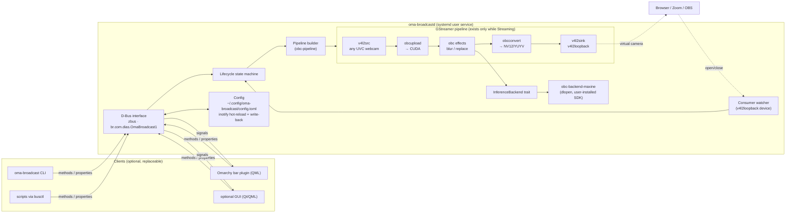
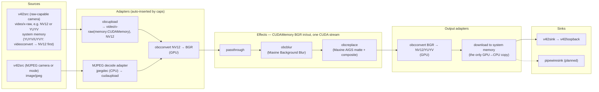
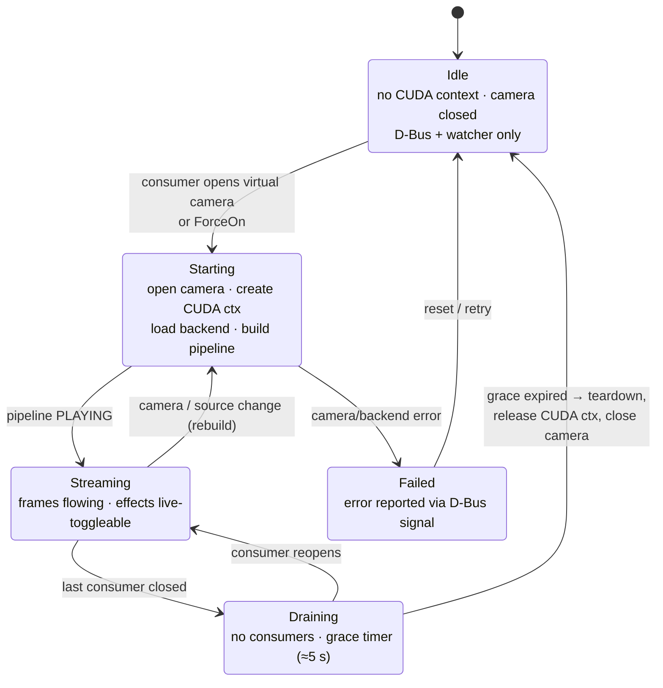

# oma-broadcast: architecture

The rationale behind each design decision is recorded in [adr/](adr/). The planned D-Bus namespace is `br.com.dias` (bus name `br.com.dias.OmaBroadcast`, interface `br.com.dias.OmaBroadcast1`); see [ADR-0005](adr/0005-dbus-zbus-control-plane.md).

The source is any UVC webcam. The pipeline queries the camera's advertised formats and picks a mode from its capabilities (section 2); nothing in the design is specific to one camera model. Where measured figures are quoted, they come from the reference test cameras (a Logitech MX Brio and a laptop-integrated FHD camera).

## 1. Component overview



## 2. Stage and caps model

Every stage declares its input and output caps: format, size, and memory type. GStreamer negotiates them, and the pipeline builder inserts adapters only where adjacent caps differ.

**Capability-driven mode selection.** The source is not hard-coded to a format. The builder enumerates the camera's modes (format, size, frame rate) from V4L2 (`VIDIOC_ENUM_FMT`, `VIDIOC_ENUM_FRAMESIZES`, `VIDIOC_ENUM_FRAMEINTERVALS`), with GStreamer device caps as the fallback. It then selects one mode for the requested `WxH@FPS` (or `FORMAT:WxH@FPS`; the benchmark default is `1920x1080@60`, any format). The rule is strictly size, then frame rate, then format:
- **Size:** the requested size if offered. Otherwise the largest size that fits within both requested dimensions, preferring the same aspect ratio (within 1 %). Only if nothing fits, the smallest size above the request.
- **Frame rate:** the exact rate, otherwise the highest rate not above the request (0.2 % tolerance, so 30 serves 30000/1001). Only if every rate is above the request, the lowest.
- **Format:** the requested format, then NV12 > YUY2 > other raw formats (GPU-direct before CPU-convert) > MJPEG.

For example, a camera offering only MJPEG 1080p30 and YUYV up to 960x540@15, asked for 1080p60, gets MJPEG 1080p30 (a degraded match) with CPU decode.

**Ingest adapters.** The builder inserts one of three adapters in front of the CUDA stages. The guarantee that every link carries `memory:CUDAMemory` starts at `cudaupload`.

| Path | Camera format | Chain |
|---|---|---|
| GPU-direct | NV12, and any raw format `cudaconvert` accepts | `v4l2src` → `cudaupload` → CUDA |
| CPU convert | YUYV, UYVY | `v4l2src` → `videoconvert` → NV12 → `cudaupload` |
| CPU decode | MJPEG | `v4l2src` → `jpegdec` → `cudaupload` |

`cudaconvert`, `cudaconvertscale` and `cudascale` accept no YUY2/UYVY input, hence the CPU convert step. The colour label (colorimetry) is preserved on the convert path; decoded MJPEG is full-range BT.601 (`1:4:0:0`), and `cudaconvert` rescales it to limited-range BT.601 (`2:4:5:1`) before the loopback, because many consumer apps ignore the range flag and would otherwise crush blacks and clip whites. After the adapter, every source looks the same to the rest of the pipeline. Effects only ever see `video/x-raw(memory:CUDAMemory), format=BGR`. They do not know which source fed them or which sink they feed. Measured cost per path is in [benchmarks/ingest-paths.md](benchmarks/ingest-paths.md); the rationale is in [ADR-0008](adr/0008-cpu-ingest-adapters.md).

**UVC controls.** `exposure_auto_priority` (`exposure_dynamic_framerate`) is probed and used only if the camera exposes it. `--camera-fixed-framerate` pins it to 0 for the run and restores it on exit, including Ctrl-C and SIGTERM. No per-camera quirks are needed.



These are the extension points, and each is a trait or element boundary:
- **New source:** another camera or a screen capture. It is a new source element, and adapters cover format gaps (for example the MJPEG decode adapter).
- **New effect:** a new element that accepts CUDAMemory BGR, backed by any `InferenceBackend`.
- **New backend:** TensorRT, CPU, or another vendor. It is a new `InferenceBackend` impl, and the effect elements are unchanged.
- **New sink:** PipeWire or recording. It is a new sink element after the output adapters.

## 3. On-demand lifecycle

The idle state holds **zero CUDA contexts**, so the dGPU can runtime-suspend.



## 4. D-Bus sequence: bar-plugin toggle

```mermaid
sequenceDiagram
    autonumber
    participant Bar as Omarchy bar plugin
    participant Bus as Session bus
    participant D as oma-broadcastd (zbus)
    participant C as config.toml
    participant P as GStreamer pipeline

    Bar->>Bus: subscribe PropertiesChanged / StateChanged
    Bar->>Bus: call OmaBroadcast1.SetEffect("blur")
    Bus->>D: SetEffect("blur")
    D->>C: write effect = "blur"
    alt pipeline Streaming
        D->>P: set obcblur passthrough=false (no rebuild)
    else Idle
        D-->>D: store only; applied on next Starting
    end
    D-->>Bus: return OK
    D-->>Bus: signal PropertiesChanged(Effect="blur")
    Bus-->>Bar: PropertiesChanged → update icon
    Note over D,C: inotify sees our own write, which is ignored by content hash
```

## Reference camera formats

Measured on the reference test camera (Logitech MX Brio, USB 3, `uvcvideo`): maximum frame rate per format for modes at least 1280 pixels wide.

| Format | 1280x720 | 1600x896 | 1920x1080 | 2560x1440 | 3840x2160 |
|---|---|---|---|---|---|
| NV12 | 60 | — | 60 | 30 | — |
| YUYV | 60 | 60 | 60 | 24 | 15 |
| MJPEG | 60 | 60 | 60 | 30 | 30 |

Raw 4K tops out at 15 fps; 4K at 30 fps is only available as MJPEG, which is what the decode adapter is for.

## Known limitations / future work

- **MJPEG is decoded on the CPU.** GStreamer's `nvjpegdec` (NVDEC) is not used: on the reference machine it rejects the 4:2:2 MJPEG that typical UVC webcams send (`unhandled chroma format 2`). The cost is CPU time that scales with resolution and frame rate (see [benchmarks/ingest-paths.md](benchmarks/ingest-paths.md)). GPU JPEG decode, for example through an element built on the nvJPEG library, is future work. See [ADR-0008](adr/0008-cpu-ingest-adapters.md).
- **YUYV/UYVY are converted on the CPU.** A custom CUDA kernel for these formats is deferred.
