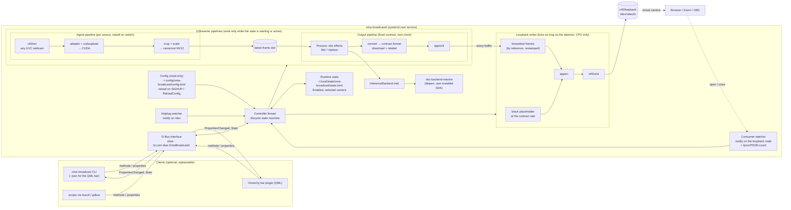
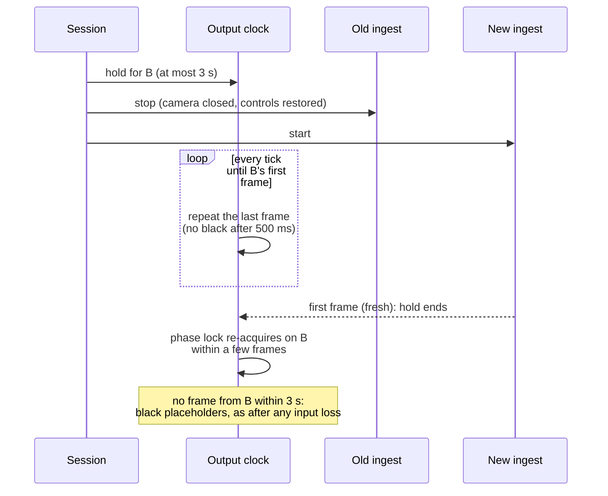
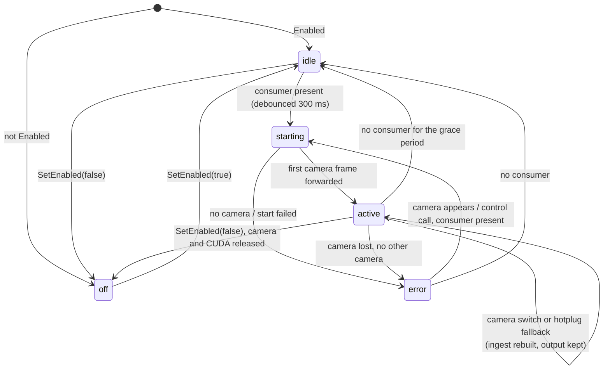

# oma-broadcast: architecture

The rationale behind each design decision is recorded in [adr/](adr/). The D-Bus namespace is `br.com.dias` (bus name `br.com.dias.OmaBroadcast`, interface `br.com.dias.OmaBroadcast1`); see [ADR-0005](adr/0005-dbus-zbus-control-plane.md), the API reference [dbus-api.md](dbus-api.md) and the lifecycle decision [ADR-0011](adr/0011-daemon-lifecycle-and-dbus-api.md). The command-line client and its JSON mode are in [cli-json.md](cli-json.md); installing the service is in [setup/daemon.md](setup/daemon.md).

The source is any UVC webcam. The pipeline queries the camera's advertised formats and picks a mode from its capabilities (section 2); nothing in the design is specific to one camera model. Where measured figures are quoted, they come from the reference test cameras (a Logitech MX Brio and a laptop-integrated FHD camera).

## 1. Component overview



The daemon owns one **loopback writer** for its whole life ([ADR-0011](adr/0011-daemon-lifecycle-and-dbus-api.md)): a CPU-only `appsrc` → `v4l2sink` pipeline with the output contract's caps (colour label included). It opens the device once and never renegotiates. While no camera is streaming it pushes a black frame at the contract rate, whenever no forwarded frame has arrived for two contract periods. While the state is `active`, the CUDA output pipeline ends in an `appsink` (instead of the `v4l2sink` that `obc-bench` still uses to write to the loopback directly) and forwards each buffer to the writer by reference, without a copy. The writer stamps every buffer on its own monotonic timeline, so an application that holds the virtual camera sees one format and one uninterrupted stream (black, camera frames, black) across the states. The writer is needed because with `exclusive_caps=1` the device is listed as a capture device only while a writer streams into it, so an idle daemon must still have one for any application to find, and open, the camera.

### Threads

| Thread | Does |
|---|---|
| D-Bus (a current-thread async runtime) | The zbus connection and object, the publisher of `PropertiesChanged` and `Stats`, and `SIGHUP` / `SIGTERM` / `SIGINT` |
| Controller (`obc-controller`) | The only owner of the configuration, the runtime state, the writer and the session. D-Bus methods, watcher events and timers reach it as commands; it replies to a method only after it has published the resulting snapshot. Time is passed into the state machine explicitly, so it is testable with a fake backend and a fake clock |
| Consumer watcher (`obc-consumers`) | An inotify watch on the loopback node, and the `/proc` count below |
| Hotplug watcher (`obc-hotplug`) | An inotify watch on `/dev` for `video*` nodes appearing or disappearing |
| GStreamer threads | The writer's streaming and placeholder threads for the life of the daemon; the ingest and output pipelines' while a session runs |

**Start-up order.** The daemon serves the object (from the files only, with no device touched), requests the bus name with no queueing and no replacement, and only then lets the controller touch devices; if another instance owns the name it exits with status 3 before any device is used. The controller starts the loopback writer, and the bus name is requested after that first writer attempt, so a `Type=dbus` unit is ready only when the virtual camera is already a capture device.

**Consumer detection.** The watcher gets `IN_OPEN` and `IN_CLOSE_*` events for the loopback node, but treats each only as a hint: it then counts the processes other than the daemon holding the node open, from `/proc/<pid>/fd`. A consumer must be present for 300 ms (the start debounce) before the camera starts, so the short opens that browsers and PipeWire make to enumerate devices do nothing. If the watch cannot be set, it counts every second.

**Hotplug.** Video nodes appearing in or disappearing from `/dev` trigger a rescan of the camera list. If the streaming camera fails or disappears, the session switches to the next camera in order, with the hold of ADR-0010; if none is left, the state is `error`. A camera that appears while another one streams does not take over.

**Configuration and state.** `config.toml` holds what the user decides and is never written by the daemon; it is re-read on `SIGHUP` or `ReloadConfig()`, and an invalid file is rejected as a whole (the previous one stays in force and `Error` says why). Changes made at run time (`Enabled` and the selected camera) go to a separate `state.toml`, written atomically. A state file that cannot be parsed starts the daemon `off` (privacy fails closed). The keys are in [config.example.toml](config.example.toml).

## 2. Stage and caps model

Every stage declares its input and output caps: format, size, and memory type. GStreamer negotiates them, and the pipeline builder inserts adapters only where adjacent caps differ.

**Capability-driven mode selection.** The source is not hard-coded to a format. The builder enumerates the camera's modes (format, size, frame rate) from V4L2 (`VIDIOC_ENUM_FMT`, `VIDIOC_ENUM_FRAMESIZES`, `VIDIOC_ENUM_FRAMEINTERVALS`), with GStreamer device caps as the fallback. It then selects one mode for the requested `WxH@FPS` (or `FORMAT:WxH@FPS`; the benchmark default is `1920x1080@60`, any format). The rule is strictly size, then frame rate, then format:
- **Size:** the requested size if offered. Otherwise the largest size that fits within both requested dimensions, preferring the same aspect ratio (within 1 %). Only if nothing fits, the smallest size above the request.
- **Frame rate:** the exact rate, otherwise the highest rate not above the request (0.2 % tolerance, so 30 serves 30000/1001). Only if every rate is above the request, the lowest.
- **Format:** the requested format, then NV12 > YUY2 > other raw formats (GPU-direct before CPU-convert) > MJPEG.

For example, a camera offering only MJPEG 1080p30 and YUYV up to 960x540@15, asked for 1080p60, gets MJPEG 1080p30 (a degraded match) with CPU decode.

**Ingest adapters.** The builder inserts one of three adapters in front of the CUDA stages. The guarantee that every link carries `memory:CUDAMemory` starts at `cudaupload`.

| Path | Camera format | Chain |
|---|---|---|
| GPU-direct | NV12, and any raw format `cudaconvert` accepts | `v4l2src` → `cudaupload` → CUDA |
| CPU convert | YUYV, UYVY | `v4l2src` → `videoconvert` → NV12 → `cudaupload` |
| CPU decode | MJPEG | `v4l2src` → `jpegdec` → `cudaupload` |

`cudaconvert`, `cudaconvertscale` and `cudascale` accept no YUY2/UYVY input, hence the CPU convert step. The colour label (colorimetry) is preserved on the convert path. Decoded MJPEG is full-range BT.601 (`1:4:0:0`); the canonical caps fix the label of the contract, and `cudaconvertscale` (the crop and scale step of the ingest pipeline) converts to it in the same pass as the scale. For the default limited-range contract that is `2:4:5:1`, which matters because many consumer apps ignore the range flag and would otherwise crush blacks and clip whites. After the ingest pipeline, every source looks the same to the rest of the stream. Measured cost per path is in [benchmarks/ingest-paths.md](benchmarks/ingest-paths.md) and [benchmarks/io-split.md](benchmarks/io-split.md); the rationale is in [ADR-0008](adr/0008-cpu-ingest-adapters.md).

**Ingest, Process, Output.** The stream is split into three stages ([ADR-0009](adr/0009-ingest-process-output.md)):
- **Ingest** (per source) crops and scales every camera to the **canonical frame**: `video/x-raw(memory:CUDAMemory), format=NV12` at the processing size (the output size for now), with the colour label of the contract's range (`2:4:5:1` limited, `1:4:5:1` full). The default aspect policy is a centre crop to fill the frame; letterbox is an option.
- **Process** applies the effect chain to canonical frames. Effects do not know which source fed them or which sink they feed. An effect that needs another format gets converters inserted around it in CUDA memory.
- **Output** (per sink) holds a fixed contract of format (NV12 or I420), size, frame rate and colour range (default NV12 1920x1080@30, limited range) and runs on its own clock: it repeats the latest frame when the source is slower, drops frames when it is faster, and sends a black placeholder after a gap without input (default 500 ms). The clock's timestamps sit on an exact grid of the contract rate, while the instant each tick is emitted is locked to the camera's frames, a small margin after each expected arrival and never later than the timestamp ([ADR-0010](adr/0010-phase-locked-output-clock.md)), so a frame waits in the slot only that margin plus the camera's arrival jitter. The source can be switched while the output keeps running: the output holds the previous camera's last frame until the new camera's first frame (at most 3 s), so a switch shows no black frame ([benchmarks/io-split.md](benchmarks/io-split.md)). The output's `appsrc` queues at most 3 frames, so a slow consumer gets recent frames, not a backlog.
- **v4l2loopback constraints.** In the daemon the persistent loopback writer ([section 1](#1-component-overview)) owns the device and the output ends in an `appsink` whose caps equal the writer's; the constraints below apply to the writer and to `obc-bench`, which writes to the device directly. The device carries no colour description: it reports every stream as BT.601 (`2:4:5:4`) and, while a consumer holds it, refuses any other label. The output therefore relabels frames `2:4:5:4` after download (labels only, no pixel change), and a **full-range contract is refused** for a loopback sink, because consumers would read it as limited. At start the output compares the device's accepted caps with the contract: if the device is held by a consumer in another format, size or rate (its caps are fixed), the error says so (`LoopbackFormatHeld`); a colour label is compared by meaning. Any other mismatch is a generic refusal.

**UVC controls.** `exposure_auto_priority` (`exposure_dynamic_framerate`) is probed and used only if the camera exposes it. `--camera-fixed-framerate` pins it to 0 while a camera streams and restores it when that camera's ingest stops (on a source switch and on exit, including Ctrl-C and SIGTERM, but not SIGKILL). No per-camera quirks are needed.

```mermaid
flowchart LR
    subgraph Ingest["Ingest pipeline — per source, rebuilt on source switch"]
        S1["v4l2src (raw mode)<br/>NV12, or YUYV/UYVY<br/>(YUYV/UYVY: videoconvert → NV12 on the CPU)"]
        S2["v4l2src (MJPEG mode)<br/>jpegdec on the CPU"]
        UP["cudaupload<br/>→ CUDAMemory"]
        CROP["videocrop<br/>(crop region only, no copy;<br/>skipped for letterbox)"]
        SCALE["cudaconvertscale<br/>→ canonical frame:<br/>CUDAMemory NV12, processing size,<br/>contract colour label"]
        AS["appsink<br/>(newest frame only)"]
        S1 --> UP
        S2 --> UP
        UP --> CROP --> SCALE --> AS
    end

    SLOT[("latest-frame slot<br/>buffer reference + sequence")]

    subgraph Output["Output pipeline — fixed contract, lives for the whole stream"]
        CLK["output clock<br/>one tick per contract period,<br/>phase locked to the camera:<br/>fresh / repeat / placeholder;<br/>holds the last frame during a switch"]
        SRC["appsrc<br/>canonical caps, at most 3 queued<br/>(oldest dropped)"]
        subgraph Process["Process — effect chain (empty in this step)"]
            E1["obcblur / obcreplace<br/>(converters around effects<br/>that need another format)"]
        end
        CONV["cudaconvert<br/>(only if the contract format is not NV12)"]
        DL["cudadownload<br/>(the only GPU→CPU copy)"]
        RL["capssetter<br/>relabel 2:4:5:4 (loopback)"]
        K1["appsink in the daemon → loopback writer<br/>(obc-bench: v4l2sink → v4l2loopback directly,<br/>contract caps, sync=false)"]
        CLK --> SRC --> E1 --> CONV --> DL --> RL --> K1
    end

    AS --> SLOT --> CLK
    K2["pipewiresink (planned)"]
    DL -.-> K2
```



A source switch, as the output sees it ([ADR-0010](adr/0010-phase-locked-output-clock.md)):



These are the extension points, and each is a trait or element boundary:
- **New source:** another camera or a screen capture. It is a new source element, and adapters cover format gaps (for example the MJPEG decode adapter).
- **New effect:** a new element in the Process stage that accepts canonical CUDAMemory NV12 (or gets converters around it), backed by any `InferenceBackend`.
- **New backend:** TensorRT, CPU, or another vendor. It is a new `InferenceBackend` impl, and the effect elements are unchanged.
- **New sink:** PipeWire or recording. It is a new output with its own contract, fed after the Process stage.

## 3. Lifecycle

Defined in [ADR-0011](adr/0011-daemon-lifecycle-and-dbus-api.md), which amends [ADR-0006](adr/0006-on-demand-gpu-lifecycle.md). Whenever the state holds no camera (`off`, `idle`, `error`), there is **no CUDA context** and the camera is closed, so the dGPU can runtime-suspend; only the CPU writer runs. Before the first activation the daemon never calls into CUDA.



| State | Camera | CUDA context | What runs | Loopback carries |
|---|---|---|---|---|
| `off` | closed | none | D-Bus, watchers, the writer | placeholder |
| `idle` | closed | none | D-Bus, watchers, the writer | placeholder |
| `starting` | opening | being created | the above, plus the output pipeline and the ingest being built | placeholder |
| `active` | streaming | held | the above, plus ingest and output pipelines, 1 Hz `Stats` | camera frames |
| `error` | closed | none | D-Bus, watchers, the writer (retried every 2 s if the loopback is missing or held) | placeholder |

- **Grace period.** `active` includes the time after the last consumer closes: the stream keeps running for `idle_grace` (default 5 s) with `Consumers` = 0, and a consumer that returns in that time finds it running. This replaces ADR-0006's separate "Draining" state.
- **Source changes** (`SelectCamera`, `NextCamera`, a camera failure) rebuild only the ingest pipeline; the output keeps its contract and clock and holds the last frame meanwhile (section 2). The state stays `active`.
- **`off`** is the privacy state: the camera is closed, so its LED is off. The writer keeps feeding black frames to any application that holds the device.
- **`error`** has a cause in the `Error` property. The daemon leaves it when the cause can have changed (camera set change, a control method, a reload).

## 4. D-Bus sequence: an application opens the virtual camera

The Omarchy bar client follows the daemon with `PropertiesChanged` and `Stats` (through the CLI's `watch --json`, or directly). The sequence below is an application opening the virtual camera, then the user switching the camera off. The details of each member are in [dbus-api.md](dbus-api.md).

```mermaid
sequenceDiagram
    autonumber
    participant App as Application (browser)
    participant K as v4l2loopback node
    participant W as Consumer watcher
    participant C as Controller
    participant D as D-Bus object
    participant Bar as Bar client
    participant P as Ingest + output pipelines
    participant LW as Loopback writer

    Note over LW,K: idle: the writer pushes black frames
    Bar->>D: subscribe PropertiesChanged / Stats
    App->>K: open
    K-->>W: inotify IN_OPEN
    W->>W: count /proc/PID/fd (other than the daemon)
    W->>C: consumers = 1
    C->>D: publish Consumers = 1
    D-->>Bar: PropertiesChanged(Consumers=1)
    Note over C: debounce 300 ms, still present
    C->>D: publish State = starting
    D-->>Bar: PropertiesChanged(State="starting")
    C->>P: open camera, create CUDA context, build pipelines
    P-->>LW: first output buffer (by reference)
    C->>D: publish State = active
    D-->>Bar: PropertiesChanged(State="active")
    loop about once per second while active
        D-->>Bar: Stats(fps, latency_p50_ms, cpu, gpu)
    end
    Bar->>D: SetEnabled(false)
    D->>C: SetEnabled(false)
    C->>P: stop, release camera and CUDA context
    C->>C: write Enabled = false to state.toml
    C->>D: publish State = off, Enabled = false
    D-->>Bar: PropertiesChanged(Enabled=false, State="off")
    D-->>Bar: return
    Note over LW,App: the writer resumes black frames; the application keeps one open stream
    App->>K: close
    K-->>W: inotify IN_CLOSE
```

When the application closes the camera instead of the user disabling it, the controller waits for the grace period with `Consumers` = 0 and then moves `active` → `idle`, releasing the camera and the CUDA context.

## Reference camera formats

Measured on the reference test camera (Logitech MX Brio, USB 3, `uvcvideo`): maximum frame rate per format for modes at least 1280 pixels wide.

| Format | 1280x720 | 1600x896 | 1920x1080 | 2560x1440 | 3840x2160 |
|---|---|---|---|---|---|
| NV12 | 60 | — | 60 | 30 | — |
| YUYV | 60 | 60 | 60 | 24 | 15 |
| MJPEG | 60 | 60 | 60 | 30 | 30 |

Raw 4K tops out at 15 fps; 4K at 30 fps is only available as MJPEG, which is what the decode adapter is for.

## Known limitations / future work

- **MJPEG is decoded on the CPU.** GStreamer's `nvjpegdec` (NVDEC) is not used: on the reference machine it rejects the 4:2:2 MJPEG that typical UVC webcams send (`unhandled chroma format 2`). The cost is CPU time that scales with resolution and frame rate (see [benchmarks/ingest-paths.md](benchmarks/ingest-paths.md)). GPU JPEG decode, for example through an element built on the nvJPEG library, is future work. See [ADR-0008](adr/0008-cpu-ingest-adapters.md).
- **YUYV/UYVY are converted on the CPU.** A custom CUDA kernel for these formats is deferred.
