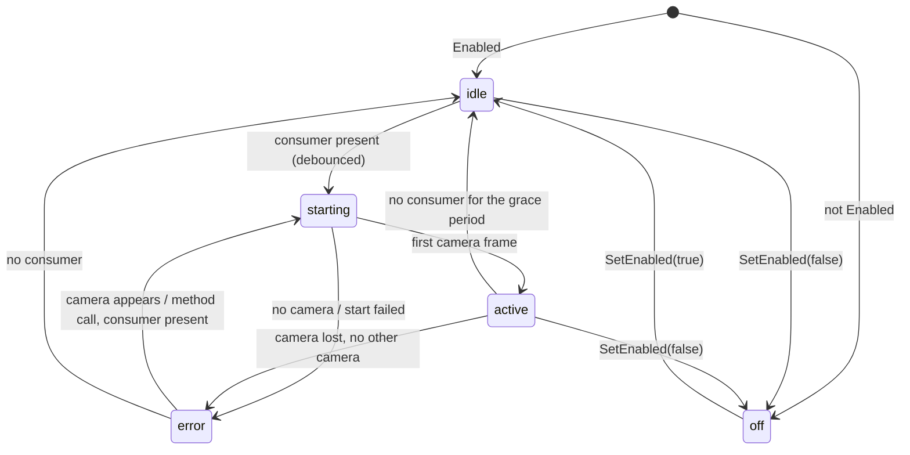

# D-Bus API reference (`br.com.dias.OmarchyBroadcast1`)

`omarchy-broadcastd` is controlled over the D-Bus session bus. This document is the reference for clients: status-bar plugins, scripts and other frontends. The design is recorded in [ADR-0005](adr/0005-dbus-zbus-control-plane.md) and [ADR-0011](adr/0011-daemon-lifecycle-and-dbus-api.md).

Clients that cannot speak D-Bus can use the CLI's JSON output instead (`omarchy-broadcast status --json`, `omarchy-broadcast watch --json`), documented in [cli-json.md](cli-json.md).

Rust clients can use the `obc-ipc` crate, which holds these names, the value types, a typed proxy (`obc_ipc::OmarchyBroadcastProxy`) for method calls and signals, and `obc_ipc::Snapshot::fetch_no_autostart`, the read that never starts the daemon (see [Service presence and activation](#service-presence-and-activation)). For the camera settings it also holds the typed model of the tree and its changes (`obc_ipc::SettingsTree`, `obc_ipc::SettingChange`), with the encoding to and from the dictionaries described in [Camera settings](#camera-settings).

## Names

| What | Value |
|---|---|
| Bus | session bus (`busctl --user`, `gdbus --session`) |
| Well-known name | `br.com.dias.OmarchyBroadcast` |
| Object path | `/br/com/dias/OmarchyBroadcast` |
| Interface | `br.com.dias.OmarchyBroadcast1` |
| Error names | `br.com.dias.OmarchyBroadcast1.Error.<Name>` |

The object also implements the standard `org.freedesktop.DBus.Properties`, `org.freedesktop.DBus.Introspectable` and `org.freedesktop.DBus.Peer` interfaces.

## Versioning

- **Breaking changes** (a removed or renamed member, a changed type or meaning, a new lifecycle state) are never made to `br.com.dias.OmarchyBroadcast1`. They go into a new interface, `br.com.dias.OmarchyBroadcast2`, on the same object.
- **Backwards-compatible additions** (a new property, method, signal or error name) are made to `br.com.dias.OmarchyBroadcast1` and raise the `InterfaceRevision` property. This document describes revision **7**. Revision 1 had no video effects: `Effect` was reserved and always `none`. Revision 2 adds the `BlurStrength` and `BackgroundImage` properties, the `SetEffect`, `SetBlurStrength` and `SetBackgroundImage` methods and the `InvalidArgument` error name, and gives `Effect` its values; it removes and changes nothing else. Revision 3 adds the optional PipeWire output ([ADR-0016](adr/0016-pipewire-output.md)): the properties `LoopbackConsumers`, `PipeWireConsumers` and `PipeWireOutput`. `Consumers` keeps its type and becomes the total of both kinds of consumer; with the PipeWire output off it has the value it had in revision 2. A client that needs only the processes holding the loopback reads `LoopbackConsumers`. Revision 4 adds video noise removal ([ADR-0018](adr/0018-video-noise-removal.md)): the `Denoise` property and the `SetDenoise` method; it changes nothing else. Revision 5 adds the live preview ([ADR-0019](adr/0019-live-preview.md)): the `AcquirePreview` and `ReleasePreview` methods, the `PreviewFrame` signal and the `PreviewConsumers` property. `Consumers` keeps its type and becomes the total of the three kinds of consumer; with no preview lease held it has the value it had in revision 4. A client that needs only the processes holding the loopback reads `LoopbackConsumers`. Revision 6 adds the camera image controls ([ADR-0020](adr/0020-camera-image-controls.md)): the `CameraControls` property and the `GetCameraControls`, `SetCameraControl` and `ResetCameraControls` methods; it changes nothing else. Revision 7 adds the camera settings channel ([ADR-0023](adr/0023-settings-schema.md)): the `SettingsRevision` and `SettingsSchemaSerial` properties, the `GetSettings`, `SetSetting` and `ResetSettings` methods, the `SettingsChanged` signal and the `UnknownSetting`, `Disabled` and `RateLimited` error names. The revision-6 members stay, with their types and meanings, as views of the same model (see [Camera settings](#camera-settings)); nothing is removed or retyped. A revision-6 client keeps working against a revision-7 daemon.
- A client that uses an addition checks `InterfaceRevision` first and treats an older daemon as not offering it. A client must ignore properties, signals and error names it does not know.

## Lifecycle states

The `State` property is one of these lower-case strings. The set is fixed for `br.com.dias.OmarchyBroadcast1`.

| State | Camera | GPU (CUDA context) | Virtual camera delivers |
|---|---|---|---|
| `off` | closed | none | black frames |
| `idle` | closed | none | black frames |
| `starting` | opening | being created | black frames |
| `active` | streaming | held | camera frames |
| `error` | closed | none | black frames, where a loopback device exists |

- **`off`**: the privacy state, set with `SetEnabled(false)`. The camera is closed (its LED is off) and the GPU is released. Applications holding the virtual camera keep receiving a valid black stream. Persists across restarts.
- **`idle`**: enabled, and no application holds the virtual camera. Nothing but a small CPU-only writer runs.
- **`starting`**: an application has held the virtual camera for the start debounce (default 300 ms); the camera and the GPU pipeline are being started. The application sees black frames until the first camera frame.
- **`active`**: camera frames are streaming. This includes the grace period after the last application closes the virtual camera (default 5 s, `Consumers` = 0): an application that reopens it in that time finds the stream running. A camera switch, or a fallback to another camera when the streaming one fails, stays in `active`.
- **`error`**: a lifecycle failure; the `Error` property says which. Causes: no loopback device with the configured label, a loopback device held by another application in another format, no camera, a camera that failed with no other camera to fall back to, or every camera having failed since one last delivered a frame (a start that delivers no frame within 10 s counts as a failed camera; once every available camera has failed the session is stopped, the camera and GPU are released, and the daemon does not cycle between cameras). The daemon leaves `error` by itself when the cause can have changed: a camera is plugged in or removed, a method is called, or the configuration is reloaded; a missing or held loopback device is retried every 2 s.
- **A damaged state file** (the runtime state file cannot be read or parsed) starts the daemon in `off`, not `idle`: privacy fails closed. `Error` names the file and the reason, and the file is left untouched until `SetEnabled` rewrites it. A configuration reload does not repair it, so `Error` stays set after a valid reload. Until then `SelectCamera` and `NextCamera` take effect but fail with `Failed`, because the selection cannot be saved.



The virtual camera itself never changes format and never stops while the daemon runs: an application holding it sees black frames, then camera frames, then black frames again, in one uninterrupted stream.

## Properties

All properties are read-only. Every change is announced with `org.freedesktop.DBus.Properties.PropertiesChanged` (interface `br.com.dias.OmarchyBroadcast1`), with the new value included, so clients never need to poll. Read the initial values with `GetAll` and then follow `PropertiesChanged`.

| Property | Type | Meaning | Changes when |
|---|---|---|---|
| `State` | `s` | Lifecycle state, one of `off`, `idle`, `starting`, `active`, `error` (see above). | On every state transition. |
| `Error` | `s` | Text of the latest error, from the lifecycle or from a configuration reload; empty if none. A one-line, human-readable message, e.g. `/home/user/.config/omarchy-broadcast/config.toml:4:1: camera.mdoe: unknown field ...`. | Set on an error; cleared by the next successful start, or by a valid reload, but only when its own cause is gone: a missing loopback writer or a damaged state file still stands after a reload, and `Error` then keeps that text. An invalid configuration sets `Error` without entering the `error` state, since the previous configuration stays in force. |
| `Enabled` | `b` | `false` is the privacy state `off`. | On `SetEnabled`. Persists across restarts. |
| `Cameras` | `a(sss)` | The cameras present, in the order the daemon uses them: first those matching the configured preference, then the others in discovery order. Each entry is `(id, name, usb)`: `id` is an opaque, stable identifier to pass to `SelectCamera`; `name` is the human-readable device name: the V4L2 card name, shown once when a driver repeats it on both sides of `: ` (`Laptop Camera: Laptop Camera` is shown as `Laptop Camera`), and made unique when several cameras would share it (the first in id order keeps the plain name, the others get ` (2)`, ` (3)`, ...; a camera still known by its `/dev/videoN` node, before udev creates its `/dev/v4l` links, is ordered last, so a camera already known keeps its name); `usb` is the USB `vid:pid` in lower-case hex (`046d:0944`), or empty for a non-USB camera. | When a camera is plugged in or removed, and on a configuration reload that changes the preference. |
| `ActiveCamera` | `s` | The `id` of the camera that streams, or that would stream if an application opened the virtual camera now; empty if there is none. | On `SelectCamera`, `NextCamera`, a fallback after a camera failure, and hotplug. |
| `OutputMode` | `s` | What the virtual camera delivers: pixel format, size and frame rate, e.g. `NV12 1920x1080@30` (a fractional rate is written `30000/1001`). | On a configuration reload that changes it. A change requested while an application holds the virtual camera is applied, and announced, when the last one closes it. |
| `Effect` | `s` | The video effect in force: `none`, `blur` or `replace`. This is the effective value (a run-time choice, else the configuration's `[effect] mode`), not whether the effect is ready yet or has failed; see [Video effects](#video-effects). | On `SetEffect`, and on a configuration reload that changes the effective value. |
| `BlurStrength` | `d` | Strength of the `blur` effect, 0.0 to 1.0. The effective value, shown whatever the effect. | On `SetBlurStrength`, and on a reload that changes the effective value. |
| `BackgroundImage` | `s` | Absolute path of the image for `replace`; empty if there is none. The effective value (a run-time choice, else the configuration's `[effect] background_image`). | On `SetBackgroundImage`, and on a reload that changes the effective value. |
| `Consumers` | `u` | Number of consumers of the virtual camera: `LoopbackConsumers` plus `PipeWireConsumers` plus `PreviewConsumers`. Before revision 3, with the PipeWire output off and with no preview lease held, only the processes holding the loopback. | When an application opens or closes the loopback, links to or leaves the PipeWire node, or takes or ends a preview lease. |
| `LoopbackConsumers` | `u` | Number of processes, other than the daemon, holding the loopback device open (the former meaning of `Consumers`). Revision 3. | When an application opens or closes the loopback. |
| `PipeWireConsumers` | `u` | Number of links to the PipeWire output's node; `0` when the output is off. A link in the error state is not counted. Revision 3. | When an application links to or leaves the node. |
| `PipeWireOutput` | `s` | State of the optional PipeWire output: `off` (not configured), `unsupported` (configured, but the daemon was built without the feature), `connecting`, `ready` (the node is registered, no stream), `streaming` (a consumer is linked and frames flow) or `failed` (no PipeWire daemon, a lost connection or a stream error; retried every 2 s). A failure never changes `State` and never sets `Error`. Revision 3. | On every transition of the output. |
| `PreviewConsumers` | `u` | Number of preview leases held (see [Live preview](#live-preview)); `0` when none. Revision 5. | When a lease is taken or ends. |
| `Denoise` | `b` | Whether video noise removal is on. It stacks with the effect: it runs before `blur` or `replace`, or alone with `none`. The effective value (a run-time choice, else the configuration's `[effect] denoise`), not whether the stage is ready or has failed; see [Video effects](#video-effects). Revision 4. | On `SetDenoise`, and on a reload that changes the effective value. |
| `CameraControls` | `(sa(siiiiib))` | The image controls of `ActiveCamera`, as `GetCameraControls` reports them (see [Camera image controls](#camera-image-controls)): the camera's id, then one `(name, min, max, step, default, value, stored)` per control the camera exposes. The id is empty, with no control, when there is no camera. Revision 6. | When `ActiveCamera` changes, on a rescan of the cameras, when the camera opens, once at its first frame, and after `SetCameraControl` and `ResetCameraControls`, and, while the camera is open, when the camera reports a control change (see [Camera settings](#camera-settings)). Not polled. From revision 7 it is a view of the settings model, with the five image controls only. |
| `SettingsRevision` | `u` | Counter of the camera settings tree of `ActiveCamera` (see [Camera settings](#camera-settings)): it starts at 1 when the daemon starts and goes up by one at every change of the published tree, a value or a structure. `0` is never published. A client that sees a gap between the revision it holds and the one of a signal has missed a change and reads the tree again. Revision 7. | At every change of the settings tree, with the new value included. Emitted before the `SettingsChanged` signal of the same step. |
| `SettingsSchemaSerial` | `u` | Counter of the *structure* of the settings tree: it starts at 1 and goes up only when the structure changes, that is when the camera changes (`ActiveCamera` changed, a camera appeared or left) or a setting appears, goes, or changes its type, range, step, default, unit, options, conditions, hint or label. A change of a value, of `stored`, `enabled` or a reason leaves it. A client keeps the structure it read while the serial stays. Revision 7. | At every structural change of the settings tree. |
| `InterfaceRevision` | `u` | Revision of `br.com.dias.OmarchyBroadcast1` the daemon implements (see Versioning). This document describes `7`. | Never while the daemon runs. |

## Methods

Every method returns nothing on success, except `AcquirePreview`, which returns the path of the preview frame file, `GetCameraControls`, which returns the camera's controls, and `GetSettings`, which returns the settings tree. On failure they return a D-Bus error named under `br.com.dias.OmarchyBroadcast1.Error`, whose message is a human-readable explanation. Calls with the wrong argument types fail with the standard `org.freedesktop.DBus.Error.InvalidArgs`.

| Error name | Meaning |
|---|---|
| `br.com.dias.OmarchyBroadcast1.Error.NoSuchCamera` | The selector, or the camera id of a camera controls method or the `camera` option of a settings method, matches no camera that is present. The message ends with `(cameras present: …)`, listing them. |
| `br.com.dias.OmarchyBroadcast1.Error.InvalidConfig` | The configuration file cannot be read or is invalid; the message names the file, the line and key, and the reason. The previous configuration stays in force. |
| `br.com.dias.OmarchyBroadcast1.Error.Unavailable` | The request cannot be served now, for example `NextCamera` with no camera present, or a camera controls or settings method for `ActiveCamera` (camera `""`) when there is none (`GetSettings` is the exception, it replies with no groups), or an action fired while the camera is not open. |
| `br.com.dias.OmarchyBroadcast1.Error.InvalidArgument` | An argument is well-formed but not acceptable: an unknown effect, a strength outside 0 to 1, a background image that is not usable, a preview frame rate other than 15 or 30, a camera control that is not offered or a value it does not accept; from revision 7 also a settings value of the wrong type, outside the range or off the step, an enum value that is not an option, an action fired with anything but `true`, a `camera` option that is not a string, a reset scope that is not one, and a reset of an action. The message says which and why. Added in revision 2. |
| `br.com.dias.OmarchyBroadcast1.Error.UnknownSetting` | The setting id (or, for a reset, the group) is not in the tree of the camera the call is for. Revision 7. |
| `br.com.dias.OmarchyBroadcast1.Error.Disabled` | The setting exists but is not enabled now; the message is its `disabled_reason`. Revision 7. |
| `br.com.dias.OmarchyBroadcast1.Error.RateLimited` | `SetSetting` or `SetCameraControl` came over the daemon's cap on device writes (see [Coalescing and the rate limit](#coalescing-and-the-rate-limit)); nothing was stored. Revision 7. |
| `br.com.dias.OmarchyBroadcast1.Error.Failed` | Any other failure. |

### `SetEnabled(b enabled)`

Enables (`true`) or disables (`false`) the camera. Disabling enters `off` from any state: the camera is closed and the GPU released at once, while black frames keep flowing to applications that hold the virtual camera. If it arrives while the state is `starting`, the start is abandoned after the output pipeline is built, without opening the camera, and `State` may pass through `starting`, `idle` and `off` in that order. Enabling enters `idle`, and `starting` straight away if an application holds the virtual camera. The value persists across restarts. Setting the current value again is not an error.

Errors: `Failed`.

### `SelectCamera(s selector)`

Selects the camera to stream from. `selector` is one of:

- an `id` from the `Cameras` property;
- a case-insensitive substring of the camera name, e.g. `Brio` (matched against the shown name and against the raw card name);
- a USB `vid:pid`, four hex digits each side, e.g. `046d:0944`;
- a device path, e.g. `/dev/video4`.

If the stream is running, it switches to the selected camera; the virtual camera holds the last frame during the switch. The selection persists across restarts and takes precedence over the configured preference while that camera is present. The selection is stored by camera `id`, not by name; a configured name preference such as `Desk Cam (2)` refers to whichever camera carries that name at the moment. If a camera's `id` changes at the same `/dev/videoN` node (for example when its udev links appear), the selection follows it only when it is the same device: the old id was the node-path fallback and neither the USB `vid:pid` nor the serial number shows a different device, or the USB `vid:pid` and serial number agree, or, without a serial number, the USB port agrees; otherwise the node is treated as a different camera.

Errors: `NoSuchCamera`, `Failed`.

### `NextCamera()`

Selects the camera after `ActiveCamera` in the `Cameras` order, wrapping around after the last. Same effect and persistence as `SelectCamera`. With a single camera it is selected again, which is not an error.

Errors: `Unavailable` (no camera present), `Failed`.

### `ReloadConfig()`

Re-reads the configuration file (`$XDG_CONFIG_HOME/omarchy-broadcast/config.toml`). Equivalent to sending `SIGHUP` to the daemon. An invalid file is rejected as a whole: the previous configuration stays in force, `Error` is set and the call fails with `InvalidConfig`. A valid file clears `Error` unless a cause outside the configuration still holds (see `Error` above). A missing file means the defaults. The configuration keys are described in [config.example.toml](config.example.toml).

Errors: `InvalidConfig`, `Failed`.

### `SetEffect(s effect)`

Selects the video effect: `none` (the camera image as it is), `blur` (blur the background behind the person) or `replace` (replace the background with the background image). It takes effect on a running stream at once, with no restart of the session and no change to what the virtual camera negotiates; see [Video effects](#video-effects) for what the application sees while an effect starts. Selecting the effect already in force does nothing. The choice persists across restarts and takes precedence over the configuration.

Any effect method also retries an effect that failed (see below), and leaves the `error` state when an effect failure put the daemon there.

Errors: `InvalidArgument` (an effect other than `none`, `blur`, `replace`; or `replace` while no background image is set), `Failed`.

### `SetBlurStrength(d strength)`

Sets the strength of the `blur` effect, from 0.0 (lightest) to 1.0 (strongest). It applies from the next frame, without reloading the effect, also while `blur` is not selected. Persists across restarts and takes precedence over the configuration.

Errors: `InvalidArgument` (outside 0 to 1, or not a finite number), `Failed`.

### `SetDenoise(b enabled)`

Turns video noise removal on or off (revision 4). It applies to the running stream without a restart of the session, and it combines with any effect: the noise is removed first, then the effect runs on the cleaned frame. Persists across restarts and takes precedence over the configuration. Calling it with the value already in the state file writes nothing. Like the effect setters, it retries a noise-removal or effect failure that stands, and clears a standing fault or effect-failure `Error`.

Errors: `Failed`. It never returns `InvalidArgument`, and a missing SDK is not an error of the call: noise removal fails open (see [Video effects](#video-effects)).

### `SetBackgroundImage(s path)`

Sets the image used by `replace`. `path` must be an absolute path to a readable regular file of at most 32 MiB. The daemon reads the file itself, as the user it runs as, when the effect starts; the file must be a PNG or JPEG image of at most 8192x8192 pixels (only its first image is used). A file that passes the checks of the call but cannot be decoded is an effect failure (see below), not an error of the call. If `replace` is in force the new image is applied at once. Persists across restarts and takes precedence over the configuration.

An empty `path` removes the run-time image: the configuration's `[effect] background_image` applies again. It is refused with `InvalidArgument` only while `replace` is in force and the configuration has no image either; select another effect first.

Errors: `InvalidArgument` (not an absolute path, unreadable, not a regular file, larger than 32 MiB; the message names the path and the reason), `Failed`.

### `AcquirePreview(u fps)` -> `s path`

Takes the live preview lease of the caller, at `fps` frames per second, and returns the absolute path of the frame file (revision 5; see [Live preview](#live-preview)). `fps` is 15 or 30. The lease belongs to the caller's unique bus name, so a second call from the same connection renews its lease at the new rate instead of taking another. The call works in every state, `off` and `error` included. The lease is a consumer: while it is held, the camera starts and stays running like it does for an application that holds the virtual camera.

Errors: `InvalidArgument` (`fps` is not 15 or 30), `Failed` (the call has no sender, as over a peer-to-peer connection without a bus; `XDG_RUNTIME_DIR` is not set or not absolute; the preview directory cannot be made safe, see below; the path is not valid UTF-8).

### `ReleasePreview()`

Ends the caller's preview lease (revision 5). It does nothing, and is not an error, when the caller holds none.

Errors: `Failed` (the call has no sender).

### `GetCameraControls(s camera)` -> `a(siiiiib)`

Returns the image controls `camera` exposes (revision 6; see [Camera image controls](#camera-image-controls)), each as `(name, min, max, step, default, value, stored)`, in the order brightness, contrast, saturation, sharpness, backlight_compensation. `camera` is an id of `Cameras`, or `""` for `ActiveCamera`. The daemon reads the device when it is called, and it does so in any state: a read starts no stream and counts as no use of the camera. An empty array means the camera has none of the controls (or its controls cannot be read).

Errors: `Unavailable` (`camera` is empty and there is no camera), `NoSuchCamera` (no camera present has that id), `Failed` (the camera's node cannot be opened).

### `SetCameraControl(s camera, s name, i value)`

Sets the image control `name` of `camera` to `value` and stores it for that camera (revision 6). `camera` is as for `GetCameraControls`. The value is written to the device at once while the daemon has the camera open (state `starting` or `active`, the camera being the one in use); otherwise it is only stored, and written the next time the camera opens. The stored value persists across restarts and is written again each time the camera opens. Setting the value already stored writes nothing to the state file.

Errors: `Unavailable`, `NoSuchCamera` (as above), `InvalidArgument` (`name` is not one of the five names, or the camera does not expose it; `value` is outside the range the device reports or not a whole number of steps from its minimum), `Failed` (the device refused the write, the node cannot be opened, or the state file cannot be written). When the device refuses a write, nothing is stored.

### `ResetCameraControls(s camera)`

Forgets the values stored for `camera` and puts the five image controls back to the camera's default (revision 6). While the daemon has the camera open the defaults are written at once. Otherwise a reset is left pending, and the defaults are written when the camera next opens. Both persist across restarts. If the device refuses a default, the call fails with `Failed` naming the controls; the stored values are forgotten all the same. From revision 7 it resets only the five image controls of the camera, as before; the settings the revision-6 members do not show (exposure, white balance and the rest) are left alone, and `ResetSettings` with the scope `camera` resets them all.

Errors: `Unavailable`, `NoSuchCamera` (as above), `Failed`.

### `GetSettings(a{sv} options)` -> `(u revision, u serial, s camera, aa{sv} groups)`

Returns the settings tree of a camera (revision 7; see [Camera settings](#camera-settings)). The reply has four out arguments: the `revision` and the `serial` the tree was read at (the values of `SettingsRevision` and `SettingsSchemaSerial`), the `camera` id the tree is of, and the `groups`.

`options` is a dictionary, and understands one key: `camera` (`s`), an id of `Cameras`; absent or `""` means `ActiveCamera`. Other keys are ignored, so a later daemon can add options. A `camera` that is not a string is `InvalidArgument`. The tree is built from the device in any state: a read starts no stream and counts as no use of the camera. For the active camera it is the published tree; for another camera it is read from the device when the call is made, and carries the current `revision` and `serial` of the daemon.

With no camera present the call is not an error: it replies `(revision, serial, "", [])`, so that a client can show "no camera". The active camera whose controls cannot be read has an empty tree (logged once by the daemon).

Errors: `NoSuchCamera` (`camera` is not an id of `Cameras`), `InvalidArgument` (a `camera` that is not a string), `Failed` (the camera's node cannot be opened).

### `SetSetting(s id, v value, a{sv} options)`

Sets the setting `id` of a camera and stores the value for that camera (revision 7). `options` is as for `GetSettings`, and its `camera` also guards against a stale target: a client that rendered the tree of one camera passes that camera's id, and a switch of the active camera in the meantime makes the call fail with `NoSuchCamera` or `UnknownSetting` instead of writing to another camera. The value is written to the device at once while the daemon has the camera open (state `starting` or `active`, the camera being the one in use); otherwise it is only stored, and written when the camera next opens.

The type of `value` follows the setting's `type`:

| `type` | `value` | Accepted |
|---|---|---|
| `bool` | `b` | `true` or `false` |
| `int` | any D-Bus integer type (`y n q i u x t`) | A number from `min` to `max`, on the step counted from `min`. A `t` above the largest `x` is refused |
| `enum` | `s` | An option's value id, one of the `options` of the setting |
| `action` | `b` | `true`. The action runs once and stores nothing |

The checks run in this order, and the first that fails ends the call:

1. the camera: `Unavailable` (no camera), `NoSuchCamera`;
2. the setting: `UnknownSetting` (no such id in that camera's tree);
3. `Disabled` (the setting is not `enabled` now; the message is its `disabled_reason`, for example `Set exposure to manual to change this`);
4. `InvalidArgument` (the wrong D-Bus type, a number outside the range or off the step, an enum value that is not an option, an action fired with anything but `true`);
5. an action while the camera is not open: `Unavailable` (an action acts on the device and is never stored);
6. while the camera is open, the coalescing window and then `RateLimited` (see [Coalescing and the rate limit](#coalescing-and-the-rate-limit)).

A write to a setting that is not enabled is refused, never stored for later: `enabled` is the daemon's view of what the camera allows now, and a stored value for a control the camera ignores would only surprise the user later. A refused call stores nothing. A device that refuses the write fails the call with `Failed` and nothing is stored. If the state file cannot take the change (it is damaged, or its last save failed) the call fails with `Failed` saying why; the change is in force on the device and in the tree, but would not survive a restart.

The reply comes after the write, and after the tree has been published, so a client that reads the tree afterwards sees the new value. A call held by the coalescing window is answered when its write has been made.

### `ResetSettings(s scope, a{sv} options)`

Forgets the values stored in `scope` and puts those settings back to the camera's defaults (revision 7). `options` is as for `GetSettings`. `scope` is one of:

| `scope` | Resets |
|---|---|
| `camera` | Every setting of the camera |
| `group:<group id>` | The settings of one group (`image`, `white_balance`, `exposure`, `focus`, `other`) |
| `setting:<setting id>` | One setting |

Any other string is `InvalidArgument`. A group or setting that is not in the camera's tree is `UnknownSetting`. `setting:` naming an action is `InvalidArgument`, because an action has no value to reset; actions inside a `camera` or `group:` scope are skipped. A reset writes the defaults while the camera is open, dependent settings first, so that a setting is put back while its master still enables it; a setting the device flags inactive at that moment is not written, because its value has no effect then, and that is not a failure. While the camera is not open the reset is left pending, as for `ResetCameraControls`: the stored values in scope are forgotten, and the defaults are written at the next open, before any value stored since. The whole camera is remembered as a flag, a narrower scope as the list of the settings it names, both in the state file (see [Storage](#storage)). The call fails with `Failed` naming the settings the device refused; the stored values are forgotten all the same. A reset drops the writes that the coalescing window still holds for the settings in scope (their callers are answered `Ok`).

Errors: `Unavailable`, `NoSuchCamera`, `UnknownSetting`, `InvalidArgument`, `Failed`.

## Camera image controls

Revision 6 lets a client adjust the image controls of each camera and put them back to the camera's defaults. The design is recorded in [ADR-0020](adr/0020-camera-image-controls.md); the CLI's `controls` command wraps this API (see [cli-json.md](cli-json.md#camera-image-controls)). It exists because some cameras keep controls set by other software far from their defaults (an oversharpened or oversaturated picture) and a user wants them back, or wants them different, and kept so.

- **Which controls.** The daemon offers `brightness`, `contrast`, `saturation`, `sharpness` and `backlight_compensation` (the names `v4l2-ctl` uses, V4L2 controls of the same names), for every camera alike; none is special-cased. A camera exposes the ones it has, and only when the device does not mark them disabled, read-only or inactive and they are integers or booleans. Range, step and default come from the device (`VIDIOC_QUERYCTRL`), and a value is checked against the range and the step before it is written. A control that cannot be queried or read is left out of the list, not the whole list. These members stay the five image controls. Exposure, focus, white balance and the other controls are offered by the settings channel of revision 7 ([Camera settings](#camera-settings)), which models the automatic modes that make a manual control inactive; the revision-6 members are views of the same model and share its storage, so a value set through either shows in both.
- **Per camera.** The values belong to the camera `id` (the one `SelectCamera` takes and `Cameras` reports), whether or not that camera is the active one. They are kept in the daemon's state file, `$XDG_STATE_HOME/omarchy-broadcast/state.toml`, only for what the user set, as one table per camera:

  ```toml
  [camera_controls."usb-046d_0944-video-index0"]
  values = { saturation = 128, sharpness = 128 }
  reset_names = ["contrast"]
  ```

  `reset_names` is present only while a reset of some controls waits for the camera to open (a closed `ResetCameraControls` lists the five image controls); `reset_all = true` stands for a reset of every control of the camera (a closed `ResetSettings` with the scope `camera`). A revision-6 daemon (0.21) wrote `reset_pending = true` for its pending reset, which meant the five image controls: it is read as those five names in `reset_names` and is not written back. An id is written as a TOML quoted string, with its special characters escaped. A bad entry (a control name that is not a lower-case letter followed by up to 31 of `a-z`, `0-9` and `_`, a value that is not a 32-bit integer, a wrong type) is dropped with a warning in the journal and never makes the state file invalid. The keys are the controls' names, and the values are raw device values (see [Storage](#storage)).
- **When the device is written.** Only while the daemon has the camera open: from the moment its stream switched to that camera, which is the state `starting` or `active`. A closed camera is left untouched. When a camera opens, the daemon first writes the defaults if a reset is pending, then each stored value, checked against the device's current range; a value the device does not take is skipped and logged, and kept. A write that fails is logged and never fails the session. The same happens when the open camera gets a new id that has stored values (the id of a camera can change while it is open, as udev adds its links).
- **Reading.** `GetCameraControls` and the property read the device in any state, with the kind of access to the node discovery already makes. `value` is the device's value while the camera is open; otherwise the stored value, else the default when a reset is pending, else the device's value. `stored` says the user has set the control.
- **Closing.** The values the user set stay on the device. The daemon does not put back what it found, because that would bring back whatever other software left. The exposure setting the daemon pins while streaming and restores when it stops (`[camera] fixed_framerate`, [ADR-0009](adr/0009-ingest-process-output.md)) is separate and unchanged, and not among these controls.
- **No polling.** `CameraControls` is the view of `ActiveCamera` and is refreshed on the events listed for it in the property table. While the camera is open, the daemon also follows the changes other software makes (see [Control events](#control-events)); while it is closed, a value changed on the device by other software is seen at the next refresh.

## Camera settings

Revision 7 lets a client show and change every standard control a camera offers, from one generic description of them, instead of a fixed list. The design and the alternatives that were rejected are recorded in [ADR-0023](adr/0023-settings-schema.md); it extends [ADR-0020](adr/0020-camera-image-controls.md), whose five image controls are now one part of it. The CLI's `settings` command wraps this API (see [cli-json.md](cli-json.md#camera-settings)).

The daemon publishes a **tree**: groups, each with settings. Every setting carries what a client needs to draw it (label, type, range or options, unit, a widget hint), its current value, and whether it can be changed now and, if not, why. The client holds no list of controls and no rules: the daemon computes `enabled`, in words a person can read. One call, `GetSettings`, returns the tree, and one signal, `SettingsChanged`, carries the changes. All of it is typed D-Bus data (dictionaries of variants), so that `busctl` can print it and a later daemon can add keys without breaking a client.

### The tree

A group dictionary (`a{sv}`):

| Key | Type | Meaning |
|---|---|---|
| `id` | `s` | `image`, `white_balance`, `exposure`, `focus` or `other` |
| `label` | `s` | `Image`, `White balance`, `Exposure`, `Focus & zoom`, `Other` |
| `settings` | `aa{sv}` | The group's settings, in the order of the table below |

The groups come in that order, and a group with no setting is not published. A camera that exposes no control has no group.

A setting dictionary (`a{sv}`). The first block of keys is always present:

| Key | Type | Meaning |
|---|---|---|
| `id` | `s` | The stable id, `camera.<group id>.<name>` (see below) |
| `label` | `s` | The name to show |
| `type` | `s` | `bool`, `int`, `enum` or `action` |
| `scope` | `s` | Where the value is kept: `camera` in this version (kept per camera id) |
| `stored` | `b` | The user has a stored value for it on this camera (it is written whenever the camera opens). Not the same as "different from the default": a camera can be away from its default with nothing stored |
| `enabled` | `b` | It can be changed now. Computed by the daemon; a client trusts it and evaluates nothing itself |
| `disabled_reason` | `s` | Why not, when `enabled` is `false`; `""` when it is `true` |
| `enabled_when` | `a(ssv)` | The rule the daemon applies, for display: `(setting id, op, value)` conditions, all of which must hold. `op` is `eq`, `ne` or `in`, a closed set; `value` is a `b`, `x` or `s`, or for `in` an `av` of them. `[]` when the setting has no rule. A client that does not understand a condition still has `enabled` |
| `hint` | `s` | Optional. A widget suggestion: `slider` for `int`, `switch` for `bool`, `segmented` for `enum`. Absent for an `action` |

Then, by `type`:

| `type` | Keys | Meaning |
|---|---|---|
| `int` | `min` `x`, `max` `x`, `step` `x`, `default` `x`, `value` `x`, optional `unit` `s` | A whole number from `min` to `max` in steps of `step` counted from `min`. `unit` is shown after the value (`K`, `×100 µs`) |
| `bool` | `default` `b`, `value` `b` | A switch |
| `enum` | `options` `a(ss)`, `default` `s`, `value` `s` | One of the `options`, each `(value id, label)`. `default` and `value` are value ids |
| `action` | none | Has no value. `SetSetting(id, true)` runs it |

A client ignores keys it does not know, skips a setting whose `type` it does not know (never the whole tree), and shows nothing for a setting with a missing common key.

**Ids.** `camera.<group id>.<name>`, matching `^[a-z0-9]+(\.[a-z0-9_]+){1,3}$` and at most 48 bytes. The name is the control's stable name as `v4l2-ctl` prints it (the kernel's name in lower case, every run of other characters one `_`), except for the inverted switch below. An id is stable across versions; the label is not.

**Which controls.** Every control of the user and camera classes that is an integer, a boolean, a menu, an integer menu or a button, for every camera alike. The ones the daemon knows get a group, a label, a unit, stable option ids and, where the camera makes one control depend on another, a rule:

| Group | Settings (`type`) |
|---|---|
| `image` | `brightness`, `contrast`, `saturation`, `hue` (needs `hue_automatic` off), `hue_automatic` (`bool`), `gamma`, `sharpness`, `backlight_compensation` |
| `white_balance` | `white_balance_automatic` (`bool`), `white_balance_temperature` (`K`), `red_balance`, `blue_balance` (the last three need `white_balance_automatic` off), `do_white_balance` (`action`, "Balance once") |
| `exposure` | `auto_exposure` (`enum`: `auto`, `manual`, `shutter_priority`, `aperture_priority`), `exposure_time_absolute` (`×100 µs`, needs `auto_exposure` `manual` or `shutter_priority`), `gain`, `keep_framerate` ("Keep 30 fps in low light", `bool`, see below), `power_line_frequency` ("Anti-flicker", `enum`: `disabled` "Off", `50hz`, `60hz`, `auto`) |
| `focus` | `focus_automatic_continuous` (`bool`), `focus_absolute` (needs `focus_automatic_continuous` off), `zoom_absolute`, `pan_absolute`, `tilt_absolute`, `pan_reset` and `tilt_reset` (`action`), `field_of_view` (`enum`, on cameras that have it, see below) |
| `other` | Any other control of those classes and types, as `camera.other.<name>` labelled with the device's name; a menu becomes an `enum` with the option ids `m<index>` and the device's item names, an integer menu the same with the integers as labels |

The enum options of a camera are exactly the items its driver reports: a camera whose `auto_exposure` has only `manual` and `aperture_priority` shows two options, and `aperture_priority` is labelled `Auto` when the device has no item 0. At most 16 options, 64 settings per camera and 4 conditions per setting are published; the rest are cut and logged once. A control whose value cannot be read, whose name is not a storable name (see [Storage](#storage)) or that duplicates a known name is left out, logged once.

**Never in the tree:** `privacy` and every `*_relative`, `*_continuous` (except `focus_automatic_continuous`) and `*_speed` motion control, and every control of another class than user and camera. The camera's LED is reachable by no setting.

**Untrusted text.** Labels and option names taken from the device (for the `other` group and unknown menu items) have control characters, bidirectional marks and zero-width characters removed, whitespace collapsed, and are cut to 48 bytes (option labels to 32), on a character boundary. They can still be hostile text, and a client shows them as plain text.

### Enabled and reasons

A setting is not `enabled` when:

- the device flags it disabled or read-only: `The camera does not allow changing this`; it stays in the tree, greyed;
- the device flags it grabbed (the camera streams and will not take the change): `The camera does not allow changing this while it streams`;
- it has a rule and the rule does not hold over its master's value: the rule's reason (`Turn off automatic white balance to change this`, `Set exposure to manual to change this`, `Turn off continuous autofocus to change this`, `Turn off automatic hue to change this`). The rule is checked against the value the camera has, or, while the camera is closed, the value it will have at the next open (the stored one). While the camera is open the device's own *inactive* flag is also required to be clear. A rule whose master the camera does not have is dropped, so the setting is enabled;
- it has no rule and the device flags it inactive: `The camera does not allow changing this now`;
- it is the field of view and the camera reports a value this version does not know: `The camera reports a field of view this version does not know`.

A control that the device marks inactive is therefore *kept in the tree and greyed*, where revision 6 left it out of its list. A client that draws the tree shows it disabled with its reason; changing it is refused with `Disabled`.

### The inverted switch

`camera.exposure.keep_framerate` is the control `exposure_dynamic_framerate` (V4L2 "exposure, auto priority") seen from the user's side. Its raw value 1 lets the camera lower the frame rate in low light, which most users do not want, so the setting is inverted: `value` is `true` when the camera keeps its frame rate (raw 0), and the default is the opposite of the device's raw default. The stored value is the raw value under the control's name, `exposure_dynamic_framerate`, so the state file is the same whichever way a client shows it.

When `[camera] fixed_framerate` is on, the daemon pins this control to 0 while a camera streams and restores it afterwards ([ADR-0009](adr/0009-ingest-process-output.md)). The user's choice wins: a camera that has a stored value for it is not pinned, and its stored value is written at the open like every other. Without a stored value the configuration behaves as before. Known limitation: a change of the setting while the camera is open *and pinned* is written, stored and logged, but the pin's guard restores the value it found when that session closes; the stored choice applies again at the next open.

### Field of view

On cameras that have it (the Logitech Brio and MX Brio, USB `046d:0944` and `046d:085e`), `camera.focus.field_of_view` is an `enum` with the options `90` ("90°"), `78` ("78°") and `65` ("65°"). It is not a standard V4L2 control: the camera keeps it in a vendor Extension Unit, which the daemon reaches by the unit's GUID and a selector from a table of such settings keyed by the USB vendor and product ids (see [architecture.md](architecture.md#camera-settings)). The setting is offered only when the device agrees that it can be read and written. It is written only while the camera is open; the daemon reads the capture format before and after the write, and if it changed, writes the previous value back and fails the call with `Failed` (`changing the field of view changed the camera's format`). Writing it while streaming leaves the format and the virtual camera's stream unchanged on the reference camera. The stored value is the raw byte under the name `field_of_view`.

### Storage

The values are kept in the state file by camera id, in the table of revision 6 (see [Camera image controls](#camera-image-controls)): `values` holds raw device values by control name, for any control name (`field_of_view` the raw byte, `exposure_dynamic_framerate` the raw value), `reset_all` and `reset_names` hold a pending reset. A value equal to the default is kept if the user set it. Only what the user set is stored.

Saving is **write-behind**: a settings change is written to the file once 300 ms have passed without another one, and at once at shutdown, before a switch of camera and together with any other state change. A slider that streams values does not rewrite the file for each one. A crash loses at most the last 300 ms of changes; the device keeps its values anyway. While the state file is known not to take a write (damaged, or its last save failed) a change is saved, or refused, at once, and the call returns `Failed` with the reason, as in revision 6; a delayed save that fails is logged and shown in `Error` when nothing else is.

### When the device is written

As in revision 6 ([ADR-0020](adr/0020-camera-image-controls.md)): only while the session has the camera open, and a closed camera is never written. At every open (every successful switch of the ingest to a camera, and a rename of the open camera to an id with stored values) the daemon opens the node once and:

1. writes the defaults of a pending reset, dependent settings first;
2. writes each stored value, the settings without a rule (the *masters*) first, and then, with the camera read again if the masters can have changed what depends on them, the rest, each checked against the device's current range. A stored value the device does not take now, or whose control is inactive (it would have no effect), is skipped and kept; a failing write is logged. None of it fails the session.

A set on the open camera is validated against the last read, writes the device, and reads back the written control and the settings that depend on it; every control is read again after an action and after a control the device says changes others when the daemon cannot name which. The tree is published once per operation, so a write and the dependency flip it causes are one signal.

### Coalescing and the rate limit

A client that follows a slider sends many `SetSetting` calls in a row. The daemon coalesces them instead of refusing them:

- **At most one device write per setting every 50 ms.** A call that is valid but arrives inside the window of its setting is *held*: its reply is held too. A later call for the same setting replaces it, and the replaced call is answered `Ok` (its value was superseded, not refused). When the window opens the held value is written, validated again, and its call answered with the real outcome. So the last value always wins, and a reply can take up to 50 ms.
- A reset whose scope holds the setting drops the held write the same way: answered `Ok` and never written. A held write follows a rename of the session's camera; if its camera closes or is left meanwhile it is only stored; at shutdown every held call is carried out and answered.
- **At most 100 device writes a second** over all `SetSetting` and `SetCameraControl` calls. A call over the cap fails with `RateLimited` and nothing is stored. Writes at an open and by resets are not counted. `RateLimited` is transient: the client waits and sends the last value again.

### Control events

While the session has a camera open, the daemon holds one extra read-only file descriptor on it, subscribed to the V4L2 control events (`V4L2_EVENT_CTRL`) of every published control, and waits for them on its own thread. The camera reports a change made by other software, a change the camera makes itself, and the flipped `inactive` flag of a control whose automatic mode was switched. The daemon reads the camera again 50 ms after the first event of a burst and publishes the difference as one `SettingsChanged`; an event that only reports what the last read already shows, such as the echo of the daemon's own write, causes no read. This replaces the polling that revision 6 declined: a value changed behind the daemon's back shows within a short moment, and nothing is polled.

The descriptor is held *only while the camera is open*, and released when it closes or changes: an open descriptor keeps a UVC camera out of autosuspend, and a closed camera is left untouched ([ADR-0006](adr/0006-on-demand-gpu-lifecycle.md)). While the camera is closed, the tree is refreshed at the events listed for `CameraControls` and a change by other software shows at the next one. A camera whose events cannot be subscribed to is logged once and followed at the other refresh points only.

### Revision and serial

- `SettingsRevision` goes up by one at every change of the published tree and `SettingsSchemaSerial` only at a structural one (see the property table). Both start at 1 when the daemon starts.
- A client reads `GetSettings` once, and keeps the tree while the serial stays. A `SettingsChanged` with the next revision and the same serial is applied as a delta. Any other (a serial that moved, or a gap in the revision, which means a signal was missed) is followed by a new `GetSettings`.
- Subscribe to the signal before reading the tree, and skip a signal whose revision the tree already includes.
- The `serial` also moves when the active camera changes, so a change of camera is a new tree, never a delta.
- Because the tree is for `ActiveCamera`, `SettingsChanged` is about it; the tree of another camera is read with `GetSettings` and its `camera` option.

### Versioning of the settings schema

The shape of the dictionaries above is the **settings schema**, version 1. It is not the `InterfaceRevision` and not the CLI's line version `v` ([cli-json.md](cli-json.md#settings-schema-version)). Adding a key, a setting `type` or a `hint` keeps it at 1: clients ignore keys and skip setting types they do not know. A change of meaning an old client would misread (a new `enabled_when` operator that reads as always true, a unit that changes) raises it, and a client that meets a higher schema than it knows does not show the settings and says it needs an update. A D-Bus client has no schema key on the wire; the schema is the one this document describes for revision 7. The CLI's JSON carries it as the field `schema`.

## Live preview

Revision 5 lets a client show what the virtual camera carries, as small JPEG frames in a file. The design is recorded in [ADR-0019](adr/0019-live-preview.md); the CLI's `preview` command wraps this API (see [cli-json.md](cli-json.md#preview)).

- **Lease.** A client takes a lease with `AcquirePreview(fps)` and holds it for as long as it wants frames. A lease ends on `ReleasePreview`, when its holder leaves the bus (`NameOwnerChanged` with no new owner), and when the daemon exits. A caller that left the bus before its lease was recorded ends up with none. Each lease counts in `PreviewConsumers` and in `Consumers`, so a lease alone starts the camera (after the start debounce) and keeps it running (until the idle grace has passed after the last consumer of any kind), and the GPU is parked at `idle` as before.
- **Frames.** While a lease is held and the loopback writer runs, the daemon writes a frame to the file `AcquirePreview` returned, `$XDG_RUNTIME_DIR/omarchy-broadcast/preview.jpg`, and then emits `PreviewFrame(seq)`. The frame is a JPEG, 480 pixels wide with the aspect of the virtual camera (480x270 for 16:9), of the same frames the applications get: black placeholders at `off` and `idle`, black while an effect loads, and the processed camera image when `active`. It is written to `preview.jpg.tmp` and renamed over `preview.jpg`, so a reader never sees a partial file. The frames are written at the highest rate among the leases held, taken from the timestamps of the loopback writer's frames (never above the contract's rate).
- **Directory.** `$XDG_RUNTIME_DIR/omarchy-broadcast` is created with mode 0700. If it already exists it must be a real directory (not a symbolic link) owned by the daemon's user, and its mode is set to 0700; otherwise `AcquirePreview` fails with `Failed`. The frame files are created with mode 0600 and never through a link: anything that is not a regular file with one link in their way (a symbolic link, a hard link, a FIFO) is removed and the file is created anew. Both files are removed when the last lease ends, when the loopback writer stops, at shutdown and when the daemon starts (a crashed daemon may have left them).
- **Reading.** A client opens the file when `PreviewFrame` arrives. A frame that replaces the file while the client reads it does not affect the client's copy of the earlier one: the rename replaces the name, not the content.

Limitations:

- A `PreviewFrame` can arrive after the reply of `ReleasePreview`: the signal was emitted before the lease ended.
- A client that does not wait for the reply of a call before it sends the next may have `AcquirePreview` and `ReleasePreview` handled out of order. Wait for the replies.
- Every client that leaves the bus wakes the daemon's controller once, whether or not it held a lease.

## Video effects

The effect settings (`Effect`, `BlurStrength`, `BackgroundImage`, `Denoise`) come from the `[effect]` section of the configuration, and the four setters override them. An override is written to the runtime state file (`state.toml` in `$XDG_STATE_HOME/omarchy-broadcast/`, with `Enabled` and the selected camera) before the call returns and survives restarts; the configuration is not modified. A value in the state file takes precedence over the configuration, and a reload does not discard it. A state file with an unreadable effect value is a damaged state file (see the `off` rules above); the effect choices saved in it are dropped in favour of the configuration when `SetEnabled` rewrites the file. A setter called with the value already in force changes and writes nothing.

**Privacy while an effect starts.** The raw camera image is never shown while an effect is requested. Going from `none` to `blur` or `replace`, the virtual camera delivers black frames until the effect is ready: a fraction of a second normally, up to a few seconds on the first load after boot or after the files left the cache. Going from one effect to another, the previous effect keeps running until the new one is ready, so every frame is processed. Going to `none` shows the camera image at once. The stream keeps its format and frame rate throughout; applications see no renegotiation.

**When an effect fails.** The effect can fail to start or while running: the Maxine SDK is missing or cannot be loaded, the background image cannot be decoded, a frame fails. The daemon reports the reason in `Error` (for example `effect blur unavailable: NvVFX_Load(GreenScreen) returned -1209 ...`) and acts according to `[effect] on_failure` in the configuration:

- `"black"` (the default): `State` becomes `error`, the camera is closed and the GPU released, and the virtual camera keeps delivering black frames. The raw camera image is not shown, because the user asked to hide the background. If the failure is found before the stream starts (the SDK is missing, `replace` has no usable image) the camera is not opened at all. The daemon leaves `error` like any other: a control method (`SetEffect` and the other setters retry), a configuration reload, a change of the set of cameras, or when the last application closes the virtual camera (then `idle`, and the next one tries again).
- `"none"`: the stream continues without the effect, so applications see the unprocessed camera image, `State` stays `active`, and `Error` carries the reason, ending `; the camera image is shown without the effect (effect.on_failure = "none")`. `Error` is cleared when the effect becomes ready after a retry, by an effect method, by a reload, or when the session ends.

If a setter finds the failure while it applies the value to a running stream, it also returns `Failed` with the same text.

**Noise removal.** `Denoise` is a stage, not a fourth effect: `Effect` stays `none`, `blur` or `replace`, and `Denoise` adds noise removal to any of them. Switching it on or off under a running `blur` or `replace` is a switch on the loaded instance, like going from `blur` to `replace`: the stream waits for the switch (including the model load when it is turned on), the last processed frame stays on screen and no raw frame is shown. From `none`, the camera image is shown until the stage is ready, because noise removal hides nothing.

**When noise removal fails.** Noise removal fails open, unlike the effects: it hides nothing, so its failure is not a privacy failure. If the stage cannot load or run (the SDK or the feature library is missing, the frame size is outside 80x80 to 1920x1080, a run error), the stream continues without it: with `none`, the camera image; with `blur` or `replace`, the effect without noise removal. `[effect] on_failure` does not apply to it, `State` does not become `error`, and `Error` reads `noise removal unavailable: <reason>; the camera image is shown without it`. A frame whose noise-removal run fails under `blur` or `replace` is processed again without the stage, so no raw frame appears. If the whole chain fails (the green screen, for example), that is the effect's failure and follows `on_failure` as above. The noise-removal failure is cleared when the stage is ready again, by an effect method (`SetDenoise` included), by a configuration reload, or when the session ends. A failure reported while the effect is still loading or ready is confirmed one poll later before it is shown, so that an effect failure read a moment apart is not blamed on noise removal. There is no check before the stream starts: a `none` session with noise removal starts even without the SDK, and the failure arrives while streaming.

When several causes apply, `Error` shows the first of: a missing writer, a fault, an effect failure, a noise-removal failure, a damaged state file.

## Signals

### `Stats(d fps, d latency_p50_ms, d cpu_percent, d gpu_percent)`

Emitted about once per second while `State` is `active`, and never in other states. A value that cannot be measured is `-1`; a client should show it as unknown, not as zero.

The signal has four arguments (signature `dddd`), not one structure (`(dddd)`). The `obc_ipc::Stats` type groups them for convenience; it is not the signal's wire form.

| Argument | Meaning |
|---|---|
| `fps` | Frames delivered to the virtual camera (the v4l2loopback device) per second over the last interval: camera frames, repeated frames and black placeholder frames alike, as counted by the daemon's loopback writer. It shows whether the device is fed at the output rate, not the camera's own frame rate. |
| `latency_p50_ms` | Median latency over the last interval, in milliseconds, of the frames that were new in an output tick: from the camera buffer leaving the source element to its tick being handed to the output pipeline's `appsrc`. It does not include the effect stage, colour conversion, download, the virtual-camera writer or the application. It follows the phase between the camera's frames and the output ticks, so with a camera that runs below its nominal rate (a dark room can hold a 60 fps camera at 15 fps) the value drifts in a sawtooth between about 0 and one output period; see [testing.md](testing.md). |
| `cpu_percent` | CPU time used by the daemon over the last interval, in percent of one core (can exceed 100). |
| `gpu_percent` | Utilisation of the GPU the pipeline runs on over the last interval, in percent. |

### `PreviewFrame(u seq)`

Emitted after each replacement of the preview frame file while a preview lease is held (revision 5). `seq` increases strictly within a daemon run, from 1. Like every signal, it goes to all clients that subscribed, lease holders or not; there is one frame file, so they all read the same one.

### `SettingsChanged(u revision, u serial, a(sa{sv}) changes)`

Emitted when the settings tree of `ActiveCamera` changes (revision 7), once per daemon operation: a write and the dependency flip it causes (setting the exposure mode to manual enables the exposure time) are in one signal, as is a control event and a reset. It is emitted after the `PropertiesChanged` of `SettingsRevision` for the same step, so a client that reads the property when the signal arrives sees the same revision.

| Argument | Meaning |
|---|---|
| `revision` | The `SettingsRevision` after the change |
| `serial` | The `SettingsSchemaSerial` after the change |
| `changes` | One `(id, dict)` per setting whose value, `stored`, `enabled` or `disabled_reason` changed |

A change dictionary has always `stored` `b`, `enabled` `b` and `disabled_reason` `s`, and `value` (`b`, `x` or `s`, the type of the setting's `value`) unless the setting is an action, which has none. Nothing else of the setting is in it: the structure is in the tree.

When the structure changed (`serial` is not the one the client holds) the `changes` list is **empty** and the client calls `GetSettings`: the camera changed, or a setting appeared, went, or changed its range, options or label. A delta never carries a structural change.

The property change signal, `org.freedesktop.DBus.Properties.PropertiesChanged(s interface, a{sv} changed, as invalidated)`, is emitted by the same object for every property listed above, with `interface` = `br.com.dias.OmarchyBroadcast1` and the new values in `changed`.

## Service presence and activation

The daemon runs as the systemd user service `omarchy-broadcastd.service`. When the D-Bus activation file `br.com.dias.OmarchyBroadcast.service` is installed, any message addressed to `br.com.dias.OmarchyBroadcast` without the `NO_AUTO_START` header flag starts the daemon if it is not running. That includes property reads: `Properties.Get` and `Properties.GetAll` start the daemon as readily as a method call does. Subscribing to signals (an `AddMatch` rule on the bus) never starts it.

A client that only looks, such as a status-bar plugin, must not start the daemon. It reads with the `NO_AUTO_START` flag set and follows `org.freedesktop.DBus.NameOwnerChanged` for `br.com.dias.OmarchyBroadcast` to learn when the daemon appears or exits. With the flag set, a read while the daemon is not running fails at once with an error from the bus, normally `org.freedesktop.DBus.Error.NameHasNoOwner`; treat `org.freedesktop.DBus.Error.ServiceUnknown` the same way. When the name has no owner, the daemon is not running: show it as unavailable rather than as `off`.

How to read without starting the daemon:

- **`busctl`**: pass `--auto-start=no`:

  ```sh
  busctl --user --auto-start=no get-property br.com.dias.OmarchyBroadcast /br/com/dias/OmarchyBroadcast \
      br.com.dias.OmarchyBroadcast1 State
  ```

- **`gdbus`** has no option to clear auto-start: every `gdbus call` may start the daemon. Ask the bus whether the name has an owner first (there is a small race if the daemon exits in between):

  ```sh
  gdbus call --session --dest org.freedesktop.DBus --object-path /org/freedesktop/DBus \
      --method org.freedesktop.DBus.NameHasOwner br.com.dias.OmarchyBroadcast
  # (true,)
  ```

- **Rust (`obc-ipc`)**: `Snapshot::fetch_no_autostart(&connection)` sends one `GetAll` with the flag and returns `None` when the daemon is not running; `Snapshot::apply_property` applies the values of a `PropertiesChanged` signal, and `obc_ipc::daemon_is_running` asks `NameHasOwner`. Do not read through the property getters of `OmarchyBroadcastProxy`: a proxy that caches properties (the zbus default) fills its cache with a `GetAll` that allows activation as soon as it is built, and the getters fall back to a `Get` that allows it too. Build the proxy with `cache_properties(CacheProperties::No)` and use it for method calls and signals only.
- **Other libraries**: set the `NO_AUTO_START` flag on the message (in GDBus, `G_DBUS_CALL_FLAGS_NO_AUTO_START`; in sd-bus, `sd_bus_message_set_auto_start(m, 0)`), and disable any property cache that a generated proxy fills on construction.

Method calls (`SetEnabled`, `SelectCamera`, `NextCamera`, `ReloadConfig`, `SetEffect`, `SetBlurStrength`, `SetDenoise`, `SetBackgroundImage`, `SetCameraControl`, `ResetCameraControls`) are actions; letting them start the daemon is normally what the user wants. `AcquirePreview` and `ReleasePreview` are different: a preview is a view, and a client that only shows it (the CLI's `preview` command does) sends them with `NO_AUTO_START`, like a read. So is `GetCameraControls`, which only reads (the CLI's `controls` command sends it with `NO_AUTO_START`).

A daemon that holds its name but does not answer leaves a call pending; D-Bus libraries differ in their default time limit (zbus sets none). Give every read a time limit of a few seconds, and treat a call that runs out of time as a failure to read, not as "not running".

## Discovery by PipeWire

Applications that open `/dev/video*` directly see the virtual camera whenever the daemon runs. Applications that list cameras through PipeWire (the camera portal, OBS's PipeWire source, browsers that use PipeWire) see it only if WirePlumber recorded it as a capture device. WirePlumber probes video nodes when it starts, and records a v4l2loopback device into which no writer is streaming at that moment as output-only; it does not probe the device again when a writer starts.

The daemon starts its loopback writer before it takes its bus name, so the virtual camera is a capture device by the time the service is ready. Two ways to have WirePlumber probe it then:

- The optional drop-in `dist/systemd/wireplumber.service.d/omarchy-broadcast.conf`, installed as `~/.config/systemd/user/wireplumber.service.d/omarchy-broadcast.conf`, orders WirePlumber after `omarchy-broadcastd.service` (followed by `systemctl --user daemon-reload`).
- Without it, or after restarting the daemon by hand, `systemctl --user restart wireplumber` once the daemon runs makes WirePlumber probe the device again.

### The native PipeWire node

With the optional PipeWire output ([ADR-0016](adr/0016-pipewire-output.md)) the daemon registers its own PipeWire video source, `omarchy-broadcast` ("Omarchy Broadcast", `media.class` `Video/Source`, `media.role` `Camera`), and PipeWire-based applications can use it directly, with no WirePlumber probe of the loopback. `PipeWireOutput` and `PipeWireConsumers` report it. Which applications use it depends on the application: Firefox through the camera portal, OBS Studio 30.1 and later, GNOME Snapshot and GStreamer's `pipewiresrc` do; Chromium and Chrome only with their PipeWire camera feature enabled; Zoom and Discord use the loopback. Setup is in [setup/daemon.md](setup/daemon.md#the-pipewire-output).

Once WirePlumber has probed the loopback while the writer streams, PipeWire also lists the loopback as a camera, so an application can show "Omarchy Broadcast" twice. A WirePlumber rule can hide the loopback from PipeWire only; applications that open `/dev/video*` directly are unaffected. The rule is in [setup/daemon.md](setup/daemon.md#hiding-the-duplicate). With it, the ordering drop-in above is not needed for applications that use the native node; it stays useful for those that reach the camera through v4l2 only.

## Examples with `busctl`

Introspect the object:

```sh
busctl --user introspect br.com.dias.OmarchyBroadcast /br/com/dias/OmarchyBroadcast br.com.dias.OmarchyBroadcast1
```

```text
NAME                        TYPE      SIGNATURE RESULT/VALUE                FLAGS
.AcquirePreview             method    u         s                           -
.GetCameraControls          method    s         a(siiiiib)                  -
.NextCamera                 method    -         -                           -
.ReleasePreview             method    -         -                           -
.ReloadConfig               method    -         -                           -
.ResetCameraControls        method    s         -                           -
.SelectCamera               method    s         -                           -
.SetBackgroundImage         method    s         -                           -
.SetBlurStrength            method    d         -                           -
.SetCameraControl           method    ssi       -                           -
.SetDenoise                 method    b         -                           -
.SetEffect                  method    s         -                           -
.SetEnabled                 method    b         -                           -
.ActiveCamera               property  s         "usb-046d_0944-video-index0" emits-change
.BackgroundImage            property  s         ""                          emits-change
.BlurStrength               property  d         0.5                         emits-change
.CameraControls              property  (sa(siiiiib)) "usb-046d_0944-video-index0" 1 "sharpness" 0 255 1 128 128 false emits-change
.Cameras                    property  a(sss)    1 "usb-046d_0944-video-index0" "Logitech MX Brio" "046d:0944" emits-change
.Consumers                  property  u         0                           emits-change
.Denoise                    property  b         false                       emits-change
.Effect                     property  s         "none"                      emits-change
.Enabled                    property  b         true                        emits-change
.Error                      property  s         ""                          emits-change
.InterfaceRevision          property  u         6                           emits-change
.LoopbackConsumers          property  u         0                           emits-change
.OutputMode                 property  s         "NV12 1920x1080@30"         emits-change
.PipeWireConsumers          property  u         0                           emits-change
.PipeWireOutput             property  s         "off"                       emits-change
.PreviewConsumers           property  u         0                           emits-change
.State                      property  s         "idle"                      emits-change
.PreviewFrame               signal    u         -                           -
.Stats                      signal    dddd      -                           -
```

(Values in these examples are illustrative; camera ids are opaque and differ between machines.)

Read properties (`--auto-start=no`: the read does not start the daemon):

```sh
busctl --user --auto-start=no get-property br.com.dias.OmarchyBroadcast /br/com/dias/OmarchyBroadcast \
    br.com.dias.OmarchyBroadcast1 State Enabled Consumers
```

```text
s "idle"
b true
u 0
```

```sh
busctl --user --auto-start=no get-property br.com.dias.OmarchyBroadcast /br/com/dias/OmarchyBroadcast \
    br.com.dias.OmarchyBroadcast1 Cameras
```

```text
a(sss) 2 "usb-046d_0944-video-index0" "Logitech MX Brio" "046d:0944" "pci-0000:00:14.0-usb-0:5:1.0-video-index0" "FHD Camera" "5986:1193"
```

Add `--json=short` for machine-readable output, e.g. `{"type":"s","data":"idle"}`.

Call each method:

```sh
busctl --user call br.com.dias.OmarchyBroadcast /br/com/dias/OmarchyBroadcast \
    br.com.dias.OmarchyBroadcast1 SetEnabled b false
busctl --user call br.com.dias.OmarchyBroadcast /br/com/dias/OmarchyBroadcast \
    br.com.dias.OmarchyBroadcast1 SetEnabled b true
busctl --user call br.com.dias.OmarchyBroadcast /br/com/dias/OmarchyBroadcast \
    br.com.dias.OmarchyBroadcast1 SelectCamera s "046d:0944"
busctl --user call br.com.dias.OmarchyBroadcast /br/com/dias/OmarchyBroadcast \
    br.com.dias.OmarchyBroadcast1 NextCamera
busctl --user call br.com.dias.OmarchyBroadcast /br/com/dias/OmarchyBroadcast \
    br.com.dias.OmarchyBroadcast1 ReloadConfig
busctl --user call br.com.dias.OmarchyBroadcast /br/com/dias/OmarchyBroadcast \
    br.com.dias.OmarchyBroadcast1 SetBlurStrength d 0.7
busctl --user call br.com.dias.OmarchyBroadcast /br/com/dias/OmarchyBroadcast \
    br.com.dias.OmarchyBroadcast1 SetBackgroundImage s /home/user/Pictures/background.png
busctl --user call br.com.dias.OmarchyBroadcast /br/com/dias/OmarchyBroadcast \
    br.com.dias.OmarchyBroadcast1 SetEffect s blur
busctl --user call br.com.dias.OmarchyBroadcast /br/com/dias/OmarchyBroadcast \
    br.com.dias.OmarchyBroadcast1 SetDenoise b true
busctl --user call br.com.dias.OmarchyBroadcast /br/com/dias/OmarchyBroadcast \
    br.com.dias.OmarchyBroadcast1 AcquirePreview u 15
busctl --user call br.com.dias.OmarchyBroadcast /br/com/dias/OmarchyBroadcast \
    br.com.dias.OmarchyBroadcast1 ReleasePreview
```

`AcquirePreview` replies with the frame file's path (`s "/run/user/1000/omarchy-broadcast/preview.jpg"`). `busctl` holds no connection after the call, so its lease ends at once; use the CLI's `preview` command, or a client that stays on the bus, to hold one.

`GetCameraControls` replies with the array of controls; an empty camera argument means `ActiveCamera`. Set one control of the active camera, then put them all back to the default:

```sh
busctl --user --auto-start=no call br.com.dias.OmarchyBroadcast /br/com/dias/OmarchyBroadcast \
    br.com.dias.OmarchyBroadcast1 GetCameraControls s ""
busctl --user call br.com.dias.OmarchyBroadcast /br/com/dias/OmarchyBroadcast \
    br.com.dias.OmarchyBroadcast1 SetCameraControl ssi "" sharpness 128
busctl --user call br.com.dias.OmarchyBroadcast /br/com/dias/OmarchyBroadcast \
    br.com.dias.OmarchyBroadcast1 ResetCameraControls s ""
```

```text
a(siiiiib) 2 "sharpness" 0 255 1 128 255 false "backlight_compensation" 0 1 1 1 0 false
```

`GetSettings` replies with the tree (`camera`, `revision` and `serial` first); `SetSetting` takes the value as a variant and `a{sv}` options, `ResetSettings` a scope and options. Read the tree of the active camera, set a switch, a number and a choice, fire an action, and reset one group:

```sh
busctl --user --auto-start=no call br.com.dias.OmarchyBroadcast /br/com/dias/OmarchyBroadcast \
    br.com.dias.OmarchyBroadcast1 GetSettings a{sv} 0
busctl --user call br.com.dias.OmarchyBroadcast /br/com/dias/OmarchyBroadcast \
    br.com.dias.OmarchyBroadcast1 SetSetting sva{sv} camera.exposure.keep_framerate b true 0
busctl --user call br.com.dias.OmarchyBroadcast /br/com/dias/OmarchyBroadcast \
    br.com.dias.OmarchyBroadcast1 SetSetting sva{sv} camera.image.sharpness i 128 0
busctl --user call br.com.dias.OmarchyBroadcast /br/com/dias/OmarchyBroadcast \
    br.com.dias.OmarchyBroadcast1 SetSetting sva{sv} camera.exposure.auto_exposure s manual 0
busctl --user call br.com.dias.OmarchyBroadcast /br/com/dias/OmarchyBroadcast \
    br.com.dias.OmarchyBroadcast1 SetSetting sva{sv} camera.white_balance.do_white_balance b true 0
busctl --user call br.com.dias.OmarchyBroadcast /br/com/dias/OmarchyBroadcast \
    br.com.dias.OmarchyBroadcast1 ResetSettings sa{sv} group:exposure 0
```

A setting that is not enabled now is refused with its reason, and the message names what to do:

```text
Call failed: Set exposure to manual to change this
```

Watch the changes:

```sh
busctl --user monitor \
    --match "type='signal',path='/br/com/dias/OmarchyBroadcast',interface='br.com.dias.OmarchyBroadcast1',member='SettingsChanged'"
```

An argument that is not acceptable is rejected with `InvalidArgument`:

```sh
busctl --user call br.com.dias.OmarchyBroadcast /br/com/dias/OmarchyBroadcast \
    br.com.dias.OmarchyBroadcast1 SetBlurStrength d 1.5
```

```text
Call failed: blur strength 1.5 is outside 0 to 1
```

A failed call prints the error message and exits with a non-zero status. The `NoSuchCamera` message lists the cameras present, as `name (id)`:

```sh
busctl --user call br.com.dias.OmarchyBroadcast /br/com/dias/OmarchyBroadcast \
    br.com.dias.OmarchyBroadcast1 SelectCamera s "no such camera"
```

```text
Call failed: no camera matches "no such camera" (cameras present: Logitech MX Brio (usb-046d_0944-video-index0), FHD Camera (pci-0000:00:14.0-usb-0:5:1.0-video-index0))
```

Watch property changes:

```sh
busctl --user monitor \
    --match "type='signal',path='/br/com/dias/OmarchyBroadcast',interface='org.freedesktop.DBus.Properties',member='PropertiesChanged'"
```

Each change prints a message whose body is the interface name, a dictionary of the changed properties and their new values, and an empty list of invalidated ones, e.g. `STRING "br.com.dias.OmarchyBroadcast1"; ARRAY "{sv}" { DICT_ENTRY "sv" { STRING "State"; VARIANT "s" { STRING "active"; }; }; ... }; ARRAY "s" { };`.

Watch the `Stats` signal:

```sh
busctl --user monitor \
    --match "type='signal',path='/br/com/dias/OmarchyBroadcast',interface='br.com.dias.OmarchyBroadcast1',member='Stats'"
```

The body of each message is four doubles: `DOUBLE 30; DOUBLE 41.2; DOUBLE 6.5; DOUBLE 18;`.

## Examples with `gdbus`

Introspect:

```sh
gdbus introspect --session --dest br.com.dias.OmarchyBroadcast --object-path /br/com/dias/OmarchyBroadcast
```

Read one property, or all of them (these calls start the daemon if it is not running; see [Service presence and activation](#service-presence-and-activation)):

```sh
gdbus call --session --dest br.com.dias.OmarchyBroadcast --object-path /br/com/dias/OmarchyBroadcast \
    --method org.freedesktop.DBus.Properties.Get br.com.dias.OmarchyBroadcast1 State
# (<'idle'>,)

gdbus call --session --dest br.com.dias.OmarchyBroadcast --object-path /br/com/dias/OmarchyBroadcast \
    --method org.freedesktop.DBus.Properties.GetAll br.com.dias.OmarchyBroadcast1
# ({'State': <'idle'>, 'Error': <''>, 'Enabled': <true>, 'Cameras': <[('usb-046d_0944-video-index0', 'Logitech MX Brio', '046d:0944')]>, ...},)
```

Call each method:

```sh
gdbus call --session --dest br.com.dias.OmarchyBroadcast --object-path /br/com/dias/OmarchyBroadcast \
    --method br.com.dias.OmarchyBroadcast1.SetEnabled false
gdbus call --session --dest br.com.dias.OmarchyBroadcast --object-path /br/com/dias/OmarchyBroadcast \
    --method br.com.dias.OmarchyBroadcast1.SelectCamera "Brio"
gdbus call --session --dest br.com.dias.OmarchyBroadcast --object-path /br/com/dias/OmarchyBroadcast \
    --method br.com.dias.OmarchyBroadcast1.NextCamera
gdbus call --session --dest br.com.dias.OmarchyBroadcast --object-path /br/com/dias/OmarchyBroadcast \
    --method br.com.dias.OmarchyBroadcast1.ReloadConfig
gdbus call --session --dest br.com.dias.OmarchyBroadcast --object-path /br/com/dias/OmarchyBroadcast \
    --method br.com.dias.OmarchyBroadcast1.SetBackgroundImage /home/user/Pictures/background.png
gdbus call --session --dest br.com.dias.OmarchyBroadcast --object-path /br/com/dias/OmarchyBroadcast \
    --method br.com.dias.OmarchyBroadcast1.SetEffect replace
gdbus call --session --dest br.com.dias.OmarchyBroadcast --object-path /br/com/dias/OmarchyBroadcast \
    --method br.com.dias.OmarchyBroadcast1.SetBlurStrength 0.7
gdbus call --session --dest br.com.dias.OmarchyBroadcast --object-path /br/com/dias/OmarchyBroadcast \
    --method br.com.dias.OmarchyBroadcast1.GetCameraControls ""
# ([('sharpness', 0, 255, 1, 128, 255, false), ('backlight_compensation', 0, 1, 1, 1, 0, false)],)
gdbus call --session --dest br.com.dias.OmarchyBroadcast --object-path /br/com/dias/OmarchyBroadcast \
    --method br.com.dias.OmarchyBroadcast1.SetCameraControl "" sharpness 128
gdbus call --session --dest br.com.dias.OmarchyBroadcast --object-path /br/com/dias/OmarchyBroadcast \
    --method br.com.dias.OmarchyBroadcast1.ResetCameraControls ""
gdbus call --session --dest br.com.dias.OmarchyBroadcast --object-path /br/com/dias/OmarchyBroadcast \
    --method br.com.dias.OmarchyBroadcast1.GetSettings "{}"
gdbus call --session --dest br.com.dias.OmarchyBroadcast --object-path /br/com/dias/OmarchyBroadcast \
    --method br.com.dias.OmarchyBroadcast1.SetSetting camera.image.sharpness "<int32 128>" "{}"
gdbus call --session --dest br.com.dias.OmarchyBroadcast --object-path /br/com/dias/OmarchyBroadcast \
    --method br.com.dias.OmarchyBroadcast1.ResetSettings camera "{}"
```

A failure is reported with its D-Bus error name, which a script can match on:

```text
Error: GDBus.Error:br.com.dias.OmarchyBroadcast1.Error.InvalidConfig: /home/user/.config/omarchy-broadcast/config.toml:4:1: camera.mdoe: unknown field `mdoe`, expected one of `preference`, `mode`, `fixed_framerate`
```

Watch every signal of the object, `PropertiesChanged` and `Stats` included:

```sh
gdbus monitor --session --dest br.com.dias.OmarchyBroadcast --object-path /br/com/dias/OmarchyBroadcast
```

```text
/br/com/dias/OmarchyBroadcast: org.freedesktop.DBus.Properties.PropertiesChanged ('br.com.dias.OmarchyBroadcast1', {'Consumers': <uint32 1>}, @as [])
/br/com/dias/OmarchyBroadcast: org.freedesktop.DBus.Properties.PropertiesChanged ('br.com.dias.OmarchyBroadcast1', {'State': <'starting'>}, @as [])
/br/com/dias/OmarchyBroadcast: org.freedesktop.DBus.Properties.PropertiesChanged ('br.com.dias.OmarchyBroadcast1', {'State': <'active'>}, @as [])
/br/com/dias/OmarchyBroadcast: br.com.dias.OmarchyBroadcast1.Stats (30.0, 41.2, 6.5, 18.0)
```

## Writing a client

- Read everything once with `GetAll` on `br.com.dias.OmarchyBroadcast1`, then update from `PropertiesChanged`; subscribe before reading so that no change is missed in between.
- Read with the `NO_AUTO_START` flag, so that looking at the daemon never starts it, and give each read a time limit (see Service presence and activation).
- Treat a missing name owner as "daemon not running" (see Service presence and activation).
- Show `Error` when it is non-empty, whatever the state: a rejected configuration reload sets it while the state stays, for example, `active`.
- Offer the effect controls only if `InterfaceRevision` is 2 or more; against revision 1 the setters do not exist and `Effect` is always `none`.
- Offer noise removal only if `InterfaceRevision` is 4 or more; against an older daemon the `Denoise` property and `SetDenoise` do not exist.
- Read `LoopbackConsumers`, `PipeWireConsumers` and `PipeWireOutput` only if `InterfaceRevision` is 3 or more; against an older daemon `Consumers` counts the loopback alone. To show a split, show it only while `PipeWireOutput` is not `off`.
- Offer the preview only if `InterfaceRevision` is 5 or more; against an older daemon `AcquirePreview`, `PreviewFrame` and `PreviewConsumers` do not exist, and `Consumers` has no leases in it. Subscribe to `PreviewFrame` before calling `AcquirePreview`, wait for each reply before the next call, and read the file when the signal arrives.
- Offer the camera controls only if `InterfaceRevision` is 6 or more; against an older daemon `CameraControls` and the three methods do not exist. Show `CameraControls` for the active camera and tell the user whether a change applies now (state `starting` or `active`) or when the camera next opens. A control's `value` is the device's value only while the camera is open. Do not poll: `CameraControls` is refreshed by the daemon on the events listed for it.
- Offer the camera settings only if `InterfaceRevision` is 7 or more; against an older daemon the two properties, the three methods and the signal do not exist (the revision-6 members remain). Subscribe to `SettingsChanged` before calling `GetSettings`, keep the tree while `SettingsSchemaSerial` stays, apply a delta only when its revision is the next one of the same serial, and read the tree again otherwise (see [Revision and serial](#revision-and-serial)). Draw `enabled` and `disabled_reason` as the daemon gives them, never compute them, and show a setting of a type you do not know as nothing. Send `camera` in the options of a write, so that a switch of camera between drawing and writing fails instead of changing another camera. Match errors by name: `Disabled` (the setting is greyed, with its reason), `RateLimited` (wait, then send the last value), `UnknownSetting`. Send a stream of slider values as they come and rely on the daemon's coalescing, or at most one call in flight per setting.
- Treat `-1` in `Stats` as unknown, and expect no `Stats` outside `active`.
- Match errors by name, not by message text: the messages are for people and may change.
