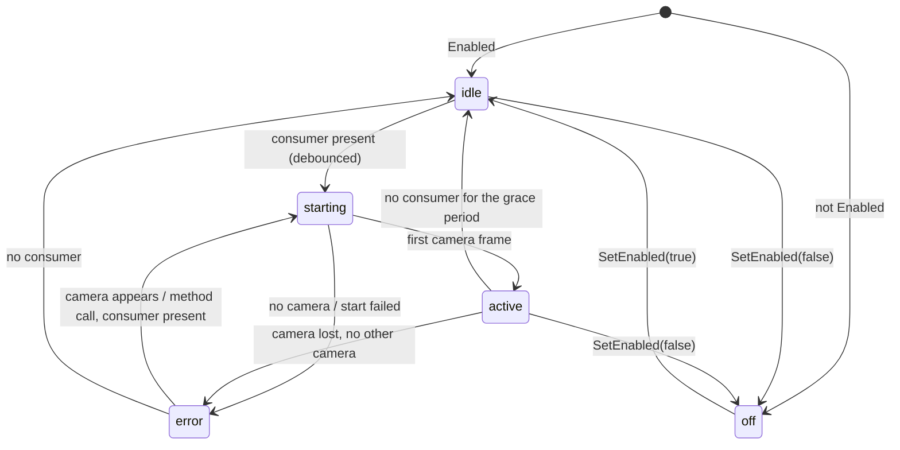

# D-Bus API reference (`br.com.dias.OmarchyBroadcast1`)

`omarchy-broadcastd` is controlled over the D-Bus session bus. This document is the reference for clients: status-bar plugins, scripts and other frontends. The design is recorded in [ADR-0005](adr/0005-dbus-zbus-control-plane.md) and [ADR-0011](adr/0011-daemon-lifecycle-and-dbus-api.md).

Clients that cannot speak D-Bus can use the CLI's JSON output instead (`omarchy-broadcast status --json`, `omarchy-broadcast watch --json`), documented in [cli-json.md](cli-json.md).

Rust clients can use the `obc-ipc` crate, which holds these names, the value types, a typed proxy (`obc_ipc::OmarchyBroadcastProxy`) for method calls and signals, and `obc_ipc::Snapshot::fetch_no_autostart`, the read that never starts the daemon (see [Service presence and activation](#service-presence-and-activation)). For the camera settings it also holds the typed model of the tree and its changes (`obc_ipc::SettingsTree`, `obc_ipc::SettingChange`), with the encoding to and from the dictionaries described in [Camera settings](#camera-settings). From revision 9 it also holds the typed model of the modules (`obc_ipc::ModuleList`, `ModuleInfo`, `StageInfo`), with the encoding to and from the dictionaries of `GetModules`. From revision 10 it also holds the typed model of the configuration (`obc_ipc::ConfigSchema`, `ConfigGroup`, `ConfigRow`, `ConfigValue`, `ConfigFiles`), with the encoding to and from the dictionaries of `GetConfigSchema`, the value `SetConfig` takes and the file list of `GetConfigFiles`.

## Names

| What | Value |
|---|---|
| Bus | session bus (`busctl --user`, `gdbus --session`) |
| Well-known name | `br.com.dias.OmarchyBroadcast` |
| Object path | `/br/com/dias/OmarchyBroadcast` |
| Interface | `br.com.dias.OmarchyBroadcast1` |
| Error names | `br.com.dias.OmarchyBroadcast1.Error.<Name>` |

The object also implements the standard `org.freedesktop.DBus.Properties`, `org.freedesktop.DBus.Introspectable` and `org.freedesktop.DBus.Peer` interfaces.

## Versioning

- **Breaking changes** (a removed or renamed member, a changed type or meaning, a new lifecycle state) are never made to `br.com.dias.OmarchyBroadcast1`. They go into a new interface, `br.com.dias.OmarchyBroadcast2`, on the same object.
- **Backwards-compatible additions** (a new property, method, signal or error name) are made to `br.com.dias.OmarchyBroadcast1` and raise the `InterfaceRevision` property. This document describes revision **20**. Revision 1 had no video effects: `Effect` was reserved and always `none`. Revision 2 adds the `BlurStrength` and `BackgroundImage` properties, the `SetEffect`, `SetBlurStrength` and `SetBackgroundImage` methods and the `InvalidArgument` error name, and gives `Effect` its values; it removes and changes nothing else. Revision 3 adds the optional PipeWire output ([ADR-0016](adr/0016-pipewire-output.md)): the properties `LoopbackConsumers`, `PipeWireConsumers` and `PipeWireOutput`. `Consumers` keeps its type and becomes the total of both kinds of consumer; with the PipeWire output off it has the value it had in revision 2. A client that needs only the processes holding the loopback reads `LoopbackConsumers`. Revision 4 adds video noise removal ([ADR-0018](adr/0018-video-noise-removal.md)): the `Denoise` property and the `SetDenoise` method; it changes nothing else. Revision 5 adds the live preview ([ADR-0019](adr/0019-live-preview.md)): the `AcquirePreview` and `ReleasePreview` methods, the `PreviewFrame` signal and the `PreviewConsumers` property. `Consumers` keeps its type and becomes the total of the three kinds of consumer; with no preview lease held it has the value it had in revision 4. A client that needs only the processes holding the loopback reads `LoopbackConsumers`. Revision 6 adds the camera image controls ([ADR-0020](adr/0020-camera-image-controls.md)): the `CameraControls` property and the `GetCameraControls`, `SetCameraControl` and `ResetCameraControls` methods; it changes nothing else. Revision 7 adds the camera settings channel ([ADR-0023](adr/0023-settings-schema.md)): the `SettingsRevision` and `SettingsSchemaSerial` properties, the `GetSettings`, `SetSetting` and `ResetSettings` methods, the `SettingsChanged` signal and the `UnknownSetting`, `Disabled` and `RateLimited` error names. The revision-6 members stay, with their types and meanings, as views of the same model (see [Camera settings](#camera-settings)); nothing is removed or retyped. A revision-6 client keeps working against a revision-7 daemon. Revision 8 adds **global settings** to the settings tree ([ADR-0024](adr/0024-stackable-stages-and-effects-in-the-settings-schema.md)): the video effects, noise removal, the enhancement of a low-resolution camera and relighting, as settings of `scope` `global` with ids `effect.<group>.<name>`, in groups after the camera's and present with no camera (see [Global settings](#global-settings-the-video-effects)). It adds no property, method, signal or error name; the revision-7 members and every effect member keep their types and meanings, and the settings schema stays at 1. A revision-7 client keeps working against a revision-8 daemon. Revision 9 adds **modules** ([ADR-0025](adr/0025-loadable-modules.md)): the effects are provided by loadable modules, and the interface gains the `GetModules`, `SetModuleEnabled`, `GetStageOrder`, `SetStageOrder`, `SetBackendProfile` and `SetStagePin` methods and the `ModulesSerial` and `BackendProfile` properties (see [Modules](#modules)). It adds no signal and no error name. Every revision-8 member, property and signal keeps its type and meaning, and the effect members (`SetEffect`, `SetBlurStrength`, `SetDenoise`, `SetBackgroundImage`, `Effect`, `BlurStrength`, `Denoise`, `BackgroundImage`) are kept as aliases of the `effect.background.*` and `effect.video.denoise` settings. What changes is which global settings the tree holds: they are those of the modules installed, so a daemon with no module has none. A revision-8 client keeps working against a revision-9 daemon, and sees no effect group when no module is installed. Revision 10 adds **configuration** ([ADR-0026](adr/0026-config-d-and-managed-config.md)): the configuration is `config.toml` followed by the files of `config.d/`, and the daemon manages one of them, `config.d/50-panel.toml`. The interface gains the `GetConfigSchema`, `SetConfig`, `ResetConfig`, `GetConfigFiles` and `GetStageOrderMoves` methods, the `ConfigChanged` signal and the `ConfigSerial` property (see [Configuration](#configuration-revision-10)). It adds no error name, and every revision-9 member keeps its type and meaning. Two things change for the four module setters (`SetModuleEnabled`, `SetStageOrder`, `SetBackendProfile`, `SetStagePin`): they persist to `config.d/50-panel.toml`, not to the state file, and they refuse (`Disabled`) to change a choice that a file after `50-panel.toml` sets. A revision-9 client keeps working against a revision-10 daemon; a client that needs the new members checks `InterfaceRevision` first. Revision 11 adds the `Warning` property: a selected stage that no module provides (no module installed or enabled for it, its module disabled, crashed or unavailable, the stage not installed) is dropped and the stream continues without it, and `Warning` says so, for every stage; and an effect that a module provides but that cannot load or run no longer stops the stream: with `[effect] on_failure = "black"` the stream continues with black frames, with `"none"` with the camera image, and `Warning` says why. Before revision 11 both were a failure of the background effect, in `Error` and, with `on_failure = "black"`, the `error` state; a failure under `"none"` was in `Error` (see [Video effects](#video-effects)). It adds no method, signal or error name, and every revision-10 member keeps its type. A client that does not read `Warning` sees `active` and an empty `Error` where it saw `error` before. Revision 12 adds the **capture and output modes** ([ADR-0027](adr/0027-output-modes-frame-generation-and-privacy-fallback.md)) and adds no member of any kind: the camera setting `camera.capture.mode` (the new first group, `capture`), the config row `output.mode` made an editable `enum` whose options the daemon computes, the third `effect.on_failure` option `image` with the row `effect.fallback_image`, and new clauses of `Warning`, which is now at most 512 bytes (see [Capture and output modes](#capture-and-output-modes-revision-12)). Every revision-11 member keeps its type and meaning. A client built for revision 11 that draws the tree and the schema generically shows the new rows with no change; one that treated `output.mode` as a read-only text row must now draw it as an `enum`. A client that needs the new rows checks `InterfaceRevision` first. Revision 13 adds the **microphone** ([ADR-0029](adr/0029-audio-modules-mic-host-and-worker.md)): the properties `MicState`, `MicConsumers`, `MicProvider`, `MicLatencyMs` and `MicError`, the `SetMicHost` method and the `MicStats` signal, the settings of ids `mic.<group>.<name>` (scope `global`) in groups that carry the new group key `surface` (`mic`), the `[mic]` configuration rows, and the `kind` of the audio modules in `GetModules` (see [The microphone](#the-microphone-revision-13)). It adds no error name. Every revision-12 member keeps its type and meaning; the settings schema stays at 1, because a key a client does not know is ignored (`surface`), and a client that does not draw `mic.*` settings shows them with the effects. A client built for revision 12 keeps working against a revision-13 daemon; a client that needs the new members checks `InterfaceRevision` first. Revision 14 enforces the conflicts and requirements that module manifests declare ([ADR-0025](adr/0025-loadable-modules.md); see [Modules](#modules) and [modules.md](modules.md#conflicts-requirements-and-forcing)) and adds no method, signal, property or error name. `GetModules` gains the `forced` key of a module, the configuration schema gains a `modules.forced.<id>` row (`bool`, editable, labelled `Force <module name>`) for each installed video module, and `Warning` gains three clauses: `<stage> unavailable: Cannot run together with <stage>` for a stage that a conflict turns off, `forced: <A> runs together with <B> despite a declared conflict (modules.forced)` while an override lets a conflict through, and `<module> unavailable from the next start: <reason>` for a module that a running session keeps for its background effect after a conflict refused it. A module refused by a conflict or a requirement (`Conflicts with <name> (<id>)`, `Needs the module <id>`) and a stage refused when its provider is chosen (`Needs <stage>`, `Needs a <slot> stage`, `Cannot run together with <label>`) are listed with `available` false and that reason. One behaviour changes: a requested background effect (`blur` or `replace`) that no module can run now follows `[effect] on_failure`, as an effect that a module provides and that fails does (black frames, the fallback image, or the camera image), with `Warning` reading `effect blur unavailable: <module>: <reason>; the video is black until it can run`; in revisions 11 to 13 such an effect was dropped and the stream continued with the camera image whatever `on_failure` said. Every other stage that no module provides is still dropped. Every revision-13 member keeps its type and meaning. A client built for revision 13 keeps working against a revision-14 daemon (it reads a missing `forced` as `false`); a client that needs the new key or rows checks `InterfaceRevision` first. Revision 15 adds the **background gallery** ([ADR-0032](adr/0032-background-gallery.md); see [The background gallery](#the-background-gallery-revision-15)): the property `MediaSerial` and the methods `GetMedia`, `ImportMedia` and `RemoveMedia`, which list the backgrounds (and the away images) that the daemon offers, bundled with the package or imported by the user, copy a file into the user's gallery after checking it, and remove one of the user's items. It adds no signal and no error name. `SetBackgroundImage` and the `[effect]` image keys keep their types and meanings and also accept a still WebP image (an animated one is refused, and WebP needs the GStreamer decoder `webpdec`; see [`SetBackgroundImage`](#setbackgroundimages-path)). Every revision-14 member keeps its type and meaning. A client built for revision 14 keeps working against a revision-15 daemon; a client that needs the gallery checks `InterfaceRevision` first. Revision 16 adds the **stage values** ([ADR-0025](adr/0025-loadable-modules.md); see [Stage values](#stage-values-revision-16)): the read-only property `StageValues`, of type `a(ssd)`, which lists the named numeric values that the running stages report about the last frame (auto-frame's zoom, for one). It adds no method, signal or error name. Every revision-15 member keeps its type and meaning. A client built for revision 15 keeps working against a revision-16 daemon; a client that needs the values checks `InterfaceRevision` first. Revision 17 adds the **away image** ([ADR-0034](adr/0034-away-image.md); see [The away image](#the-away-image-revision-17)) and adds no method, signal, property or error name, as revision 12 added none. The configuration schema gains the row `output.placeholder` (`enum`: `black` or `image`, default `black`, editable, `live`, labelled `When there is no camera picture`), and the row `effect.fallback_image` becomes editable (`path`, `live`) and is labelled `Away image` instead of `Fallback image`. `Warning` gains two clauses, `output.placeholder is "image" but effect.fallback_image is not set: showing black` and `Away image <path> could not be read (<why>): showing black`. Every revision-16 member keeps its type and meaning. A client built for revision 16 keeps working against a revision-17 daemon (it shows the new rows as it shows any row); a client that offers the away image checks `InterfaceRevision` first. Revision 18 adds **video backgrounds** ([ADR-0035](adr/0035-video-backgrounds.md); see [Video backgrounds](#video-backgrounds-revision-18)) and adds no method, signal, property or error name, as revisions 12 and 17 added none. `SetBackgroundImage` and `[effect] background_image` also accept a video file (MP4, M4V, MOV, MKV or WebM holding H.264, HEVC, VP9 or AV1, 8-bit 4:2:0, at most 512 MiB and 3840x2160), which is played in a loop behind the person; `ImportMedia` of a background also accepts such a video (stored as it is) and an animated GIF, WebP or APNG (stored as a VP9 WebM, which needs ffmpeg); `GetMedia` lists videos with `type` `video`, their `width`, `height`, `duration_ms` and `poster`; and `Warning` gains the clauses of a video shown as a still, of a video being prepared for playback on the CPU and of a video that cannot play. Every revision-17 member keeps its type and meaning. A client built for revision 17 keeps working against a revision-18 daemon (it lists a video as an item of a type it does not know); a client that offers videos checks `InterfaceRevision` first. Revision 19 stops the daemon's making **playback copies** of videos for the CPU ([ADR-0035](adr/0035-video-backgrounds.md), amended): a video that does not play on the CPU is shown as its poster, a still, and `Warning` points at the command that converts it. It adds two methods, `GetConvertCommand(s path) -> s` (the shell command that converts a video into a CPU-ready WebM) and `GetMediaDirs(s kind) -> a{sv}` (the user's folders of a kind, the Videos folder among them); adds the keys `cpu_ready` and `convert_command` to the items of `GetMedia`; replaces the `Warning` clauses of a video being prepared, of a missing ffmpeg and of a failed copy by the two clauses of [Video backgrounds](#video-backgrounds-revision-18); and moves the user's gallery from `$XDG_DATA_HOME/omarchy-broadcast/media` to an `omarchy-broadcast` folder in the user's Pictures folder and one in the Videos folder ([The background gallery](#the-background-gallery-revision-15), [ADR-0032](adr/0032-background-gallery.md), amended), moving the files of an earlier gallery once at the daemon's start. `RemoveMedia` accepts media files only. Every revision-18 member keeps its type and meaning, and `GetMedia`'s reply keeps its signature. A client built for revision 18 keeps working against a revision-19 daemon (it ignores the new keys and shows the new clauses as text); a client that offers the command or lists the Videos folder checks `InterfaceRevision` first. Revision 20 adds the **camera's health** ([ADR-0036](adr/0036-camera-quirk-rows-and-camera-health.md); see [Camera health](#camera-health-revision-20)): the read-only property `CameraHealth`, of type `a{sv}`, which says what the daemon knows about the camera named by `ActiveCamera` (the rate it really delivers, the damaged frames it dropped, warnings about its USB port and its damaged frames, effect suggestions, and the recommended settings of its model), and the method `ApplyRecommendedSettings(s camera) -> ()`, which puts the camera's device settings back to their defaults and then sets the recommended values. It adds no signal and no error name. The label of the capture mode in use, in the settings tree, reads `640x480 · 19.5 of 30 fps` while the camera delivers short of that mode's rate ([The capture mode](#the-capture-mode-cameracapturemode)); and a camera that has nothing stored for its power-line frequency is given the frequency of the time zone at each open ([When the device is written](#when-the-device-is-written)). Every revision-19 member keeps its type and meaning, and `Stats` is unchanged. A client built for revision 19 keeps working against a revision-20 daemon (it ignores the property and the method, and shows the longer label as it shows any label); a client that shows the camera's health or offers the recommended settings checks `InterfaceRevision` first.
- A client that uses an addition checks `InterfaceRevision` first and treats an older daemon as not offering it. A client must ignore properties, signals and error names it does not know.

## Lifecycle states

The `State` property is one of these lower-case strings. The set is fixed for `br.com.dias.OmarchyBroadcast1`.

| State | Camera | GPU (CUDA context) | Virtual camera delivers |
|---|---|---|---|
| `off` | closed | none | black frames, or the away image (revision 17, see [The away image](#the-away-image-revision-17)) |
| `idle` | closed | none | black frames, or the away image |
| `starting` | opening | being created | black frames, or the away image, until the first camera frame |
| `active` | streaming | held | camera frames (black while a requested effect cannot run, see [Video effects](#video-effects)) |
| `error` | closed | none | black frames, or the away image, where a loopback device exists |

- **`off`**: the privacy state, set with `SetEnabled(false)`. The camera is closed (its LED is off) and the GPU is released. Applications holding the virtual camera keep receiving a valid black stream or, from revision 17 with `[output] placeholder = "image"` and an away image set, that image. Persists across restarts.
- **`idle`**: enabled, and no application holds the virtual camera. Nothing but a small CPU-only writer runs.
- **`starting`**: an application has held the virtual camera for the start debounce (default 300 ms); the camera and the GPU pipeline are being started. The application sees black frames, or the away image if it is chosen, until the first camera frame.
- **`active`**: camera frames are streaming. This includes the grace period after the last application closes the virtual camera (default 5 s, `Consumers` = 0): an application that reopens it in that time finds the stream running. A camera switch, or a fallback to another camera when the streaming one fails, stays in `active`.
- **`error`**: a lifecycle failure; the `Error` property says which. An effect that cannot load or run is not one from revision 11 (the stream continues, see [Video effects](#video-effects)), and neither is a stage that no module provides. Causes: no loopback device with the configured label, a loopback device held by another application in a format that cannot be streamed instead (one the daemon streams, NV12 or I420, is streamed meanwhile and the configured output waits: see [Capture and output modes](#capture-and-output-modes-revision-12); a format such as YUY2 comes from another producer and has no fallback), no camera, a camera that failed with no other camera to fall back to, or every camera having failed since one last delivered a frame (a start that delivers no frame within 10 s counts as a failed camera; once every available camera has failed the session is stopped, the camera and GPU are released, and the daemon does not cycle between cameras). The daemon leaves `error` by itself when the cause can have changed: a camera is plugged in or removed, a method is called, or the configuration is reloaded; a missing or held loopback device is retried every 2 s. With a loopback device, the virtual camera delivers black frames in `error`, or the away image if it is chosen (revision 17).
- **A damaged state file** (the runtime state file cannot be read or parsed) starts the daemon in `off`, not `idle`: privacy fails closed. `Error` names the file and the reason, and the file is left untouched until `SetEnabled` rewrites it. A configuration reload does not repair it, so `Error` stays set after a valid reload. Until then `SelectCamera` and `NextCamera` take effect but fail with `Failed`, because the selection cannot be saved.



The virtual camera itself never changes format and never stops while the daemon runs: an application holding it sees black frames, then camera frames, then black frames again, in one uninterrupted stream.

## Properties

All properties are read-only. Every change is announced with `org.freedesktop.DBus.Properties.PropertiesChanged` (interface `br.com.dias.OmarchyBroadcast1`), with the new value included, so clients never need to poll. Read the initial values with `GetAll` and then follow `PropertiesChanged`.

| Property | Type | Meaning | Changes when |
|---|---|---|---|
| `State` | `s` | Lifecycle state, one of `off`, `idle`, `starting`, `active`, `error` (see above). | On every state transition. |
| `Error` | `s` | Text of the latest error, from the lifecycle or from a configuration reload; empty if none. A one-line, human-readable message, e.g. `/home/user/.config/omarchy-broadcast/config.toml:4:1: camera.mdoe: unknown field ...`. | Set on an error; cleared by the next successful start, or by a valid reload, but only when its own cause is gone: a missing loopback writer or a damaged state file still stands after a reload, and `Error` then keeps that text. An invalid configuration sets `Error` without entering the `error` state, since the previous configuration stays in force. |
| `Warning` | `s` | What runs other than the user asked, without being an error; empty if nothing. Several causes: a selected stage that no module provides (noise removal, relighting, enhancement where it applies to the camera, a module's own stage), dropped while the stream continues without it, and a stage that a declared conflict turns off (`<stage> unavailable: Cannot run together with <stage>`, revision 14); an effect that no module can run (none installed or enabled, its module disabled, refused by a conflict, unable to load, or the stage not installed; from revision 14) or that a module provides but that cannot load or run, while the stream continues with black frames (`[effect] on_failure = "black"`) or the camera image (`"none"`), or, from revision 12, the fallback image (`"image"`); a capture mode, an output mode or an output rate that cannot be as chosen (see [Capture and output modes](#capture-and-output-modes-revision-12)); a fallback or away image that cannot be read, or `output.placeholder` set to `image` with no away image; and a session that streams without its effects. A stage that a module provides but the running stream cannot run, which the daemon does not restart the camera for (only at a camera start whose modules change twice while it starts), reads `<stage> unavailable: it runs when the camera next starts`. One human-readable line of clauses joined by `; `: the effect failure first, then the clauses of the fallback image and of a session without its effects (the clauses of the away image, in this order: `effect.on_failure is "image" but effect.fallback_image is not set: showing black`, then, from revision 17, `output.placeholder is "image" but effect.fallback_image is not set: showing black`, then `Away image <path> could not be read (<why>): showing black` for the writer's placeholder and then, once and only if the file is not the one just named, for the running session output's placeholder, then the effect element's own clause, in the same words, `Away image <path> could not be read (<why>): showing black`), then (revision 18) the clauses of a video background (`<module> shows the video background as a still`, `Video background <path> could not be played (<why>)`, and in system memory, for a video that is not CPU-ready, `The video background is shown as a still: it can't play without an NVIDIA GPU; run omarchy-broadcast media convert-command '<path>' for the conversion command`, or with no still to show `The video background plays only with an NVIDIA GPU; run omarchy-broadcast media convert-command '<path>' for the conversion command` (revision 19; `<path>` is `<file>` when the path would not fit or not show unchanged); see [Video backgrounds](#video-backgrounds-revision-18)), then the clause of a refused switch (`<module>: <reason>; the previous setting keeps running`, see [Video effects](#video-effects)), then the clause of an engine that was chosen and cannot run, which the module runs another in place of (`<module name>: <Requested> was chosen and cannot run: <reason>; using <engine>`, the module's notice from module ABI 1.5, see [Video effects](#video-effects); no revision changes for it), then one clause per module and reason, listing the stages it holds back, then (revision 14) the clause of a module kept for a running session after a conflict refused it (`<name> unavailable from the next start: <reason>`) and the clauses of a forced conflict that lets two modules or stages run together (`forced: <A> runs together with <B> despite a declared conflict (modules.forced)`, only while the override is in effect), then the clauses of frame generation, of the capture mode and of the output mode, e.g. `effect blur, noise removal unavailable: NVIDIA Maxine video effects: Disabled` or `effect blur unavailable: NVIDIA Maxine video effects: Disabled after crashing the daemon twice in a row; warm tint unavailable: Hello tint: Disabled`. The reasons are those `GetModules` reports, and an effect failure's is cleaned of control and bidirectional characters and at most 400 bytes (the daemon's journal has it whole); the whole line has no control or bidirectional characters, whatever a module calls itself. The line is at most **512 bytes** (revision 12; before it was not bounded in the daemon): a longer one is cut on a character boundary and ends with `…`, so a client that shows it needs room for that and no more. The text is for people and is not to be parsed: a client that needs the details per module and stage reads `GetModules`. It never changes `State`. Revision 11; revision 12 adds the clauses and the bound. | When a stage is dropped or comes back (a module enabled or disabled, a reload, what the modules can run found again, a method or setting that selects or leaves the stage, another camera for enhancement), and when an effect fails or becomes ready. |
| `Enabled` | `b` | `false` is the privacy state `off`. | On `SetEnabled`. Persists across restarts. |
| `Cameras` | `a(sss)` | The cameras present, in the order the daemon uses them: first those matching the configured preference, then the others in discovery order. Each entry is `(id, name, usb)`: `id` is an opaque, stable identifier to pass to `SelectCamera`; `name` is the human-readable device name: the V4L2 card name, shown once when a driver repeats it on both sides of `: ` (`Laptop Camera: Laptop Camera` is shown as `Laptop Camera`), and made unique when several cameras would share it (the first in id order keeps the plain name, the others get ` (2)`, ` (3)`, ...; a camera still known by its `/dev/videoN` node, before udev creates its `/dev/v4l` links, is ordered last, so a camera already known keeps its name); `usb` is the USB `vid:pid` in lower-case hex (`046d:0944`), or empty for a non-USB camera. | When a camera is plugged in or removed, and on a configuration reload that changes the preference. |
| `ActiveCamera` | `s` | The `id` of the camera that streams, or that would stream if an application opened the virtual camera now; empty if there is none. | On `SelectCamera`, `NextCamera`, a fallback after a camera failure, and hotplug. |
| `OutputMode` | `s` | What the virtual camera delivers: pixel format, size and frame rate, e.g. `NV12 1920x1080@30` (a fractional rate is written `30000/1001`). | On a configuration reload that changes it. A change requested while an application holds the virtual camera is applied, and announced, when the last one closes it. |
| `Effect` | `s` | The video effect in force: `none`, `blur` or `replace`. This is the effective value (a run-time choice, else the configuration's `[effect] mode`), not whether the effect is ready yet or has failed; see [Video effects](#video-effects). | On `SetEffect`, and on a configuration reload that changes the effective value. |
| `BlurStrength` | `d` | Strength of the `blur` effect, 0.0 to 1.0. The effective value, shown whatever the effect. | On `SetBlurStrength`, and on a reload that changes the effective value. |
| `BackgroundImage` | `s` | Absolute path of the image for `replace` (from revision 18 it may name a video, see [Video backgrounds](#video-backgrounds-revision-18)); empty if there is none. The effective value (a run-time choice, else the configuration's `[effect] background_image`). | On `SetBackgroundImage`, and on a reload that changes the effective value. |
| `Consumers` | `u` | Number of consumers of the virtual camera: `LoopbackConsumers` plus `PipeWireConsumers` plus `PreviewConsumers`. Before revision 3, with the PipeWire output off and with no preview lease held, only the processes holding the loopback. | When an application opens or closes the loopback, links to or leaves the PipeWire node, or takes or ends a preview lease. |
| `LoopbackConsumers` | `u` | Number of processes, other than the daemon, holding the loopback device open (the former meaning of `Consumers`). Revision 3. | When an application opens or closes the loopback. |
| `PipeWireConsumers` | `u` | Number of links to the PipeWire output's node; `0` when the output is off. A link in the error state is not counted. Revision 3. | When an application links to or leaves the node. |
| `PipeWireOutput` | `s` | State of the optional PipeWire output: `off` (not configured), `unsupported` (configured, but the daemon was built without the feature), `connecting`, `ready` (the node is registered, no stream), `streaming` (a consumer is linked and frames flow) or `failed` (no PipeWire daemon, a lost connection or a stream error; retried every 2 s). A failure never changes `State` and never sets `Error`. Revision 3. | On every transition of the output. |
| `PreviewConsumers` | `u` | Number of preview leases held (see [Live preview](#live-preview)); `0` when none. Revision 5. | When a lease is taken or ends. |
| `Denoise` | `b` | Whether video noise removal is on. It stacks with the effect: it runs before `blur` or `replace`, or alone with `none`. The effective *request* (a run-time choice, else the configuration's `[effect] denoise`), not whether the stage is ready, installed or has failed: while the SDK's noise-removal feature is not installed it stays `true` if it was asked for, and the global setting `effect.video.denoise` shows what runs (off, greyed "Not installed"); see [Video effects](#video-effects). Revision 4. | On `SetDenoise`, and on a reload that changes the effective value. |
| `CameraControls` | `(sa(siiiiib))` | The image controls of `ActiveCamera`, as `GetCameraControls` reports them (see [Camera image controls](#camera-image-controls)): the camera's id, then one `(name, min, max, step, default, value, stored)` per control the camera exposes. The id is empty, with no control, when there is no camera. Revision 6. | When `ActiveCamera` changes, on a rescan of the cameras, when the camera opens, once at its first frame, and after `SetCameraControl` and `ResetCameraControls`, and, while the camera is open, when the camera reports a control change (see [Camera settings](#camera-settings)). Not polled. From revision 7 it is a view of the settings model, with the five image controls only. |
| `SettingsRevision` | `u` | Counter of the settings tree (the camera settings of `ActiveCamera` and, from revision 8, the global ones; see [Camera settings](#camera-settings)): it starts at 1 when the daemon starts and goes up by one at every change of the published tree, a value or a structure. `0` is never published. A client that sees a gap between the revision it holds and the one of a signal has missed a change and reads the tree again. Revision 7. | At every change of the settings tree, with the new value included. Emitted before the `SettingsChanged` signal of the same step. |
| `SettingsSchemaSerial` | `u` | Counter of the *structure* of the settings tree: it starts at 1 and goes up only when the structure changes, that is when the camera changes (`ActiveCamera` changed, a camera appeared or left) or a setting appears, goes, or changes its type, range, step, default, unit, options, conditions, hint or label. A change of a value, of `stored`, `enabled` or a reason leaves it. A client keeps the structure it read while the serial stays. Revision 7. | At every structural change of the settings tree. |
| `ModulesSerial` | `u` | Counter of what `GetModules` and `GetStageOrder` return: it starts at 1 and goes up by one (wrapping past 2^32 - 1 to 1) whenever either result would be different, that is whenever a module's status, reason, `enabled` flag or stages change, a module appears or goes, a stage is provided by another module, or the order changes. See [Modules](#modules). Revision 9. | At a reload that changes the modules, after a session has started and the modules were probed again, and on `SetModuleEnabled`, `SetStageOrder`, `SetBackendProfile` and `SetStagePin` (or the `SetConfig` of the same keys) when they change the result. |
| `BackendProfile` | `s` | Which module provides a stage that several offer: `quality` (the default) or `battery`. The effective value: the configuration's `[modules] profile` (which `SetBackendProfile` writes to `config.d/50-panel.toml` from revision 10; in revision 9 a run-time choice in the state file came first), `quality` when none sets it. Revision 9. | On `SetBackendProfile` when it changes the value, and on a reload that changes the effective value. |
| `ConfigSerial` | `u` | Counter of what `GetConfigSchema` and `GetConfigFiles` return: it starts at 1 and goes up by one (wrapping past 2^32 - 1 to 1) whenever either result would be different, that is on a write through the daemon, on a reload that changes the configuration, where a value comes from or the list of files, on every reload that is refused (the file list then shows the error), when the state file's module choices are moved into the configuration by a reload, and when the modules found change the rows of the `modules` group. See [Configuration](#configuration-revision-10). Revision 10. | At each of those, with the new value included, before the `ConfigChanged` signal of the same step. |
| `MicState` | `s` | The microphone ([The microphone](#the-microphone-revision-13)): `off` (the mic host unit does not run), `passthrough` (it runs and the audio passes unchanged: processing is off, no stage is on or can run, or the worker is not running because nothing records), `starting` (a chain is loading or warming up; the audio is raw until it is ready), `active` (the audio is processed) or `error` (stages are on but none of them could run; `MicError` says why; the audio is raw). The set may grow: show a value you do not know as it is. Revision 13. | On every transition. |
| `MicConsumers` | `u` | The applications recording from the Omarchy Broadcast Mic. A level meter is not counted; `0` while the state is `off`. Revision 13. | When the count changes (debounced). |
| `MicProvider` | `s` | The module running each microphone stage, as text for people, one `<stage>: <module>` clause per stage joined by `, `; `""` when none runs. Revision 13. | When it changes. |
| `MicLatencyMs` | `d` | The delay the microphone processing adds, in milliseconds: the transport delay plus the chain's algorithmic delay. `0` while the state is `off`. Revision 13. | When it changes. |
| `MicError` | `s` | Why microphone stages that are on cannot run (text for people); `""` when none. Revision 13. | When it changes. |
| `MediaSerial` | `u` | Counter of the background gallery (see [The background gallery](#the-background-gallery-revision-15)): it starts at 1 each time the daemon starts, and goes up by one whenever the gallery's content changes through the daemon, that is after an import that stored a new file and after a removal. An import that returned a file already in the gallery leaves it. It is not kept across daemon starts, and a file added to or removed from a gallery directory by other means is not counted: a client compares serials only within one daemon run (a new owner of the bus name is a new run), and reads the gallery again when it differs from the serial of its last `GetMedia`. Revision 15. | After each import that stored a file and each removal, with the new value included. |
| `StageValues` | `a(ssd)` | The named numeric values the running stages report about the last frame, one `(stage, name, value)` per value: `stage` is the stage id and `name` is unique within the stage (see [Stage values](#stage-values-revision-16)). Auto-frame reports `("auto-frame", "zoom", z)`. Empty when the camera is idle (no session runs) and when no stage reports. Revision 16. | When the set of values changes, or a value moves by 0.01 or more, at most every 250 ms. |
| `CameraHealth` | `a{sv}` | What the daemon knows about the camera named by `ActiveCamera`: the rate of good frames it delivers, the damaged frames dropped, warnings, effect suggestions and the recommended settings of its model, as the keys `camera`, `delivered_fps`, `nominal_fps`, `corrupt_frames`, `warnings`, `suggestions`, `has_recommendation` and `recommended` (see [Camera health](#camera-health-revision-20)). With no camera, `camera` is `""` and every other key has its empty value (`-1` for the two rates). Revision 20. | When `ActiveCamera` changes or a warning, a suggestion or the list of recommended changes appears or goes, at once; otherwise (the counters) at most every 2 s. |
| `InterfaceRevision` | `u` | Revision of `br.com.dias.OmarchyBroadcast1` the daemon implements (see Versioning). This document describes `20`. | Never while the daemon runs. |

## Methods

Every method returns nothing on success, except `AcquirePreview`, which returns the path of the preview frame file, `GetCameraControls`, which returns the camera's controls, `GetSettings`, which returns the settings tree; from revision 9 `GetModules` and `GetStageOrder`, which return the modules and the stage order; and from revision 10 `GetStageOrderMoves`, `GetConfigSchema` and `GetConfigFiles`, which return the stage order with its moves, the configuration schema and the configuration files. `SetMicHost` (revision 13) returns nothing. From revision 15 `GetMedia` returns the gallery's items, `ImportMedia` the path of the stored file, and `RemoveMedia` nothing; from revision 19 `GetMediaDirs` returns the gallery's user folders and `GetConvertCommand` the command that converts a video. On failure they return a D-Bus error named under `br.com.dias.OmarchyBroadcast1.Error`, whose message is a human-readable explanation. Calls with the wrong argument types fail with the standard `org.freedesktop.DBus.Error.InvalidArgs`.

| Error name | Meaning |
|---|---|
| `br.com.dias.OmarchyBroadcast1.Error.NoSuchCamera` | The selector, or the camera id of a camera controls method or the `camera` option of a settings method, matches no camera that is present (the `camera` option is ignored for a global setting). The message ends with `(cameras present: …)`, listing them. |
| `br.com.dias.OmarchyBroadcast1.Error.InvalidConfig` | A configuration file cannot be read or is invalid; the message names the file, the line and key, and the reason. The previous configuration stays in force. From revision 10 the files are `config.toml` and those of `config.d/`, and the error is also the answer to a write (`SetConfig`, `ResetConfig`, a module setter) while a file other than the managed one does not load: nothing can be checked, and nothing is written. |
| `br.com.dias.OmarchyBroadcast1.Error.Unavailable` | The request cannot be served now, for example `NextCamera` with no camera present, or a camera controls or settings method for `ActiveCamera` (camera `""`) when there is none (`GetSettings` is the exception, it replies with the global groups alone; a write or reset of a global setting never needs a camera), or an action fired while the camera is not open. |
| `br.com.dias.OmarchyBroadcast1.Error.InvalidArgument` | An argument is well-formed but not acceptable: an unknown effect, a strength outside 0 to 1, a background image that is not usable, a preview frame rate other than 15 or 30, a camera control that is not offered or a value it does not accept; from revision 7 also a settings value of the wrong type, outside the range or off the step, an enum value that is not an option, an action fired with anything but `true`, a `camera` option that is not a string, a reset scope that is not one, and a reset of an action. The message says which and why. Added in revision 2. From revision 9 also a module or stage id that is not installed or not well formed, a profile that is not `quality` or `battery`, and a stage order that is not valid (the message is the reason; see [Modules](#modules)). From revision 10 also a `SetConfig` value of the wrong type for its key, one that is not an option of an enum, one the configuration's checks refuse (out of range, not valid; the message names the key), or a D-Bus type no key takes; from revision 15 also a gallery call that is refused (an unknown kind, a path that is not absolute, a video, a file that cannot be read or is not an accepted image, a format without a decoder, a path that is not an item of the user's gallery, or an item that the configuration names; see [The background gallery](#the-background-gallery-revision-15)); from revision 18 also a video that the video check refuses (its container, codec, size, format, or its file size; the message says which) and an animation that needs ffmpeg or whose conversion failed, as `SetBackgroundImage` and `ImportMedia` give them (see [Video backgrounds](#video-backgrounds-revision-18)). |
| `br.com.dias.OmarchyBroadcast1.Error.UnknownSetting` | The setting id (or, for a reset, the group) is not in the tree of the camera the call is for. Revision 7. From revision 10 also a configuration key that does not exist (`SetConfig`, `ResetConfig`), among them `modules.enabled.<id>` of a module that is not installed and `modules.pin.<stage>` of a stage no module offers. |
| `br.com.dias.OmarchyBroadcast1.Error.Disabled` | The setting exists but is not enabled now; the message is its `disabled_reason`. Revision 7. From revision 10 also a configuration key that the daemon does not change (`<key> cannot be changed here: set it in config.toml`) and one that a file after `config.d/50-panel.toml` sets (`Overridden by config.d/<file>`); the module setters answer the second for the choice they would write. |
| `br.com.dias.OmarchyBroadcast1.Error.RateLimited` | `SetSetting` or `SetCameraControl` came over the daemon's cap on device writes (see [Coalescing and the rate limit](#coalescing-and-the-rate-limit)); nothing was stored. Revision 7. |
| `br.com.dias.OmarchyBroadcast1.Error.Failed` | Any other failure; from revision 9 also a module choice (enabled flag, order, profile, pin) that could not be saved: to the state file in revision 9; from revision 10 to `config.d/50-panel.toml` (the same applies to `SetConfig` and `ResetConfig`), when the directory or the file cannot be written, the file cannot be read, or it is a symbolic link, which the daemon does not replace. The message names the path. From revision 15 also a gallery that cannot be used or written (no data directory, a file that cannot be created, written, synced or removed, no free name left) and a stored file whose path is not valid UTF-8. |

### `SetEnabled(b enabled)`

Enables (`true`) or disables (`false`) the camera. Disabling enters `off` from any state: the camera is closed and the GPU released at once, while black frames keep flowing to applications that hold the virtual camera. If it arrives while the state is `starting`, the start is abandoned after the output pipeline is built, without opening the camera, and `State` may pass through `starting`, `idle` and `off` in that order. Enabling enters `idle`, and `starting` straight away if an application holds the virtual camera. The value persists across restarts. Setting the current value again is not an error.

Errors: `Failed`.

### `SelectCamera(s selector)`

Selects the camera to stream from. `selector` is one of:

- an `id` from the `Cameras` property;
- a case-insensitive substring of the camera name, e.g. `Brio` (matched against the shown name and against the raw card name);
- a USB `vid:pid`, four hex digits each side, e.g. `046d:0944`;
- a device path, e.g. `/dev/video4`.

If the stream is running, it switches to the selected camera; the virtual camera holds the last frame during the switch. The selection persists across restarts and takes precedence over the configured preference while that camera is present. The selection is stored by camera `id`, not by name; a configured name preference such as `Desk Cam (2)` refers to whichever camera carries that name at the moment. If a camera's `id` changes at the same `/dev/videoN` node (for example when its udev links appear), the selection follows it only when it is the same device: the old id was the node-path fallback and neither the USB `vid:pid` nor the serial number shows a different device, or the USB `vid:pid` and serial number agree, or, without a serial number, the USB port agrees; otherwise the node is treated as a different camera.

Errors: `NoSuchCamera`, `Failed`.

### `NextCamera()`

Selects the camera after `ActiveCamera` in the `Cameras` order, wrapping around after the last. Same effect and persistence as `SelectCamera`. With a single camera it is selected again, which is not an error.

Errors: `Unavailable` (no camera present), `Failed`.

### `ReloadConfig()`

Re-reads the configuration (`$XDG_CONFIG_HOME/omarchy-broadcast/config.toml`, then the files of `config.d/` next to it, in the order described under [Configuration](#configuration-revision-10); before revision 10 only `config.toml`). Equivalent to sending `SIGHUP` to the daemon. An invalid file is rejected as a whole: the previous configuration stays in force, `Error` is set, naming the file, and the call fails with `InvalidConfig`. A valid set clears `Error` unless a cause outside the configuration still holds (see `Error` above). A missing `config.toml` and a missing `config.d` mean the defaults. The configuration keys are described in [config.example.toml](config.example.toml).

Errors: `InvalidConfig`, `Failed`.

### `SetEffect(s effect)`

Selects the video effect: `none` (the camera image as it is), `blur` (blur the background behind the person) or `replace` (replace the background with the background image). It takes effect on a running stream at once, with no restart of the session and no change to what the virtual camera negotiates; see [Video effects](#video-effects) for what the application sees while an effect starts. Selecting the effect already in force does nothing. The choice persists across restarts and takes precedence over the configuration.

Any effect method also retries an effect that failed (see below), and leaves the `error` state when settings the stream refused put the daemon there.

Errors: `InvalidArgument` (an effect other than `none`, `blur`, `replace`; or `replace` while no background image is set), `Failed`.

### `SetBlurStrength(d strength)`

Sets the strength of the `blur` effect, from 0.0 (lightest) to 1.0 (strongest). It applies from the next frame, without reloading the effect, also while `blur` is not selected. Persists across restarts and takes precedence over the configuration.

Errors: `InvalidArgument` (outside 0 to 1, or not a finite number), `Failed`.

### `SetDenoise(b enabled)`

Turns video noise removal on or off (revision 4). It applies to the running stream without a restart of the session, and it combines with any effect: the noise is removed first, then the effect runs on the cleaned frame. Persists across restarts and takes precedence over the configuration. Calling it with the value already in the state file writes nothing. Like the effect setters, it retries a noise-removal or effect failure that stands, and clears a standing fault or effect-failure `Error`.

Errors: `Failed`. It never returns `InvalidArgument`, and a missing SDK is not an error of the call: noise removal fails open (see [Video effects](#video-effects)).

### `SetBackgroundImage(s path)`

Sets the image used by `replace`. From revision 18 it may also be a video (see below and [Video backgrounds](#video-backgrounds-revision-18)). `path` must be an absolute path to a readable regular file of at most 32 MiB for an image. The daemon reads the file itself, as the user it runs as, when the effect starts; the file must be a PNG, JPEG or still WebP image of at most 8192x8192 pixels (only its first image is used). An animated WebP is refused, and WebP needs the GStreamer WebP decoder (`webpdec`, in gst-plugins-bad), an optional package dependency: without it a WebP file is refused with a reason that names it. A file that passes the checks of the call but cannot be decoded is an effect failure (see below), not an error of the call. If `replace` is in force the new image is applied at once. Persists across restarts and takes precedence over the configuration.

An empty `path` removes the run-time image: the configuration's `[effect] background_image` applies again. It is refused with `InvalidArgument` only while `replace` is in force and the configuration has no image either; select another effect first.

**A video** (revision 18). A file that starts like an MP4, M4V, MOV, MKV or WebM file is checked as a video, not as an image, with the check of the gallery (a container and codec found from the content, H.264, HEVC, VP9 or AV1, 8-bit 4:2:0, at most 512 MiB and 3840x2160; nothing is decoded). The check runs before the call is handed on, off the daemon's controller, and may take a moment (a few seconds for a large file); a file it refuses is `InvalidArgument` with the reason, for example `the video file /home/user/loop.mp4: it is 7680x4320, larger than the 3840x2160 limit`. A video that passes is played in a loop behind the person while `replace` is in force, with the poster as its still image until it plays; see [Video backgrounds](#video-backgrounds-revision-18) for what plays in a session with an NVIDIA GPU and in one in system memory, and for the `Warning`. Changing from one background to another, a still or a video, never shows black frames or the camera: the one in force stays until the new one's first frame. An older daemon (before revision 18) does not support a video.

Errors: `InvalidArgument` (not an absolute path, unreadable, not a regular file, larger than 32 MiB for an image or than 512 MiB for a video, a video the check refuses; the message names the path and the reason), `Failed`.

The path may be any readable file; the files of the [background gallery](#the-background-gallery-revision-15) are the ones a panel offers, and `RemoveMedia` clears the run-time choice when it removes the file that is chosen.

### `AcquirePreview(u fps)` -> `s path`

Takes the live preview lease of the caller, at `fps` frames per second, and returns the absolute path of the frame file (revision 5; see [Live preview](#live-preview)). `fps` is 15 or 30. The lease belongs to the caller's unique bus name, so a second call from the same connection renews its lease at the new rate instead of taking another. The call works in every state, `off` and `error` included. The lease is a consumer: while it is held, the camera starts and stays running like it does for an application that holds the virtual camera.

Errors: `InvalidArgument` (`fps` is not 15 or 30), `Failed` (the call has no sender, as over a peer-to-peer connection without a bus; `XDG_RUNTIME_DIR` is not set or not absolute; the preview directory cannot be made safe, see below; the path is not valid UTF-8).

### `ReleasePreview()`

Ends the caller's preview lease (revision 5). It does nothing, and is not an error, when the caller holds none.

Errors: `Failed` (the call has no sender).

### `GetCameraControls(s camera)` -> `a(siiiiib)`

Returns the image controls `camera` exposes (revision 6; see [Camera image controls](#camera-image-controls)), each as `(name, min, max, step, default, value, stored)`, in the order brightness, contrast, saturation, sharpness, backlight_compensation. `camera` is an id of `Cameras`, or `""` for `ActiveCamera`. The daemon reads the device when it is called, and it does so in any state: a read starts no stream and counts as no use of the camera. An empty array means the camera has none of the controls (or its controls cannot be read).

Errors: `Unavailable` (`camera` is empty and there is no camera), `NoSuchCamera` (no camera present has that id), `Failed` (the camera's node cannot be opened).

### `SetCameraControl(s camera, s name, i value)`

Sets the image control `name` of `camera` to `value` and stores it for that camera (revision 6). `camera` is as for `GetCameraControls`. The value is written to the device at once while the daemon has the camera open (state `starting` or `active`, the camera being the one in use); otherwise it is only stored, and written the next time the camera opens. The stored value persists across restarts and is written again each time the camera opens. Setting the value already stored writes nothing to the state file.

Errors: `Unavailable`, `NoSuchCamera` (as above), `InvalidArgument` (`name` is not one of the five names, or the camera does not expose it; `value` is outside the range the device reports or not a whole number of steps from its minimum), `Failed` (the device refused the write, the node cannot be opened, or the state file cannot be written). When the device refuses a write, nothing is stored.

### `ResetCameraControls(s camera)`

Forgets the values stored for `camera` and puts the five image controls back to the camera's default (revision 6). While the daemon has the camera open the defaults are written at once. Otherwise a reset is left pending, and the defaults are written when the camera next opens. Both persist across restarts. If the device refuses a default, the call fails with `Failed` naming the controls; the stored values are forgotten all the same. From revision 7 it resets only the five image controls of the camera, as before; the settings the revision-6 members do not show (exposure, white balance and the rest) are left alone, and `ResetSettings` with the scope `camera` resets them all.

Errors: `Unavailable`, `NoSuchCamera` (as above), `Failed`.

### `GetSettings(a{sv} options)` -> `(u revision, u serial, s camera, aa{sv} groups)`

Returns the settings tree of a camera (revision 7; see [Camera settings](#camera-settings)): the camera's groups, then, from revision 8, the global groups (the video effects), which are the same for every camera. The reply has four out arguments: the `revision` and the `serial` the tree was read at (the values of `SettingsRevision` and `SettingsSchemaSerial`), the `camera` id the tree is of, and the `groups`.

`options` is a dictionary, and understands one key: `camera` (`s`), an id of `Cameras`; absent or `""` means `ActiveCamera`. Other keys are ignored, so a later daemon can add options. A `camera` that is not a string is `InvalidArgument`. The tree is built from the device in any state: a read starts no stream and counts as no use of the camera. For the active camera it is the published tree; for another camera it is read from the device when the call is made, and carries the current `revision` and `serial` of the daemon.

With no camera present the call is not an error: it replies `(revision, serial, "", groups)`, with no camera group so that a client can show "no camera", and, from revision 8, the global groups (`[]` from a revision-7 daemon). The active camera whose controls cannot be read has no camera group (logged once by the daemon), and the global groups are still there.

Errors: `NoSuchCamera` (`camera` is not an id of `Cameras`), `InvalidArgument` (a `camera` that is not a string), `Failed` (the camera's node cannot be opened).

### `SetSetting(s id, v value, a{sv} options)`

Sets the setting `id` of a camera and stores the value for that camera (revision 7). `options` is as for `GetSettings`, and its `camera` also guards against a stale target: a client that rendered the tree of one camera passes that camera's id, and a switch of the active camera in the meantime makes the call fail with `NoSuchCamera` or `UnknownSetting` instead of writing to another camera. The value is written to the device at once while the daemon has the camera open (state `starting` or `active`, the camera being the one in use); otherwise it is only stored, and written when the camera next opens. A write of the value already in force and already stored (or, for a global setting, already in the state file) succeeds and changes nothing: no `SettingsChanged` is emitted and `SettingsRevision` does not move. A client that waits for its write to show therefore settles when the call returns successfully, not on a signal.

The type of `value` follows the setting's `type`:

| `type` | `value` | Accepted |
|---|---|---|
| `bool` | `b` | `true` or `false` |
| `int` | any D-Bus integer type (`y n q i u x t`) | A number from `min` to `max`, on the step counted from `min`. A `t` above the largest `x` is refused |
| `enum` | `s` | An option's value id, one of the `options` of the setting |
| `action` | `b` | `true`. The action runs once and stores nothing |

The checks run in this order, and the first that fails ends the call:

1. the camera: `Unavailable` (no camera), `NoSuchCamera`;
2. the setting: `UnknownSetting` (no such id in that camera's tree);
3. `Disabled` (the setting is not `enabled` now; the message is its `disabled_reason`, for example `Set exposure to manual to change this`);
4. `InvalidArgument` (the wrong D-Bus type, a number outside the range or off the step, an enum value that is not an option, an action fired with anything but `true`);
5. an action while the camera is not open: `Unavailable` (an action acts on the device and is never stored);
6. while the camera is open, the coalescing window and then `RateLimited` (see [Coalescing and the rate limit](#coalescing-and-the-rate-limit)).

**Global settings (revision 8).** A write to a global id (`effect.*`) is checked in the same order (the camera is never looked at: `options.camera` is ignored, and there is no `Unavailable` for want of a camera), and is then exactly the existing setter it stands for: `SetEffect`, `SetBlurStrength` or `SetDenoise` for `effect.background.mode`, `effect.background.blur_strength` and `effect.video.denoise`; the same kind of write for enhancement and relighting, which have no method of their own. It persists in the state file at once, applies to the running stream, is announced like any other change, and clears a standing fault or effect-failure `Error` as the effect methods do. It is not a device write: the coalescing window and the 100-writes-a-second cap do not apply, and a call is answered when the change is made. A blur strength is a whole percentage, 0 to 100 (`SetBlurStrength` takes 0.0 to 1.0). An unknown `effect.*` id is `UnknownSetting`. See [Global settings](#global-settings-the-video-effects).

A write to a setting that is not enabled is refused, never stored for later: `enabled` is the daemon's view of what the camera allows now, and a stored value for a control the camera ignores would only surprise the user later. A refused call stores nothing. A device that refuses the write fails the call with `Failed` and nothing is stored. If the state file cannot take the change (it is damaged, or its last save failed) the call fails with `Failed` saying why; the change is in force on the device and in the tree, but would not survive a restart.

The reply comes after the write, and after the tree has been published, so a client that reads the tree afterwards sees the new value. A call held by the coalescing window is answered when its write has been made.

### `ResetSettings(s scope, a{sv} options)`

Forgets the values stored in `scope` and puts those settings back to the camera's defaults (revision 7). `options` is as for `GetSettings`. `scope` is one of:

| `scope` | Resets |
|---|---|
| `camera` | Every setting of the camera |
| `group:<group id>` | The settings of one group (`image`, `white_balance`, `exposure`, `focus`, `other`) |
| `setting:<setting id>` | One setting |

From revision 8 the group ids also include the global groups (`background`, `video`, `lighting`), and a setting id can be a global one. `camera` never reaches a global setting. A reset of a global group or setting forgets the state file's value for it, so the configuration's `[effect]` value applies again, at once and to the running stream (a standing fault or effect-failure `Error` is cleared as an effect method does), and `options.camera` is ignored. Any other string is `InvalidArgument`. A group or setting that is not in the camera's tree is `UnknownSetting`. `setting:` naming an action is `InvalidArgument`, because an action has no value to reset; actions inside a `camera` or `group:` scope are skipped. A reset writes the defaults while the camera is open, dependent settings first, so that a setting is put back while its master still enables it; a setting the device flags inactive at that moment is not written, because its value has no effect then, and that is not a failure. While the camera is not open the reset is left pending, as for `ResetCameraControls`: the stored values in scope are forgotten, and the defaults are written at the next open, before any value stored since. The whole camera is remembered as a flag, a narrower scope as the list of the settings it names, both in the state file (see [Storage](#storage)). The call fails with `Failed` naming the settings the device refused; the stored values are forgotten all the same. A reset drops the writes that the coalescing window still holds for the settings in scope (their callers are answered `Ok`).

Errors: `Unavailable`, `NoSuchCamera`, `UnknownSetting`, `InvalidArgument`, `Failed` (none of the first two for a global group or setting), and `Disabled` for a global reset that would bring back a background effect nothing can run, with nothing changed ([Global settings](#global-settings-the-video-effects)).

### `ApplyRecommendedSettings(s camera)`

Puts the device settings of a camera back to their defaults and then sets the values recommended for its model (revision 20; see [Camera health](#camera-health-revision-20) and [ADR-0036](adr/0036-camera-quirk-rows-and-camera-health.md)). `camera` is a camera id as for `GetSettings`, or `""` for `ActiveCamera`. The call:

1. resets every device setting of the camera as `ResetSettings("camera")` does: the stored values are forgotten and the defaults are written while the camera is open, or at its next open. The capture mode and the effects are not touched (the effects are not a camera's). Where the daemon pins `exposure_dynamic_framerate` (`[camera] fixed_framerate`), that control goes back to the pin's `0`, not to its default;
2. sets, through the path of `SetSetting`, each value of the model's row (`recommended` in `CameraHealth` lists them) and the power-line frequency of the time zone ([When the device is written](#when-the-device-is-written)) when the camera offers that frequency, and stores them as the user's values, so that they are written at every later open like any value the user set.

The call replies once the result is published, so `CameraHealth.recommended` has already changed (to `[]`, unless the camera refused a value) when it returns. A refused value does not stop the rest: the first failure is the error of the call, and everything else is carried out all the same.

The daemon never calls it by itself: the recommended settings are an offer, never applied without a request ([ADR-0020](adr/0020-camera-image-controls.md): the controls are the user's).

Errors: `InvalidArgument` when `camera` matches no camera or the camera's model has no row of recommended settings (`CameraHealth.has_recommendation` is `false`); otherwise the first failure of the reset and the writes it makes, with the errors of `ResetSettings` and `SetSetting` (`Failed`, for one).

### `GetModules()` -> `(u serial, aa{sv} modules)`

Returns the modules the daemon found (revision 9; see [Modules](#modules)). `serial` is the value `ModulesSerial` had when the list was made. `modules` has one dictionary per module, ordered by module id, with these keys:

| Key | Type | Meaning |
|---|---|---|
| `id` | `s` | The module id (reverse-DNS, at most 64 bytes). For a manifest that could not be read, its `id` key when that is a valid id, else the file name without `.toml` |
| `name`, `version`, `licence`, `description` | `s` | From the manifest. `""` when the manifest could not be read; `description` is `""` when the manifest has none |
| `kind` | `s` | `video-stage`, `audio-filter` (revision 13: a microphone module; the daemon lists it with the audio worker's view of it and never opens its library) or `analyser` (listed, unavailable). A client that does not know a kind shows the module without its stages' order |
| `library` | `s` | The library's absolute path (a relative `library` is resolved against the manifest's directory) |
| `manifest` | `s` | The manifest file's path |
| `enabled` | `b` | `false` when the module is disabled, by the user (`SetModuleEnabled`, the configuration's `[modules] disabled`) or by the crash ledger |
| `forced` | `b` | Revision 14: the module's conflicts are not enforced (`modules.forced.<id>`, for debugging and testing). Always `false` for an audio module, whose conflicts `[mic] force_conflicts` lifts. A client reads a missing key as `false` |
| `status` | `s` | `available` (loaded, probed, and at least one stage can run), `unavailable` (see `reason`) or `disabled` |
| `reason` | `s` | Why the module is not `available`: the manifest's parse error, the ABI version that does not match (`Built for module ABI 2; this daemon supports module ABI 1`), a kind that is not supported yet (`analyser`), a library that is not installed or cannot be opened, a failing `init` or probe, `Conflicts with <name> (<id>)` or `Needs the module <id>` (revision 14: the module is refused, and its library is never opened), `Disabled`, or `Disabled after crashing the daemon twice in a row`. `""` when `available` |
| `stages` | `aa{sv}` | The module's stages, in manifest order; empty for a manifest that could not be read |

A stage dictionary has `id` (`s`), `slot` (`s`: `pre-matte`, `matte`, `post-matte` or `post-composite`; `clean` or `shape` for the stage of an audio module), `rank` (`u`), `device` (`s`: `nvidia-gpu`, `gpu`, `npu` or `cpu`), `available` (`b`: the probe says it can run here), `reason` (`s`: why not, `""` when it can) and `selected` (`b`: this module provides the stage at the next pipeline start, by pin and profile; at most one module has `selected` for a stage). The stages of a module that is disabled or unavailable are `available` `false` with the module's reason, and never `selected`. From revision 14 a stage that the module's probe says can run but that the daemon refuses is `available` `false` too, with the reason: `Needs <stage>` or `Needs a <slot> stage` (a requirement without a provider), `Needs the cut-out of the module that provides it`, or `Cannot run together with <label>` (a stage conflict).

A client ignores keys it does not know and reads a missing key as its default. The call never starts a camera or a GPU: it reads what the daemon already knows.

Errors: none besides the standard ones.

### `SetModuleEnabled(s id, b enabled)`

Enables (`true`) or disables (`false`) module `id` (revision 9). From revision 10 the choice is written to `modules.enabled.<id>` in `config.d/50-panel.toml`, which beats the configuration's `[modules] disabled` list for this module, and survives restarts; a daemon of revision 9 kept it in the state file, over the list. An enabled module is opened and probed at once, so that its settings appear in the tree and its status is known; a running pipeline keeps the modules it started with, and the change applies when the camera next starts. Enabling a module the daemon disabled after it crashed the daemon twice in a row forgives it (its strikes are cleared). A module that cannot be opened is not an error of the call: it is enabled, `unavailable`, with the reason. Setting the current value again is not an error.

Errors: `InvalidArgument` (`No module <id> is installed`), `Disabled` (revision 10: a file after `50-panel.toml` sets `modules.enabled.<id>`: `Overridden by config.d/<file>`), `InvalidConfig` (revision 10: another file does not load), `Failed` (the choice cannot be saved: before revision 10 the state file, from revision 10 `config.d/50-panel.toml`; or the daemon's module registry refuses the module). A call that changes nothing writes nothing.

### `GetStageOrder()` -> `as`

Returns the stage order in force (revision 9): every stage that the enabled modules offer, available or not, each once, in the order the pipeline runs them. With no module enabled the list is empty. A stored order that does not fit the modules found (a module went away, or a new one added a stage) is replaced by the default order, with a warning in the log, and this call returns the default.

### `SetStageOrder(as order)`

Sets the stage order (revision 9). `order` must name every stage the enabled modules offer, once each, and keep the limits the manifests declare: the slots never go back (`pre-matte`, `matte`, `post-matte`, `post-composite`), and a stage that requires a stage, or any stage of a slot, has one before it. An empty list sets the default order (by slot, then each stage's `position`, then the stage id): from revision 10 it removes `modules.order` from `config.d/50-panel.toml`, or, when an earlier file sets an order, writes an empty one, so that the default really applies. The order is saved (from revision 10 in `config.d/50-panel.toml` as `modules.order`, before that in the state file) and applies when the camera next starts. From revision 10 an order is refused with `Disabled` (`Overridden by config.d/<file>`) while a file after `50-panel.toml` sets `modules.order`. An order that is not valid is refused with `InvalidArgument`, and the message is the reason, one of:

| Message | When |
|---|---|
| `The order names <stage> twice` | A stage is listed twice |
| `No enabled module offers the stage <stage>` | A stage no enabled module declares |
| `The order leaves out <a>, <b>` | Stages that are offered and not listed |
| `<stage> (<slot>) cannot come after <other> (<slot>)` | A stage in an earlier slot after one in a later slot |
| `<stage> needs <stage or "a <slot> stage"> before it` | A `requires` entry not met by an earlier stage |
| a stage-id message | A string that is not a stage id (a lower-case letter, then up to 31 of `a-z`, `0-9` and `-`; not `status`, `effect`, `reason`, `module` or a name ending in `-reason`) |

Errors: `InvalidArgument`, `Disabled` and `InvalidConfig` (revision 10, as for `SetModuleEnabled`), `Failed` (the order cannot be saved).

### `SetBackendProfile(s profile)`

Sets the backend profile (revision 9): `quality` or `battery`. It decides which module provides a stage that several enabled, available modules offer: `quality` takes the highest `rank`; `battery` prefers the device (an NPU, then the CPU, then a GPU, then an NVIDIA GPU) and then the highest `rank`; a tie goes to the lower module id. The choice is saved and applies when the camera next starts, never to a running pipeline: from revision 10 as `modules.profile` in `config.d/50-panel.toml` (refused with `Disabled`, `Overridden by config.d/<file>`, while a later file sets it), before that in the state file, over the configuration's `[modules] profile`. The `BackendProfile` property follows it.

Errors: `InvalidArgument` (a profile that is neither), `Disabled` and `InvalidConfig` (revision 10, as for `SetModuleEnabled`), `Failed` (the profile cannot be saved).

### `SetStagePin(s stage, s module)`

Pins the module that provides `stage`, whatever the profile says, while it can (revision 9); an empty `module` clears the pin, so the profile decides again, also over a pin of the configuration's `[modules] pin`. A pin that cannot be honoured when a pipeline starts (the module is disabled, unavailable, does not provide the stage, or cannot run it) does not fail anything: the stage falls back to the profile's choice, and its `reason` in `GetModules` says `Pinned module <id> is unavailable: <why>`. A stage that needs the cut-out (it `requires` the `matte` slot or the `background` stage) is only provided by the module that provides `background`, so a pin to another module for it falls back the same way ([Modules](#modules)). The pin is saved and applies when the camera next starts: from revision 10 as `modules.pin.<stage>` in `config.d/50-panel.toml` (clearing it removes the key, or writes `""`, which means automatic, when an earlier file pins the stage), before that in the state file. From revision 10 a pin is refused with `Disabled` (`Overridden by config.d/<file>`) while a file after `50-panel.toml` sets it. The stage id is only checked for its form: pinning a stage that no module offers is accepted and has no effect.

Errors: `InvalidArgument` (a `stage` that is not a stage id, or a `module` that is not installed), `Disabled` and `InvalidConfig` (revision 10, as for `SetModuleEnabled`), `Failed` (the pin cannot be saved).

### `GetStageOrderMoves()` -> `a(ssbb)`

Returns the stage order in force, as `GetStageOrder` does, with the moves the daemon accepts (revision 10): one `(id, slot, up, down)` per stage, in order. `slot` is the stage's slot (`""` if none is known). `up` is `true` when `SetStageOrder` would accept the order with the stage swapped with the one before it, `down` with the one after it; they are `false` for the first and the last stage, and the daemon works them out with the same check as `SetStageOrder`, so a client that offers move up and move down buttons holds none of the rules. All are `false` while a file after `50-panel.toml` sets `modules.order` (`SetStageOrder` would be refused). The result changes when `ModulesSerial` or `ConfigSerial` moves.

Errors: none besides the standard ones.

### `GetConfigSchema()` -> `(u serial, aa{sv} groups)`

Returns the configuration schema (revision 10; see [Configuration](#configuration-revision-10)): every key the daemon publishes, self-described like the settings tree. `serial` is the value `ConfigSerial` had when the schema was made. `groups` has one dictionary per group, in order: `id` `s` (`camera`, `output`, `loopback`, `lifecycle`, `effect`, `pipewire`, `modules`), `label` `s` and `settings` `aa{sv}`, its rows.

A row dictionary has these keys:

| Key | Type | Meaning |
|---|---|---|
| `id` | `s` | The dotted configuration key, e.g. `output.format`, `modules.profile`, `modules.enabled.<module id>`, `modules.forced.<module id>`, `modules.pin.<stage id>`. This is the key `SetConfig` and `ResetConfig` take. A module id holds dots; the key after `modules.enabled.` and `modules.pin.` is taken whole |
| `label` | `s` | The name to show. For `modules.enabled.<id>` the module's name |
| `description` | `s` | Help text, at most 160 bytes |
| `type` | `s` | `bool`, `int`, `float`, `enum`, `string`, `path` or `list`. A client skips a type it does not know |
| `value` | by `type` | The value in force: `b`, `x`, `d`, `s` (`enum`, `string`, `path`) or `as` (`list`). A key no file sets has its default |
| `default` | as `value` | The built-in default. Absent when there is none (a `path` that is not set) |
| `editable` | `b` | The daemon accepts `SetConfig` for it. The others are shown read only |
| `source` | `s` | The file that sets the value in force, relative to the configuration directory: `config.toml`, `config.d/50-panel.toml`, `config.d/90-local.toml`; `""` when no file does (the default is in force) |
| `overridden_by` | `s` | The file **after** `config.d/50-panel.toml` that sets the value in force, `""` when none does. A write to the row is refused while it is set |
| `apply` | `s` | When a change takes effect: `live` (at once), `reload` (at the next camera start or reopening of the device; for the output, once no application holds the virtual camera) or `restart` (at the next daemon start) |
| `enabled` | `b` | It can be changed now: `false` when `overridden_by` is set, with the reason `Overridden by <file>`. A read-only row is not marked disabled for that; use `editable` |
| `disabled_reason` | `s` | Why not, when `enabled` is `false`; `""` otherwise |

Then, by `type`: `int` has `min`, `max` and `step` (`x`) and an optional `unit` (`s`); `float` the same in `d`; `enum` has `options`, `a(ss)` of `(value, label)`; the others no more. A client ignores keys it does not know, skips a row whose `type` it does not know, and reads a missing `editable` as `false`, a missing `enabled` as `true`. The settings schema version (1) is that of the settings tree; the new types are additive.

The `modules` group holds `modules.profile`, then a `modules.pin.<stage>` row for each stage a module offers (an `enum`: `""` is `Automatic`, then each module that offers the stage, labelled with its name, and a configured module that is not installed, so that the value shows), a `modules.enabled.<id>` row (`bool`) for each installed module, a `modules.forced.<id>` row (`bool`, revision 14, labelled `Force <module name>`, off by default) for each installed video module (an audio module has none), then the read-only `modules.order`, `modules.dirs` and `modules.disabled` (`list`). Which keys are editable, and where each value comes from, are in [Configuration](#configuration-revision-10).

Two rows have options the daemon computes when it makes the schema (revision 12; see [Capture and output modes](#capture-and-output-modes-revision-12)): `output.mode`, from the selected camera, and `effect.on_failure`, which offers `image` only while an away image (`effect.fallback_image`) is set. `output.placeholder` offers `image` always: with no away image set it shows black, with a `Warning` that says so. The value in force is always one of the options, so that a configured value the camera cannot feed still shows.

Errors: none besides the standard ones.

### `SetConfig(s key, v value)`

Sets the configuration key `key` to `value` (revision 10). The daemon checks that the key is a row of the schema that is editable, that `value` has the type of the row (`b`; any integer type for `int`, an integer or `d` for `float`; `s` for `enum`, `string` and `path`, an `enum` one of its options; `as` for `list`), and that the whole configuration, with the key set, is valid as a load would check it. It then writes the key to `config.d/50-panel.toml` and applies the result as a reload would, restarting only what the key needs (`apply` says when it takes effect). A change of `modules.enabled.<id>`, `modules.profile` or `modules.pin.<stage>` is the same as the setter of that name: it applies when the camera next starts, and enabling a module forgives one the daemon disabled after it crashed twice in a row. A change of `modules.forced.<id>` (revision 14) opens or closes the modules that the conflicts it lifts or brings back refuse, and `UnknownSetting` answers an audio module or one that is not installed. A write of the value already in the managed file writes nothing and emits nothing. `ConfigChanged` follows a write that changed something.

Errors: `UnknownSetting` (no such key, module or stage), `Disabled` (the key is not editable: `<key> cannot be changed here: set it in config.toml`; or a file after `50-panel.toml` sets it: `Overridden by config.d/<file>`), `InvalidArgument` (the value), `InvalidConfig` (another file does not load, so nothing can be checked), `Failed` (`50-panel.toml` cannot be read or written, or is a symbolic link). Nothing is written when the call fails.

### `ResetConfig(s key)`

Removes `key` from `config.d/50-panel.toml` (revision 10), so that the value of an earlier file, or the default, is in force again; `ConfigChanged` follows if something was removed. The refusals are those of `SetConfig`, except that a key that `50-panel.toml` sets can always be reset, even when its module is no longer installed, its stage no longer offered, or the daemon would not set it. A key the managed file does not set is not an error and writes nothing. A table (`modules.pin`) is not a key.

Errors: `UnknownSetting`, `Disabled`, `InvalidConfig`, `Failed`, as for `SetConfig`.

### `GetConfigFiles()` -> `(u serial, s dir, a(ssbs) files)`

Returns the configuration files in load order (revision 10), as they are on disk when the call is made, so that a file added or broken since the last load shows before a reload takes it. `serial` is the value `ConfigSerial` had; `dir` is the configuration directory (`$XDG_CONFIG_HOME/omarchy-broadcast`, or the directory of the `--config` path). `files` has one `(path, status, managed, reason)` per file: `path` is relative to `dir`; `status` is `loaded` (read and valid), `absent` (not there; only `config.toml` and the managed file are listed when absent) or `error` (it cannot be used); `managed` is `true` for the file the daemon writes, `config.d/50-panel.toml`; `reason` is why for `error` (the position and the message, without the path), `""` otherwise. The order is `config.toml`, then the files of `config.d/` in the order they load, the managed file among them.

Errors: none besides the standard ones.

### `SetMicHost(b on)`

Turns the microphone on or off (revision 13; see [The microphone](#the-microphone-revision-13)). `true` enables and starts the user unit `omarchy-broadcast-mic.service`, which runs the Omarchy Broadcast Mic: it starts again at the next login. `false` first makes the previous default microphone the default again, if the Omarchy Broadcast Mic is the default and "Use as default microphone" recorded one (otherwise WirePlumber's own choice applies), and then stops and disables the unit, so that applications move to a live microphone as the node goes. The call is answered when the unit's job has finished. It does not touch the camera.

Errors: `Unavailable` (`true` while an ADR 0014 filter-chain unit, `omarchy-broadcast-mic@rnnoise.service` or `@deepfilter.service`, is running: the message names the unit and the command that stops it; or the daemon has no service manager to ask), `Failed` (the service manager could not enable, start, stop or disable the unit; the message says why). A restore of the default microphone that fails does not keep the microphone on.


### `GetMedia(s kind)` -> `(u serial, s bundled_dir, s user_dir, aa{sv} items)`

Lists the background gallery of `kind` (revision 15; see [The background gallery](#the-background-gallery-revision-15)). `kind` is `background` (the backgrounds of `replace`) or `away` (the images shown while the camera is away). `serial` is the value `MediaSerial` had when the list was made: it is read before the list is made, so a change made during the call is announced after a list that misses it. `bundled_dir` and `user_dir` are the kind's directory in the package's read-only gallery and in the user's gallery (for `background`, the `omarchy-broadcast` folder in the user's Pictures folder; for `away`, its `away` folder), which a client can hand to a file picker; they are returned whether or not they exist. The folder of a background's videos is not in this reply, whose signature is that of revision 15: a client of revision 19 asks [`GetMediaDirs`](#getmediadirss-kind---asv). Each of `items` is a dictionary with these keys:

| Key | Type | Meaning |
|---|---|---|
| `path` | `s` | The file's absolute path. |
| `label` | `s` | The name to show: the title of a bundled item (from its `SOURCES.toml`), else one made from the file name (`warm-bokeh.jpg` is `Warm bokeh`). |
| `bundled` | `b` | `true` for an item of the package's gallery, which cannot be removed. |
| `type` | `s` | `image`, or from revision 18 `video` (a video, and the transcode of an animated image). A client shows a value it does not know as it is. |
| `width`, `height` | `u` | The size in pixels, read from the file's header (for a video, from its check); `0` when unknown. |
| `duration_ms` | `t` | `0` for a still image or when unknown; for a video, its length from the check. |
| `poster` | `s` | The path of a video's poster image, a JPEG in the daemon's cache (the first frame, at most 1280x720); `""` for a still image, and for a video whose poster is not made yet (`MediaSerial` goes up when it is, so a client lists again). |
| `cpu_ready` | `b` | Revision 19, for a video only (the key is absent for an image): `true` when the video plays without an NVIDIA GPU as it is (VP9 profile 0 in WebM or Matroska, at most 1920x1080 and 30 fps), `false` when the CPU shows only its poster. |
| `convert_command` | `s` | Revision 19, for a video that is not CPU-ready, when its path and the Videos folder can be named (UTF-8): the shell command that converts it into a CPU-ready WebM in the Videos folder, the very string [`GetConvertCommand`](#getconvertcommands-path---s) gives for it. The key is absent otherwise. The command is only given, never run by the daemon. |

The bundled items come first, in the order of their `SOURCES.toml` and then by name; the user's follow, by name ignoring case, those of the Pictures folder and of the Videos folder together (a still in the Videos folder, or a video in the Pictures folder, is listed too). An item whose path is not valid UTF-8 is left out, as D-Bus cannot carry it. A client ignores keys it does not know and reads a missing key as `""`, `false` or `0`.

The call answers in every state and reads only files; it never decodes a frame. The first listing of a new video reads its container and codec to find its size and length (remembered per file for the daemon's run, so the first listing may take a moment), and a video whose poster does not exist is handed to the daemon's poster maker, off the call. The reply is made on a worker thread, so a slow directory does not hold up the other calls.

Errors: `InvalidArgument` (`kind` is neither `background` nor `away`), `Failed` (the gallery is unavailable: `HOME` is not an absolute path).

### `GetMediaDirs(s kind)` -> `a{sv}`

The user's folders of the gallery of `kind` (revision 19; see [The background gallery](#the-background-gallery-revision-15)), which `GetMedia`'s fixed reply does not carry. The dictionary has two keys, both `s`:

| Key | Meaning |
|---|---|
| `user_dir` | The kind's directory in the user's gallery, as `GetMedia` gives it (the Pictures folder's `omarchy-broadcast` for `background`, its `away` folder for `away`). |
| `video_dir` | The folder where the kind's videos are stored and listed from: the Videos folder's `omarchy-broadcast` for `background`. `""` for `away` (a still only), and `""` when it is the same folder as `user_dir` (the same path, or the same directory through a link or a bind mount), so a client never lists one folder twice. |

Both folders are returned whether or not they exist (the daemon makes them when it starts). A client that lists the folders itself, or hands them to a picker, reads them here and checks `InterfaceRevision` (19 or more); against an older daemon the user's gallery is `user_dir` alone, and videos are in it.

Errors, as for `GetMedia`: `InvalidArgument` (`kind` is neither `background` nor `away`), `Failed` (the gallery is unavailable).

### `ImportMedia(s kind, s path)` -> `s path`

Copies the image, or from revision 18 the video, at `path` into the user's gallery of `kind` and returns the absolute path of the stored file (revision 15; see [The background gallery](#the-background-gallery-revision-15)). `path` must be absolute. The daemon reads the file itself, as the user it runs as, with the checks it makes of a background image: a regular file of at most 32 MiB; its format found from its content, never from its name, which must be PNG, JPEG or still WebP; a size within 8192x8192 pixels read from the header; a first image that is complete; and a decoder for the format (WebP needs `webpdec`). A file whose bytes are already in the gallery of that kind is not copied again: the call returns the path of the file that has them. From revision 18 what the file is comes from its content: a **video** (for the kind `background`) is checked as `SetBackgroundImage` checks one (MP4, M4V, MOV, MKV or WebM holding H.264, HEVC, VP9 or AV1, 8-bit 4:2:0, at most 512 MiB and 3840x2160) and **stored as it is** in the Videos folder (`GetMediaDirs`' `video_dir`), with the extension of its container, and a file whose content hash (SHA-256) is already a video of the user's gallery is not copied again; an **animated GIF, WebP or APNG** (for the kind `background`) is converted with ffmpeg into a VP9 WebM of at most 1920x1080 and 30 fps, which is stored in the Videos folder and is the item (the same source is not stored twice, and the call is refused with a reason that says so when ffmpeg is not installed); a video gets its poster in the daemon's cache at the import. An import of a video is a synchronous call that takes as long as the copy and the check do, and, for an animation, as long as the conversion (at most 120 seconds). An **away image** is a still: a video or an animation given as one is refused with `an away image must be a still image (PNG, JPEG or WebP)`.

`MediaSerial` goes up only when a file was stored, not when an existing file was returned. The call does not select the image: a client sets it as the background with `SetBackgroundImage`, which is what `omarchy-broadcast media import --select` does.

Errors: `InvalidArgument` (an unknown `kind`, a relative path, a video or an animation given as an away image, a video the check refuses, an animation when ffmpeg is not installed or its conversion failed, a file that cannot be read, is not a regular file or is over the size limit, content that is not an accepted image, a size over the limit, an incomplete image, or a format with no decoder installed; the message names the path and the reason), `Failed` (the gallery is unavailable or cannot be written, no free name is left, or the stored file's path is not valid UTF-8, in which case the file was stored all the same).

### `GetConvertCommand(s path)` -> `s`

The shell command that converts the video at `path` (absolute) into a CPU-ready VP9 WebM in the user's Videos folder, as `<name>-cpu.webm` or the first free `<name>-cpu-<n>.webm` (revision 19; see [Video backgrounds](#video-backgrounds-revision-18)). It is the string `GetMedia` gives as `convert_command` for a gallery video, here for any file, so a video outside the gallery (a path of `[effect] background_image`) has a command too. The daemon checks the file as `SetBackgroundImage` does, off the call's thread, and never runs the command. The call answers in every state.

Errors: `InvalidArgument` (a relative path; a file that is not a video, or that the video check refuses; a video that already plays without an NVIDIA GPU, with the reason that there is nothing to convert; a path, or the Videos folder, that is not UTF-8, which a command cannot name), `Failed` (the gallery is unavailable).

### `RemoveMedia(s path)`

Removes the item at `path` from the user's gallery (revision 15; see [The background gallery](#the-background-gallery-revision-15)). `path` must be absolute and name a regular file, not a symbolic link, directly in a user folder of a kind (the Pictures folder's `omarchy-broadcast` or its `away` folder, or the Videos folder's), as `GetMedia` lists it: an image or video file with a name that is not hidden. Any other file of those folders, a hidden record (`.migrated`, `.sources`) or an import in progress, is not an item and is refused (revision 19; before it, any regular file of the kind directory was accepted). A bundled item cannot be removed. The call is refused while the configuration names the file, as `[effect] background_image` or `[effect] fallback_image`: that setting is the user's, and the daemon does not change `config.toml`. When the file is the run-time background (`BackgroundImage`), that choice is cleared first, as `SetBackgroundImage` with an empty path does, and the configuration's `background_image` applies again; a refusal of that clear (it is refused while `replace` is in force and the configuration has no image, as for `SetBackgroundImage`) refuses the removal with its error, and the file stays. If the file then cannot be removed, the cleared choice is chosen again.

The check, the clear and the removal are one step of the daemon's controller, so no `SetBackgroundImage` can choose the file between them. `MediaSerial` goes up after a removal.

Errors: `InvalidArgument` (a relative path; a path that is not an item of the user's gallery (a file that is not an image or video included), a bundled item included; a file the configuration names, with the key; a background that cannot be cleared, with the reason of `SetBackgroundImage`), `Failed` (the gallery is unavailable, or the file cannot be removed).


## Modules

Revision 9 puts the effects in loadable modules ([ADR-0025](adr/0025-loadable-modules.md); the author guide is [modules.md](modules.md)). A module is a manifest and a shared library. The daemon finds manifests in the system, user, configured and `OBC_MODULE_PATH` directories without opening any library, opens the library of each enabled module, probes it (the filesystem only; never the GPU) and builds the settings tree from what the modules describe.

- **Stages.** A module provides stages. A stage has an id (`background`, `denoise`, `relight`, ...), a `slot` that says where it sits relative to the person's cut-out (`pre-matte`, `matte`, `post-matte`, `post-composite`), a `rank` and a `device`. `background` (the cut-out, and the core's blur and replacement) and `enhance` (the ingest's upscaler) have a meaning to the daemon; every other id is opaque to it.
- **Who provides a stage.** One enabled, available module provides each stage, chosen by the pin of `SetStagePin`, else by the profile of `SetBackendProfile`. The choice is made when the camera starts, and the running session keeps the modules it started with; `GetModules` reports it as `selected`. Two things follow what the modules provide while it runs: a stage whose module is disabled (or can no longer run it) is dropped from the stream at once, and comes back when the module can run it again (the background effect is the exception from revision 14: its effect element drops the module's instance and shows black or the fallback image from the next frame, with the camera open, and the effect returns with no restart when the module can run it again; under `on_failure = "none"` it is dropped and the camera image shows); and when a selected stage (the background effect, another stage, enhancement) has no module in the running session that can run it but one provides it now (a module enabled that the session started without, or one that now runs a stage the session's own module cannot), the session is restarted once with that module (the camera is opened again; the virtual camera delivers black frames for that moment, as at any start). A pin, a profile or an order alone never does either: a stage whose module in the session can still run it keeps running there until the next start. The module that provides `background` runs the whole cut-out family inside the effect element, and a stage that needs the cut-out is provided only by it; a stage that needs the cut-out and is offered by another module only is `available` `false` with the reason `Needs the cut-out of the module that provides it`.
- **Conflicts and requirements** (revision 14). A manifest can declare modules it conflicts with (`conflicts`) and modules it needs (`[requires] modules`), and stages that conflict with it or that it requires. An enabled module that declares a conflict with another enabled, installed module is refused, with `status` `unavailable` and the `reason` `Conflicts with <name> (<id>)`, and its library is never opened; the declarer is refused, and when both declare it the higher module id; the module that provides `background` is never the one refused. A module that needs a module that is not enabled and installed is refused with `Needs the module <id>` (the check is not transitive). Of two stages that are both switched on and conflict, the stage that declares it wins, the earlier in the order loses when both declare it, and `background` never loses: the loser is dropped with a `Warning` and listed `available` `false` with `Cannot run together with <label>`. A stage whose required stage or slot has no provider is `available` `false` with `Needs <stage>` or `Needs a <slot> stage`. A module that runs the session's background effect is never closed under it by a conflict: the refusal applies at the next start. The rules and their reasons are in [modules.md](modules.md#conflicts-requirements-and-forcing).
- **The override.** For debugging and testing the configuration key `modules.forced.<id>` (`bool`, a row of the schema for each installed video module; `SetConfig`, or `omarchy-broadcast modules enable <id> --force`) lifts the conflicts that involve a module, for modules and for stages; it never lifts a requirement or a placement rule. `GetModules` marks the module with `forced` `true`, and `Warning` carries `forced: <A> runs together with <B> despite a declared conflict (modules.forced)` while an override actually lets two modules or stages run together. An audio module is never forced this way (`[mic] force_conflicts` lifts the audio worker's conflicts).
- **The order.** The stages of the enabled modules have one order, `GetStageOrder` and `SetStageOrder`, within the slots and requirements the manifests declare.
- **Where the choices are kept.** The enabled modules, the order, the profile and the pins are configuration keys (`modules.enabled.<id>`, `modules.order`, `modules.profile`, `modules.pin.<stage>`), and from revision 14 so is the override of a module's conflicts (`modules.forced.<id>`, written with `SetConfig`). From revision 10 the four setters write them to `config.d/50-panel.toml` and are refused for a key that a later file sets ([Configuration](#configuration-revision-10)); in revision 9 they were kept in the state file, over the configuration. A state file that still holds them is migrated by the daemon.
- **When changes apply.** `SetModuleEnabled`, `SetStageOrder`, `SetBackendProfile` and `SetStagePin` are stored at once and apply when the camera next starts, except as said above: disabling a module drops its stages from the running stream, and enabling one gives back the stages it provides (restarting the session once when the session was started without it and one of its stages is selected). A module's settings (the global groups of the tree) follow the enabled modules at once. A reload (`ReloadConfig`, `SIGHUP`) finds the modules again; a library rebuilt in place is not loaded again until the daemon restarts.
- **`ModulesSerial`.** A client reads `GetModules` (and `GetStageOrder`) once, remembers the `serial`, and reads again when the property `ModulesSerial` differs from it. The counter moves whenever either result changes, including `selected`, the status of a module and a stage's `available` and `reason`, and not otherwise: a call that changes nothing (the same profile, the pin already set) does not move it. It starts at 1 when the daemon has made its first list and is not announced for that list, so a client reads `GetModules` when it connects. Subscribe to `PropertiesChanged` before reading.
- **Zero modules.** With no module installed, or none enabled, `GetModules` returns the empty list (or only unavailable and disabled modules), `GetStageOrder` an empty list, and the tree no effect group; the daemon passes the camera image through. `BackendProfile` is still `quality` or `battery`.
- **The effect members.** `SetEffect`, `SetBlurStrength`, `SetDenoise`, `SetBackgroundImage` and the properties of the same names keep working as in revision 8. A request for `blur` or `replace` while no enabled module can run `background` is kept, and (revision 14) follows `[effect] on_failure`, as an effect that a module provides and that fails does: black frames (the default), the fallback image or, with `none`, the camera image. The stream stays active and the camera open, `State` is `active` as usual and `Warning` reads `effect blur unavailable: <module>: <reason>; the video is black until it can run` (with the endings of the other two, see [Video effects](#video-effects); `effect blur unavailable: No installed module provides it; the video is black until it can run` with none installed). The cause can be none installed or enabled, the module disabled, refused by a conflict, a probe or an open that failed, the crash ledger, or a pin that falls back to nothing. Every other selected stage that no module provides is dropped and named in `Warning`. When a module can run the effect again it applies with no further call. In revisions 11 to 13 the background effect was dropped in this case as well, and the stream showed the camera image whatever `on_failure` said; up to revision 10 this was an effect failure, in `Error`, under `on_failure`. The setting `effect.background.mode` refuses it with `No installed module provides the background effect`, or in system memory with the reason of the module that could run it ([Global settings](#global-settings-the-video-effects)).
- **Crashes.** A module whose code was running when the daemon went down twice in a row is disabled at the next start: `status` is `disabled`, `enabled` is `false` and `reason` is `Disabled after crashing the daemon twice in a row`, until `SetModuleEnabled(id, true)`.
- **Module settings.** A module's settings are global settings of the tree (`effect.<group>.<name>`, [Global settings](#global-settings-the-video-effects)): written with `SetSetting`, reset with `ResetSettings`, announced by `SettingsChanged`. A module that is enabled adds its groups and a module that is disabled or gone removes them, which is a structural change (the `SettingsSchemaSerial` moves).

## Configuration (revision 10)

Revision 10 lets a client read the daemon's configuration, with where each value comes from, and change some of it ([ADR-0026](adr/0026-config-d-and-managed-config.md)). The keys are those of [config.example.toml](config.example.toml).

- **The files.** `config.toml` in `$XDG_CONFIG_HOME/omarchy-broadcast/` (or the `--config` path), then every regular file of the `config.d` directory next to it whose name ends in `.toml` and does not start with a dot, in byte order of the file name. Each file is checked alone, so that an error names that file and line. The files are then merged: tables key by key, any other value (a number, a string, an array) replaced whole by the later file. One invalid file rejects the whole set, and the previous configuration stays in force. The files are read at start, on `SIGHUP` and on `ReloadConfig`.
- **The managed file.** The daemon writes one file of the set, `config.d/50-panel.toml`, which starts with a comment that says it is managed, and never writes `config.toml` or any other file. It holds the keys written through `SetConfig` and the four module setters, written atomically and whole. A file that sorts after it, such as `90-local.toml`, wins over it: a row it sets has `overridden_by` set, is not `enabled`, and every write to it is refused with `Overridden by config.d/90-local.toml`. A file before it, or `config.toml`, gives the value that `ResetConfig` brings back. A `50-panel.toml` that does not load is never overwritten, nor is one that is a symbolic link; a write answers `Failed` with the reason.
- **Editable keys.** `SetConfig` accepts `camera.fixed_framerate`; `output.format`, `output.aspect`, `output.hold_timeout_s` and `output.input_gap_ms`; `lifecycle.idle_grace_s` and `lifecycle.start_debounce_ms`; `effect.on_failure`; `output.mode` (revision 12); `output.placeholder` and `effect.fallback_image` (revision 17); `pipewire.enabled` and `pipewire.offer_nv12`; `modules.profile`, `modules.enabled.<id>`, `modules.forced.<id>` (revision 14) and `modules.pin.<stage>`. The rest are rows with `editable` `false`: `camera.preference`, `camera.mode`, `loopback.label`, `loopback.device`, `modules.dirs`, `modules.disabled`, `modules.order` (changed with `SetStageOrder`), `effect.maxine_root`, and the `[effect]` defaults (`mode`, `blur_strength`, `background_image`, `denoise`, `enhance`, `relight` and its `light`, `direction` and `brightness`), which the choices made at run time (the panel, `SetEffect`, `SetSetting`) override, so that a write to them would not show.
- **When a change applies** is the row's `apply`. Of the editable keys, `live`: `lifecycle.idle_grace_s`, `lifecycle.start_debounce_ms`, `effect.on_failure`, `output.placeholder` and `effect.fallback_image` (revision 17); `reload` (at the next camera start or reopening of the device; for `output.mode` and `output.format`, once no application holds the virtual camera): `camera.fixed_framerate`, the `output.*` and `pipewire.*` keys and the `modules.*` keys. Of the read-only rows, `loopback.*` and `modules.*` are `reload`, `effect.maxine_root` is `restart` and the rest are `live`.
- **The module choices** are in the configuration, not in the state file. A state file written by a daemon of revision 9 holds them; at the first load and at each reload that finds some left, the daemon writes into `50-panel.toml` each key the file does not set already, and only then removes them from the state file. While that cannot be done (`config.d` is not writable, or the set did not load at start), the state file's choices stay in force over the configuration, and a module setter answers `Failed` or `InvalidConfig` with the reason until the move can be made. The values of a module's settings (`effect.<group>.<name>`), the camera, the effect choices and the camera settings stay in the state file.
- **`modules.enabled` and `modules.disabled`.** `modules.enabled.<id>` beats a `modules.disabled` list that names the module, in whichever file the list is. Only a later file that sets `modules.enabled.<id>` itself overrides the key.
- **`ConfigSerial` and `ConfigChanged`.** A client reads `GetConfigSchema` and `GetConfigFiles` once, remembers the `serial`, and reads again when `ConfigSerial` differs. The property is announced before the `ConfigChanged(serial)` signal of the same step; the counter starts at 1 and is not announced for the first read. A hand edit changes nothing until a reload. Subscribe before reading.
- **Downgrade.** A daemon of revision 9 ignores `config.d`, so after the migration it sees only what `config.toml` says of the modules.

## Capture and output modes (revision 12)

Revision 12 lets a client choose the size and frame rate the camera captures at and the size and frame rate of the virtual camera, with no new member ([ADR-0027](adr/0027-output-modes-frame-generation-and-privacy-fallback.md)). The CLI wraps both through `settings set` and `config set` ([cli-json.md](cli-json.md#config)).

### The capture mode: `camera.capture.mode`

A setting of the camera settings tree, the only one of the new first group `capture` (see [The tree](#the-tree)): `scope` `camera`, `type` `enum`, label "Resolution and frame rate", kept per camera.

- **Options.** `auto` (label "Automatic": the configured `camera.mode`, as before), then the sizes and rates the camera reports, as `WxH@FPS` (a fractional rate as `N/D`, e.g. `1280x720@30000/1001`) labelled `3840x2160 · 30 fps` (a fractional rate with two decimals, `29.97 fps`). The pixel format is not part of the value and is not shown: the daemon picks the format that ingests best for the size and rate. The list holds the modes of 15 fps or faster and 640 pixels wide or more, largest size first, then fastest rate, and at most 15 of them (when there are more, the slowest rates go first, a size keeping its fastest rate, then the smallest sizes). The default is `auto`. The setting is published only while the camera's modes are known.
- **The label of the mode in use (revision 20).** While the camera delivers short of the mode it captures at ([The delivered rate](#the-delivered-rate)), the option of that mode shows what arrives in place of its rate: `640x480 · 19.5 of 30 fps` instead of `640x480 · 30 fps`. Only the mode in use is marked, and only once the camera is measured below 95 % of the mode's rate; the value of the option does not change. The mark has a hysteresis, because a change of a label is a structural change of the tree (clients read it again, `SettingsSchemaSerial` goes up): it goes on below 95 % of the rate and off above 97 %, and while it is on the rate it shows moves only when the delivered rate is 1.5 fps or more away from the one shown, and at most once every 30 s. A client shows the label as it is given.
- **Writing.** `SetSetting("camera.capture.mode", "3840x2160@30")` stores the mode for that camera in the state file's `[camera_modes]` table and applies it at once, by reopening the camera as a camera switch does: the output keeps its contract and holds the last frame meanwhile, so the virtual camera is untouched and applications see no renegotiation. `auto` forgets the choice. A value that is not one of the options is `InvalidArgument`; with no modes known the setting does not exist (`UnknownSetting`). Writing the mode already in force reopens nothing.
- **A mode the camera no longer offers** (another camera in the same slot, a driver change) stays the stored value and is shown as an option labelled with the mode and ` (gone)`, so that the value is always an option. The camera captures the nearest mode it offers, and `Warning` has the clause `<camera> does not offer <mode>: it captures <mode> instead`.
- **A mode that the camera offers but cannot open** falls back to `auto`, with the clause `<camera> could not open <mode> (<why>): it captures <mode> instead`. The daemon blames the mode only once `auto` has delivered a frame: if `auto` fails too, the camera is at fault and the mode is not blamed. The mode is not tried again until it is chosen again or the camera changes.

### The output mode: `output.mode`

A row of the config schema (see [Configuration](#configuration-revision-10)): `type` `enum`, `editable`, `apply` `reload`. `SetConfig("output.mode", "1280x720@30")` writes it to `config.d/50-panel.toml`; the syntax of `config.toml` is unchanged (`mode = "WxH@FPS"` under `[output]`), and a later file that sets it overrides the write as for any key.

- **Options.** Computed when the schema is made, from the selected camera: the 16:9 sizes among 3840x2160, 2560x1440, 1920x1080, 1280x720, 960x540 and 640x360 that the camera offers, and at each the rates of 24 fps or faster that the camera offers at that size or a larger one, largest size first, then fastest rate, at most 16. When a module provides the `frame-generation` stage, also a rate at twice each of those, up to 60 fps, that the camera does not offer itself, labelled `1920x1080 · 60 fps (generated)`. The value in force is always an option; with no camera selected the options are the value in force, `1920x1080@30` and `1280x720@30`. The default stays `1920x1080@30`, whatever the camera.
- **A change is deferred while applications hold the virtual camera.** The format of a v4l2loopback device with `exclusive_caps` cannot change while it is open. The writer is rebuilt when nobody holds the device, and `Warning` says so meanwhile: `Output 1280x720@30 applies when mpv and obs release the virtual camera` (the holding processes by name, at most three, then `and N more`; `the apps using it` when none can be named). The clause goes when the writer has been rebuilt.
- **A held device keeps its format and is tried again.** When the device is found held in another format although nobody was counted (a process the daemon cannot see), the last working format keeps streaming, the clause above shows, and the new format is tried again after 2 s, then 4, 8, 16 and every 32 s while the hold lasts. Each try stops the writer and starts it at the last working format again, so the native PipeWire node is **recreated at each try**; that is a known limit. A holder that is counted stops the tries.
- **A format that cannot start reverts.** If the writer, or the session output, cannot start at the new format, another one streams instead and `Warning` has the clause `Output <mode> could not start (<why>): streaming <mode> instead`, until another format is chosen. The order tried, never the failing format: the format the device is held in (when it is NV12 or I420), the last working format of this run, the last working format kept in the state file (`output_good`, written once a frame has been streamed at it, so it survives a restart of the daemon), then `1920x1080@30`. A session output that cannot start even without effects leaves the first application on the writer's placeholder until it releases the device; applications that open it later get the format that works. A device held in YUY2 by another producer has no fallback, which is inherent: the daemon streams NV12 and I420, and `Error` names the held format.

### Frame generation

A module may provide the vendor-neutral stage `frame-generation`; the Maxine module does, with NVIDIA Video Frame Generation, which needs no model files ([modules.md](modules.md#the-frame-generation-stage)). It is never a user's switch and never in `modules.order`, and its pin row (`modules.pin.frame-generation`) is shown only when two modules provide it. The daemon turns it on while the output rate is twice the camera's (within 0.2 %): a "(generated)" option of `output.mode` is that case, and a capture mode change or a camera switch turns it on or off in the running session. On a fresh camera frame it outputs the frame midway between the previous frame and this one; on the repeat that follows it outputs the held frame. The output is therefore one output tick later than without it. If the stage cannot load or run, only the stage is dropped: the output repeats frames as before, and `Warning` has the clause `60 fps output repeats frames: no frame generation available`.

## Camera image controls

Revision 6 lets a client adjust the image controls of each camera and put them back to the camera's defaults. The design is recorded in [ADR-0020](adr/0020-camera-image-controls.md); the CLI's `controls` command wraps this API (see [cli-json.md](cli-json.md#camera-image-controls)). It exists because some cameras keep controls set by other software far from their defaults (an oversharpened or oversaturated picture) and a user wants them back, or wants them different, and kept so.

- **Which controls.** The daemon offers `brightness`, `contrast`, `saturation`, `sharpness` and `backlight_compensation` (the names `v4l2-ctl` uses, V4L2 controls of the same names), for every camera alike; none is special-cased. A camera exposes the ones it has, and only when the device does not mark them disabled, read-only or inactive and they are integers or booleans. Range, step and default come from the device (`VIDIOC_QUERYCTRL`), and a value is checked against the range and the step before it is written. A control that cannot be queried or read is left out of the list, not the whole list. These members stay the five image controls. Exposure, focus, white balance and the other controls are offered by the settings channel of revision 7 ([Camera settings](#camera-settings)), which models the automatic modes that make a manual control inactive; the revision-6 members are views of the same model and share its storage, so a value set through either shows in both.
- **Per camera.** The values belong to the camera `id` (the one `SelectCamera` takes and `Cameras` reports), whether or not that camera is the active one. They are kept in the daemon's state file, `$XDG_STATE_HOME/omarchy-broadcast/state.toml`, only for what the user set, as one table per camera:

  ```toml
  [camera_controls."usb-046d_0944-video-index0"]
  values = { saturation = 128, sharpness = 128 }
  reset_names = ["contrast"]
  ```

  `reset_names` is present only while a reset of some controls waits for the camera to open (a closed `ResetCameraControls` lists the five image controls); `reset_all = true` stands for a reset of every control of the camera (a closed `ResetSettings` with the scope `camera`). A revision-6 daemon (0.21) wrote `reset_pending = true` for its pending reset, which meant the five image controls: it is read as those five names in `reset_names` and is not written back. An id is written as a TOML quoted string, with its special characters escaped. A bad entry (a control name that is not a lower-case letter followed by up to 31 of `a-z`, `0-9` and `_`, a value that is not a 32-bit integer, a wrong type) is dropped with a warning in the journal and never makes the state file invalid. The keys are the controls' names, and the values are raw device values (see [Storage](#storage)).
- **When the device is written.** Only while the daemon has the camera open: from the moment its stream switched to that camera, which is the state `starting` or `active`. A closed camera is left untouched. When a camera opens, the daemon first writes the defaults if a reset is pending, then each stored value, checked against the device's current range; a value the device does not take is skipped and logged, and kept. A write that fails is logged and never fails the session. The same happens when the open camera gets a new id that has stored values (the id of a camera can change while it is open, as udev adds its links).
- **Reading.** `GetCameraControls` and the property read the device in any state, with the kind of access to the node discovery already makes. `value` is the device's value while the camera is open; otherwise the stored value, else the default when a reset is pending, else the device's value. `stored` says the user has set the control.
- **Closing.** The values the user set stay on the device. The daemon does not put back what it found, because that would bring back whatever other software left. The exposure setting the daemon pins while streaming and restores when it stops (`[camera] fixed_framerate`, [ADR-0009](adr/0009-ingest-process-output.md)) is separate and unchanged, and not among these controls.
- **No polling.** `CameraControls` is the view of `ActiveCamera` and is refreshed on the events listed for it in the property table. While the camera is open, the daemon also follows the changes other software makes (see [Control events](#control-events)); while it is closed, a value changed on the device by other software is seen at the next refresh.

## Camera settings

Revision 7 lets a client show and change every standard control a camera offers, from one generic description of them, instead of a fixed list. The design and the alternatives that were rejected are recorded in [ADR-0023](adr/0023-settings-schema.md); it extends [ADR-0020](adr/0020-camera-image-controls.md), whose five image controls are now one part of it. The CLI's `settings` command wraps this API (see [cli-json.md](cli-json.md#camera-settings)).

The daemon publishes a **tree**: groups, each with settings. Every setting carries what a client needs to draw it (label, type, range or options, unit, a widget hint), its current value, and whether it can be changed now and, if not, why. The client holds no list of controls and no rules: the daemon computes `enabled`, in words a person can read. One call, `GetSettings`, returns the tree, and one signal, `SettingsChanged`, carries the changes. All of it is typed D-Bus data (dictionaries of variants), so that `busctl` can print it and a later daemon can add keys without breaking a client.

### The tree

A group dictionary (`a{sv}`):

| Key | Type | Meaning |
|---|---|---|
| `id` | `s` | `image`, `white_balance`, `exposure`, `focus` or `other`; from revision 8 also `background`, `video` or `lighting`; from revision 12 also `capture`, which comes first; from revision 13 also the microphone's groups (`input`, then those the audio modules describe, for example `noise` and `cpu`) |
| `label` | `s` | `Image`, `White balance`, `Exposure`, `Focus & zoom`, `Other`; `Background effect`, `Video`, `Lighting`; `Capture` |
| `settings` | `aa{sv}` | The group's settings, in the order of the table below |
| `surface` | `s` | Optional, from revision 13: where a client shows the group. `mic` is the microphone's page. Absent for every other group, whose scope says where it goes. A client that does not know the key, or the value, ignores it and shows the group with the effects |

The groups come in that order, and a group with no setting is not published. A camera that exposes no control has no group. From revision 8 the global groups `background`, `video` and `lighting` follow them (see [Global settings](#global-settings-the-video-effects)); they are published whatever the camera, and with no camera. From revision 13 the microphone's groups come after those, with `surface` `mic` ([The microphone](#the-microphone-revision-13)).

A setting dictionary (`a{sv}`). The first block of keys is always present:

| Key | Type | Meaning |
|---|---|---|
| `id` | `s` | The stable id, `camera.<group id>.<name>` or, for a global setting, `effect.<group id>.<name>`, or from revision 13 `mic.<group id>.<name>` for the microphone's (see below) |
| `label` | `s` | The name to show |
| `type` | `s` | `bool`, `int`, `enum` or `action` |
| `scope` | `s` | Where the value is kept: `camera` (kept per camera id) or, from revision 8, `global` (kept for the daemon, the same whatever the camera; the microphone's settings are global too). Every setting of a group has the same scope. A client skips a scope it does not know |
| `stored` | `b` | The user has a stored value for it on this camera (it is written whenever the camera opens). Not the same as "different from the default": a camera can be away from its default with nothing stored |
| `enabled` | `b` | It can be changed now. Computed by the daemon; a client trusts it and evaluates nothing itself |
| `disabled_reason` | `s` | Why not, when `enabled` is `false`; `""` when it is `true` |
| `enabled_when` | `a(ssv)` | The rule the daemon applies, for display: `(setting id, op, value)` conditions, all of which must hold. `op` is `eq`, `ne` or `in`, a closed set; `value` is a `b`, `x` or `s`, or for `in` an `av` of them. `[]` when the setting has no rule. A client that does not understand a condition still has `enabled` |
| `hint` | `s` | Optional. A widget suggestion: `slider` for `int`, `switch` for `bool`, `segmented` for `enum`. Absent for an `action` |

Then, by `type`:

| `type` | Keys | Meaning |
|---|---|---|
| `int` | `min` `x`, `max` `x`, `step` `x`, `default` `x`, `value` `x`, optional `unit` `s` | A whole number from `min` to `max` in steps of `step` counted from `min`. `unit` is shown after the value (`K`, `×100 µs`) |
| `bool` | `default` `b`, `value` `b` | A switch |
| `enum` | `options` `a(ss)`, `default` `s`, `value` `s` | One of the `options`, each `(value id, label)`. `default` and `value` are value ids |
| `action` | none | Has no value. `SetSetting(id, true)` runs it |

A client ignores keys it does not know, skips a setting whose `type` it does not know (never the whole tree), and shows nothing for a setting with a missing common key.

**Ids.** `camera.<group id>.<name>` (and `effect.<group id>.<name>` for global settings), matching `^[a-z0-9]+(\.[a-z0-9_]+){1,3}$` and at most 48 bytes. The name is the control's stable name as `v4l2-ctl` prints it (the kernel's name in lower case, every run of other characters one `_`), except for the inverted switch below. An id is stable across versions; the label is not.

**Which controls.** Every control of the user and camera classes that is an integer, a boolean, a menu, an integer menu or a button, for every camera alike. The ones the daemon knows get a group, a label, a unit, stable option ids and, where the camera makes one control depend on another, a rule:

| Group | Settings (`type`) |
|---|---|
| `capture` | From revision 12, first: `camera.capture.mode` (`enum`, "Resolution and frame rate": `auto` or a size and rate the camera reports; see [Capture and output modes](#capture-and-output-modes-revision-12)). It is the daemon's own setting, not a device control, and is published only when the camera's modes are known |
| `image` | `brightness`, `contrast`, `saturation`, `hue` (needs `hue_automatic` off), `hue_automatic` (`bool`), `gamma`, `sharpness`, `backlight_compensation` |
| `white_balance` | `white_balance_automatic` (`bool`), `white_balance_temperature` (`K`), `red_balance`, `blue_balance` (the last three need `white_balance_automatic` off), `do_white_balance` (`action`, "Balance once") |
| `exposure` | `auto_exposure` (`enum`: `auto`, `manual`, `shutter_priority`, `aperture_priority`), `exposure_time_absolute` (`×100 µs`, needs `auto_exposure` `manual` or `shutter_priority`), `gain`, `keep_framerate` ("Keep 30 fps in low light", `bool`, see below), `power_line_frequency` ("Anti-flicker", `enum`: `disabled` "Off", `50hz`, `60hz`, `auto`) |
| `focus` | `focus_automatic_continuous` (`bool`), `focus_absolute` (needs `focus_automatic_continuous` off), `zoom_absolute`, `pan_absolute`, `tilt_absolute`, `pan_reset` and `tilt_reset` (`action`), `field_of_view` (`enum`, on cameras that have it, see below) |
| `other` | Any other control of those classes and types, as `camera.other.<name>` labelled with the device's name; a menu becomes an `enum` with the option ids `m<index>` and the device's item names, an integer menu the same with the integers as labels |

The enum options of a camera are exactly the items its driver reports: a camera whose `auto_exposure` has only `manual` and `aperture_priority` shows two options, and `aperture_priority` is labelled `Auto` when the device has no item 0. At most 16 options, 64 settings per camera and 4 conditions per setting are published; the rest are cut and logged once. A control whose value cannot be read, whose name is not a storable name (see [Storage](#storage)) or that duplicates a known name is left out, logged once.

**Never in the tree:** `privacy` and every `*_relative`, `*_continuous` (except `focus_automatic_continuous`) and `*_speed` motion control, and every control of another class than user and camera. The camera's LED is reachable by no setting.

**Untrusted text.** Labels and option names taken from the device (for the `other` group and unknown menu items) have control characters, bidirectional marks and zero-width characters removed, whitespace collapsed, and are cut to 48 bytes (option labels to 32), on a character boundary. They can still be hostile text, and a client shows them as plain text.

### Enabled and reasons

A setting is not `enabled` when:

- the device flags it disabled or read-only: `The camera does not allow changing this`; it stays in the tree, greyed;
- the device flags it grabbed (the camera streams and will not take the change): `The camera does not allow changing this while it streams`;
- it has a rule and the rule does not hold over its master's value: the rule's reason (`Turn off automatic white balance to change this`, `Set exposure to manual to change this`, `Turn off continuous autofocus to change this`, `Turn off automatic hue to change this`). The rule is checked against the value the camera has, or, while the camera is closed, the value it will have at the next open (the stored one). While the camera is open the device's own *inactive* flag is also required to be clear. A rule whose master the camera does not have is dropped, so the setting is enabled;
- it has no rule and the device flags it inactive: `The camera does not allow changing this now`;
- it is the field of view and the camera reports a value this version does not know: `The camera reports a field of view this version does not know`.

A control that the device marks inactive is therefore *kept in the tree and greyed*, where revision 6 left it out of its list. A client that draws the tree shows it disabled with its reason; changing it is refused with `Disabled`.

### The inverted switch

`camera.exposure.keep_framerate` is the control `exposure_dynamic_framerate` (V4L2 "exposure, auto priority") seen from the user's side. Its raw value 1 lets the camera lower the frame rate in low light, which most users do not want, so the setting is inverted: `value` is `true` when the camera keeps its frame rate (raw 0), and the default is the opposite of the device's raw default. The stored value is the raw value under the control's name, `exposure_dynamic_framerate`, so the state file is the same whichever way a client shows it.

When `[camera] fixed_framerate` is on, the daemon pins this control to 0 while a camera streams and restores it afterwards ([ADR-0009](adr/0009-ingest-process-output.md)). The user's choice wins: a camera that has a stored value for it is not pinned, and its stored value is written at the open like every other. Without a stored value the configuration behaves as before. Known limitation: a change of the setting while the camera is open *and pinned* is written, stored and logged, but the pin's guard restores the value it found when that session closes; the stored choice applies again at the next open.

### Field of view

On cameras that have it (the Logitech Brio and MX Brio, USB `046d:0944` and `046d:085e`), `camera.focus.field_of_view` is an `enum` with the options `90` ("90°"), `78` ("78°") and `65` ("65°"). It is not a standard V4L2 control: the camera keeps it in a vendor Extension Unit, which the daemon reaches by the unit's GUID and a selector from a table of such settings keyed by the USB vendor and product ids (see [architecture.md](architecture.md#camera-settings)). The setting is offered only when the device agrees that it can be read and written. It is written only while the camera is open; the daemon reads the capture format before and after the write, and if it changed, writes the previous value back and fails the call with `Failed` (`changing the field of view changed the camera's format`). Writing it while streaming leaves the format and the virtual camera's stream unchanged on the reference camera. The stored value is the raw byte under the name `field_of_view`.

### Storage

The values are kept in the state file by camera id, in the table of revision 6 (see [Camera image controls](#camera-image-controls)): `values` holds raw device values by control name, for any control name (`field_of_view` the raw byte, `exposure_dynamic_framerate` the raw value), `reset_all` and `reset_names` hold a pending reset. A value equal to the default is kept if the user set it. Only what the user set is stored. The capture mode (revision 12) is the one exception to `values`: it is kept in the `[camera_modes]` table, by camera id, as its `WxH@FPS` string (`auto` is no entry).

Saving is **write-behind**: a settings change is written to the file once 300 ms have passed without another one, and at once at shutdown, before a switch of camera and together with any other state change. A slider that streams values does not rewrite the file for each one. A crash loses at most the last 300 ms of changes; the device keeps its values anyway. While the state file is known not to take a write (damaged, or its last save failed) a change is saved, or refused, at once, and the call returns `Failed` with the reason, as in revision 6; a delayed save that fails is logged and shown in `Error` when nothing else is.

### When the device is written

As in revision 6 ([ADR-0020](adr/0020-camera-image-controls.md)): only while the session has the camera open, and a closed camera is never written. At every open (every successful switch of the ingest to a camera, and a rename of the open camera to an id with stored values) the daemon opens the node once and:

1. writes the defaults of a pending reset, dependent settings first;
2. writes each stored value, the settings without a rule (the *masters*) first, and then, with the camera read again if the masters can have changed what depends on them, the rest, each checked against the device's current range. A stored value the device does not take now, or whose control is inactive (it would have no effect), is skipped and kept; a failing write is logged. None of it fails the session.

Revision 20 adds a third step for the power-line frequency (`power_line_frequency`, shown as the anti-flicker setting): at an open, when **nothing is stored for it**, the daemon writes the mains frequency of the time zone, 50 or 60 Hz, if the camera offers that value and the control can be written now (not read-only, disabled or inactive) and it is not set already. The zone is read once, from `TZ`, else from the target of `/etc/localtime`. The value is **not stored**: it is no choice of the user's, a value the user stored wins and is written as before, and a reset leaves the camera to the same rule at its next open. Where the zone has no single frequency (Japan has both, and a few other zones have both or sources that disagree) or is unknown (`UTC`, a rule such as `EST5EDT`, a path outside the zone database), nothing is written and the camera keeps what it has. It is the one value the daemon sets on its own; it is logged once per camera. The frequency belongs to the region, not to the camera, so no row of camera models holds it ([ADR-0036](adr/0036-camera-quirk-rows-and-camera-health.md)).

A set on the open camera is validated against the last read, writes the device, and reads back the written control and the settings that depend on it; every control is read again after an action and after a control the device says changes others when the daemon cannot name which. The tree is published once per operation, so a write and the dependency flip it causes are one signal.

### Coalescing and the rate limit

A client that follows a slider sends many `SetSetting` calls in a row. The daemon coalesces them instead of refusing them:

- **At most one device write per setting every 50 ms.** A call that is valid but arrives inside the window of its setting is *held*: its reply is held too. A later call for the same setting replaces it, and the replaced call is answered `Ok` (its value was superseded, not refused). When the window opens the held value is written, validated again, and its call answered with the real outcome. So the last value always wins, and a reply can take up to 50 ms.
- A reset whose scope holds the setting drops the held write the same way: answered `Ok` and never written. A held write follows a rename of the session's camera; if its camera closes or is left meanwhile it is only stored; at shutdown every held call is carried out and answered.
- **At most 100 device writes a second** over all `SetSetting` and `SetCameraControl` calls. A call over the cap fails with `RateLimited` and nothing is stored. Writes at an open and by resets are not counted. `RateLimited` is transient: the client waits and sends the last value again.

### Control events

While the session has a camera open, the daemon holds one extra read-only file descriptor on it, subscribed to the V4L2 control events (`V4L2_EVENT_CTRL`) of every published control, and waits for them on its own thread. The camera reports a change made by other software, a change the camera makes itself, and the flipped `inactive` flag of a control whose automatic mode was switched. The daemon reads the camera again 50 ms after the first event of a burst and publishes the difference as one `SettingsChanged`; an event that only reports what the last read already shows, such as the echo of the daemon's own write, causes no read. This replaces the polling that revision 6 declined: a value changed behind the daemon's back shows within a short moment, and nothing is polled.

The descriptor is held *only while the camera is open*, and released when it closes or changes: an open descriptor keeps a UVC camera out of autosuspend, and a closed camera is left untouched ([ADR-0006](adr/0006-on-demand-gpu-lifecycle.md)). While the camera is closed, the tree is refreshed at the events listed for `CameraControls` and a change by other software shows at the next one. A camera whose events cannot be subscribed to is logged once and followed at the other refresh points only.

### Global settings: the video effects

Revision 8 puts the video effects in the same tree, as settings of `scope` `global` ([ADR-0024](adr/0024-stackable-stages-and-effects-in-the-settings-schema.md)). They are not a camera's: they follow the camera groups, are published when there is no camera (`camera` `""` in `GetSettings` and in the CLI's lines), and a write to one ignores `options.camera`. Each is a view of an effect setting that already exists, and a write is that setting's setter. The groups and settings, in order:

**From revision 9 these settings come from the modules installed** ([Modules](#modules), [ADR-0025](adr/0025-loadable-modules.md)). The table below is what the Maxine module describes, with the ids, labels, ranges, defaults and reasons of revision 8; the `background` group is the daemon's own (the compositor's mode and blur strength) and is published while an enabled module declares the `background` stage, or a mode other than `none` is in force. With no enabled module that declares it, the group holds the mode alone so that a mode in force can be turned off (a write of `blur` or `replace` is then refused with `No installed module provides the background effect`). In system memory (`[video] memory`, [ADR-0033](adr/0033-system-memory-pipeline.md)), a module that declares the stage for CUDA frames only leaves the group shown greyed with that module's reason, as the disabled reasons below say. Another module adds its own groups, whose ids and settings it chooses within the same grammar (`effect.<group>.<name>`), after the Maxine module's by module id; a group of a module cannot be named `background`. With no module the tree has no effect group. A module's settings are written, reset and announced like any other, and their values are kept in the state file by setting id.

| Group | Setting id | `type`, range, hint | Meaning |
|---|---|---|---|
| `background` ("Background effect") | `effect.background.mode` | `enum`: `none` "Off", `blur` "Blur", `replace` "Replace"; `segmented` | The effect (`Effect`, `SetEffect`). `replace` without a background image is refused as `SetEffect` refuses it |
| | `effect.background.blur_strength` | `int` 0 to 100, step 1, unit `%`; `slider` | The blur strength (`BlurStrength`, `SetBlurStrength`); enabled only while the mode is `blur` |
| `video` ("Video") | `effect.video.denoise` | `bool`; `switch` | Noise removal (`Denoise`, `SetDenoise`) |
| | `effect.video.enhance` | `bool`; `switch` | Enhancement of a low-resolution camera (see below) |
| | `effect.video.enhance_method` | `enum`: `ai` "AI super resolution", `fast` "Fast upscale (lower power)"; `segmented`; default `ai` | The enhancement method (see below); enabled only while enhancement is on |
| | `effect.video.hdr` | `bool`, off by default; `switch` | The HDR look (see below): NVIDIA TrueHDR, tone-mapped back to the 8-bit output |
| `cutout` ("Cut-out") | `effect.cutout.chair` | `bool`; `switch` | "Hide the chair with the background", off by default (see below); enabled only while the mode is not `none` |
| `lighting` ("Lighting") | `effect.lighting.relight` | `bool`; `switch` | Relighting of the person (see below) |
| | `effect.lighting.light` | `enum`: `warm`, `neutral`, `cool`; `segmented` | The colour of the key light |
| | `effect.lighting.direction` | `int` -90 to 90, step 5, unit `°`; `slider` | Where the key light comes from; 0 is the default position |
| | `effect.lighting.brightness` | `int` 50 to 200, step 5, unit `%`; `slider` | How bright the relit person is; 100 is unchanged |

- **Values, `stored` and defaults.** `value` is the effective value (a run-time choice, else the configuration's `[effect]` value); `stored` says the state file holds a choice; `default` is the configuration's value, which a reset puts back. A blur strength is published as `round(100 * strength)`. The background image has no setting: a path is not a type of the schema, and `BackgroundImage` and `SetBackgroundImage` stay the way to read and set it.
- **Disabled reasons.** In system memory, when the modules that declare `background` cannot run it there, the blur strength is greyed with the module's own reason (`Needs an NVIDIA GPU (CUDA)`, or `Needs CUDA; the video pipeline is set to system memory` when `[video] memory` is `system`), and so is the mode while it is `none`. A mode in force that is not `none` stays enabled, so that it can be turned off; a write of `blur` or `replace` is refused with the same reason. `Choose Blur to change this`: the blur strength while the mode is not `blur`. `Turn on relighting to change this`: the light, the direction and the brightness while relighting is off. `Turn on enhancement to change this`: the enhancement method while enhancement is off. `Turn on the background effect to change this`: the chair setting while the mode is `none`. `Not installed`: the setting's SDK feature is known not to be installed (noise removal: its feature; enhancement: both video super resolution and the upscale feature, since either makes the stage available; relighting: the relighting feature and the green screen), and the light, direction and brightness with relighting. `The camera already captures at full resolution`: enhancement, when the camera in use (else the selected one) captures at a size that does not call for it. `The camera's format cannot be enhanced`: enhancement, when the camera's frames come in a format the stage cannot read (it reads NV12 and I420: a camera in NV12, YUYV or UYVY, or MJPEG, gives one of them; one whose raw format is NV21, YV12, RGB or BGR does not). With no camera, enhancement is enabled. The conditions are also in `enabled_when` (`effect.background.mode` `eq` `blur`; `effect.lighting.relight` `eq` `true`; `effect.video.enhance` `eq` `true` for the method; `effect.background.mode` `ne` `none` for the chair).
- **What is published while a feature is missing.** A setting greyed "Not installed" or by the camera is published **off**, which is what runs, with its `stored` flag kept: the choice applies once the feature is installed (or the camera changes). The `Denoise` property is the request and stays as asked; neither raises an error.
- **How the daemon knows what is installed.** From the files of the SDK, never the GPU: a feature is installed when its library and, for those that have model files, the models for the GPU's compute capability are present. The daemon looks at start, on a reload and after a session has started, and publishes the change as a delta of `enabled` and the reason. Until the GPU's compute capability is known (it is learnt while a session has the GPU up, and kept in `$XDG_CACHE_HOME/omarchy-broadcast/compute-capability` across restarts), models for any architecture count. With no SDK root nothing is known, and nothing is greyed for want of the SDK.
- **Resets.** `ResetSettings` with `group:background`, `group:cutout`, `group:video`, `group:lighting` or `setting:effect.…` forgets the state file's value, so the configuration's applies again; `camera` never touches them. From daemon 0.42.1 (still revision 17), a reset that would put back a configured `blur` or `replace` that nothing can run, over a stored mode that differs from it, is refused with `Disabled` and the reason the write is refused with, and changes nothing. This is the reset of `group:background` or of `setting:effect.background.mode`; the blur strength alone is not refused.
- **Changes.** A change of a global setting, by `SetSetting`, by an effect method, by a reload or by a change of what is installed, is one `SettingsChanged` like any other, whether or not there is a camera. A reload that changes a configured default is a structural change (an empty `changes` list; read the tree again). The effect members (`Effect`, `BlurStrength`, `Denoise` and their setters) keep working, and a write by either way shows in both.

**Enhancing a low-resolution camera.** `effect.video.enhance` upscales the camera image before it is fitted to the output size, so a camera that captures well below the output (a 960x540 or 640x360 mode into a 1080p output) is sharper than the scaler alone makes it. It is a stage of the ingest, not of the output effect, and it runs with any effect. It applies only to a camera mode that calls for it: the part of the camera frame the output shows is at most half the pixels of the area it fills in the output (with `[output] aspect = "letterbox"`, each dimension at most 1/sqrt(2) of the output's), the enhanced frame is within 3840x2160, and the frames are NV12 or I420; otherwise the setting is greyed with its reason. The factor is the smallest whole number from 2 to 4 that covers the output. `effect.video.enhance_method` chooses how: `ai` (the default) is AI video super resolution; `fast` is NVIDIA's non-AI upscale, lighter on the GPU and with less power drawn, for a picture with less detail restored. The method is a setting like the others (kept in the state file, `settings reset` forgets it) and a change of it reopens the camera as turning enhancement on or off does. With no method asked the installed one runs, `ai` first. `ai` asked while only the upscale feature is installed runs `fast`, with a warning in the daemon's log; `fast` asked while its feature is missing is refused with the reason in `Error` (as any enhancement failure below) and never replaced by `ai`. Turning it on or off while a camera is open reopens the camera through the same path as a camera switch (the virtual camera holds the last frame meanwhile and keeps its format); with no camera open it applies at the next open. It hides nothing, so it fails open: if the stage cannot load or run, the camera frames pass through at their own size and `Error` says `enhance unavailable: <reason>; the video continues without it`. It is cleared by a write or reset of the setting and by a reload (which retry the stage), by a camera switch, and when the session ends.

**The chair.** `effect.cutout.chair` makes the green screen treat a chair the person sits on as part of the background (it is hidden by `blur` and covered by `replace`) instead of keeping it with the person, which is the default. It applies to `blur` and `replace` and is greyed while the effect is `none`. A change reloads the effect: the new cut-out is built before the old one is released, so the previous effect keeps running until it is ready, and if it cannot be built the previous effect keeps running. A failure follows `[effect] on_failure` as any failure of the cut-out does; the cut-out never fails open.

**The HDR look.** `effect.video.hdr` ("HDR look", off by default) runs NVIDIA's TrueHDR on the finished picture and tone-maps the result back to SDR, so the 8-bit output (the virtual camera, the PipeWire node and the preview) has the look of the HDR pass; no output carries HDR itself. It is a stage of the output effect, after the cut-out, the blur or replacement and relighting, and before frame generation, and it needs only the `nvvfxtruehdr` feature (no model files): without it the setting is greyed "Not installed". It fails open and alone: if it cannot load or fails on a frame, only the look is dropped and the picture goes out as it was. NVIDIA's debander is left on (the SDK default), and it limits banding in smooth gradients from an 8-bit source; banding may still show there. The design is in [ADR-0030](adr/0030-hdr-look-and-truehdr.md).

**Relighting.** `effect.lighting.relight` lights the person as if from a key light, with the SDK's relighting feature. It needs the green-screen feature too, because it uses the person's mask, and it runs after the mask: the light falls on the person and is composited over the effect's background, so the camera image (`none`), the blurred image (`blur`) or the replacement image (`replace`) behind them is not relit. The light is one of three lighting environments made by the daemon (`warm`, `neutral`, `cool`); the direction and the brightness are read at every frame, so a stream of slider values reloads nothing, and a new light is rebound on the loaded stage without loading a model. Turning relighting on or off loads or releases only its own model. When the input switches to another camera the stage is rebuilt, because the SDK cannot clear its temporal state in place and one camera's look must not carry into the next; the first frames of the new source run without it (the effect alone under `blur` and `replace`, never a raw frame). It fails open: if the stage cannot load or run, the video continues without it and `Error` says `relighting unavailable: <reason>; the video continues without it`; the text is cleared as noise removal's is.

### Revision and serial

- `SettingsRevision` goes up by one at every change of the published tree and `SettingsSchemaSerial` only at a structural one (see the property table). Both start at 1 when the daemon starts.
- A client reads `GetSettings` once, and keeps the tree while the serial stays. A `SettingsChanged` with the next revision and the same serial is applied as a delta. Any other (a serial that moved, or a gap in the revision, which means a signal was missed) is followed by a new `GetSettings`.
- Subscribe to the signal before reading the tree, and skip a signal whose revision the tree already includes.
- The `serial` also moves when the active camera changes, so a change of camera is a new tree, never a delta.
- Because the camera part of the tree is for `ActiveCamera`, `SettingsChanged` is about it; the tree of another camera is read with `GetSettings` and its `camera` option. The global groups are the same whichever camera the tree is of, and a change of one is announced as for any setting.

### Versioning of the settings schema

The shape of the dictionaries above is the **settings schema**, version 1. It is not the `InterfaceRevision` and not the CLI's line version `v` ([cli-json.md](cli-json.md#settings-schema-version)). Adding a key, a setting `type` or a `hint` keeps it at 1: clients ignore keys and skip setting types they do not know. A change of meaning an old client would misread (a new `enabled_when` operator that reads as always true, a unit that changes) raises it, and a client that meets a higher schema than it knows does not show the settings and says it needs an update. A D-Bus client has no schema key on the wire; the schema is the one this document describes for revisions 7 and 8. A new `scope` and new groups of revision 8 are additions of that kind, and keep it at 1. The CLI's JSON carries it as the field `schema`.

## The microphone (revision 13)

Revision 13 adds the Omarchy Broadcast Mic: a PipeWire source that applications select like any microphone, with noise removal (and, with a module for it, room echo removal) applied by **audio modules** ([ADR-0029](adr/0029-audio-modules-mic-host-and-worker.md), [modules.md](modules.md#audio-modules), the user's guide [setup/microphone.md](setup/microphone.md)). Three processes share it: the mic host (`omarchy-broadcast-mic.service`, a PipeWire filter-chain), the audio worker (`omarchy-broadcast-audiod`, which runs the modules) and this daemon, which is the interface of the whole and the single writer of its settings. The daemon runs no audio code. The worker's own D-Bus interface (`br.com.dias.OmarchyBroadcast.AudioWorker1`) is internal and unstable and is not described here; clients use this one.

- **Members.** The properties `MicState`, `MicConsumers`, `MicProvider`, `MicLatencyMs` and `MicError` (see the table above), `SetMicHost(b)` and the `MicStats` signal. All read without the camera and in every lifecycle state; the microphone has no relation to `State`.
- **`MicState`.** `off` while the mic host unit does not run, whatever else is true. With it running, `passthrough`, `starting`, `active` or `error` as the worker reports, and `passthrough` while no worker runs: the worker starts when something records from the microphone and exits after `[mic] idle_exit_s` seconds with no audio and no D-Bus call to it (and not before `[mic] gpu_warm_s` has ended, while it keeps a GPU chain loaded), so a microphone that nobody uses is `passthrough` with `MicConsumers` 0. In `passthrough`, `starting` and `error` the applications get the microphone's own audio, never silence.
- **Settings.** The microphone's settings are `scope` `global` settings of the tree with ids `mic.<group>.<name>`, in groups with `surface` `mic`, after the effects' groups. They are written with `SetSetting` and announced by `SettingsChanged` like the others, and need no camera. There is no new setting type.
  - The daemon's group `input` ("Noise and echo processing" and the device), published once the audio worker is known to be installed or the mic host runs: `mic.input.enabled` (`bool`: off is raw audio, never muted; it is the configuration key `[mic] enabled`), `mic.input.device` (`enum`: `default` and the hardware microphones; the configuration key `[mic] device`), `mic.input.make_default` ("Use as default microphone", an `action`, greyed with `Turn the microphone on first` while the mic host does not run) and `mic.input.restore_default` ("Use the previous default microphone", an `action`, greyed with `The Omarchy Broadcast Mic was not made the default here` until `make_default` has recorded one).
  - **The device options.** An option's value is a token: `default` or `pw-` followed by 12 hexadecimal characters (an FNV-1a hash of the microphone's PipeWire `node.name`), and its label is the microphone's description. The tokens are stable for a given microphone; they are short because the CLI's JSON limits an option value to 32 bytes. `SetSetting` of `mic.input.device` also accepts a `node.name` that is listed or configured, which is what `omarchy-broadcast mic device NAME` sends. The configuration key stores the `node.name`. At most 16 options; the Omarchy Broadcast Mic's own nodes are not listed; a configured microphone that is not present stays in the list as `Unavailable: <name>`. The device chosen is the one the capture side is pinned to the next time `make_default` runs; see below.
  - The audio modules' groups, as the worker describes them, for example `mic.noise.enabled` and `mic.noise.strength` (shared by every provider of noise removal) and `mic.cpu.engine` (the CPU module's engine). One group per id, the active provider's. A module setting is kept in the state file by its id, as for the effects.
  - A write to `mic.input.enabled` or `mic.input.device` is a configuration write: it goes to `config.d/50-panel.toml` and is refused (`Disabled`, naming the file) when a later file sets the key ([Configuration](#configuration-revision-10)). `enabled` applies at once: the mic host's plugin plays the raw audio, at the same delay, with a crossfade.
- **Making it the default, and restoring.** `mic.input.make_default` writes WirePlumber's `default.configured.audio.source` in its `default` metadata so that applications that follow the default use the Omarchy Broadcast Mic, records the configured default (the previous default) in the state file, and **pins the capture side** (`target.object` on the mic host's capture node) to the chosen device, else to the configured default when it is connected, else to the microphone WirePlumber uses in its place (`default.audio.source`): with the new node as the default, the capture side would otherwise choose among microphones of equal priority. The pin is saved by WirePlumber's restore-stream and survives restarts of the mic host, the worker and WirePlumber. Running it again while the Omarchy Broadcast Mic is the default changes the pin only, and never records the new node as the "previous" default; a write of `mic.input.device` (or `mic.device`) while the Omarchy Broadcast Mic is the default and the mic host runs does the same at once, with the new device. `mic.input.restore_default` makes the previous default the default again and removes the pin; it does nothing when the Omarchy Broadcast Mic is not the default. It writes `default.configured.audio.source` in two steps: first a hardware microphone, the pinned one or, when the pinned one is the one being restored or there is none, the connected microphone with the highest `priority.session`; then the remembered previous default. The first step exists because WirePlumber keeps a history of configured defaults (each write moves its name to the top) and, when the configured one is absent, picks the highest available entry: without it the Omarchy Broadcast Mic would become the default by itself when the previous default is unplugged. With no other microphone connected, only the previous default is written.
- **Modules.** `GetModules` lists the audio modules with `kind` `audio-filter`, their stages (slots `clean` and `shape`) and, for a stage, `selected` as for video (the provider by pin and profile). The backend profile and the pins (`SetBackendProfile`, `SetStagePin`) apply to the microphone's stages as to the video ones. An audio module that crashed the worker twice in a row is `disabled` with the reason, until `SetModuleEnabled(id, true)` forgives it.
- **Configuration.** The `[mic]` table has the rows `mic.enabled`, `mic.device`, `mic.pipeline_depth` (blocks of 10 ms between the microphone and the processed audio, 0 to 4; 0 chooses by device), `mic.idle_exit_s` (seconds with no audio from the plugin and no D-Bus call to the worker before it exits; 0 never), `mic.gpu_warm_s` (seconds the GPU stages stay loaded after the last application stops recording; 0 drops them at once), `mic.gpu_policy` (`always`, `with-camera` or `never`) and `mic.force_conflicts` (read only: set in a file). See [config.example.toml](config.example.toml). Every change is written to `audio-settings.json` in the state directory and pushed to the worker, which reads the file when it starts.
- **Without the daemon.** The microphone keeps working when the daemon is stopped or crashes: the worker reads `audio-settings.json`, and `SetMicHost` is the daemon's alone, so turning the microphone on or off with the daemon down is `systemctl --user enable --now|disable --now omarchy-broadcast-mic.service`.
- **Old and new.** A revision-12 daemon has none of this: a client checks `InterfaceRevision` (13 or more) before it shows the microphone, and a revision-12 client shows the microphone's settings, if it draws global settings generically, with the effects.

## Live preview

Revision 5 lets a client show what the virtual camera carries, as small JPEG frames in a file. The design is recorded in [ADR-0019](adr/0019-live-preview.md); the CLI's `preview` command wraps this API (see [cli-json.md](cli-json.md#preview)).

- **Lease.** A client takes a lease with `AcquirePreview(fps)` and holds it for as long as it wants frames. A lease ends on `ReleasePreview`, when its holder leaves the bus (`NameOwnerChanged` with no new owner), and when the daemon exits. A caller that left the bus before its lease was recorded ends up with none. Each lease counts in `PreviewConsumers` and in `Consumers`, so a lease alone starts the camera (after the start debounce) and keeps it running (until the idle grace has passed after the last consumer of any kind), and the GPU is parked at `idle` as before.
- **Frames.** While a lease is held and the loopback writer runs, the daemon writes a frame to the file `AcquirePreview` returned, `$XDG_RUNTIME_DIR/omarchy-broadcast/preview.jpg`, and then emits `PreviewFrame(seq)`. The frame is a JPEG, 480 pixels wide with the aspect of the virtual camera (480x270 for 16:9), of the same frames the applications get: black placeholders at `off` and `idle`, black while an effect loads, and the processed camera image when `active`. It is written to `preview.jpg.tmp` and renamed over `preview.jpg`, so a reader never sees a partial file. The frames are written at the highest rate among the leases held, taken from the timestamps of the loopback writer's frames (never above the contract's rate).
- **Directory.** `$XDG_RUNTIME_DIR/omarchy-broadcast` is created with mode 0700. If it already exists it must be a real directory (not a symbolic link) owned by the daemon's user, and its mode is set to 0700; otherwise `AcquirePreview` fails with `Failed`. The frame files are created with mode 0600 and never through a link: anything that is not a regular file with one link in their way (a symbolic link, a hard link, a FIFO) is removed and the file is created anew. Both files are removed when the last lease ends, when the loopback writer stops, at shutdown and when the daemon starts (a crashed daemon may have left them).
- **Reading.** A client opens the file when `PreviewFrame` arrives. A frame that replaces the file while the client reads it does not affect the client's copy of the earlier one: the rename replaces the name, not the content.

Limitations:

- A `PreviewFrame` can arrive after the reply of `ReleasePreview`: the signal was emitted before the lease ended.
- A client that does not wait for the reply of a call before it sends the next may have `AcquirePreview` and `ReleasePreview` handled out of order. Wait for the replies.
- Every client that leaves the bus wakes the daemon's controller once, whether or not it held a lease.

## The background gallery (revision 15)

Revision 15 gives the daemon a gallery of images that a client can offer as backgrounds for `replace` (and, under the kind `away`, as the away image: the image shown in place of black, see [The away image](#the-away-image-revision-17)). The daemon owns it: it lists the images, copies a file in after checking it and removes one, and a client, whether the bar's panel, a script or the CLI's `media` command ([cli-json.md](cli-json.md#media)), is a front end for three methods. The design and the alternatives are recorded in [ADR-0032](adr/0032-background-gallery.md).

- **Two galleries, one per kind.** The bundled gallery has a directory per kind; the user's has the folders below.

  | Root | Where | Written by |
  |---|---|---|
  | Bundled (the package's) | `/usr/share/omarchy-broadcast/media/<kind>/` | Nobody at run time: it is read only. |
  | The user's images | `omarchy-broadcast` in the user's Pictures folder (`$(xdg-user-dir PICTURES)`: `XDG_PICTURES_DIR` of `$XDG_CONFIG_HOME/user-dirs.dirs`, else `$HOME/Pictures`). The background images are the files directly in it; the away images are in its `away/` folder. | The daemon, through `ImportMedia` and `RemoveMedia`; and the user, who may drop a file in. |
  | The user's videos | `omarchy-broadcast` in the user's Videos folder (`$(xdg-user-dir VIDEOS)`: `XDG_VIDEOS_DIR`, else `$HOME/Videos`): the background videos, the WebM an animated import becomes, the hidden `.sources/` of those, and what the conversion command writes. | As above. |

  The kind `background` is the files directly in both user folders, and `away` those of `away/` only (a still: it has no Videos folder). A relative `HOME` or `XDG_*` variable is ignored, and a `user-dirs.dirs` value that is `$HOME` itself (the specification's disabled folder) is ignored too. [`GetMediaDirs`](#getmediadirss-kind---asv) names the folders of a kind. The daemon makes the folders, with mode 0700, when it starts (a Videos folder that cannot be made does not stop an image import), so a file can be dropped in before any import. The files the daemon stores have mode 0600. With `HOME` not an absolute path the daemon has no user's gallery, and the methods answer `Failed` with that reason. The gallery has no relation to the desktop's wallpapers or the theme's backgrounds: the daemon neither reads nor writes them. The reasons for the places are in [ADR-0032](adr/0032-background-gallery.md).
- **The earlier gallery moves once.** A gallery of revision 18 or earlier, `$XDG_DATA_HOME/omarchy-broadcast/media/{backgrounds,away}` (else under `$HOME/.local/share`), is moved into the folders above at the daemon's start, before the daemon takes its bus name: each file by its type (a video to the Videos folder, any other file to the Pictures folder or its `away/`), on the same file system by a hard link of the same inode, otherwise by a copy that is read back and compared (size and SHA-256), and only then is the old file removed. `[effect] background_image` and `fallback_image` of `config.d/50-panel.toml` and the background of the state file are rewritten to the new paths; a file that `config.toml` or another drop-in names is kept where it is. A new folder that is, holds or sits in the old gallery (through a link or a bind mount: compared by device and inode and by canonical path) leaves the whole old gallery as it is, logged. A start moves files for at most 15 seconds and finishes the rest at the next start; a lock of the old root lets one of two daemons started at once do it; the files kept are recorded in the old directory's hidden `.migrated`. The rules are in [ADR-0032](adr/0032-background-gallery.md).
- **The bundled items and their provenance.** The package installs the background images that the repository keeps in `assets/media/backgrounds`: procedural stills and, from revision 18, two video loops (`slow-aurora.webm` and `drifting-bokeh.webm`, VP9, 1920x1080 at 30 fps, 10 seconds, no audio, seamless), made by `scripts/gen-backgrounds.sh` and licensed with the project. Each loop ships its poster beside it, `<stem>.poster.jpg` (640x360), a derived file that is not an item and has no `SOURCES.toml` entry; the daemon copies it into its cache the first time the loop is listed, so a bundled loop has a poster with no ffmpeg. The directory has a `SOURCES.toml` with one `[[item]]` per file: `file`, `title`, `author`, `licence` (an SPDX expression), `source` (a URL, or the script that generates the file), `retrieved` and `edits`. The rule for what may be bundled is that an image is the project's own work or is licensed CC0-1.0, with the source recorded; nothing under a licence that restricts redistribution is shipped. The daemon reads only `file` and `title` (the title is the item's `label`); the rest is the record, which a test of the repository checks against the files. The package also installs the away images in `assets/media/away`, under the same rules and with the same `SOURCES.toml`: two cards made by the same script, `camera-off.jpg` ("Camera off") and `away-soft.jpg` ("Away, soft"). They are listed under the kind `away`.
- **Importing copies.** `ImportMedia` stores a copy; the gallery never refers to the original, so moving or deleting it later changes nothing. A path chosen with `SetBackgroundImage` instead is used where it is, and fails when the file goes away; a client that wants a choice to survive imports the file first.
  - *The checks* are those of a background image (see [`ImportMedia`](#importmedias-kind-s-path---s-path)); the format is found from the content, and the stored file gets the extension of that format (`png`, `jpg` or `webp`; for a video `mp4`, `mov`, `mkv` or `webm`; an animation becomes `webm`), whatever the source was called.
  - *The name.* The stored name is the source's file name without its extension, made safe: runs of white space (line breaks and tabs included) become one space; other control characters, the invisible Unicode format characters (soft hyphen, zero-width and bidirectional formatting characters, the byte order mark) and `/` are removed; leading dots and surrounding white space are dropped; and the result is cut to 96 bytes on a character boundary. A name with nothing left is `background` or `away`, as the kind says.
  - *Never overwritten.* If the name is taken, a suffix is added (`office-2.jpg`, `office-3.jpg`, ...) up to `-10000`, after which the import fails with `Failed`.
  - *Never twice.* Before it copies, the daemon compares the file's bytes with each image in the user's folders of that kind and, if one has them, returns its path and stores nothing (`MediaSerial` does not move). A video is compared by the SHA-256 of its content, and an animation by the hash of its source, which the daemon records in the Videos folder's hidden `.sources/` directory. Bundled items and the other kind's directory are not compared.
  - *No partial file.* The copy is written to a hidden temporary file in the same directory (`.import-<pid>-<n>.tmp`), synced, linked to its final name (on a file system without hard links, such as exFAT, renamed to it with `RENAME_NOREPLACE`, which never replaces a file), and the directory is synced; a reader of the directory never sees a half-written image, and a name that is listed is complete. A temporary file left by an import that was cut short (the daemon killed) is removed by a later import once it is ten minutes old.
  - *No lock.* Two imports of the same file made at the same moment may both store a copy.
  - *Files derived from a video* (its poster) are not in the gallery: they are in the daemon's cache, `$XDG_CACHE_HOME/omarchy-broadcast/` (else `$HOME/.cache/omarchy-broadcast/`), named by the content hash, and `RemoveMedia` of the video removes them (see [Video backgrounds](#video-backgrounds-revision-18)).
- **Selecting an away image.** `ImportMedia` of the kind `away` stores the file as it stores a background; the daemon does not select it. A client selects an away image from the gallery (bundled or the user's) by writing its path to `effect.fallback_image` with `SetConfig`, which stores it in `config.d/50-panel.toml` ([ADR-0026](adr/0026-config-d-and-managed-config.md)). The CLI's `media import away PATH --select` does both steps ([cli-json.md](cli-json.md#media)). Choosing an away image does not switch `output.placeholder`.
- **Removing.** `RemoveMedia` removes only a regular file, not a symbolic link, directly in a user folder of a kind, with an image or video extension and a name that is not hidden. The name is checked in the directory's canonical path, so a link in the directory part of the path that is swapped meanwhile cannot make the daemon remove another file. Besides that, the call is refused for a file that `[effect] background_image` or `[effect] fallback_image` names (the daemon does not edit `config.toml`; the message says which key to change), and it clears the run-time background first when that is the file (see [`RemoveMedia`](#removemedias-path)). When the run-time background was that file, `BackgroundImage` changes as it does for `SetBackgroundImage` with an empty path.
- **What listing skips.** `GetMedia` lists only what an import would accept, so that every listed image can be chosen. It reads the regular files directly in the kind's folders (no subdirectory is entered; `away/` is not a background folder) and skips: names that start with a dot, which includes an import in progress; names that are not UTF-8; files whose extension is not `png`, `jpg`, `jpeg` or `webp` (or, from revision 18, for a video, `mp4`, `m4v`, `mov`, `mkv` or `webm`; a bundled video's `<stem>.poster.jpg` is not an item); files that are not regular files, are over 32 MiB (512 MiB for a video), or whose header cannot be read or declares a size over 8192x8192 pixels (for a video, whose check refuses it: not an accepted container or codec, over 3840x2160, not 8-bit 4:2:0); and, in the user's gallery, symbolic links, which are never followed (in the bundled gallery they may be, as a package may link its files). The size comes from the header, or for a video from its check, with no decode. The list does not check that a decoder is installed: a WebP file is listed on a machine without `webpdec` and refused when it is imported or chosen.
- **Files put there by hand.** A file copied or dropped into a user folder by other means (the point of a folder in Pictures and Videos) is listed on the next `GetMedia` if it passes the checks above, but `MediaSerial` does not move for it; a client that wants to see such files reads again when its panel opens.
- **Stills in revision 15, videos from revision 18.** Revision 15 imported still images only and refused a video with `videos are not supported yet`; `type`, `duration_ms` and `poster` were in the reply for the revision that added videos (revision 18, see [Video backgrounds](#video-backgrounds-revision-18)).
- **Old and new.** A revision-14 daemon has none of these members: a client checks `InterfaceRevision` (15 or more) before it offers the gallery, and keeps offering a path to `SetBackgroundImage` against an older daemon. Before revision 19 the user's gallery was in `$XDG_DATA_HOME/omarchy-broadcast/media`; a client takes the folders from `GetMedia` and `GetMediaDirs` and never builds a path.

## Stage values (revision 16)

Revision 16 adds the `StageValues` property: the named numeric values that the running stages report about the last frame they processed. A panel can show them as a read-out next to the setting that causes them. The first value is auto-frame's zoom. The mechanism is the optional `instance_status_values` entry of module ABI 1.3 ([modules.md](modules.md#status-values-abi-13)); the reasons are in [ADR-0025](adr/0025-loadable-modules.md).

- **Shape.** An array of structures `(stage, name, value)`, of types `(ssd)`: the stage id, the name of the value (unique within the stage) and the value. The array is in pipeline order. A client matches on `stage` and `name`, and ignores a pair it does not know.
- **Auto-frame's zoom.** `("auto-frame", "zoom", z)` is the height of the camera frame divided by the height of the crop that auto-frame takes from it, so `1.00` means the full frame, with no zoom, and `1.24` means a crop 1/1.24 as high. It is capped by the stage's own zoom limit. It is reported while the auto-frame stage is loaded, and it follows the crop as it eases toward the face, not the target. A repeated frame does not move it.
- **When it is empty.** While the state is not `active` (no session runs), and while no running stage reports a value. A stage that is switched off or has failed reports nothing. The list is emptied as soon as the session ends.
- **When it is announced.** `PropertiesChanged` carries the new list when the *set* changes (a stage or a value appears or goes) or when any value moves by 0.01 or more since it was last announced, and at most once every 250 ms, so a value that eases does not flood the bus. A move held back by the interval goes out later, while frames are still processed; a move smaller than 0.01 is not announced, and `StageValues` can therefore differ from the live value by less than 0.01. The end of a session is announced at once.
- **Not for control.** The values describe what the last frame did. They are not a setting, cannot be written, and are not part of the settings tree.
- **Old and new.** A revision-15 daemon has no `StageValues`: a client checks `InterfaceRevision` (16 or more) before it shows the read-out, and treats a daemon without it as reporting none. A module built for ABI 1.0 to 1.2 reports no values.

## The away image (revision 17)

Revision 17 lets the virtual camera show a still image, the **away image**, in place of black frames whenever there is no camera picture ([ADR-0034](adr/0034-away-image.md)). It adds no member. It is one image with two switches, and the image is the file that revision 12 called the fallback image ([ADR-0027](adr/0027-output-modes-frame-generation-and-privacy-fallback.md)).

- **The image: `effect.fallback_image`.** A `path` row labelled `Away image`, editable (`SetConfig` stores it in `config.d/50-panel.toml`), `live`. A PNG, JPEG or still WebP file, checked and decoded as a background image is, decoded on the CPU and cropped to fill the frame. It is read when it is first needed (under `output.placeholder` `image`, when the virtual camera starts), and again when a configuration reload finds another file at the path; an unchanged file is not decoded again. The bundled away images and the user's are listed by `GetMedia` with the kind `away` (see [The background gallery](#the-background-gallery-revision-15)).
- **The switch for no camera picture: `output.placeholder`.** An `enum` row labelled `When there is no camera picture`: `black` (the default) or `image`, editable, `live`. Under `image` the away image is shown in place of black wherever the virtual camera has no camera picture:
  - the camera off (`State` `off`), while an application holds the virtual camera;
  - a start, from the moment an application holds the virtual camera until the session's first frame (the debounce and `State` `starting`), and a start tried again;
  - no session: no camera, a session refused, or `error` where a loopback device exists;
  - an output that is stuck: the writer holds the last frame for 1 second of a stall of the session's output (see the writer's hold in [ADR-0011](adr/0011-daemon-lifecycle-and-dbus-api.md)), and after that shows the placeholder;
  - an input gap: the session output's clock shows the placeholder once the camera sends nothing for `output.input_gap_ms` (default 500 ms), or, after a camera switch, once the next camera's first frame has not arrived within `output.hold_timeout_s`;
  - the crash cover: the image the loopback device shows while the daemon is down ([ADR-0022](adr/0022-crash-recovery-for-consumers.md)), which is the away image whenever `image` is chosen and an image is set, whatever the placeholder shows at that moment, and black otherwise.
- **Where it is never shown.** While a camera picture streams. At a user's toggle (an effect or a stage turned on or off): the writer's hold keeps the last frame through the stall of the session's output, and when the toggle restarts the session (a module now provides a selected stage) the writer holds the last frame across the restart for at most 3 seconds, so the toggle shows neither black nor the away image. The one exception is privacy: when the running session does not run the background effect that the new one is given under an `on_failure` that hides the camera, the last frame is the room the user asks to hide and is not held. A privacy refusal follows `on_failure`, not `output.placeholder` (see [Video effects](#video-effects)).
- **The effect elements leave it alone.** A placeholder frame that shows the away image is marked, and the effect element and every module stage pass it on untouched: it is never blurred, replaced, blacked out or counted in the effect's statistics, and it leaves the state of the effect (the repeat cache, a pending reset) as it was. The frames count in `Stats` `fps` as the black placeholder frames do.
- **No black at the transitions.** The writer's placeholder holds the away image whenever `image` is chosen and an image is set, also while the camera streams and while no application holds the virtual camera (it shows only where nothing is forwarded), so the camera turned off, a start and a session that stops show the image from the first frame without a camera picture, never black while it would be decoded. A writer started with the image (the daemon's start, its restart after a crash) waits up to 1 second for its decode before its first frame, while the crash cover of the previous writer keeps showing the image; past that it starts black and shows the image once decoded. The session output's clock, while its own copy of the image is decoded at its start, sends nothing in its place, and the writer's placeholder shows the image. A privacy hold under `on_failure = "black"` turns the writer's placeholder black.
- **Still image only, no GPU wake.** The image is a still, decoded on the CPU. While the camera is off nothing is decoded on the GPU and the GPU stays released; a session's output uploads the decoded frame once at its start.
- **When the image cannot be shown.** Black is shown instead, with a `Warning` (clauses in the order given under `Warning` in [Properties](#properties)): `output.placeholder is "image" but effect.fallback_image is not set: showing black`, and `Away image <path> could not be read (<why>): showing black` for the writer's placeholder (said whenever `image` is chosen, also while the camera streams, since the writer holds the image then too) and, if the session output cannot read the same file, once for the session. A decode that does not finish within 10 seconds reads `<why>` as `not decoded within 10 s`.
- **Known limits.** After a restart that is deliberate, the writer holds the last frame only while no output is attached; the new session's output shows its own placeholder, black or the away image, from its start to its first camera frame. The crash cover is installed again when its image changes, with the race window it has at the start of the writer ([ADR-0022](adr/0022-crash-recovery-for-consumers.md)). A session output that cannot decode the file says so in the `Warning`, though the writer's own placeholder may show it.
- **The CLI.** `omarchy-broadcast media import away PATH --select` imports the file and writes `effect.fallback_image`; it does not change `output.placeholder`. `config set output.placeholder image` does ([cli-json.md](cli-json.md#media)).
- **Old and new.** A revision-16 daemon has neither row as editable: a client checks `InterfaceRevision` (17 or more) before it offers the away image.

## Video backgrounds (revision 18)

Revision 18 lets the background of `replace` be a video that plays in a loop behind the person ([ADR-0035](adr/0035-video-backgrounds.md)). It adds no member: the calls that took an image take a video, and `GetMedia` already had the fields. Revision 19 changes what a machine without an NVIDIA GPU does with a video the CPU cannot play, and adds `GetConvertCommand` (below). The decode pipeline, the module interface it needs and the choice of what plays are in [architecture.md](architecture.md#video-backgrounds) and [modules.md](modules.md#the-per-frame-background-abi-14).

- **What is a video.** An MP4, M4V, MOV, MKV or WebM file holding H.264, HEVC, VP9 or AV1, 8-bit 4:2:0, of at most 512 MiB and 3840x2160 pixels; the audio is ignored. It is found from the content, never from the name, by a check that decodes nothing. The check is the same for `SetBackgroundImage`, `ImportMedia` and the listing, and a file it refuses is refused with the reason (an unaccepted container or codec, a size over the limit, a format other than 8-bit 4:2:0, a file over 512 MiB). The configuration's `[effect] background_image` may name a video as well; it is not checked when the configuration is read but when the camera starts, and a file that cannot play is reported in `Warning`.
- **Where to get one.** From the gallery (the two bundled loops `slow-aurora` and `drifting-bokeh`, and the user's), or by `ImportMedia`: a video is stored as it is, and an animated GIF, WebP or APNG is converted with ffmpeg into a VP9 WebM, which is the item. The call sets the background with `SetBackgroundImage` as for an image.
- **What the user sees.** The video plays in a loop with no gap at its end, behind the person, at its own rate: a clip slower than the output is shown for more than one output frame, and a repeat of a camera frame does not advance it. Changing the background to a video, from one video to another, or from a video to a still never shows black frames or the camera: the background in force (the still, or the last frame of the previous video) stays until the new video's first frame. A video that stops playing (it cannot be decoded, its decoder is missing, it ends with no frame) keeps the picture in force for good and says why in `Warning`. It is never an effect failure and never shows the room: the matte runs whatever the video does. The video plays only while `replace` is loaded; it never runs at idle, so the GPU parks as before.
- **What plays, by the session's memory** ([ADR-0033](adr/0033-system-memory-pipeline.md), `[video] memory`):

  | Session memory | What plays |
  |---|---|
  | With CUDA frames (an NVIDIA GPU) | The original, through NVDEC (H.264, HEVC, VP9 and AV1, up to 3840x2160). No copy is ever made. |
  | In system memory | The original when it is **CPU-ready** (VP9 profile 0 in WebM or Matroska, at most 1920x1080 and 30 fps: every animated import and the bundled loops are). Any other video is shown as its **poster, a still**, with a `Warning` that points at the command that converts it (revision 19; revision 18 made a playback copy in the daemon's cache instead, and no longer does). |

  The gallery item is never replaced, and the daemon makes no second file for playback. Only VP9 is played on the CPU.
- **The module has to take it.** The video is given to the `background` module frame by frame (module ABI 1.4). A module without that, or of an older ABI, shows the video as a still (its poster, or the still in force when it was chosen) and says so in `Warning`. The Maxine module and the ONNX module both take it.
- **`Warning` clauses** (revision 18; they sit after the away image's and before the module clauses, see `Warning` in [Properties](#properties)). The text is for people:

  | Clause | When |
  |---|---|
  | `<module> shows the video background as a still` | the `background` module takes no per-frame background |
  | `Video background <path> could not be played (<why>)` | the video cannot play or stopped: a file that cannot be read, a size over 3840x2160, an unsupported codec, a missing decoder (`the nvh264dec decoder of H.264 is not installed`, or, in system memory, `its video is H.264, and without the GPU only VP9 is played`), a decode error, a clip with no frames |
  | `The video background is shown as a still: it can't play without an NVIDIA GPU; run omarchy-broadcast media convert-command '<path>' for the conversion command` | revision 19, system memory, the video is not CPU-ready and `replace` is selected with it; the poster (or the earlier still) is shown |
  | `The video background plays only with an NVIDIA GPU; run omarchy-broadcast media convert-command '<path>' for the conversion command` | the same with no still to show: black behind the person |

  In both, `<path>` is the video's path single-quoted as one shell word (a `'` in it written `'\''`), so the clause can be pasted as it is. A path is never cut: when it would not fit the 512 bytes of `Warning` whole, or would not show unchanged (it has a control or bidirectional character, or is not UTF-8), the clause names `<file>` in its place. The clause carries only the pointer: the command itself, about 575 bytes, is more than `Warning` can hold, and is given by `GetMedia` (`convert_command`) and `GetConvertCommand`.

  Playing the original on the CPU has no clause: running on the CPU is a normal state. The line as a whole keeps the bounds of `Warning` (512 bytes, no control or bidirectional characters), so a long path or reason may be cut.
- **The conversion command** (revision 19). The daemon converts nothing for playback. For a video that does not play on the CPU it gives the user a command to run, `omarchy-broadcast media convert-command <file>` ([cli-json.md](cli-json.md#media)), which prints an `ffmpeg` command that writes a CPU-ready VP9 WebM (at most 1920x1080 and 30 fps, the settings of the animated import) into the user's Videos folder as `<name>-cpu.webm`, or the first free `<name>-cpu-<n>.webm`. The result is listed with the other videos, and plays on the CPU. The command is `ffmpeg -nostdin -n -protocol_whitelist file -i '<input>' …` with every path single-quoted, so it can be pasted into a shell; `-n` makes it refuse to overwrite. The cache holds posters only: the `playback/` directory that revision 18 made is removed at the daemon's start, and `RemoveMedia` removes a video's poster. [`GetConvertCommand`](#getconvertcommands-path---s) gives the command for any video.
- **Posters.** The first frame of a video as a JPEG, at most 1280x720, made at import or when a listing finds a video with none (never on the listing's own call), and shipped beside a bundled video. They are the still of a video that does not play on the CPU, and what a client draws for it. `MediaSerial` goes up when a poster is made.
- **Old and new.** A revision-18 daemon makes a playback copy in its cache and has neither `GetConvertCommand` nor `cpu_ready`; a client that offers the command checks `InterfaceRevision` (19 or more). A revision-17 daemon does not support a video background: a client checks `InterfaceRevision` (18 or more) before it offers one, and keeps offering stills against an older daemon.

## Camera health (revision 20)

Revision 20 adds what the daemon knows about how well the active camera works, and an offer of settings measured to suit its model ([ADR-0036](adr/0036-camera-quirk-rows-and-camera-health.md)). It is one property, `CameraHealth`, and one method, `ApplyRecommendedSettings` (see [Methods](#applyrecommendedsettingss-camera)). A panel can say that the camera delivers fewer frames than it was asked for, why, and what could help, and can offer the recommended settings in one action.

`CameraHealth` is a dictionary `a{sv}` about the camera named by `ActiveCamera` (the other cameras have none). A client ignores keys it does not know and reads a missing key as its empty value.

| Key | Type | Meaning |
|---|---|---|
| `camera` | `s` | The id of `ActiveCamera`; `""` when there is none, and then every other key has its empty value. |
| `delivered_fps` | `d` | The rate of **good** frames the camera really delivers, in frames per second, rounded to 0.1; `-1` until it has been measured. See [The delivered rate](#the-delivered-rate). |
| `nominal_fps` | `d` | The rate of the capture mode in use (30 for `640x480@30`); `-1` when it is not known. |
| `corrupt_frames` | `t` | The damaged frames dropped since the camera last opened (flagged by the driver, or a JPEG that is not whole; see [ADR-0036](adr/0036-camera-quirk-rows-and-camera-health.md)). Counted while the camera streams: the last count stays until the camera opens again, and `0` is a camera not opened yet. |
| `warnings` | `as` | Sentences for people, in this order: the shared-hub warning, then the damaged-frames warning; `[]` when there is none. See [Warnings](#warnings). |
| `suggestions` | `aa{sv}` | Effects worth turning on for this camera; each entry has `setting` (`s`, a global setting id: `effect.video.denoise` or `effect.video.enhance`), `value` (`s`, what to write with `SetSetting`: `"on"`) and `reason` (`s`, a sentence). See [Suggestions](#suggestions). |
| `has_recommendation` | `b` | The camera's model has a row of recommended settings. |
| `recommended` | `aa{sv}` | The changes `ApplyRecommendedSettings` would make, **only where they differ from now**; each entry has `setting` (`s`, a camera setting id such as `camera.image.sharpness`), `label` (`s`, as the tree gives it), `value` (`s`, the recommended value as the tree displays it: a number with its unit, `On` or `Off`, an option's label) and `current` (`s`, the value now, displayed the same way). `[]` when nothing would change, and when there is no row. |

### The delivered rate

A camera is asked for a rate (its capture mode) and can deliver a lower one: a long exposure in dim light that stretches the frame interval, a sensor whose real rate is not the advertised one (a camera listing 30 fps that sends a frame every 51.4 ms, which is 19.45 fps), USB bandwidth, or frames dropped as damaged. The daemon measures what arrives:

- **What is counted.** Only frames that passed the corrupt-frame guard ([architecture.md](architecture.md#2-stage-and-caps-model)), by the kernel's timestamps of the buffers (the camera's own spacing, not the daemon's threads'). The rate is the number of frames less one over the span between the first and the last frame of a sliding window of about 5 s, so a gap in the stream lowers it as it lowers what the virtual camera receives.
- **Warm-up.** The first 15 good frames of a stream are not counted (a camera's first frames come irregularly while its exposure settles), and a rate is reported once the window spans 3 s. Until then, and for a camera never measured, `delivered_fps` is `-1`. The ingest reports no rate once no good frame has come for 1 s (a stalled camera has no current rate); `CameraHealth` then keeps the last measurement, it does not go back to `-1`.
- **Kept per camera and mode.** The last measurement of each camera and capture mode is kept while the daemon runs, so it shows while the camera is idle, and again when the camera comes back at the same mode. A camera at another mode shows `-1` until measured there.
- **Delivering short.** A client compares `delivered_fps` with `nominal_fps`: below 95 % is "delivering short" (`Delivers 19.5 of 30 fps`); at or above it, there is nothing to say.

`Stats` is unchanged: its `fps` is the rate of the virtual camera's writer, not the camera's, and the damaged-frame count lives in `CameraHealth`.

### Warnings

Each warning is a sentence naming the camera, for people. They are computed for the active camera and the capture mode it uses.

- **A shared hub.** The camera sits below a USB hub, other than the root hub of the bus, that also carries keyboards, mice or other HID devices (a device that has a HID interface and no video interface; a camera's own buttons are a HID interface and do not count, so two cameras on a hub are not a shared hub), **and** its mode is a raw, uncompressed one that needs at least 12 MB/s (width x height x bytes per pixel x rate: `640x480` YUYV at 30 fps is 18.4 MB/s). A compressed (MJPEG) mode has no fixed rate and never draws it. For example: `Plug <camera> into its own USB port: it shares a hub with <devices>, and its uncompressed 640x480 at 30 fps stream uses most of the hub's bandwidth, which can stall the keyboard or mouse and damage frames.` The devices are named by their product string, else `vid:pid`, at most three and then `and N more`. The placement is read from sysfs at the first need and at each open of the camera, and forgotten at a rescan.
- **Damaged frames.** At least 5 % of the camera's frames were dropped as damaged over the last 10 s (judged once 5 s of the stream have been seen), whatever the port: `<camera> sends damaged frames: at least 1 in 20 of its frames were dropped in the last 10 seconds.`, followed by `Try another USB port or cable.`, or, on a shared hub whose own warning is not already shown, the advice to use its own port. The warning goes once the share is **below 3 %** (a share that hovers about 5 % does not make it come and go), and at the camera's next open.

A warning appearing or going is announced at once.

### Suggestions

A suggestion is a global setting worth turning on for this camera, with the value to write and why. The panel shows it as a hint and writes the value with `SetSetting` only when the user asks.

- **`effect.video.denoise`**, `"on"`: for a camera whose row of camera profiles says its picture is noisy (grainy at its usual light).
- **`effect.video.enhance`**, `"on"`: for a camera whose largest capture mode is below 720 lines.
- A suggestion is **omitted** when the setting is already on, and when the stage cannot run here (the setting is greyed: no provider, no CUDA). It is never the HDR look.

### Recommended settings

Some camera models have a row of **recommended settings**: values for their controls that a measurement found best (for a model, a sharpness that adds detail before it adds halos, a hue left at 0, or nothing, when its defaults are the best). `has_recommendation` says there is a row; `recommended` lists what applying it would change now, and is `[]` once the camera is at them. What "applying" does is [`ApplyRecommendedSettings`](#applyrecommendedsettingss-camera): every device setting of the camera at its default, overlaid with the row's values and the power-line frequency of the time zone. A row value that the camera's control does not accept is left out.

Recommended settings are **never applied without a request**: the controls are the user's ([ADR-0020](adr/0020-camera-image-controls.md)).

### Publication

`CameraHealth` is announced with `PropertiesChanged`, with the new value included, like any property. A change that appears or goes (the camera, a warning, a suggestion, the list of recommended changes) is announced at once. A change that only the counters make (the delivered rate, the damaged-frame count) is announced at most **every 2 s**, and only when the published values changed (the rate is rounded to 0.1). The daemon takes the measurements at its statistics tick of a running stream and starts no thread for them; with no stream there is nothing to measure, and the last values stay.

## Video effects

The effect settings (`Effect`, `BlurStrength`, `BackgroundImage`, `Denoise`) come from the `[effect]` section of the configuration, and the four setters override them. From revision 8 the same settings, and the enhancement and relighting that have no member of their own, are also settings of the tree ([Global settings](#global-settings-the-video-effects)), written with `SetSetting`, and the state file keeps the overrides of all of them (`effect`, `blur_strength`, `background_image`, `denoise`, `enhance`, `relight`, `relight_light`, `relight_direction`, `relight_brightness`). An override is written to the runtime state file (`state.toml` in `$XDG_STATE_HOME/omarchy-broadcast/`, with `Enabled` and the selected camera) before the call returns and survives restarts; the configuration is not modified. A value in the state file takes precedence over the configuration, and a reload does not discard it. A state file with an unreadable effect value is a damaged state file (see the `off` rules above); the effect choices saved in it are dropped in favour of the configuration when `SetEnabled` rewrites the file. A setter called with the value already in force changes and writes nothing.

**A video background** (revision 18). With `replace` the background may be a video, set as an image is (`SetBackgroundImage`, `[effect] background_image`); it plays behind the person and fails as described under [Video backgrounds](#video-backgrounds-revision-18): never as an effect failure, never with the room shown. A `replace` with a video needs no still image.

**Privacy while an effect starts.** The raw camera image is never shown while an effect is requested and `on_failure` hides the camera (`"black"` or `"image"`), whether a module provides the effect or none can run it (see "When no module can run the effect" below). When the camera starts with an effect requested, or the camera is switched while the effect is not ready, the virtual camera delivers black frames until the effect is ready: a fraction of a second normally, up to a few seconds on the first load after boot or after the files left the cache. Going from `none` to `blur` or `replace` while the camera is streaming is different: the camera picture was already on screen, so it continues until the effect is ready and the first frame of the effect replaces it, with no black frames in between. A failure of the effect always follows `on_failure`, whatever was on screen. Going from one effect to another, the previous effect keeps running until the new one is ready, so every frame is processed. Going to `none` shows the camera image at once. The stream keeps its format and frame rate throughout; applications see no renegotiation.

**When an effect fails.** An effect that a module provides can fail to start or while running: the Maxine SDK is missing or cannot be loaded, the models cannot be loaded, the background image cannot be decoded, a frame fails. From revision 11 the stream never stops for it and `State` never becomes `error`: the camera stays open and applications keep the virtual camera. What they see follows `[effect] on_failure` in the configuration:

- `"black"` (the default): black frames, so the raw camera image is not shown, because the user asked to hide the background. `State` is `starting` or `active` as usual, and `Warning` carries the reason, ending `; the video is black until it can run` (for example `effect blur unavailable: NvVFX_Load(GreenScreen) returned -1209; the video is black until it can run`). The reason is cleaned of control and bidirectional characters and at most 400 bytes, so a hint at its end survives; the daemon's journal has it whole. The effect is tried again by an effect method (`SetEffect` and the other setters, a stage switch or a new background image; not a strength change), a configuration reload, a module enabled again, or the next start of the camera; once it is ready its frames replace the black ones and `Warning` is cleared. While a retry loads, the frames stay black and `Warning` keeps the text until the effect reports. Up to revision 10 this was the `error` state with the camera closed.
- `"image"` (revision 12): as `"black"`, with the still image of `[effect] fallback_image` (from revision 17 the away image: the same file and setting, now also shown where there is no camera picture, see [The away image](#the-away-image-revision-17)) in place of the black frames, scaled to fill the frame (a PNG, JPEG or still WebP image, checked and decoded as a background is); `Warning` ends `; the fallback image is shown until it can run`. The image is shown wherever `"black"` would show black because privacy holds the feed: the effect element's frames while the effect starts or has failed, and the writer's placeholder while the session is refused for privacy. Black stays black where nothing is to be hidden (the camera off, an idle camera, the gap of a camera switch, and the crash cover that the loopback shows when the daemon dies), unless the user also chose `[output] placeholder = "image"` (revision 17), which shows the away image there; that is a second switch and `on_failure` does not govern it. A privacy refusal (a session refused or a start tried again while privacy holds the feed) follows `on_failure` alone, whatever `output.placeholder` says: `"image"` shows the away image, `"black"` black. An image that is not set, or cannot be read, shows black, with a `Warning` that says so: `effect.on_failure is "image" but effect.fallback_image is not set: showing black`, or `Away image <path> could not be read (<why>): showing black` (before revision 17, `Fallback image <path> could not be read (<why>): showing black`; from revision 17 the effect element's own clause, said while the effect has failed, has the same words), within about 250 ms of the decode ending; a decode that does not finish within 10 seconds reads `<why>` as `not decoded within 10 s`, and the clause goes if the decode finishes later. A fallback image replaced at the same path is read again when the configuration is reloaded; an unchanged file is not decoded again. It is a still image only. Every rule written for `"black"` on this page holds for `"image"`.
- `"none"`: the stream continues without the effect, so applications see the unprocessed camera image, `State` stays `active`, `Error` stays empty for it, and `Warning` carries the reason, bounded as above, ending `; the camera image is shown without the effect (effect.on_failure = "none")`. `Warning` is cleared when the effect becomes ready after a retry, by an effect method, by a reload, when the effect is no longer to run (`none` selected, or its module disabled: the clause of the dropped stage then stands alone, and a module enabled again gives the effect again), or when the session ends. Up to revision 10 this text was in `Error`.

Settings the stream cannot be built with or that the running stream refuses (`replace` without a background image, or with one that can no longer be read) are not an effect failure: with `"black"`, `State` becomes `error`, the camera is closed and the GPU released, and the virtual camera keeps delivering black frames (found before the camera opens when the stream starts); the daemon leaves `error` like any other (a control method, a reload, a change of the set of cameras, or the last application leaving). If the stream cannot be built when it starts after the module had refused the effect, `Error` gives the module's reason, `effect blur unavailable: <reason>`, not the build's. With `"none"` the stream continues without the effect, as above.

**A change of the effect's settings that cannot load** is not an effect failure. A change that keeps the effect and fails while the previous chain is loaded (another model of the background module that cannot be read or started; another background image that cannot be read; an engine the module cannot run is not one of these, it falls back, below) is a refused switch: the previous setting keeps running on every frame, so the picture is never black or the away image for it, `State` and `Error` do not change, and `Warning` carries `<module>: <reason>; the previous setting keeps running` (the module's name, or `effect blur` or `effect replace` with no module name; the reason cleaned as the other clauses are). The setting is not rewritten: `GetSettings` keeps showing what the user chose. The clause stands until a request loads with the settings it asks for; meanwhile other changes (a stage turned on, `blur` to `replace`, a camera switch) load against the settings that run, and the refused value is tried again only when the user changes it or applies the unchanged settings again (a retry). New caps, a stop and turning the effect off end it. A refused value still stored is tried at the next camera start, where a load that fails fails the effect and `on_failure` applies. Each refused value is remembered separately (two refused values are not retried in turn), and selecting a background video does not try a refused value again. If the running chain is lost while a new setting loads, the effect fails with the reason for the loss, never reported as the refusal. With system-memory frames a change of the background provider's own settings loads on a second instance of the module while the first keeps running, and any failure of that load (a module panic or a stage error included) is a refusal that leaves the running chain untouched; only when a second instance cannot be created at all does the change load on the loaded instance, as on CUDA frames. On CUDA frames it switches on the loaded instance and a slow switch holds the last frame, never black.

**An engine that was chosen and cannot run** (module ABI 1.5) is not a failed load either. The open-model cut-out, when the engine set in `effect.onnx.engine` cannot run (ruled out, CUDA off because the video pipeline runs in system memory, or failed to start), runs the first later engine of its order that starts (TensorRT, CUDA, OpenVINO NPU, GPU and CPU, then the CPU provider; a choice of an OpenVINO or CPU engine never falls back to TensorRT or CUDA), so the effect is on and the picture is not black. `Warning` carries `<module name>: <Requested> was chosen and cannot run: <reason>; using <engine>`, the notice the module reported with the load. `State` and `Error` do not change and the stored setting is not rewritten. The clause stands until a load runs the chosen engine, and ends at a stop, on new caps and when the effect is turned off. A live switch to such an engine succeeds on the fallback and is not a refused switch. Only when no later engine starts does the load fail, with `<Chosen> was chosen and cannot run: <reason>; no later engine could run it (<engine>: <reason>; ...)` (without the list when no engine follows), and `on_failure` applies. On CUDA frames the switch runs under the element's lock, so the feed holds its last frame while the fallback engines are tried.

**A session that cannot start with its effects** (revision 12). When the output cannot start with its effects and stages, the daemon starts it again at the same format without them, so that an application that opened the virtual camera gets the camera: `State` is `active` and `Warning` reads `Output <mode> could not start with its effects (<why>): streaming without them`. It does this unless privacy applies: with a background effect selected and `on_failure` `"black"` or `"image"` it never streams without the effect, the session is refused as above, and the camera image is not shown. A control call (`SetEffect` and the other setters), a configuration reload or a change of modules tries the effects again by restarting the camera once. If a blur is selected later in such a session, under `"black"` or `"image"` the session is stopped and started again with the effect, or refused if it cannot run: the room is not shown. With `"black"` or `"image"` the camera image never takes the place of an effect that is to hide it. An effect whose module cannot yet say that it can run it (what a module can run on this GPU is known once the GPU is up) is asked of the session all the same, so the element fails it and the video is black, or the fallback image, until the module can run it; the effect is then given again, with no restart. If the output cannot be built with the module at a start, no camera is opened and the session is refused as above. A session whose module cannot run the effect follows `on_failure` (see "When no module can run the effect" below) and is not restarted again and again.

If a setter finds the failure while it applies the value to a running stream, it also returns `Failed` with the same text.

**When no module can run the effect.** From revision 14 `on_failure` governs an effect that no module can run as it governs one that a module provides and that fails. A requested `blur` or `replace` (`Effect` and the state file keep the selection) that no module can run (none installed or enabled for `background`, its module disabled, refused by a conflict, unable to load or probe, disabled by the crash rule, without the stage on this machine, or a pin that falls back to nothing) shows what `on_failure` says: black frames, the fallback image, or the camera image. The stream stays active, the camera stays open and applications keep the virtual camera; `State` is `starting` and `active` as usual, `Error` stays empty for this cause, and `Warning` says why, with the ending of the failure it follows (`effect blur unavailable: <module>: <reason>; the video is black until it can run`; `No installed module provides it` is the reason with none installed). The output always holds the effect element, so a session needs nothing built for it: with no backend behind it, and the effect off, the element passes frames through at no cost. When a module can run the effect (enabled with `SetModuleEnabled`, a reload, a conflict lifted), it applies by itself and `Warning` is cleared; a session started without that module's code is restarted once for it. The settings tree refuses a write of `blur` or `replace` to `effect.background.mode`, and a reset that would bring one back, with `Disabled` ([Global settings](#global-settings-the-video-effects)); `SetEffect` and the `Effect` property still accept them, and the rule above applies.

The same holds in a running session. When the module behind the effect can no longer run it (it is disabled, its probe fails when the modules are probed again, or it cannot be opened again at a reload), the effect element drops that module's instance and shows black or the fallback image from the next frame, with the camera open; under `"none"` the effect is dropped and the camera image shows. When a module can run the effect again it returns with no restart, and while it loads it reads as loading (the frames stay black and `Warning` is empty), not as an error. A module that a conflict refuses while it runs the session's effect is kept until the session ends, and `Warning` says `<name> unavailable from the next start: <reason>`: the refusal applies at the next start, as a pin does.

In revisions 11 to 13 an effect that no module could run was dropped instead: the stream continued with the camera image, whatever `on_failure` said. Every other selected stage that no module provides is dropped, the stream continuing without it, and named in the same `Warning`: noise removal, relighting, enhancement (only where it applies to the camera: a camera already at full resolution is not missing it) and a module's own stage, its switch being on. A module's own stage is known to be selected once a module has described its switch since the daemon started; one whose module never loaded since then is not named (`GetModules` still gives the module's status and reason).

**Noise removal.** `Denoise` is a stage, not a fourth effect: `Effect` stays `none`, `blur` or `replace`, and `Denoise` adds noise removal to any of them. Switching it on or off under a running `blur` or `replace` is a switch on the loaded instance, like going from `blur` to `replace`: the stream waits for the switch (including the model load when it is turned on), the last processed frame stays on screen and no raw frame is shown. From `none`, the camera image is shown until the stage is ready, because noise removal hides nothing.

**When noise removal fails.** Noise removal fails open, unlike the effects: it hides nothing, so its failure is not a privacy failure. If the stage cannot load or run (the SDK or the feature library is missing, the frame size is outside 80x80 to 1920x1080, a run error), the stream continues without it: with `none`, the camera image; with `blur` or `replace`, the effect without noise removal. `[effect] on_failure` does not apply to it, `State` does not become `error`, and `Error` reads `noise removal unavailable: <reason>; the camera image is shown without it`. A frame whose noise-removal run fails under `blur` or `replace` is processed again without the stage, so no raw frame appears. If the whole chain fails (the green screen, for example), that is the effect's failure and follows `on_failure` as above. The noise-removal failure is cleared when the stage is ready again, by an effect method (`SetDenoise` included), by a configuration reload, or when the session ends. A failure reported while the effect is still loading or ready is confirmed one poll later before it is shown, so that an effect failure read a moment apart is not blamed on noise removal. There is no check before the stream starts: a `none` session with noise removal starts even without the SDK, and the failure arrives while streaming.

**Stages.** Noise removal (before the mask), relighting (after it) and enhancement (in the camera's ingest, before the frame is scaled) are stackable stages that run with any effect ([ADR-0024](adr/0024-stackable-stages-and-effects-in-the-settings-schema.md)). Each fails open as noise removal does: the stream continues without that stage, `State` never becomes `error`, `[effect] on_failure` does not apply to it, and under `blur` or `replace` the effect keeps its own rule, so no raw frame appears. A failure of one stage does not stop the others. The texts are `noise removal unavailable: <reason>; the camera image is shown without it`, `relighting unavailable: <reason>; the video continues without it` and `enhance unavailable: <reason>; the video continues without it`; the last two are worded to be true under every effect and show the reason cleaned of control and bidirectional characters, at most 400 bytes. A stage whose SDK feature is known not to be installed is never requested, so it raises no error: the tree greys it ("Not installed").

When several causes apply, `Error` shows the first of: a missing writer, a fault, an effect failure, a noise-removal failure, a relighting failure, an enhance failure, a damaged state file.

## Signals

### `Stats(d fps, d latency_p50_ms, d cpu_percent, d gpu_percent)`

Emitted about once per second while `State` is `active`, and never in other states. A value that cannot be measured is `-1`; a client should show it as unknown, not as zero.

The signal has four arguments (signature `dddd`), not one structure (`(dddd)`). The `obc_ipc::Stats` type groups them for convenience; it is not the signal's wire form.

| Argument | Meaning |
|---|---|
| `fps` | Frames delivered to the virtual camera (the v4l2loopback device) per second over the last interval: camera frames, repeated frames, frames held across a stall of the output and black placeholder frames alike, as counted by the daemon's loopback writer. It shows whether the device is fed at the output rate, not the camera's own frame rate. |
| `latency_p50_ms` | Median latency over the last interval, in milliseconds, of the frames that were new in an output tick: from the camera buffer leaving the source element to its tick being handed to the output pipeline's `appsrc`. It does not include the effect stage, colour conversion, download, the virtual-camera writer or the application. It follows the phase between the camera's frames and the output ticks, so with a camera that runs below its nominal rate (a dark room can hold a 60 fps camera at 15 fps) the value drifts in a sawtooth between about 0 and one output period; see [testing.md](testing.md). |
| `cpu_percent` | CPU time used by the daemon over the last interval, in percent of one core (can exceed 100). |
| `gpu_percent` | Utilisation of the GPU the pipeline runs on over the last interval, in percent. |

### `MicStats(u overruns, u misses, d voice)`

Emitted about once per second while `MicState` is `active`, and never in other states (revision 13). The three arguments are not a structure. `overruns` is the number of blocks of 10 ms that a module did not finish in time, since the audio worker started; `misses` is the number of blocks that the mic host played unprocessed because the processed block was late, for the current connection; `voice` is the voice probability of the last block, 0.0 to 1.0, or `-1` when no module reports one (show it as unknown). The signal is relayed from the audio worker; it is for diagnostics and a speaking indicator, not for correctness.

### `PreviewFrame(u seq)`

Emitted after each replacement of the preview frame file while a preview lease is held (revision 5). `seq` increases strictly within a daemon run, from 1. Like every signal, it goes to all clients that subscribed, lease holders or not; there is one frame file, so they all read the same one.

### `SettingsChanged(u revision, u serial, a(sa{sv}) changes)`

Emitted when the settings tree changes (revision 7: the camera settings of `ActiveCamera`; from revision 8 also the global settings, with or without a camera), once per daemon operation: a write and the dependency flip it causes (setting the exposure mode to manual enables the exposure time) are in one signal, as is a control event and a reset. It is emitted after the `PropertiesChanged` of `SettingsRevision` for the same step, so a client that reads the property when the signal arrives sees the same revision.

| Argument | Meaning |
|---|---|
| `revision` | The `SettingsRevision` after the change |
| `serial` | The `SettingsSchemaSerial` after the change |
| `changes` | One `(id, dict)` per setting whose value, `stored`, `enabled` or `disabled_reason` changed |

A change dictionary has always `stored` `b`, `enabled` `b` and `disabled_reason` `s`, and `value` (`b`, `x` or `s`, the type of the setting's `value`) unless the setting is an action, which has none. Nothing else of the setting is in it: the structure is in the tree.

When the structure changed (`serial` is not the one the client holds) the `changes` list is **empty** and the client calls `GetSettings`: the camera changed, or a setting appeared, went, or changed its range, options or label. A delta never carries a structural change.

A write of the value already in force and already stored changes nothing, so it emits no signal (see `SetSetting`).

### `ConfigChanged(u serial)`

Emitted when what `GetConfigSchema` or `GetConfigFiles` returns changes (revision 10; see [Configuration](#configuration-revision-10)), once per daemon operation: a write or reset, a reload that changed the configuration, where a value comes from or the file list (a refused reload included), a migration, a change of the modules found. `serial` is the new `ConfigSerial`, which the property announced just before. The signal carries no changes: the client calls `GetConfigSchema` (and `GetConfigFiles` for the diagnostics). A call that changes nothing emits nothing.

The property change signal, `org.freedesktop.DBus.Properties.PropertiesChanged(s interface, a{sv} changed, as invalidated)`, is emitted by the same object for every property listed above, with `interface` = `br.com.dias.OmarchyBroadcast1` and the new values in `changed`.

## Service presence and activation

The daemon runs as the systemd user service `omarchy-broadcastd.service`. When the D-Bus activation file `br.com.dias.OmarchyBroadcast.service` is installed, any message addressed to `br.com.dias.OmarchyBroadcast` without the `NO_AUTO_START` header flag starts the daemon if it is not running. That includes property reads: `Properties.Get` and `Properties.GetAll` start the daemon as readily as a method call does. Subscribing to signals (an `AddMatch` rule on the bus) never starts it.

A client that only looks, such as a status-bar plugin, must not start the daemon. It reads with the `NO_AUTO_START` flag set and follows `org.freedesktop.DBus.NameOwnerChanged` for `br.com.dias.OmarchyBroadcast` to learn when the daemon appears or exits. With the flag set, a read while the daemon is not running fails at once with an error from the bus, normally `org.freedesktop.DBus.Error.NameHasNoOwner`; treat `org.freedesktop.DBus.Error.ServiceUnknown` the same way. When the name has no owner, the daemon is not running: show it as unavailable rather than as `off`.

How to read without starting the daemon:

- **`busctl`**: pass `--auto-start=no`:

  ```sh
  busctl --user --auto-start=no get-property br.com.dias.OmarchyBroadcast /br/com/dias/OmarchyBroadcast \
      br.com.dias.OmarchyBroadcast1 State
  ```

- **`gdbus`** has no option to clear auto-start: every `gdbus call` may start the daemon. Ask the bus whether the name has an owner first (there is a small race if the daemon exits in between):

  ```sh
  gdbus call --session --dest org.freedesktop.DBus --object-path /org/freedesktop/DBus \
      --method org.freedesktop.DBus.NameHasOwner br.com.dias.OmarchyBroadcast
  # (true,)
  ```

- **Rust (`obc-ipc`)**: `Snapshot::fetch_no_autostart(&connection)` sends one `GetAll` with the flag and returns `None` when the daemon is not running; `Snapshot::apply_property` applies the values of a `PropertiesChanged` signal, and `obc_ipc::daemon_is_running` asks `NameHasOwner`. Do not read through the property getters of `OmarchyBroadcastProxy`: a proxy that caches properties (the zbus default) fills its cache with a `GetAll` that allows activation as soon as it is built, and the getters fall back to a `Get` that allows it too. Build the proxy with `cache_properties(CacheProperties::No)` and use it for method calls and signals only.
- **Other libraries**: set the `NO_AUTO_START` flag on the message (in GDBus, `G_DBUS_CALL_FLAGS_NO_AUTO_START`; in sd-bus, `sd_bus_message_set_auto_start(m, 0)`), and disable any property cache that a generated proxy fills on construction.

Method calls (`SetEnabled`, `SelectCamera`, `NextCamera`, `ReloadConfig`, `SetEffect`, `SetBlurStrength`, `SetDenoise`, `SetBackgroundImage`, `SetCameraControl`, `ResetCameraControls`, and from revision 15 `ImportMedia` and `RemoveMedia`) are actions; letting them start the daemon is normally what the user wants. `AcquirePreview` and `ReleasePreview` are different: a preview is a view, and a client that only shows it (the CLI's `preview` command does) sends them with `NO_AUTO_START`, like a read. So is `GetCameraControls`, which only reads (the CLI's `controls` command sends it with `NO_AUTO_START`). So are `GetMedia` (revision 15) and `GetMediaDirs` (revision 19), which only read the gallery: the CLI's `media` and `media list` send them with `NO_AUTO_START`. `GetConvertCommand` (revision 19) only reads too, but the CLI's `media convert-command` lets it start the daemon, as `media remove` does.

A daemon that holds its name but does not answer leaves a call pending; D-Bus libraries differ in their default time limit (zbus sets none). Give every read a time limit of a few seconds, and treat a call that runs out of time as a failure to read, not as "not running".

## Discovery by PipeWire

Applications that open `/dev/video*` directly see the virtual camera whenever the daemon runs. Applications that list cameras through PipeWire (the camera portal, OBS's PipeWire source, browsers that use PipeWire) see it only if WirePlumber recorded it as a capture device. WirePlumber probes video nodes when it starts, and records a v4l2loopback device into which no writer is streaming at that moment as output-only; it does not probe the device again when a writer starts.

The daemon starts its loopback writer before it takes its bus name, so the virtual camera is a capture device by the time the service is ready. Two ways to have WirePlumber probe it then:

- The optional drop-in `dist/systemd/wireplumber.service.d/omarchy-broadcast.conf`, installed as `~/.config/systemd/user/wireplumber.service.d/omarchy-broadcast.conf`, orders WirePlumber after `omarchy-broadcastd.service` (followed by `systemctl --user daemon-reload`).
- Without it, or after restarting the daemon by hand, `systemctl --user restart wireplumber` once the daemon runs makes WirePlumber probe the device again.

### The native PipeWire node

With the optional PipeWire output ([ADR-0016](adr/0016-pipewire-output.md)) the daemon registers its own PipeWire video source, `omarchy-broadcast` ("Omarchy Broadcast", `media.class` `Video/Source`, `media.role` `Camera`), and PipeWire-based applications can use it directly, with no WirePlumber probe of the loopback. `PipeWireOutput` and `PipeWireConsumers` report it. Which applications use it depends on the application: Firefox through the camera portal, OBS Studio 30.1 and later, GNOME Snapshot and GStreamer's `pipewiresrc` do; Chromium and Chrome only with their PipeWire camera feature enabled; Zoom and Discord use the loopback. Setup is in [setup/daemon.md](setup/daemon.md#the-pipewire-output).

Once WirePlumber has probed the loopback while the writer streams, PipeWire also lists the loopback as a camera, so an application can show "Omarchy Broadcast" twice. A WirePlumber rule can hide the loopback from PipeWire only; applications that open `/dev/video*` directly are unaffected. The rule is in [setup/daemon.md](setup/daemon.md#hiding-the-duplicate). With it, the ordering drop-in above is not needed for applications that use the native node; it stays useful for those that reach the camera through v4l2 only.

## Examples with `busctl`

Introspect the object:

```sh
busctl --user introspect br.com.dias.OmarchyBroadcast /br/com/dias/OmarchyBroadcast br.com.dias.OmarchyBroadcast1
```

```text
NAME                        TYPE      SIGNATURE RESULT/VALUE                FLAGS
.AcquirePreview             method    u         s                           -
.GetCameraControls          method    s         a(siiiiib)                  -
.NextCamera                 method    -         -                           -
.ReleasePreview             method    -         -                           -
.ReloadConfig               method    -         -                           -
.ResetCameraControls        method    s         -                           -
.SelectCamera               method    s         -                           -
.SetBackgroundImage         method    s         -                           -
.SetBlurStrength            method    d         -                           -
.SetCameraControl           method    ssi       -                           -
.SetDenoise                 method    b         -                           -
.SetEffect                  method    s         -                           -
.SetEnabled                 method    b         -                           -
.ActiveCamera               property  s         "usb-046d_0944-video-index0" emits-change
.BackgroundImage            property  s         ""                          emits-change
.BlurStrength               property  d         0.5                         emits-change
.CameraControls              property  (sa(siiiiib)) "usb-046d_0944-video-index0" 1 "sharpness" 0 255 1 128 128 false emits-change
.Cameras                    property  a(sss)    1 "usb-046d_0944-video-index0" "Logitech MX Brio" "046d:0944" emits-change
.Consumers                  property  u         0                           emits-change
.Denoise                    property  b         false                       emits-change
.Effect                     property  s         "none"                      emits-change
.Enabled                    property  b         true                        emits-change
.Error                      property  s         ""                          emits-change
.InterfaceRevision          property  u         6                           emits-change
.LoopbackConsumers          property  u         0                           emits-change
.OutputMode                 property  s         "NV12 1920x1080@30"         emits-change
.PipeWireConsumers          property  u         0                           emits-change
.PipeWireOutput             property  s         "off"                       emits-change
.PreviewConsumers           property  u         0                           emits-change
.State                      property  s         "idle"                      emits-change
.PreviewFrame               signal    u         -                           -
.Stats                      signal    dddd      -                           -
```

(Values in these examples are illustrative; camera ids are opaque and differ between machines.)

Read properties (`--auto-start=no`: the read does not start the daemon):

```sh
busctl --user --auto-start=no get-property br.com.dias.OmarchyBroadcast /br/com/dias/OmarchyBroadcast \
    br.com.dias.OmarchyBroadcast1 State Enabled Consumers
```

```text
s "idle"
b true
u 0
```

```sh
busctl --user --auto-start=no get-property br.com.dias.OmarchyBroadcast /br/com/dias/OmarchyBroadcast \
    br.com.dias.OmarchyBroadcast1 Cameras
```

```text
a(sss) 2 "usb-046d_0944-video-index0" "Logitech MX Brio" "046d:0944" "pci-0000:00:14.0-usb-0:5:1.0-video-index0" "FHD Camera" "5986:1193"
```

Add `--json=short` for machine-readable output, e.g. `{"type":"s","data":"idle"}`.

Call each method:

```sh
busctl --user call br.com.dias.OmarchyBroadcast /br/com/dias/OmarchyBroadcast \
    br.com.dias.OmarchyBroadcast1 SetEnabled b false
busctl --user call br.com.dias.OmarchyBroadcast /br/com/dias/OmarchyBroadcast \
    br.com.dias.OmarchyBroadcast1 SetEnabled b true
busctl --user call br.com.dias.OmarchyBroadcast /br/com/dias/OmarchyBroadcast \
    br.com.dias.OmarchyBroadcast1 SelectCamera s "046d:0944"
busctl --user call br.com.dias.OmarchyBroadcast /br/com/dias/OmarchyBroadcast \
    br.com.dias.OmarchyBroadcast1 NextCamera
busctl --user call br.com.dias.OmarchyBroadcast /br/com/dias/OmarchyBroadcast \
    br.com.dias.OmarchyBroadcast1 ReloadConfig
busctl --user call br.com.dias.OmarchyBroadcast /br/com/dias/OmarchyBroadcast \
    br.com.dias.OmarchyBroadcast1 SetBlurStrength d 0.7
busctl --user call br.com.dias.OmarchyBroadcast /br/com/dias/OmarchyBroadcast \
    br.com.dias.OmarchyBroadcast1 SetBackgroundImage s /home/user/Pictures/background.png
busctl --user call br.com.dias.OmarchyBroadcast /br/com/dias/OmarchyBroadcast \
    br.com.dias.OmarchyBroadcast1 SetEffect s blur
busctl --user call br.com.dias.OmarchyBroadcast /br/com/dias/OmarchyBroadcast \
    br.com.dias.OmarchyBroadcast1 SetDenoise b true
busctl --user call br.com.dias.OmarchyBroadcast /br/com/dias/OmarchyBroadcast \
    br.com.dias.OmarchyBroadcast1 AcquirePreview u 15
busctl --user call br.com.dias.OmarchyBroadcast /br/com/dias/OmarchyBroadcast \
    br.com.dias.OmarchyBroadcast1 ReleasePreview
```

`AcquirePreview` replies with the frame file's path (`s "/run/user/1000/omarchy-broadcast/preview.jpg"`). `busctl` holds no connection after the call, so its lease ends at once; use the CLI's `preview` command, or a client that stays on the bus, to hold one.

`GetCameraControls` replies with the array of controls; an empty camera argument means `ActiveCamera`. Set one control of the active camera, then put them all back to the default:

```sh
busctl --user --auto-start=no call br.com.dias.OmarchyBroadcast /br/com/dias/OmarchyBroadcast \
    br.com.dias.OmarchyBroadcast1 GetCameraControls s ""
busctl --user call br.com.dias.OmarchyBroadcast /br/com/dias/OmarchyBroadcast \
    br.com.dias.OmarchyBroadcast1 SetCameraControl ssi "" sharpness 128
busctl --user call br.com.dias.OmarchyBroadcast /br/com/dias/OmarchyBroadcast \
    br.com.dias.OmarchyBroadcast1 ResetCameraControls s ""
```

```text
a(siiiiib) 2 "sharpness" 0 255 1 128 255 false "backlight_compensation" 0 1 1 1 0 false
```

`GetSettings` replies with the tree (`camera`, `revision` and `serial` first); `SetSetting` takes the value as a variant and `a{sv}` options, `ResetSettings` a scope and options. Read the tree of the active camera, set a switch, a number and a choice, fire an action, and reset one group:

```sh
busctl --user --auto-start=no call br.com.dias.OmarchyBroadcast /br/com/dias/OmarchyBroadcast \
    br.com.dias.OmarchyBroadcast1 GetSettings a{sv} 0
busctl --user call br.com.dias.OmarchyBroadcast /br/com/dias/OmarchyBroadcast \
    br.com.dias.OmarchyBroadcast1 SetSetting sva{sv} camera.exposure.keep_framerate b true 0
busctl --user call br.com.dias.OmarchyBroadcast /br/com/dias/OmarchyBroadcast \
    br.com.dias.OmarchyBroadcast1 SetSetting sva{sv} camera.image.sharpness i 128 0
busctl --user call br.com.dias.OmarchyBroadcast /br/com/dias/OmarchyBroadcast \
    br.com.dias.OmarchyBroadcast1 SetSetting sva{sv} camera.exposure.auto_exposure s manual 0
busctl --user call br.com.dias.OmarchyBroadcast /br/com/dias/OmarchyBroadcast \
    br.com.dias.OmarchyBroadcast1 SetSetting sva{sv} camera.white_balance.do_white_balance b true 0
busctl --user call br.com.dias.OmarchyBroadcast /br/com/dias/OmarchyBroadcast \
    br.com.dias.OmarchyBroadcast1 ResetSettings sa{sv} group:exposure 0
```

From revision 8 the video effects are in the same tree. They take no camera, and the same calls write them:

```sh
busctl --user call br.com.dias.OmarchyBroadcast /br/com/dias/OmarchyBroadcast \
    br.com.dias.OmarchyBroadcast1 SetSetting sva{sv} effect.background.mode s blur 0
busctl --user call br.com.dias.OmarchyBroadcast /br/com/dias/OmarchyBroadcast \
    br.com.dias.OmarchyBroadcast1 SetSetting sva{sv} effect.background.blur_strength i 70 0
busctl --user call br.com.dias.OmarchyBroadcast /br/com/dias/OmarchyBroadcast \
    br.com.dias.OmarchyBroadcast1 SetSetting sva{sv} effect.lighting.relight b true 0
busctl --user call br.com.dias.OmarchyBroadcast /br/com/dias/OmarchyBroadcast \
    br.com.dias.OmarchyBroadcast1 SetSetting sva{sv} effect.lighting.direction i -30 0
busctl --user call br.com.dias.OmarchyBroadcast /br/com/dias/OmarchyBroadcast \
    br.com.dias.OmarchyBroadcast1 ResetSettings sa{sv} group:lighting 0
```

Revision 9 adds the modules. Read the order the stages run in, the profile, and the list (the list is a `(u, aa{sv})`, which `busctl` prints in full; the CLI's `modules` command shows it as text or JSON):

```sh
busctl --user --auto-start=no call br.com.dias.OmarchyBroadcast /br/com/dias/OmarchyBroadcast \
    br.com.dias.OmarchyBroadcast1 GetStageOrder
busctl --user --auto-start=no get-property br.com.dias.OmarchyBroadcast /br/com/dias/OmarchyBroadcast \
    br.com.dias.OmarchyBroadcast1 BackendProfile
busctl --user --auto-start=no call br.com.dias.OmarchyBroadcast /br/com/dias/OmarchyBroadcast \
    br.com.dias.OmarchyBroadcast1 GetModules
busctl --user call br.com.dias.OmarchyBroadcast /br/com/dias/OmarchyBroadcast \
    br.com.dias.OmarchyBroadcast1 SetModuleEnabled sb org.example.hello true
busctl --user call br.com.dias.OmarchyBroadcast /br/com/dias/OmarchyBroadcast \
    br.com.dias.OmarchyBroadcast1 SetStageOrder as 4 enhance denoise background relight
busctl --user call br.com.dias.OmarchyBroadcast /br/com/dias/OmarchyBroadcast \
    br.com.dias.OmarchyBroadcast1 SetBackendProfile s battery
busctl --user call br.com.dias.OmarchyBroadcast /br/com/dias/OmarchyBroadcast \
    br.com.dias.OmarchyBroadcast1 SetStagePin ss background br.com.dias.maxine-vfx
```

```text
as 4 "enhance" "denoise" "background" "relight"
```

Revision 10 adds the configuration. Read the schema and the files, then set and reset a key (the schema is a `(u, aa{sv})`, which `busctl` prints in full; the CLI's `config` command shows it as text or JSON). The value of `SetConfig` is a variant: `d` for a number of seconds, `x` for a whole number, `b`, `s`:

```sh
busctl --user --auto-start=no call br.com.dias.OmarchyBroadcast /br/com/dias/OmarchyBroadcast \
    br.com.dias.OmarchyBroadcast1 GetConfigFiles
busctl --user call br.com.dias.OmarchyBroadcast /br/com/dias/OmarchyBroadcast \
    br.com.dias.OmarchyBroadcast1 SetConfig sv lifecycle.idle_grace_s d 10
busctl --user call br.com.dias.OmarchyBroadcast /br/com/dias/OmarchyBroadcast \
    br.com.dias.OmarchyBroadcast1 ResetConfig s lifecycle.idle_grace_s
```

A key that a later file sets is refused with its file (`Disabled`):

```text
Call failed: Overridden by config.d/90-local.toml
```

An order that is not valid is refused with the reason (`InvalidArgument`):

```text
Call failed: The order leaves out relight
```

A setting that is not enabled now is refused with its reason, and the message names what to do:

```text
Call failed: Set exposure to manual to change this
```

Watch the changes:

```sh
busctl --user monitor \
    --match "type='signal',path='/br/com/dias/OmarchyBroadcast',interface='br.com.dias.OmarchyBroadcast1',member='SettingsChanged'"
```

Revision 15 adds the background gallery. List the backgrounds (the reply is the serial, the two directories and one dictionary per item; `busctl` prints it in full), import an image, select it and remove it (the CLI's `media` command shows the same as text or JSON):

```sh
busctl --user --auto-start=no call br.com.dias.OmarchyBroadcast /br/com/dias/OmarchyBroadcast \
    br.com.dias.OmarchyBroadcast1 GetMedia s background
busctl --user call br.com.dias.OmarchyBroadcast /br/com/dias/OmarchyBroadcast \
    br.com.dias.OmarchyBroadcast1 ImportMedia ss background /home/user/Pictures/office.jpg
busctl --user call br.com.dias.OmarchyBroadcast /br/com/dias/OmarchyBroadcast \
    br.com.dias.OmarchyBroadcast1 RemoveMedia s /home/user/Pictures/omarchy-broadcast/office.jpg
```

`ImportMedia` replies with the stored path:

```text
s "/home/user/Pictures/omarchy-broadcast/office.jpg"
```

A removal of a file that the configuration names is refused with its key (`InvalidArgument`), and an import of a video as an away image with its reason:

```text
Call failed: /home/user/Pictures/omarchy-broadcast/office.jpg is set in the configuration ([effect] background_image); change it there first
Call failed: cannot import /home/user/Videos/loop.webm: an away image must be a still image (PNG, JPEG or WebP)
```

An argument that is not acceptable is rejected with `InvalidArgument`:

```sh
busctl --user call br.com.dias.OmarchyBroadcast /br/com/dias/OmarchyBroadcast \
    br.com.dias.OmarchyBroadcast1 SetBlurStrength d 1.5
```

```text
Call failed: blur strength 1.5 is outside 0 to 1
```

A failed call prints the error message and exits with a non-zero status. The `NoSuchCamera` message lists the cameras present, as `name (id)`:

```sh
busctl --user call br.com.dias.OmarchyBroadcast /br/com/dias/OmarchyBroadcast \
    br.com.dias.OmarchyBroadcast1 SelectCamera s "no such camera"
```

```text
Call failed: no camera matches "no such camera" (cameras present: Logitech MX Brio (usb-046d_0944-video-index0), FHD Camera (pci-0000:00:14.0-usb-0:5:1.0-video-index0))
```

Watch property changes:

```sh
busctl --user monitor \
    --match "type='signal',path='/br/com/dias/OmarchyBroadcast',interface='org.freedesktop.DBus.Properties',member='PropertiesChanged'"
```

Each change prints a message whose body is the interface name, a dictionary of the changed properties and their new values, and an empty list of invalidated ones, e.g. `STRING "br.com.dias.OmarchyBroadcast1"; ARRAY "{sv}" { DICT_ENTRY "sv" { STRING "State"; VARIANT "s" { STRING "active"; }; }; ... }; ARRAY "s" { };`.

Revision 16 adds the stage values. Read them (the reply is an array of `(stage, name, value)`, empty when the camera is idle or nothing reports); with `busctl monitor` they appear in `PropertiesChanged` as they change:

```sh
busctl --user --auto-start=no get-property br.com.dias.OmarchyBroadcast /br/com/dias/OmarchyBroadcast \
    br.com.dias.OmarchyBroadcast1 StageValues
# a(ssd) 1 "auto-frame" "zoom" 1.24
```

Revision 20 adds the camera's health. Read it (the reply is a dictionary with the keys of [Camera health](#camera-health-revision-20)), and apply the recommended settings of the active camera (`""`):

```sh
busctl --user --auto-start=no get-property br.com.dias.OmarchyBroadcast /br/com/dias/OmarchyBroadcast \
    br.com.dias.OmarchyBroadcast1 CameraHealth
busctl --user call br.com.dias.OmarchyBroadcast /br/com/dias/OmarchyBroadcast \
    br.com.dias.OmarchyBroadcast1 ApplyRecommendedSettings s ""
```

Watch the `Stats` signal:

```sh
busctl --user monitor \
    --match "type='signal',path='/br/com/dias/OmarchyBroadcast',interface='br.com.dias.OmarchyBroadcast1',member='Stats'"
```

The body of each message is four doubles: `DOUBLE 30; DOUBLE 41.2; DOUBLE 6.5; DOUBLE 18;`.

## Examples with `gdbus`

Introspect:

```sh
gdbus introspect --session --dest br.com.dias.OmarchyBroadcast --object-path /br/com/dias/OmarchyBroadcast
```

Read one property, or all of them (these calls start the daemon if it is not running; see [Service presence and activation](#service-presence-and-activation)):

```sh
gdbus call --session --dest br.com.dias.OmarchyBroadcast --object-path /br/com/dias/OmarchyBroadcast \
    --method org.freedesktop.DBus.Properties.Get br.com.dias.OmarchyBroadcast1 State
# (<'idle'>,)

gdbus call --session --dest br.com.dias.OmarchyBroadcast --object-path /br/com/dias/OmarchyBroadcast \
    --method org.freedesktop.DBus.Properties.GetAll br.com.dias.OmarchyBroadcast1
# ({'State': <'idle'>, 'Error': <''>, 'Enabled': <true>, 'Cameras': <[('usb-046d_0944-video-index0', 'Logitech MX Brio', '046d:0944')]>, ...},)
```

Call each method:

```sh
gdbus call --session --dest br.com.dias.OmarchyBroadcast --object-path /br/com/dias/OmarchyBroadcast \
    --method br.com.dias.OmarchyBroadcast1.SetEnabled false
gdbus call --session --dest br.com.dias.OmarchyBroadcast --object-path /br/com/dias/OmarchyBroadcast \
    --method br.com.dias.OmarchyBroadcast1.SelectCamera "Brio"
gdbus call --session --dest br.com.dias.OmarchyBroadcast --object-path /br/com/dias/OmarchyBroadcast \
    --method br.com.dias.OmarchyBroadcast1.NextCamera
gdbus call --session --dest br.com.dias.OmarchyBroadcast --object-path /br/com/dias/OmarchyBroadcast \
    --method br.com.dias.OmarchyBroadcast1.ReloadConfig
gdbus call --session --dest br.com.dias.OmarchyBroadcast --object-path /br/com/dias/OmarchyBroadcast \
    --method br.com.dias.OmarchyBroadcast1.SetBackgroundImage /home/user/Pictures/background.png
gdbus call --session --dest br.com.dias.OmarchyBroadcast --object-path /br/com/dias/OmarchyBroadcast \
    --method br.com.dias.OmarchyBroadcast1.SetEffect replace
gdbus call --session --dest br.com.dias.OmarchyBroadcast --object-path /br/com/dias/OmarchyBroadcast \
    --method br.com.dias.OmarchyBroadcast1.SetBlurStrength 0.7
gdbus call --session --dest br.com.dias.OmarchyBroadcast --object-path /br/com/dias/OmarchyBroadcast \
    --method br.com.dias.OmarchyBroadcast1.GetCameraControls ""
# ([('sharpness', 0, 255, 1, 128, 255, false), ('backlight_compensation', 0, 1, 1, 1, 0, false)],)
gdbus call --session --dest br.com.dias.OmarchyBroadcast --object-path /br/com/dias/OmarchyBroadcast \
    --method br.com.dias.OmarchyBroadcast1.SetCameraControl "" sharpness 128
gdbus call --session --dest br.com.dias.OmarchyBroadcast --object-path /br/com/dias/OmarchyBroadcast \
    --method br.com.dias.OmarchyBroadcast1.ResetCameraControls ""
gdbus call --session --dest br.com.dias.OmarchyBroadcast --object-path /br/com/dias/OmarchyBroadcast \
    --method br.com.dias.OmarchyBroadcast1.GetSettings "{}"
gdbus call --session --dest br.com.dias.OmarchyBroadcast --object-path /br/com/dias/OmarchyBroadcast \
    --method br.com.dias.OmarchyBroadcast1.SetSetting camera.image.sharpness "<int32 128>" "{}"
gdbus call --session --dest br.com.dias.OmarchyBroadcast --object-path /br/com/dias/OmarchyBroadcast \
    --method br.com.dias.OmarchyBroadcast1.ResetSettings camera "{}"
```

A failure is reported with its D-Bus error name, which a script can match on:

```text
Error: GDBus.Error:br.com.dias.OmarchyBroadcast1.Error.InvalidConfig: /home/user/.config/omarchy-broadcast/config.toml:4:1: camera.mdoe: unknown field `mdoe`, expected one of `preference`, `mode`, `fixed_framerate`
```

Watch every signal of the object, `PropertiesChanged` and `Stats` included:

```sh
gdbus monitor --session --dest br.com.dias.OmarchyBroadcast --object-path /br/com/dias/OmarchyBroadcast
```

```text
/br/com/dias/OmarchyBroadcast: org.freedesktop.DBus.Properties.PropertiesChanged ('br.com.dias.OmarchyBroadcast1', {'Consumers': <uint32 1>}, @as [])
/br/com/dias/OmarchyBroadcast: org.freedesktop.DBus.Properties.PropertiesChanged ('br.com.dias.OmarchyBroadcast1', {'State': <'starting'>}, @as [])
/br/com/dias/OmarchyBroadcast: org.freedesktop.DBus.Properties.PropertiesChanged ('br.com.dias.OmarchyBroadcast1', {'State': <'active'>}, @as [])
/br/com/dias/OmarchyBroadcast: br.com.dias.OmarchyBroadcast1.Stats (30.0, 41.2, 6.5, 18.0)
```

## Writing a client

- Read everything once with `GetAll` on `br.com.dias.OmarchyBroadcast1`, then update from `PropertiesChanged`; subscribe before reading so that no change is missed in between.
- Read with the `NO_AUTO_START` flag, so that looking at the daemon never starts it, and give each read a time limit (see Service presence and activation).
- Treat a missing name owner as "daemon not running" (see Service presence and activation).
- Show `Error` when it is non-empty, whatever the state: a rejected configuration reload sets it while the state stays, for example, `active`.
- Offer the effect controls only if `InterfaceRevision` is 2 or more; against revision 1 the setters do not exist and `Effect` is always `none`.
- Offer noise removal only if `InterfaceRevision` is 4 or more; against an older daemon the `Denoise` property and `SetDenoise` do not exist.
- Read `LoopbackConsumers`, `PipeWireConsumers` and `PipeWireOutput` only if `InterfaceRevision` is 3 or more; against an older daemon `Consumers` counts the loopback alone. To show a split, show it only while `PipeWireOutput` is not `off`.
- Offer the preview only if `InterfaceRevision` is 5 or more; against an older daemon `AcquirePreview`, `PreviewFrame` and `PreviewConsumers` do not exist, and `Consumers` has no leases in it. Subscribe to `PreviewFrame` before calling `AcquirePreview`, wait for each reply before the next call, and read the file when the signal arrives.
- Offer the camera controls only if `InterfaceRevision` is 6 or more; against an older daemon `CameraControls` and the three methods do not exist. Show `CameraControls` for the active camera and tell the user whether a change applies now (state `starting` or `active`) or when the camera next opens. A control's `value` is the device's value only while the camera is open. Do not poll: `CameraControls` is refreshed by the daemon on the events listed for it.
- Offer the camera settings only if `InterfaceRevision` is 7 or more; against an older daemon the two properties, the three methods and the signal do not exist (the revision-6 members remain). Subscribe to `SettingsChanged` before calling `GetSettings`, keep the tree while `SettingsSchemaSerial` stays, apply a delta only when its revision is the next one of the same serial, and read the tree again otherwise (see [Revision and serial](#revision-and-serial)). Draw `enabled` and `disabled_reason` as the daemon gives them, never compute them, and show a setting of a type you do not know as nothing. Send `camera` in the options of a write, so that a switch of camera between drawing and writing fails instead of changing another camera. Match errors by name: `Disabled` (the setting is greyed, with its reason), `RateLimited` (wait, then send the last value), `UnknownSetting`. Send a stream of slider values as they come and rely on the daemon's coalescing, or at most one call in flight per setting.
- Offer the effects as settings only if `InterfaceRevision` is 8 or more and the tree has groups of `scope` `global`. They are there with no camera and for every camera; send no `camera` option for them (it is ignored), draw `enabled` and the reason as for any setting (a feature that is not installed is greyed "Not installed"), and do not reset them with the scope `camera`. A client that keeps a dedicated row for the effect choice can draw every other global setting generically, so that a stage added later needs no change in it. Against an older daemon the effect members above are the way.
- Offer the modules only if `InterfaceRevision` is 9 or more. Subscribe to `PropertiesChanged` before reading `GetModules` and `GetStageOrder`, keep the `serial` of the list, and read both again when `ModulesSerial` differs. Draw the effect groups from the settings tree, never from a list of effects of your own: with no module the tree has none, and a module can add groups. Say when a choice applies (the next camera start), show `reason` for a module or a stage that is not available (from revision 14 also a module refused by a conflict or a requirement, and a stage the daemon refuses), mark a module whose `forced` is `true` (from revision 14; a missing key is `false`) and show which module provides each stage by `selected`. The force itself is the configuration key `modules.forced.<id>`: offer it only as a debugging aid, and never as an everyday switch.
- Offer the configuration only if `InterfaceRevision` is 10 or more. Subscribe to `PropertiesChanged` and `ConfigChanged` before reading `GetConfigSchema` and `GetConfigFiles`, keep the `serial`, and read again when `ConfigSerial` differs. Draw the rows as given: group by `group`, show `source`, grey a row whose `enabled` is `false` with its `disabled_reason` (`Overridden by <file>`), show a row with `editable` `false` read only, skip a row of a `type` you do not know, and say when a change applies (`apply`). Write with `SetConfig`; never write the files yourself, and never carry the list of keys. A refused write says why: show it. Draw the order buttons from `GetStageOrderMoves`, not from your own reading of the slots.
- Offer the background gallery only if `InterfaceRevision` is 15 or more. Read it with `GetMedia` when the panel opens and again when `MediaSerial` differs from the `serial` of the last reply (compare only within one daemon run: the serial restarts at 1 with the daemon, so also read again when the bus name has a new owner). Draw `label`, `width` and `height`, and show an item with a `type` you do not know as it is. Add an image with `ImportMedia` (a path the user picked, absolute), which returns the path to hand to `SetBackgroundImage`; do not copy files into the gallery's directories yourself, and do not remove them: `RemoveMedia` clears a background that is in force and keeps a file the configuration names. Show the daemon's message when a call is refused. A client with a file picker can give it `bundled_dir` and `user_dir`, and from revision 19 the `video_dir` of `GetMediaDirs` (when it is not `""`); take every path from the daemon, since the user's folders are in Pictures and Videos from revision 19 and in `$XDG_DATA_HOME` before it.
- Offer a video as the background only if `InterfaceRevision` is 18 or more: a gallery item with `type` `video` (draw its `poster` and `duration_ms`; the poster may be `""` until `MediaSerial` goes up), a file chooser that also takes videos and animated images, and `SetBackgroundImage` to select it. Offer the choice against an older daemon for stills only. A video can be chosen on any machine; what plays depends on the session, and `Warning` says when a still is shown instead. From revision 19, offer the command that converts a video the CPU does not play (`cpu_ready` `false`): show `convert_command` of the item, with a way to copy it, and give the user's Videos folder (`GetMediaDirs`) as where the result will be; `GetConvertCommand` gives it for a file that is not in the gallery.
- Offer the away image only if `InterfaceRevision` is 17 or more: the rows `output.placeholder` and `effect.fallback_image` (editable) in the configuration schema, the gallery kind `away`, and `SetConfig` to select. Choosing an image does not turn the switch on; offer both.
- Show the camera's health only if `InterfaceRevision` is 20 or more. Read `CameraHealth` with `GetAll` and follow `PropertiesChanged`; draw it for the camera named by its `camera` key (equal to `ActiveCamera`), show `delivered_fps` against `nominal_fps` only when it is not `-1` and below 95 % of the nominal rate, each warning as text, and each suggestion as a hint with an action that writes its `value` to its `setting` with `SetSetting` (nothing is written until the user asks). Offer "Use recommended settings" only when `recommended` is not empty, list the changes (`label`, `current`, `value`), and call `ApplyRecommendedSettings` only on the user's click.
- Show the stage values only if `InterfaceRevision` is 16 or more. Read `StageValues` with `GetAll` and follow `PropertiesChanged`; draw a value you recognise (`auto-frame` `zoom`, for example as `Zoom 1.24x`) as a read-only line near its setting, and nothing for an empty list or an unknown pair.
- Show `Warning` when it is non-empty (`InterfaceRevision` 11 or more), next to the state, not as an error: the stream runs without stages the user selected because no module provides them, or shows black frames (or the fallback image with `on_failure = "image"`, or with `"none"` the camera image) because the effect cannot run (a module that fails, or none that can run it, revision 14), or runs at a capture or output mode other than the one chosen (revision 12), and the text says which and why. It is at most 512 bytes. Show it as one line of text; do not parse it (`GetModules` has the details). Against an older daemon the property does not exist, and the same cases are an effect failure in `Error` (with `on_failure = "black"`, the `error` state).
- Treat `-1` in `Stats` as unknown, and expect no `Stats` outside `active`.
- Match errors by name, not by message text: the messages are for people and may change.
