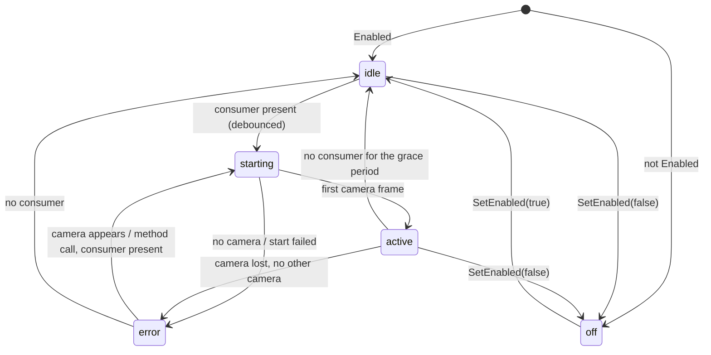

# D-Bus API reference (`br.com.dias.OmaBroadcast1`)

`oma-broadcastd` is controlled over the D-Bus session bus. This document is the reference for clients: status-bar plugins, scripts and other frontends. The design is recorded in [ADR-0005](adr/0005-dbus-zbus-control-plane.md) and [ADR-0011](adr/0011-daemon-lifecycle-and-dbus-api.md).

Clients that cannot speak D-Bus can use the CLI's JSON output instead (`oma-broadcast status --json`, `oma-broadcast watch --json`), documented in [cli-json.md](cli-json.md).

Rust clients can use the `obc-ipc` crate, which holds these names, the value types, a typed proxy (`obc_ipc::OmaBroadcastProxy`) for method calls and signals, and `obc_ipc::Snapshot::fetch_no_autostart`, the read that never starts the daemon (see [Service presence and activation](#service-presence-and-activation)).

## Names

| What | Value |
|---|---|
| Bus | session bus (`busctl --user`, `gdbus --session`) |
| Well-known name | `br.com.dias.OmaBroadcast` |
| Object path | `/br/com/dias/OmaBroadcast` |
| Interface | `br.com.dias.OmaBroadcast1` |
| Error names | `br.com.dias.OmaBroadcast1.Error.<Name>` |

The object also implements the standard `org.freedesktop.DBus.Properties`, `org.freedesktop.DBus.Introspectable` and `org.freedesktop.DBus.Peer` interfaces.

## Versioning

- **Breaking changes** (a removed or renamed member, a changed type or meaning, a new lifecycle state) are never made to `br.com.dias.OmaBroadcast1`. They go into a new interface, `br.com.dias.OmaBroadcast2`, on the same object.
- **Backwards-compatible additions** (a new property, method, signal or error name) are made to `br.com.dias.OmaBroadcast1` and raise the `InterfaceRevision` property. This document describes revision **3**. Revision 1 had no video effects: `Effect` was reserved and always `none`. Revision 2 adds the `BlurStrength` and `BackgroundImage` properties, the `SetEffect`, `SetBlurStrength` and `SetBackgroundImage` methods and the `InvalidArgument` error name, and gives `Effect` its values; it removes and changes nothing else. Revision 3 adds the optional PipeWire output ([ADR-0016](adr/0016-pipewire-output.md)): the properties `LoopbackConsumers`, `PipeWireConsumers` and `PipeWireOutput`. `Consumers` keeps its type and becomes the total of both kinds of consumer; with the PipeWire output off it has the value it had in revision 2. A client that needs only the processes holding the loopback reads `LoopbackConsumers`.
- A client that uses an addition checks `InterfaceRevision` first and treats an older daemon as not offering it. A client must ignore properties, signals and error names it does not know.

## Lifecycle states

The `State` property is one of these lower-case strings. The set is fixed for `br.com.dias.OmaBroadcast1`.

| State | Camera | GPU (CUDA context) | Virtual camera delivers |
|---|---|---|---|
| `off` | closed | none | black frames |
| `idle` | closed | none | black frames |
| `starting` | opening | being created | black frames |
| `active` | streaming | held | camera frames |
| `error` | closed | none | black frames, where a loopback device exists |

- **`off`**: the privacy state, set with `SetEnabled(false)`. The camera is closed (its LED is off) and the GPU is released. Applications holding the virtual camera keep receiving a valid black stream. Persists across restarts.
- **`idle`**: enabled, and no application holds the virtual camera. Nothing but a small CPU-only writer runs.
- **`starting`**: an application has held the virtual camera for the start debounce (default 300 ms); the camera and the GPU pipeline are being started. The application sees black frames until the first camera frame.
- **`active`**: camera frames are streaming. This includes the grace period after the last application closes the virtual camera (default 5 s, `Consumers` = 0): an application that reopens it in that time finds the stream running. A camera switch, or a fallback to another camera when the streaming one fails, stays in `active`.
- **`error`**: a lifecycle failure; the `Error` property says which. Causes: no loopback device with the configured label, a loopback device held by another application in another format, no camera, a camera that failed with no other camera to fall back to, or every camera having failed since one last delivered a frame (a start that delivers no frame within 10 s counts as a failed camera; once every available camera has failed the session is stopped, the camera and GPU are released, and the daemon does not cycle between cameras). The daemon leaves `error` by itself when the cause can have changed: a camera is plugged in or removed, a method is called, or the configuration is reloaded; a missing or held loopback device is retried every 2 s.
- **A damaged state file** (the runtime state file cannot be read or parsed) starts the daemon in `off`, not `idle`: privacy fails closed. `Error` names the file and the reason, and the file is left untouched until `SetEnabled` rewrites it. A configuration reload does not repair it, so `Error` stays set after a valid reload. Until then `SelectCamera` and `NextCamera` take effect but fail with `Failed`, because the selection cannot be saved.



The virtual camera itself never changes format and never stops while the daemon runs: an application holding it sees black frames, then camera frames, then black frames again, in one uninterrupted stream.

## Properties

All properties are read-only. Every change is announced with `org.freedesktop.DBus.Properties.PropertiesChanged` (interface `br.com.dias.OmaBroadcast1`), with the new value included, so clients never need to poll. Read the initial values with `GetAll` and then follow `PropertiesChanged`.

| Property | Type | Meaning | Changes when |
|---|---|---|---|
| `State` | `s` | Lifecycle state, one of `off`, `idle`, `starting`, `active`, `error` (see above). | On every state transition. |
| `Error` | `s` | Text of the latest error, from the lifecycle or from a configuration reload; empty if none. A one-line, human-readable message, e.g. `/home/user/.config/oma-broadcast/config.toml:4:1: camera.mdoe: unknown field ...`. | Set on an error; cleared by the next successful start, or by a valid reload, but only when its own cause is gone: a missing loopback writer or a damaged state file still stands after a reload, and `Error` then keeps that text. An invalid configuration sets `Error` without entering the `error` state, since the previous configuration stays in force. |
| `Enabled` | `b` | `false` is the privacy state `off`. | On `SetEnabled`. Persists across restarts. |
| `Cameras` | `a(sss)` | The cameras present, in the order the daemon uses them: first those matching the configured preference, then the others in discovery order. Each entry is `(id, name, usb)`: `id` is an opaque, stable identifier to pass to `SelectCamera`; `name` is the human-readable device name: the V4L2 card name, shown once when a driver repeats it on both sides of `: ` (`Laptop Camera: Laptop Camera` is shown as `Laptop Camera`), and made unique when several cameras would share it (the first in id order keeps the plain name, the others get ` (2)`, ` (3)`, ...; a camera still known by its `/dev/videoN` node, before udev creates its `/dev/v4l` links, is ordered last, so a camera already known keeps its name); `usb` is the USB `vid:pid` in lower-case hex (`046d:0944`), or empty for a non-USB camera. | When a camera is plugged in or removed, and on a configuration reload that changes the preference. |
| `ActiveCamera` | `s` | The `id` of the camera that streams, or that would stream if an application opened the virtual camera now; empty if there is none. | On `SelectCamera`, `NextCamera`, a fallback after a camera failure, and hotplug. |
| `OutputMode` | `s` | What the virtual camera delivers: pixel format, size and frame rate, e.g. `NV12 1920x1080@30` (a fractional rate is written `30000/1001`). | On a configuration reload that changes it. A change requested while an application holds the virtual camera is applied, and announced, when the last one closes it. |
| `Effect` | `s` | The video effect in force: `none`, `blur` or `replace`. This is the effective value (a run-time choice, else the configuration's `[effect] mode`), not whether the effect is ready yet or has failed; see [Video effects](#video-effects). | On `SetEffect`, and on a configuration reload that changes the effective value. |
| `BlurStrength` | `d` | Strength of the `blur` effect, 0.0 to 1.0. The effective value, shown whatever the effect. | On `SetBlurStrength`, and on a reload that changes the effective value. |
| `BackgroundImage` | `s` | Absolute path of the image for `replace`; empty if there is none. The effective value (a run-time choice, else the configuration's `[effect] background_image`). | On `SetBackgroundImage`, and on a reload that changes the effective value. |
| `Consumers` | `u` | Number of consumers of the virtual camera: `LoopbackConsumers` plus `PipeWireConsumers`. Before revision 3, and with the PipeWire output off, only the processes holding the loopback. | When an application opens or closes the loopback, or links to or leaves the PipeWire node. |
| `LoopbackConsumers` | `u` | Number of processes, other than the daemon, holding the loopback device open (the former meaning of `Consumers`). Revision 3. | When an application opens or closes the loopback. |
| `PipeWireConsumers` | `u` | Number of links to the PipeWire output's node; `0` when the output is off. A link in the error state is not counted. Revision 3. | When an application links to or leaves the node. |
| `PipeWireOutput` | `s` | State of the optional PipeWire output: `off` (not configured), `unsupported` (configured, but the daemon was built without the feature), `connecting`, `ready` (the node is registered, no stream), `streaming` (a consumer is linked and frames flow) or `failed` (no PipeWire daemon, a lost connection or a stream error; retried every 2 s). A failure never changes `State` and never sets `Error`. Revision 3. | On every transition of the output. |
| `InterfaceRevision` | `u` | Revision of `br.com.dias.OmaBroadcast1` the daemon implements (see Versioning). This document describes `3`. | Never while the daemon runs. |

## Methods

All methods return nothing on success. On failure they return a D-Bus error named under `br.com.dias.OmaBroadcast1.Error`, whose message is a human-readable explanation. Calls with the wrong argument types fail with the standard `org.freedesktop.DBus.Error.InvalidArgs`.

| Error name | Meaning |
|---|---|
| `br.com.dias.OmaBroadcast1.Error.NoSuchCamera` | The selector matches no camera that is present. The message ends with `(cameras present: …)`, listing them. |
| `br.com.dias.OmaBroadcast1.Error.InvalidConfig` | The configuration file cannot be read or is invalid; the message names the file, the line and key, and the reason. The previous configuration stays in force. |
| `br.com.dias.OmaBroadcast1.Error.Unavailable` | The request cannot be served now, for example `NextCamera` with no camera present. |
| `br.com.dias.OmaBroadcast1.Error.InvalidArgument` | An argument is well-formed but not acceptable: an unknown effect, a strength outside 0 to 1, a background image that is not usable. The message says which and why. Added in revision 2. |
| `br.com.dias.OmaBroadcast1.Error.Failed` | Any other failure. |

### `SetEnabled(b enabled)`

Enables (`true`) or disables (`false`) the camera. Disabling enters `off` from any state: the camera is closed and the GPU released at once, while black frames keep flowing to applications that hold the virtual camera. If it arrives while the state is `starting`, the start is abandoned after the output pipeline is built, without opening the camera, and `State` may pass through `starting`, `idle` and `off` in that order. Enabling enters `idle`, and `starting` straight away if an application holds the virtual camera. The value persists across restarts. Setting the current value again is not an error.

Errors: `Failed`.

### `SelectCamera(s selector)`

Selects the camera to stream from. `selector` is one of:

- an `id` from the `Cameras` property;
- a case-insensitive substring of the camera name, e.g. `Brio` (matched against the shown name and against the raw card name);
- a USB `vid:pid`, four hex digits each side, e.g. `046d:0944`;
- a device path, e.g. `/dev/video4`.

If the stream is running, it switches to the selected camera; the virtual camera holds the last frame during the switch. The selection persists across restarts and takes precedence over the configured preference while that camera is present. The selection is stored by camera `id`, not by name; a configured name preference such as `Desk Cam (2)` refers to whichever camera carries that name at the moment. If a camera's `id` changes at the same `/dev/videoN` node (for example when its udev links appear), the selection follows it only when it is the same device: the old id was the node-path fallback and neither the USB `vid:pid` nor the serial number shows a different device, or the USB `vid:pid` and serial number agree, or, without a serial number, the USB port agrees; otherwise the node is treated as a different camera.

Errors: `NoSuchCamera`, `Failed`.

### `NextCamera()`

Selects the camera after `ActiveCamera` in the `Cameras` order, wrapping around after the last. Same effect and persistence as `SelectCamera`. With a single camera it is selected again, which is not an error.

Errors: `Unavailable` (no camera present), `Failed`.

### `ReloadConfig()`

Re-reads the configuration file (`$XDG_CONFIG_HOME/oma-broadcast/config.toml`). Equivalent to sending `SIGHUP` to the daemon. An invalid file is rejected as a whole: the previous configuration stays in force, `Error` is set and the call fails with `InvalidConfig`. A valid file clears `Error` unless a cause outside the configuration still holds (see `Error` above). A missing file means the defaults. The configuration keys are described in [config.example.toml](config.example.toml).

Errors: `InvalidConfig`, `Failed`.

### `SetEffect(s effect)`

Selects the video effect: `none` (the camera image as it is), `blur` (blur the background behind the person) or `replace` (replace the background with the background image). It takes effect on a running stream at once, with no restart of the session and no change to what the virtual camera negotiates; see [Video effects](#video-effects) for what the application sees while an effect starts. Selecting the effect already in force does nothing. The choice persists across restarts and takes precedence over the configuration.

Any effect method also retries an effect that failed (see below), and leaves the `error` state when an effect failure put the daemon there.

Errors: `InvalidArgument` (an effect other than `none`, `blur`, `replace`; or `replace` while no background image is set), `Failed`.

### `SetBlurStrength(d strength)`

Sets the strength of the `blur` effect, from 0.0 (lightest) to 1.0 (strongest). It applies from the next frame, without reloading the effect, also while `blur` is not selected. Persists across restarts and takes precedence over the configuration.

Errors: `InvalidArgument` (outside 0 to 1, or not a finite number), `Failed`.

### `SetBackgroundImage(s path)`

Sets the image used by `replace`. `path` must be an absolute path to a readable regular file of at most 32 MiB. The daemon reads the file itself, as the user it runs as, when the effect starts; the file must be a PNG or JPEG image of at most 8192x8192 pixels (only its first image is used). A file that passes the checks of the call but cannot be decoded is an effect failure (see below), not an error of the call. If `replace` is in force the new image is applied at once. Persists across restarts and takes precedence over the configuration.

An empty `path` removes the run-time image: the configuration's `[effect] background_image` applies again. It is refused with `InvalidArgument` only while `replace` is in force and the configuration has no image either; select another effect first.

Errors: `InvalidArgument` (not an absolute path, unreadable, not a regular file, larger than 32 MiB; the message names the path and the reason), `Failed`.

## Video effects

The effect settings (`Effect`, `BlurStrength`, `BackgroundImage`) come from the `[effect]` section of the configuration, and the three setters override them. An override is written to the runtime state file (`state.toml` in `$XDG_STATE_HOME/oma-broadcast/`, with `Enabled` and the selected camera) before the call returns and survives restarts; the configuration is not modified. A value in the state file takes precedence over the configuration, and a reload does not discard it. A state file with an unreadable effect value is a damaged state file (see the `off` rules above); the effect choices saved in it are dropped in favour of the configuration when `SetEnabled` rewrites the file. A setter called with the value already in force changes and writes nothing.

**Privacy while an effect starts.** The raw camera image is never shown while an effect is requested. Going from `none` to `blur` or `replace`, the virtual camera delivers black frames until the effect is ready: a fraction of a second normally, up to a few seconds on the first load after boot or after the files left the cache. Going from one effect to another, the previous effect keeps running until the new one is ready, so every frame is processed. Going to `none` shows the camera image at once. The stream keeps its format and frame rate throughout; applications see no renegotiation.

**When an effect fails.** The effect can fail to start or while running: the Maxine SDK is missing or cannot be loaded, the background image cannot be decoded, a frame fails. The daemon reports the reason in `Error` (for example `effect blur unavailable: NvVFX_Load(GreenScreen) returned -1209 ...`) and acts according to `[effect] on_failure` in the configuration:

- `"black"` (the default): `State` becomes `error`, the camera is closed and the GPU released, and the virtual camera keeps delivering black frames. The raw camera image is not shown, because the user asked to hide the background. If the failure is found before the stream starts (the SDK is missing, `replace` has no usable image) the camera is not opened at all. The daemon leaves `error` like any other: a control method (`SetEffect` and the other setters retry), a configuration reload, a change of the set of cameras, or when the last application closes the virtual camera (then `idle`, and the next one tries again).
- `"none"`: the stream continues without the effect, so applications see the unprocessed camera image, `State` stays `active`, and `Error` carries the reason, ending `; the camera image is shown without the effect (effect.on_failure = "none")`. `Error` is cleared when the effect becomes ready after a retry, by an effect method, by a reload, or when the session ends.

If a setter finds the failure while it applies the value to a running stream, it also returns `Failed` with the same text.

## Signals

### `Stats(d fps, d latency_p50_ms, d cpu_percent, d gpu_percent)`

Emitted about once per second while `State` is `active`, and never in other states. A value that cannot be measured is `-1`; a client should show it as unknown, not as zero.

The signal has four arguments (signature `dddd`), not one structure (`(dddd)`). The `obc_ipc::Stats` type groups them for convenience; it is not the signal's wire form.

| Argument | Meaning |
|---|---|
| `fps` | Frames delivered to the virtual camera (the v4l2loopback device) per second over the last interval: camera frames, repeated frames and black placeholder frames alike, as counted by the daemon's loopback writer. It shows whether the device is fed at the output rate, not the camera's own frame rate. |
| `latency_p50_ms` | Median latency over the last interval, in milliseconds, of the frames that were new in an output tick: from the camera buffer leaving the source element to its tick being handed to the output pipeline's `appsrc`. It does not include the effect stage, colour conversion, download, the virtual-camera writer or the application. It follows the phase between the camera's frames and the output ticks, so with a camera that runs below its nominal rate (a dark room can hold a 60 fps camera at 15 fps) the value drifts in a sawtooth between about 0 and one output period; see [testing.md](testing.md). |
| `cpu_percent` | CPU time used by the daemon over the last interval, in percent of one core (can exceed 100). |
| `gpu_percent` | Utilisation of the GPU the pipeline runs on over the last interval, in percent. |

The property change signal, `org.freedesktop.DBus.Properties.PropertiesChanged(s interface, a{sv} changed, as invalidated)`, is emitted by the same object for every property listed above, with `interface` = `br.com.dias.OmaBroadcast1` and the new values in `changed`.

## Service presence and activation

The daemon runs as the systemd user service `oma-broadcastd.service`. When the D-Bus activation file `br.com.dias.OmaBroadcast.service` is installed, any message addressed to `br.com.dias.OmaBroadcast` without the `NO_AUTO_START` header flag starts the daemon if it is not running. That includes property reads: `Properties.Get` and `Properties.GetAll` start the daemon as readily as a method call does. Subscribing to signals (an `AddMatch` rule on the bus) never starts it.

A client that only looks, such as a status-bar plugin, must not start the daemon. It reads with the `NO_AUTO_START` flag set and follows `org.freedesktop.DBus.NameOwnerChanged` for `br.com.dias.OmaBroadcast` to learn when the daemon appears or exits. With the flag set, a read while the daemon is not running fails at once with an error from the bus, normally `org.freedesktop.DBus.Error.NameHasNoOwner`; treat `org.freedesktop.DBus.Error.ServiceUnknown` the same way. When the name has no owner, the daemon is not running: show it as unavailable rather than as `off`.

How to read without starting the daemon:

- **`busctl`**: pass `--auto-start=no`:

  ```sh
  busctl --user --auto-start=no get-property br.com.dias.OmaBroadcast /br/com/dias/OmaBroadcast \
      br.com.dias.OmaBroadcast1 State
  ```

- **`gdbus`** has no option to clear auto-start: every `gdbus call` may start the daemon. Ask the bus whether the name has an owner first (there is a small race if the daemon exits in between):

  ```sh
  gdbus call --session --dest org.freedesktop.DBus --object-path /org/freedesktop/DBus \
      --method org.freedesktop.DBus.NameHasOwner br.com.dias.OmaBroadcast
  # (true,)
  ```

- **Rust (`obc-ipc`)**: `Snapshot::fetch_no_autostart(&connection)` sends one `GetAll` with the flag and returns `None` when the daemon is not running; `Snapshot::apply_property` applies the values of a `PropertiesChanged` signal, and `obc_ipc::daemon_is_running` asks `NameHasOwner`. Do not read through the property getters of `OmaBroadcastProxy`: a proxy that caches properties (the zbus default) fills its cache with a `GetAll` that allows activation as soon as it is built, and the getters fall back to a `Get` that allows it too. Build the proxy with `cache_properties(CacheProperties::No)` and use it for method calls and signals only.
- **Other libraries**: set the `NO_AUTO_START` flag on the message (in GDBus, `G_DBUS_CALL_FLAGS_NO_AUTO_START`; in sd-bus, `sd_bus_message_set_auto_start(m, 0)`), and disable any property cache that a generated proxy fills on construction.

Method calls (`SetEnabled`, `SelectCamera`, `NextCamera`, `ReloadConfig`, `SetEffect`, `SetBlurStrength`, `SetBackgroundImage`) are actions; letting them start the daemon is normally what the user wants.

A daemon that holds its name but does not answer leaves a call pending; D-Bus libraries differ in their default time limit (zbus sets none). Give every read a time limit of a few seconds, and treat a call that runs out of time as a failure to read, not as "not running".

## Discovery by PipeWire

Applications that open `/dev/video*` directly see the virtual camera whenever the daemon runs. Applications that list cameras through PipeWire (the camera portal, OBS's PipeWire source, browsers that use PipeWire) see it only if WirePlumber recorded it as a capture device. WirePlumber probes video nodes when it starts, and records a v4l2loopback device into which no writer is streaming at that moment as output-only; it does not probe the device again when a writer starts.

The daemon starts its loopback writer before it takes its bus name, so the virtual camera is a capture device by the time the service is ready. Two ways to have WirePlumber probe it then:

- The optional drop-in `dist/systemd/wireplumber.service.d/oma-broadcast.conf`, installed as `~/.config/systemd/user/wireplumber.service.d/oma-broadcast.conf`, orders WirePlumber after `oma-broadcastd.service` (followed by `systemctl --user daemon-reload`).
- Without it, or after restarting the daemon by hand, `systemctl --user restart wireplumber` once the daemon runs makes WirePlumber probe the device again.

### The native PipeWire node

With the optional PipeWire output ([ADR-0016](adr/0016-pipewire-output.md)) the daemon registers its own PipeWire video source, `oma-broadcast` ("Omarchy Broadcast", `media.class` `Video/Source`, `media.role` `Camera`), and PipeWire-based applications can use it directly, with no WirePlumber probe of the loopback. `PipeWireOutput` and `PipeWireConsumers` report it. Which applications use it depends on the application: Firefox through the camera portal, OBS Studio 30.1 and later, GNOME Snapshot and GStreamer's `pipewiresrc` do; Chromium and Chrome only with their PipeWire camera feature enabled; Zoom and Discord use the loopback. Setup is in [setup/daemon.md](setup/daemon.md#the-pipewire-output).

Once WirePlumber has probed the loopback while the writer streams, PipeWire also lists the loopback as a camera, so an application can show "Omarchy Broadcast" twice. A WirePlumber rule can hide the loopback from PipeWire only; applications that open `/dev/video*` directly are unaffected. The rule is in [setup/daemon.md](setup/daemon.md#hiding-the-duplicate). With it, the ordering drop-in above is not needed for applications that use the native node; it stays useful for those that reach the camera through v4l2 only.

## Examples with `busctl`

Introspect the object:

```sh
busctl --user introspect br.com.dias.OmaBroadcast /br/com/dias/OmaBroadcast br.com.dias.OmaBroadcast1
```

```text
NAME                        TYPE      SIGNATURE RESULT/VALUE                FLAGS
.NextCamera                 method    -         -                           -
.ReloadConfig               method    -         -                           -
.SelectCamera               method    s         -                           -
.SetBackgroundImage         method    s         -                           -
.SetBlurStrength            method    d         -                           -
.SetEffect                  method    s         -                           -
.SetEnabled                 method    b         -                           -
.ActiveCamera               property  s         "usb-046d_0944-video-index0" emits-change
.BackgroundImage            property  s         ""                          emits-change
.BlurStrength               property  d         0.5                         emits-change
.Cameras                    property  a(sss)    1 "usb-046d_0944-video-index0" "Logitech MX Brio" "046d:0944" emits-change
.Consumers                  property  u         0                           emits-change
.Effect                     property  s         "none"                      emits-change
.Enabled                    property  b         true                        emits-change
.Error                      property  s         ""                          emits-change
.InterfaceRevision          property  u         3                           emits-change
.LoopbackConsumers          property  u         0                           emits-change
.OutputMode                 property  s         "NV12 1920x1080@30"         emits-change
.PipeWireConsumers          property  u         0                           emits-change
.PipeWireOutput             property  s         "off"                       emits-change
.State                      property  s         "idle"                      emits-change
.Stats                      signal    dddd      -                           -
```

(Values in these examples are illustrative; camera ids are opaque and differ between machines.)

Read properties (`--auto-start=no`: the read does not start the daemon):

```sh
busctl --user --auto-start=no get-property br.com.dias.OmaBroadcast /br/com/dias/OmaBroadcast \
    br.com.dias.OmaBroadcast1 State Enabled Consumers
```

```text
s "idle"
b true
u 0
```

```sh
busctl --user --auto-start=no get-property br.com.dias.OmaBroadcast /br/com/dias/OmaBroadcast \
    br.com.dias.OmaBroadcast1 Cameras
```

```text
a(sss) 2 "usb-046d_0944-video-index0" "Logitech MX Brio" "046d:0944" "pci-0000:00:14.0-usb-0:5:1.0-video-index0" "FHD Camera" "5986:1193"
```

Add `--json=short` for machine-readable output, e.g. `{"type":"s","data":"idle"}`.

Call each method:

```sh
busctl --user call br.com.dias.OmaBroadcast /br/com/dias/OmaBroadcast \
    br.com.dias.OmaBroadcast1 SetEnabled b false
busctl --user call br.com.dias.OmaBroadcast /br/com/dias/OmaBroadcast \
    br.com.dias.OmaBroadcast1 SetEnabled b true
busctl --user call br.com.dias.OmaBroadcast /br/com/dias/OmaBroadcast \
    br.com.dias.OmaBroadcast1 SelectCamera s "046d:0944"
busctl --user call br.com.dias.OmaBroadcast /br/com/dias/OmaBroadcast \
    br.com.dias.OmaBroadcast1 NextCamera
busctl --user call br.com.dias.OmaBroadcast /br/com/dias/OmaBroadcast \
    br.com.dias.OmaBroadcast1 ReloadConfig
busctl --user call br.com.dias.OmaBroadcast /br/com/dias/OmaBroadcast \
    br.com.dias.OmaBroadcast1 SetBlurStrength d 0.7
busctl --user call br.com.dias.OmaBroadcast /br/com/dias/OmaBroadcast \
    br.com.dias.OmaBroadcast1 SetBackgroundImage s /home/user/Pictures/background.png
busctl --user call br.com.dias.OmaBroadcast /br/com/dias/OmaBroadcast \
    br.com.dias.OmaBroadcast1 SetEffect s blur
```

An argument that is not acceptable is rejected with `InvalidArgument`:

```sh
busctl --user call br.com.dias.OmaBroadcast /br/com/dias/OmaBroadcast \
    br.com.dias.OmaBroadcast1 SetBlurStrength d 1.5
```

```text
Call failed: blur strength 1.5 is outside 0 to 1
```

A failed call prints the error message and exits with a non-zero status. The `NoSuchCamera` message lists the cameras present, as `name (id)`:

```sh
busctl --user call br.com.dias.OmaBroadcast /br/com/dias/OmaBroadcast \
    br.com.dias.OmaBroadcast1 SelectCamera s "no such camera"
```

```text
Call failed: no camera matches "no such camera" (cameras present: Logitech MX Brio (usb-046d_0944-video-index0), FHD Camera (pci-0000:00:14.0-usb-0:5:1.0-video-index0))
```

Watch property changes:

```sh
busctl --user monitor \
    --match "type='signal',path='/br/com/dias/OmaBroadcast',interface='org.freedesktop.DBus.Properties',member='PropertiesChanged'"
```

Each change prints a message whose body is the interface name, a dictionary of the changed properties and their new values, and an empty list of invalidated ones, e.g. `STRING "br.com.dias.OmaBroadcast1"; ARRAY "{sv}" { DICT_ENTRY "sv" { STRING "State"; VARIANT "s" { STRING "active"; }; }; ... }; ARRAY "s" { };`.

Watch the `Stats` signal:

```sh
busctl --user monitor \
    --match "type='signal',path='/br/com/dias/OmaBroadcast',interface='br.com.dias.OmaBroadcast1',member='Stats'"
```

The body of each message is four doubles: `DOUBLE 30; DOUBLE 41.2; DOUBLE 6.5; DOUBLE 18;`.

## Examples with `gdbus`

Introspect:

```sh
gdbus introspect --session --dest br.com.dias.OmaBroadcast --object-path /br/com/dias/OmaBroadcast
```

Read one property, or all of them (these calls start the daemon if it is not running; see [Service presence and activation](#service-presence-and-activation)):

```sh
gdbus call --session --dest br.com.dias.OmaBroadcast --object-path /br/com/dias/OmaBroadcast \
    --method org.freedesktop.DBus.Properties.Get br.com.dias.OmaBroadcast1 State
# (<'idle'>,)

gdbus call --session --dest br.com.dias.OmaBroadcast --object-path /br/com/dias/OmaBroadcast \
    --method org.freedesktop.DBus.Properties.GetAll br.com.dias.OmaBroadcast1
# ({'State': <'idle'>, 'Error': <''>, 'Enabled': <true>, 'Cameras': <[('usb-046d_0944-video-index0', 'Logitech MX Brio', '046d:0944')]>, ...},)
```

Call each method:

```sh
gdbus call --session --dest br.com.dias.OmaBroadcast --object-path /br/com/dias/OmaBroadcast \
    --method br.com.dias.OmaBroadcast1.SetEnabled false
gdbus call --session --dest br.com.dias.OmaBroadcast --object-path /br/com/dias/OmaBroadcast \
    --method br.com.dias.OmaBroadcast1.SelectCamera "Brio"
gdbus call --session --dest br.com.dias.OmaBroadcast --object-path /br/com/dias/OmaBroadcast \
    --method br.com.dias.OmaBroadcast1.NextCamera
gdbus call --session --dest br.com.dias.OmaBroadcast --object-path /br/com/dias/OmaBroadcast \
    --method br.com.dias.OmaBroadcast1.ReloadConfig
gdbus call --session --dest br.com.dias.OmaBroadcast --object-path /br/com/dias/OmaBroadcast \
    --method br.com.dias.OmaBroadcast1.SetBackgroundImage /home/user/Pictures/background.png
gdbus call --session --dest br.com.dias.OmaBroadcast --object-path /br/com/dias/OmaBroadcast \
    --method br.com.dias.OmaBroadcast1.SetEffect replace
gdbus call --session --dest br.com.dias.OmaBroadcast --object-path /br/com/dias/OmaBroadcast \
    --method br.com.dias.OmaBroadcast1.SetBlurStrength 0.7
```

A failure is reported with its D-Bus error name, which a script can match on:

```text
Error: GDBus.Error:br.com.dias.OmaBroadcast1.Error.InvalidConfig: /home/user/.config/oma-broadcast/config.toml:4:1: camera.mdoe: unknown field `mdoe`, expected one of `preference`, `mode`, `fixed_framerate`
```

Watch every signal of the object, `PropertiesChanged` and `Stats` included:

```sh
gdbus monitor --session --dest br.com.dias.OmaBroadcast --object-path /br/com/dias/OmaBroadcast
```

```text
/br/com/dias/OmaBroadcast: org.freedesktop.DBus.Properties.PropertiesChanged ('br.com.dias.OmaBroadcast1', {'Consumers': <uint32 1>}, @as [])
/br/com/dias/OmaBroadcast: org.freedesktop.DBus.Properties.PropertiesChanged ('br.com.dias.OmaBroadcast1', {'State': <'starting'>}, @as [])
/br/com/dias/OmaBroadcast: org.freedesktop.DBus.Properties.PropertiesChanged ('br.com.dias.OmaBroadcast1', {'State': <'active'>}, @as [])
/br/com/dias/OmaBroadcast: br.com.dias.OmaBroadcast1.Stats (30.0, 41.2, 6.5, 18.0)
```

## Writing a client

- Read everything once with `GetAll` on `br.com.dias.OmaBroadcast1`, then update from `PropertiesChanged`; subscribe before reading so that no change is missed in between.
- Read with the `NO_AUTO_START` flag, so that looking at the daemon never starts it, and give each read a time limit (see Service presence and activation).
- Treat a missing name owner as "daemon not running" (see Service presence and activation).
- Show `Error` when it is non-empty, whatever the state: a rejected configuration reload sets it while the state stays, for example, `active`.
- Offer the effect controls only if `InterfaceRevision` is 2 or more; against revision 1 the setters do not exist and `Effect` is always `none`.
- Read `LoopbackConsumers`, `PipeWireConsumers` and `PipeWireOutput` only if `InterfaceRevision` is 3 or more; against an older daemon `Consumers` counts the loopback alone. To show a split, show it only while `PipeWireOutput` is not `off`.
- Treat `-1` in `Stats` as unknown, and expect no `Stats` outside `active`.
- Match errors by name, not by message text: the messages are for people and may change.
