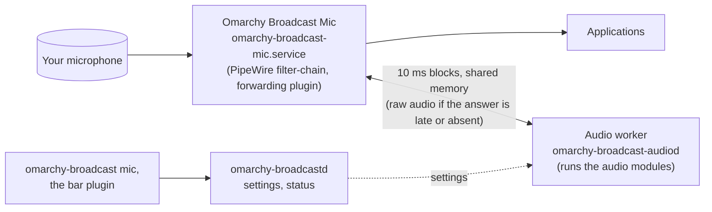

# Set up the Omarchy Broadcast Mic

"Omarchy Broadcast Mic" is an optional virtual microphone: your microphone with the background noise removed. Any application can select it like a hardware microphone. Turn it on with `omarchy-broadcast mic on`. The default CPU module needs no GPU and no vendor SDK.

Audio modules do the processing, loadable like the video effects ([modules.md](../modules.md#audio-modules)). The default module runs on the CPU with two engines: DeepFilterNet (the default) and RNNoise. A second module, for NVIDIA GPUs, runs the NVIDIA Maxine Audio Effects. It needs the SDK, which you obtain yourself ([On an NVIDIA GPU](#on-an-nvidia-gpu-maxine-audio-effects)). Other engines can be installed as further modules. They appear as further providers of the same stages, with no change to this setup. The design and the reasons are in [ADR-0029](../adr/0029-audio-modules-mic-host-and-worker.md).

The virtual microphone is independent of the virtual camera: neither needs the other. The daemon is only the control panel of the microphone and is not in the audio path.

**Whatever stops, you keep a microphone.** If a module, the worker or the daemon stops, applications that chose "Omarchy Broadcast Mic" keep receiving your microphone's own audio, unprocessed. They get the processed audio again when the part is back. An effect never makes the microphone silent.

You can run the virtual microphone in two ways, one at a time:

| Way | What you get | Use it when |
|---|---|---|
| **Audio modules** (this page, before [the filter-chain section](#the-lightweight-alternative-the-filter-chain-units)) | Settings (on and off, the microphone, the engine, the strength), several providers, status | Recommended |
| **Filter-chain units** of [ADR-0014](../adr/0014-mic-noise-removal-filter-chain.md) ([below](#the-lightweight-alternative-the-filter-chain-units)) | One fixed engine per unit, no settings, no worker | You want a lightweight, supported alternative |

Both create a source with the same name, so they exclude each other. Each unit declares `Conflicts=` with the others. `omarchy-broadcast mic on` refuses, and names the unit, while a filter-chain unit is running.

## Before you start

- PipeWire with WirePlumber 0.5 (the default on Omarchy).
- A systemd user session.
- For the CPU module: nothing else. DeepFilterNet and RNNoise are built into it, with no model files and no LADSPA package.
- Optional, for the GPU module: an NVIDIA RTX GPU and the Maxine Audio Effects SDK, as the `maxine-afx-sdk-local` package ([On an NVIDIA GPU](#on-an-nvidia-gpu-maxine-audio-effects)).

## Install

Packaging installs everything and **enables nothing**. Choose one route.

### From the Arch package

The package installs:

- the mic host's PipeWire configuration, `/usr/share/omarchy-broadcast/pipewire/omarchy-broadcast-mic.conf`, and its unit `omarchy-broadcast-mic.service`. The unit's `ExecStart=` names that configuration by absolute path.
- the forwarding plugin, `/usr/lib/ladspa/libomarchy_broadcast_mic.so`, which the configuration finds by name.
- the worker, `/usr/bin/omarchy-broadcast-audiod`, with its units `omarchy-broadcast-audiod.service` and `omarchy-broadcast-audiod.socket` and the D-Bus activation file `br.com.dias.OmarchyBroadcast.AudioWorker.service`.
- the CPU voice module, with its manifest, in `/usr/lib/omarchy-broadcast/modules` and `modules.d`, and the third-party licence notices.

The Maxine audio effects module is a package of its own from the same build, `omarchy-broadcast-maxine-afx-git`. It depends on the module ABI that the core provides and on `maxine-afx-sdk-local`. The packages never contain the SDK. Install the module package with the core to get the GPU module. You need no drop-in: the worker applies the SDK package's environment to itself ([below](#the-workers-sdk-environment)).

Building the package fetches the DeepFilterNet source from its upstream repository (a git dependency pinned by commit), so `makepkg` needs network access.

### With `scripts/install-user.sh --audio`

From the repository root, `scripts/install-user.sh --audio` ([INSTALL.md](../../INSTALL.md#per-user-install-from-a-checkout)) builds and installs the same parts without root, under `~/.local`:

- the worker in `${XDG_BIN_HOME:-~/.local/bin}`;
- the plugin, the mic host's configuration (with the plugin's absolute path), and the library and manifest of the CPU module and of the Maxine audio effects module (which loads without the SDK), under `${XDG_DATA_HOME:-~/.local/share}/omarchy-broadcast/`;
- the units in `${XDG_DATA_HOME:-~/.local/share}/systemd/user/` and the activation file in `${XDG_DATA_HOME:-~/.local/share}/dbus-1/services/`.

The script enables nothing and prints the next steps. The worker needs no Maxine drop-in: it applies the SDK package's environment itself.

- `--audio` and `--mic` (the filter-chain units) are alternatives. The script refuses both in one run.
- `scripts/install-user.sh --uninstall` removes what it installed. It refuses while a mic unit is enabled, so turn the microphone off first ([Undo](#undo)).
- The DeepFilterNet source is fetched once, so the first build needs network access.

## Turn it on

```sh
omarchy-broadcast mic on
```

This enables and starts `omarchy-broadcast-mic.service`. The source "Omarchy Broadcast Mic" now exists, and it comes back at every login until you turn it off.

- The command needs the daemon and starts it by D-Bus activation. Without the daemon, run `systemctl --user enable --now omarchy-broadcast-mic.service`.
- If a filter-chain unit is running, `mic on` refuses and names it. Stop it first with `systemctl --user disable --now omarchy-broadcast-mic@rnnoise.service` (or `@deepfilter`).

## Check that it works

```sh
omarchy-broadcast mic
```

With nothing recording, the state is `passthrough`: the worker is not running and nothing needs processing.

```text
Microphone: passthrough
Consumers:  0
Latency:    0.0 ms
```

When an application records from "Omarchy Broadcast Mic", the worker starts. The state goes to `starting` while the engine loads (the audio is the raw microphone meanwhile), then to `active`:

```text
Microphone: active
Consumers:  1
Provider:   mic-denoise: br.com.dias.voice-cpu
Latency:    40.0 ms
```

The states:

| State | Meaning |
|---|---|
| `off` | The mic host is not running. There is no "Omarchy Broadcast Mic" source |
| `passthrough` | It runs and the audio passes unchanged: processing is off, nothing records, or no stage is on or able to run |
| `starting` | An engine is loading or warming up. The audio is your microphone's own until it is ready |
| `active` | The audio is processed |
| `error` | Stages are on but none could run. `Error:` says why. The audio is your microphone's own |

## Use it

"Omarchy Broadcast Mic" appears as an ordinary microphone. Select it in the application (the input device setting of the meeting, recording or chat program), or make it the default microphone:

```sh
omarchy-broadcast mic default            # Use as default microphone
omarchy-broadcast mic restore-default    # go back to the microphone that was the default
```

Nothing makes it the default by itself. The source is mono at 48 kHz. A stereo microphone is downmixed. `wpctl status` lists the source under **Filters**, not under Sources, because WirePlumber groups filter-chain nodes there. Applications list it as an ordinary input named "Omarchy Broadcast Mic".

### What `mic default` does

1. It remembers two microphones. The configured default microphone is the one `mic restore-default` gives back. The microphone actually in use at that moment (`default.audio.source`, a connected hardware microphone) is the one the restore falls back to when the configured default is unplugged.
2. It pins the capture side of the Omarchy Broadcast Mic, so that it never captures from itself. It pins, in this order:
   1. the microphone you chose ([Choose the microphone](#choose-the-microphone));
   2. else the microphone that was in use before;
   3. else the configured default microphone, when it is connected;
   4. else the microphone WirePlumber is using in its place (`default.audio.source`), or else the one it chooses.

   If none of these can be pinned, the command fails and suggests `omarchy-broadcast mic device`.
3. It makes the Omarchy Broadcast Mic the default, so that applications that follow the default use it.

Running `mic default` again while the Omarchy Broadcast Mic is already the default changes nothing that was remembered.

### What `mic restore-default` does

`mic restore-default` makes the remembered microphone the default again and removes the pin. It falls back in this order:

1. The remembered microphone.
2. When that microphone is unplugged: the one that was in use before `mic default`.
3. If that is gone too: another connected hardware microphone, chosen as WirePlumber would and never the Omarchy Broadcast Mic. The microphone the capture side is pinned to is used only when there is no other.

`mic off` does the same restore first, when the Omarchy Broadcast Mic is the default, before it stops the microphone. Applications move to a live microphone as it goes.

Making it the default is safe: the capture side and the output side of the node share one link group, which WirePlumber never links to each other.

### Choose the microphone

By default the capture side follows the system's default microphone. To use one particular microphone, choose it:

```sh
omarchy-broadcast settings          # lists the microphones as the options of mic.input.device
omarchy-broadcast mic device alsa_input.usb-...      # or `mic device default`
```

The choice is stored (`[mic] device`, the microphone's PipeWire `node.name`). It takes effect at once while the microphone is on, whether or not the Omarchy Broadcast Mic is the default.

- **When the pin is made.** The capture side is pinned to your choice when you choose, when the microphone is turned on, when the daemon starts, when the capture node comes back and after a restore.
- **Choosing `default`.** While the Omarchy Broadcast Mic is not the default, this pins nothing: the capture side follows the system default. While it is the default, the capture side follows the microphone that was in use before, else the previous default.
- **A microphone that is not connected yet.** A pin that cannot be made yet is tried again for about 30 s.
- **Restarts and replugging.** WirePlumber saves the pin, so it survives restarts of the mic host, the worker and WirePlumber. A microphone that is unplugged and plugged again is a new PipeWire object, which the daemon pins again when it comes back.
- **The list.** The microphone list never includes the Omarchy Broadcast Mic's own nodes.

## Noise removal and its settings

The settings are in the settings tree. `omarchy-broadcast settings` shows it, and the bar plugin's Mic page draws it. The bar plugin is a separate project and needs the daemon's revision 13 interface.

| Setting | What it does |
|---|---|
| `mic.input.enabled` ("Noise and echo processing") | The master switch. Off, the microphone's audio passes unchanged, at the same delay: never muted |
| `mic.input.device` ("Input device") | The microphone captured ([above](#choose-the-microphone)) |
| `mic.input.hardware_gain_db` ("Hardware gain", in dB; daemon interface revision 25) | The capture gain of a USB microphone's own mixer, in the range the device reports. Offered only while the microphone captured is a USB device with one capture volume control. See [Hardware gain](#hardware-gain-of-a-usb-microphone) |
| `mic.input.use_as_default` ("Use as default microphone"; daemon interface revision 28) | On while the Omarchy Broadcast Mic is the default made here. Turning it on is `mic default`; turning it off is `mic restore-default`. Greyed while the microphone is off. Before revision 28 the tree had the two actions `mic.input.make_default` and `mic.input.restore_default` in its place. The daemon still takes them and the CLI still sends them |
| `mic.noise.enabled` ("Noise removal") | Noise removal on or off |
| `mic.noise.strength` ("Strength", 0 to 100 %) | How much noise goes. One control for every provider of noise removal: each engine maps it its own way. 100 % is the strongest. Applies live, with no break in the sound |
| `mic.cpu.engine` ("Engine") | `deepfilternet` (the default) or `rnnoise`. Reloads the engine. The audio stays raw while the new one loads |
| `mic.echo.*`, `mic.voice.*` | Room echo removal and studio voice, offered by the GPU module only: [On an NVIDIA GPU](#on-an-nvidia-gpu-maxine-audio-effects) |

```sh
omarchy-broadcast settings set mic.noise.strength 70
omarchy-broadcast settings set mic.cpu.engine rnnoise
omarchy-broadcast settings set mic.input.enabled off     # raw audio through the same source
```

A module installed later adds its own settings to the same page, such as the GPU module's switch and strength for room echo removal. A setting that cannot be changed now is shown with the reason.

### Hardware gain of a USB microphone

A USB microphone has its own capture gain, applied in the device before any software sees the sound. `mic.input.hardware_gain_db` sets it in whole dB, within the range the device reports. The Logitech MX Brio's `Headset` control, for example, runs from +18 to +54 dB in 1 dB steps.

```sh
omarchy-broadcast settings set mic.input.hardware_gain_db 36
omarchy-broadcast config set mic.hardware_gain_db 36.0    # the same, as a configuration key
```

- **When it appears.** The setting appears only when the microphone being captured is a USB audio device whose card has one capture volume control. With several controls, the daemon takes one only when it is named `Mic`, `Headset`, `Capture` or `Microphone`. Otherwise the setting is absent rather than a guess. A value outside the device's range is refused.
- **When it is applied.** The gain is applied when you set it (setting the same value again applies it again), and each time the microphone appears: plugging it in, the worker starting, the mic host starting. While `hardware_gain_db` is unset, which is the default, the gain of the device is never touched. The setting follows changes made elsewhere, so it shows the device's gain.
- **It is the same control as the source's volume in PipeWire.** PipeWire's ALSA profile binds this hardware control to the volume of the physical microphone. Changing that volume (`wpctl set-volume`, a volume slider) changes the hardware gain, and the other way round. The last writer wins. The setting pins the gain at the moments it is applied and does not fight a change you make in between. This is the reason to have it: once the Omarchy Broadcast Mic is the default source, the system's volume slider moves the volume of the virtual microphone, not that of the physical one.
- **Failed writes.** A write that fails is tried again only when the microphone, the value or an ALSA event from the card changes, not on a timer. If the daemon restarts while the audio worker keeps running, the worker applies the configured gain once more. This overrides a change made meanwhile through the source's volume.

### Choose the engine

| | RNNoise | DeepFilterNet |
|---|---|---|
| Strength | Light on the CPU; steady noise such as fans and hiss | Non-stationary noise such as keyboards and voices in the background; less damage to speech; non-speech sound is kept |
| Weakness | A voice-activity gate mutes what it does not classify as voice (ambience, music, keyboard between words); weaker on keyboards; can clip the onset of words | Heavier on the CPU |
| Delay of the engine | About 10 ms | About 30 ms |
| `mic.noise.strength` | A mix of the processed and the original sound, with the original delayed to match | The limit on how many decibels of noise are taken away, from a light touch at 0 % (about 1 dB) to no limit at 100 %. 25 % is about 3 dB, 50 % about 10 dB, 75 % about 30 dB |

DeepFilterNet is the default because it keeps the voice and removes noise from under it. Choose RNNoise when the CPU matters more, for instance on a laptop battery. For measured CPU figures of the two engines, see [ADR-0014](../adr/0014-mic-noise-removal-filter-chain.md). The module runs the same engines. Compare by ear with your own microphone and room.

### Configuration

The `[mic]` keys are in [config.example.toml](../config.example.toml). The panel and `omarchy-broadcast config set mic.<key> VALUE` change all but `force_conflicts`.

| Key | Default | Meaning |
|---|---|---|
| `enabled` | `true` | The master switch above |
| `device` | `"default"` | The microphone captured, a PipeWire `node.name` |
| `pipeline_depth` | `0` | Blocks of 10 ms between the microphone and the processed audio, 0 to 4. 0 chooses by device (1 on the CPU, 2 when a stage runs on a GPU). More tolerates a late block at the cost of delay |
| `idle_exit_s` | `30` | Seconds with no audio from the source and no call from the daemon or the panel before the worker exits and frees its memory (and a GPU). 0 never exits |
| `gpu_warm_s` | `30` | Seconds after the last application stops recording that the GPU stages (for instance studio voice) stay loaded, so the next recording starts with them already processing instead of waiting for the model to load. 0 to 86400; 0 drops them at once. The worker does not exit while they are kept, so a value above `idle_exit_s` keeps the worker, and the GPU, awake that much longer ([below](#what-it-does-with-the-gpu)) |
| `gpu_policy` | `"always"` | When a GPU module may be used: `always`, `with-camera` (only in a microphone session that starts while the camera runs) or `never`. A stage the GPU may not run runs on the best CPU module that offers it. A level meter alone never wakes the GPU |
| `hardware_gain_db` | unset | The capture gain of a USB microphone, in dB. Unset never touches the device's gain ([above](#hardware-gain-of-a-usb-microphone)) |
| `force_conflicts` | `false` | Run effects that their modules declare as excluding each other, together (studio voice with noise or room echo removal, [below](#studio-voice-excludes-noise-and-echo-removal)). For testing; set in a file |

Which module provides a stage is chosen as for video: by rank, by the backend profile and by pin. `omarchy-broadcast modules profile battery` prefers a CPU module over a GPU one. `omarchy-broadcast modules pin mic-denoise MODULE` pins a module. `omarchy-broadcast modules` lists the audio modules with their stages next to the video ones.

## On an NVIDIA GPU (Maxine audio effects)

On a machine with an NVIDIA RTX GPU, the microphone can run the NVIDIA Maxine Audio Effects through a second audio module, `br.com.dias.maxine-afx`. It provides the same noise removal stage as the CPU module, ranked above it, and four more:

- speaker focus
- room echo removal
- headset bandwidth restoration
- studio voice

Speaker focus and headset bandwidth restoration need an extra download ([described below](#optional-features-speaker-focus-and-headset-bandwidth)).

NVIDIA licenses the SDK, and omarchy-broadcast never distributes it. You download it with your own NVIDIA account. The sibling project omarchy-nvidia-sdks packages it for Arch as `maxine-afx-sdk-local`. The Arch package `omarchy-broadcast-maxine-afx-git` (which depends on `maxine-afx-sdk-local`) and `install-user.sh --audio` install the module.

The module opens the SDK only at run time, so everything above works without the SDK, on any machine. The CPU module keeps the microphone going, and the Maxine stages are listed as unavailable, with the reason. The SDK's licence terms and the compatibility shim are described for the video SDK in [maxine.md](maxine.md#9-licence-and-support). They apply to this one too.

Only the audio worker loads this SDK. The video daemon never does. The daemon's own Maxine SDK environment ([maxine.md](maxine.md#3-the-sdk-environment)) is not needed for the microphone, and this one is not needed for the camera.

### The worker's SDK environment

The SDK finds its feature libraries through the dynamic linker's search path, which is read once, when the process starts. Its model loader refuses the distributions NVIDIA lists, and Omarchy is not one of them. The worker sets both up itself, with no systemd drop-in.

When it starts, the worker looks for two files from the SDK package:

- the environment file, `/usr/share/maxine-afx/maxine-afx.env` (in the `EnvironmentFile=` syntax of systemd);
- the os-release shim, `/usr/lib/maxine-afx/os-release-shim.so`.

When both are there, the worker merges the file into its environment, preloads the shim and executes itself again, once, as the same process (the socket that systemd handed over is kept). The log has one line:

```sh
journalctl --user -u omarchy-broadcast-audiod | grep 'SDK environment'
# SDK environment applied from /usr/share/maxine-afx/maxine-afx.env
```

The worker starts on demand and exits when the microphone is idle, so the next start applies a newly installed package. The rules are those of the daemon ([maxine.md](maxine.md#3-the-sdk-environment)):

- A variable that the worker's environment sets already is not overwritten.
- The shim is appended to any `LD_PRELOAD`.
- Other `LD_*` variables and `GCONV_PATH` of the file are refused.
- No `MAXINE_AFX_ROOT` is applied, so `sdk_root` works.

One difference: **the worker applies `LD_LIBRARY_PATH`**, merged (its own entries first, then the file's, which name the SDK's libraries and each effect's feature library). The SDK opens its feature libraries by names that only the library search path resolves. The daemon never applies it.

- A package that is not installed gives no log line.
- A half-installed one (a file without the other, or an environment file that does not parse) gives one warning that names the file and ends `running without its environment`. The worker goes on without the SDK.
- `OBC_NO_SDK_ENV=1` in the worker's environment skips all of it.

NVIDIA does not support running its SDK on a distribution it does not list. The shim is what makes this process (and only this one) see a listed one. The real file is not touched, and the worker's child processes do not inherit the shim.

The module requires `LD_LIBRARY_PATH` to lead to the feature libraries. Without the SDK's environment, the Maxine stages are unavailable, with a reason that names the package, and the microphone uses the CPU module.

**A drop-in from an earlier version.** `maxine-afx.conf` in `~/.config/systemd/user/omarchy-broadcast-audiod.service.d/` still works, because a shim it preloads counts as in place. You no longer need it. Remove it, then run `systemctl --user daemon-reload`.

#### An SDK tree without the package

For an SDK unpacked by hand:

1. Write a drop-in of your own at `~/.config/systemd/user/omarchy-broadcast-audiod.service.d/maxine-tree.conf`. It names the shim, the file it shows and the libraries of the root in use (an SDK tree laid out as NVIDIA's download; change the root in each entry if yours is elsewhere). `%h` is your home directory: systemd does not expand `$HOME` inside `Environment=`.

   ```ini
   [Service]
   Environment=LD_LIBRARY_PATH=%h/.local/opt/maxine/afx/nvafx/lib:%h/.local/opt/maxine/afx/features/denoiser/lib:%h/.local/opt/maxine/afx/features/dereverb/lib:%h/.local/opt/maxine/afx/features/dereverb_denoiser/lib:%h/.local/opt/maxine/afx/features/studio_voice/lib:%h/.local/opt/maxine/afx/external/cuda/lib
   Environment=LD_PRELOAD=%h/.local/lib/maxine-afx/os-release-shim.so
   Environment=MAXINE_OS_RELEASE=%h/.local/lib/maxine-afx/fake-os-release
   ```

2. Set the root in `config.toml` (`sdk_root` under `[module."br.com.dias.maxine-afx"]`) or with `MAXINE_AFX_ROOT`.
3. Run `systemctl --user daemon-reload`.

The `LD_LIBRARY_PATH` line is the required one. Add `features/speaker_focus/lib` and `features/superres/lib` when you installed those features. The shim and the replacement `os-release` come from the omarchy-nvidia-sdks repository. In a checkout of it, build the shim with `make -C tools/os-release-shim` and take `tools/maxine-probe/fake-os-release`. Copy both to `~/.local/lib/maxine-afx/`. The worker sees a library named `os-release-shim.so` loaded in its own process, from whatever directory, and applies nothing from a package.

### Where the SDK is

The module looks for the SDK root in this order:

1. `sdk_root` in the module's table of `config.toml` (`[module."br.com.dias.maxine-afx"]`).
2. The `MAXINE_AFX_ROOT` environment variable.
3. `/opt/nvidia/maxine/afx`, where the package installs it.

**This is the reverse of the video modules**, where the environment variable wins over the configured root ([maxine.md](maxine.md#the-sdk-root)). Here the configured root comes first, and the worker never applies the `MAXINE_AFX_ROOT` that the package's environment file sets. The package therefore does not hide a root you chose.

If you choose another root, `LD_LIBRARY_PATH` must name that root's libraries too. Set it in a drop-in of your own ([above](#an-sdk-tree-without-the-package)). The table takes no other key. A root change takes effect when the worker next starts.

### What the Mic tab offers

With the module usable, the same page gains groups, and noise removal's switch and strength become the GPU module's:

| Setting | What it does |
|---|---|
| `mic.noise.enabled`, `mic.noise.strength` | The same switch and strength as with the CPU module (shared by every provider of noise removal). The strength applies live: it mixes the processed sound with your own, delayed to match, so a change never steps or reloads |
| `mic.focus.enabled` ("Speaker focus (removes other voices)", off by default) | Keeps the main speaker and removes other voices and background talk. It has no strength. It removes neither noise nor echo, so it works alongside the other effects, studio voice included. It runs first in the chain. It needs a separate download: until that is installed, the switch is greyed with the reason "Models not installed" ([below](#optional-features-speaker-focus-and-headset-bandwidth)) |
| `mic.echo.enabled`, `mic.echo.strength` ("Room echo removal", off by default) | Removes the room's reverberation from the voice, before noise removal. Its strength applies live. While noise removal is on, the strength is greyed: both effects then run as one combined model, whose single strength is noise removal's. Turn noise removal off to set the echo strength on its own |
| `mic.bandwidth.enabled` ("Restore headset audio (for narrowband mics)", group "Headset bandwidth", off by default) | Restores the high band of a narrowband microphone, such as a Bluetooth headset in its 16 kHz mode, whose voice otherwise sounds muffled. It has no strength and conflicts with no other effect. It runs after noise and room echo removal, so it extends a signal that has already been cleaned. The audio is reduced to 16 kHz for it and rebuilt at 48 kHz. The small delay that adds is counted in the chain's delay. It needs a separate download: until that is installed, the switch is greyed with the reason "Models not installed" ([below](#optional-features-speaker-focus-and-headset-bandwidth)) |
| `mic.voice.enabled` ("Studio voice (adds noticeable delay)", off by default), `mic.voice.profile` ("Mic profile") | Re-creates the voice as if recorded in a studio. The profile (None, Bright, Vibrant, Flat, Full, Thin or Warm) changes the character. Changing it reloads the chain |

When noise removal and room echo removal are both on, the combined model is used where the SDK has it installed. If it is not there or fails to load, the two run one after the other as two effects. `omarchy-broadcast settings` lists the same settings. `mic.cpu.engine` has no effect while the GPU module provides noise removal.

**Delay.** Studio voice adds a delay you can notice in a conversation, which is why its label says so. The module measures each effect's delay when the chain is loaded and reports the chain's total. The delay shown by `omarchy-broadcast mic` (and in the panel) is therefore the delay of the audio you are sending now, studio voice included. If it is too much for a call, turn studio voice off. The other effects add less.

### Optional features: speaker focus and headset bandwidth

Two features are not part of NVIDIA's SDK package and need a separate download:

- **Speaker focus** (`mic-focus`) is an NVIDIA Early Access feature. It may require NVIDIA's approval for your account.
- **Headset bandwidth** (`mic-bandwidth`) is NVIDIA's superres feature, in its 16 kHz to 48 kHz model.

Until a feature's library and models are installed, the Mic tab shows its switch greyed with the reason "Models not installed". The rest of the microphone is unaffected.

To install them:

1. From the SDK's `features` directory, run NVIDIA's `download_features.sh` with your NGC API key in the `NGC_API_KEY` environment variable. Download into a directory of your own, then copy the result into the SDK:

   ```sh
   cd /opt/nvidia/maxine/afx/features
   NGC_API_KEY=<your NGC key> ./download_features.sh -o ~/maxine-afx-extra --effects speaker_focus-48k,superres-16k_to_48k
   sudo cp -a ~/maxine-afx-extra/speaker_focus ~/maxine-afx-extra/superres /opt/nvidia/maxine/afx/features/
   ```

   - Run it from the `features` directory: the script then detects your GPU's compute capability itself. Its `--gpu` option lists only data-centre and workstation GPUs, so leave it out.
   - `-o` downloads into a directory of your own, so the key is never used under `sudo`. Only the copy into `/opt` needs it.
   - Take only the effects you want: list `speaker_focus-48k` or `superres-16k_to_48k` alone if you need only one, and copy only that directory.
2. Check that the files are in the SDK root the module uses. For speaker focus, that is `features/speaker_focus/lib` and `features/speaker_focus/models/sm_<NN>`. For headset bandwidth, it is `features/superres/lib` and `features/superres/models/sm_<NN>`. `<NN>` is your GPU's compute capability.
3. Put each feature's library directory on the audio worker's library search path. The `maxine-afx-sdk-local` package's environment file lists them from its next release, so with the package you need nothing more. With an SDK tree of your own, add `features/speaker_focus/lib` and `features/superres/lib` to the `LD_LIBRARY_PATH` line of your [drop-in](#an-sdk-tree-without-the-package).
4. Restart the worker:

   ```sh
   systemctl --user try-restart omarchy-broadcast-audiod.service
   ```

The layout above follows NVIDIA's download and has not yet been verified against a real installation. If a switch stays greyed after the steps, `omarchy-broadcast modules` shows the stage's current reason.

### Studio voice excludes noise and echo removal

Studio voice already removes noise and echo, so its stage declares a conflict with the other two. While it is on, their switches are greyed with the reason "Cannot run together with studio voice (adds noticeable delay)", and they do not run. Turn studio voice off to use them again.

To run studio voice together with them anyway, for testing, set the override in a configuration file. The panel does not change it.

```toml
[mic]
force_conflicts = true
```

The combination is not tuned and adds the delay of each effect. The override applies to every pair of effects whose modules declare a conflict, not only these.

### Which module runs a stage

The GPU module ranks above the CPU one, so it provides noise removal whenever it can run it, subject to `[mic] gpu_policy`.

- The `battery` profile picks the CPU module instead: `omarchy-broadcast modules profile battery` (back with `quality`).
- To use the CPU module for noise removal while keeping the GPU for room echo removal or studio voice, pin it: `omarchy-broadcast modules pin mic-denoise br.com.dias.voice-cpu`.
- A stage the GPU module does not provide runs on the CPU module, or not at all. The Mic tab says why.

### What it does with the GPU

The GPU is used only while an application records from the source, never by a level meter, and only from the moment the worker loads a chain. Some of the SDK's effects keep their GPU memory until the process ends. The GPU is therefore released when the worker exits after `idle_exit_s` seconds without audio or calls, not the moment recording stops.

After the last application stops recording, the worker keeps the GPU stages planned and loaded for `gpu_warm_s` seconds (30 by default). The next recording then starts with them already processing instead of loading the model again.

- An application that records again within that time cancels the countdown, with no reload.
- A reconnect of the source's plugin, or a change of a live setting such as the strength, keeps the stages loaded.
- A change of what the chain loads (a setting that reloads an effect, or a stage switched on or off) ends it, so no new GPU chain is loaded while nobody records.
- The GPU policy closes it at once: `never`, `with-camera` while the camera is off, or any change of the policy.
- A worker that never served a recording is never kept warm.
- `gpu_warm_s = 0` drops the GPU stages as soon as nobody records.

This costs nothing by default. Once the worker has loaded a GPU effect, the SDK keeps its GPU memory, and the GPU awake, until the worker process exits anyway. The default of 30 seconds ends inside the worker's normal lifetime: the worker exits at the later of `idle_exit_s` and the end of this time. A longer `gpu_warm_s` is the trade-off of the setting. The worker, and with it the GPU, stays awake that much longer after the last recording, so a laptop's GPU suspends later. Set it to 0 to release the GPU as early as the SDK allows.

If one stage cannot be loaded, only that stage is dropped and the rest of the chain runs. If an effect fails while running, that stage passes the voice through at the same delay, so the delay does not jump, and the rest keeps running. An effect never makes the microphone silent. If the worker itself stops, you get your own audio ([When something stops](#when-something-stops)).

## When something stops

| What stops | What you get |
|---|---|
| The daemon (stopped, crashed, restarted) | Nothing changes: the microphone and the worker keep going with the settings in force |
| The worker, or a module (crash, hang, too slow) | Your microphone's own audio within a few milliseconds, then processed audio again when the worker is back (systemd restarts it, and a connection to its socket starts it) |
| A module that crashes the worker twice in a row | The module is disabled, with the reason in `omarchy-broadcast modules`. The microphone stays raw or on another provider until you enable it again: `omarchy-broadcast modules enable ID` |
| A stage that fails | The stage is dropped and the rest of the chain runs |
| Processing switched off | Raw audio, never silence |
| An engine still loading (the first seconds after an application starts recording, or after changing the engine) | Raw audio, then a short crossfade to the processed audio |
| `omarchy-broadcast mic off` | The previous default microphone is restored first, then the source goes |

## Troubleshooting

Logs:

```sh
journalctl --user -u omarchy-broadcast-mic.service                     # the mic host and its plugin
journalctl --user -u omarchy-broadcast-audiod.service -u omarchy-broadcast-audiod.socket   # the worker
journalctl --user -u omarchy-broadcastd                                # the daemon
```

| Symptom | Cause | Fix |
|---|---|---|
| `mic on` says a filter-chain unit is running | The filter-chain units create the same source | `systemctl --user disable --now omarchy-broadcast-mic@rnnoise.service omarchy-broadcast-mic@deepfilter.service`, then `mic on` |
| The unit `omarchy-broadcast-mic.service` fails to start | Often the forwarding plugin or the configuration is not found. The unit fails on purpose, so a missing plugin is visible instead of leaving a source with no effect behind it | Read the mic host's log. Check that `libomarchy_broadcast_mic.so` is in `/usr/lib/ladspa` (package) or at the path in the installed configuration (`install-user.sh`) |
| "Omarchy Broadcast Mic" is not in the application's list | The mic host is not running (`omarchy-broadcast mic` says `off`), or the application read its device list before the source existed | `omarchy-broadcast mic on`; reopen the application's input settings or restart it |
| The state stays `passthrough` while an application records | That application is not recording from "Omarchy Broadcast Mic" (it uses the hardware microphone), processing is off, or the worker could not start | Select the source in the application. Check `settings` for `mic.input.enabled` and `mic.noise.enabled`. Read the worker's log |
| The state is `error` | The stages that are on could not run. The `Error:` line says why | Fix what it names, or turn the stage off |
| The audio is raw for a moment, then processed | The engine was loading, or a block was late | Nothing to fix. If it repeats, raise `pipeline_depth` or check the load on the CPU |
| The worker does not start after a crash loop | systemd stops restarting a unit that failed five times in a minute, and the socket fails with it | `systemctl --user reset-failed omarchy-broadcast-audiod.service omarchy-broadcast-audiod.socket`, then `systemctl --user start omarchy-broadcast-audiod.socket` (or `mic off` and `mic on`) |
| The source exists but is silent | No hardware source is available, or the capture side is pinned to a microphone that is gone | `wpctl status`; `pw-link -l` to see whether `omarchy-broadcast-mic.capture` has an input link. Run `mic restore-default`, or choose another microphone with `mic device` and run `mic default` |
| Two "Omarchy Broadcast Mic" entries | A filter-chain unit and the mic host both run (a stale process) | Stop the one you do not want |
| The voice sounds clipped or pumping | The reduction is too strong | Lower `mic.noise.strength`, or use the other engine |
| High CPU while recording | DeepFilterNet is the heavier engine | `settings set mic.cpu.engine rnnoise`, or lower the load another way |
| A module is `disabled` | It crashed the worker twice in a row | Read the worker's log, then `omarchy-broadcast modules enable ID` |
| The GPU stages say the worker's `LD_LIBRARY_PATH` does not name the Maxine feature libraries | The worker runs without the SDK's environment (`maxine-afx-sdk-local` is not installed, was installed after the worker started, or `OBC_NO_SDK_ENV` is set), or with a `LD_LIBRARY_PATH` of your own that leads to another root than the one in use | Install `omarchy-broadcast-maxine-afx-git` and the SDK package, then `systemctl --user try-restart omarchy-broadcast-audiod.service`. The worker's log has `SDK environment applied from /usr/share/maxine-afx/maxine-afx.env` ([above](#the-workers-sdk-environment)). The CPU module keeps working meanwhile |
| The GPU stages say `Maxine Audio Effects SDK not installed` | No SDK root was found, or it lacks the core library | Install `maxine-afx-sdk-local`, or set `sdk_root` or `MAXINE_AFX_ROOT` ([Where the SDK is](#where-the-sdk-is)) |
| `Maxine ... not installed`, or `No ... models for this GPU` | The package was built without that effect, or without models for your GPU architecture | Rebuild `maxine-afx-sdk-local` with the effect for your architecture and reinstall it. `omarchy-broadcast modules info br.com.dias.maxine-afx` shows each stage's reason |
| `NVIDIA driver not loaded` | The probe found no NVIDIA driver (`/proc/driver/nvidia` is missing) | Load the NVIDIA driver. The CPU module is used meanwhile |
| The GPU stages are available but a stage drops out when the chain loads | The SDK refused the distribution (the shim is not applied to the worker), or the model could not be loaded | Put `Environment=MAXINE_OS_RELEASE_DEBUG=1` in a drop-in of yours: it logs each redirect to the worker's journal. Check that the worker's log says `SDK environment applied` (or `already in place`) and not `running without its environment` |
| The microphone uses the CPU module though the GPU module is installed | The `battery` profile, a pin, `gpu_policy` (`never`, or `with-camera` without the camera) or the stages above | `omarchy-broadcast modules` shows the provider of each stage and why. `modules profile quality` and `modules pin` change it |
| The voice has a noticeable delay | Studio voice is on | Turn it off, or check `omarchy-broadcast mic` for the total delay in force |
| The CPU module only, after removing `maxine-afx-sdk-local` | The package's environment file is gone | Nothing to fix: the worker finds no SDK files, starts without the SDK, and the CPU module works. A `maxine-afx.conf` drop-in of an earlier version would make the dynamic linker log that the shim cannot be preloaded. Remove it |

## Undo

```sh
omarchy-broadcast mic off        # restores the previous default microphone, stops and disables the unit
```

Without the daemon, change the default microphone back (`wpctl set-default ID` or the desktop's audio settings), then run:

```sh
systemctl --user disable --now omarchy-broadcast-mic.service
```

Then remove the files according to the route:

- Arch package: `sudo pacman -R omarchy-broadcast-git` (`omarchy-broadcast-bin` for the prebuilt package) removes the daemon too. You cannot remove the microphone files alone. Leaving the unit disabled is enough.
- `install-user.sh --audio`: `scripts/install-user.sh --uninstall`.

Remove the Maxine module package and then the SDK package with the command below, only if nothing else uses the SDK. The worker then starts without it.

```sh
sudo pacman -R omarchy-broadcast-maxine-afx-git maxine-afx-sdk-local
```

A drop-in copied for an earlier version, `~/.config/systemd/user/omarchy-broadcast-audiod.service.d/maxine-afx.conf`, is not needed any more. `rm` it and run `systemctl --user daemon-reload`.

## How it works



- The **mic host** is a small PipeWire process that creates the source. It runs no effect. A forwarding plugin hands each 10 ms of audio to the worker and plays the result back, or your microphone's own audio when the result is not there.
- The **audio worker** runs the modules. It runs in its own unit, so restarting the daemon does not stop it, and its crash does not stop the microphone.
  - It starts when an application starts recording from the source.
  - It exits after 30 seconds (`idle_exit_s`) with no audio from the source and no call from the daemon or the panel. This also frees a GPU module's memory.
  - While a GPU chain is kept warm after the last recording (`gpu_warm_s`, [above](#what-it-does-with-the-gpu)), it exits at the later of the two times.
  - Audio stops a few seconds after the last application stops recording, when PipeWire suspends the source. A status query from the daemon or the panel postpones the exit.
- The **daemon** is where you control it: `omarchy-broadcast mic`, the settings tree and the bar. It writes your settings to a file the worker reads, so the microphone works as you set it with the daemon down.

The processing adds a delay. It is 10 ms to hand the audio to the worker and back (20 ms when a stage runs on a GPU), plus the engine's own: about 10 ms for RNNoise and about 30 ms for DeepFilterNet. `omarchy-broadcast mic` shows the total in force.

### What it touches

- **PipeWire and WirePlumber.** Only on your explicit actions. Nothing else is written to WirePlumber, and your own WirePlumber configuration files are never touched.
  - `mic default` writes WirePlumber's default-source setting (`default.configured.audio.source` in its `default` metadata).
  - The capture stream's target is set when you choose a microphone with `mic device` while the microphone is on, and by `mic default`. WirePlumber stores it in its own saved state for that stream (restore-stream).
  - `mic restore-default`, and `mic off` when the Omarchy Broadcast Mic is the default, write the default back in two steps, both to `default.configured.audio.source`. First they write the microphone that was in use before `mic default`, when it is connected and is not the remembered one (else another connected hardware microphone). Then they write the remembered default microphone. Then they delete the target.
  - The first step keeps a hardware microphone more recent than the Omarchy Broadcast Mic in WirePlumber's history of configured defaults. The Omarchy Broadcast Mic therefore does not become the default by itself, and the microphone that was in use comes back when the remembered microphone is unplugged. If no other microphone is connected, only the remembered one is written.
- **The microphone's ALSA mixer.** The audio worker reads the capture control of the captured USB microphone, and listens for its changes, to offer the hardware gain setting. It writes that one control only when `[mic] hardware_gain_db` is set (it is unset by default), on the occasions listed in [Hardware gain](#hardware-gain-of-a-usb-microphone). It never changes any other control.
- **Files.**
  - `config.d/50-panel.toml`: the daemon's managed drop-in, with `[mic]`.
  - The daemon's state file: the previous default microphone, the microphone that was in use before it, and the module settings.
  - `audio-settings.json` and `audio-modules-crash.json` in the state directory.
  - The worker's socket in `$XDG_RUNTIME_DIR/omarchy-broadcast/`.
  - The installed units, plugin and module.

  The worker holds audio in memory only. These processes store and send no audio.
- **The GPU.** A GPU module is loaded only while an application records from the source (a level meter does not count) and the policy allows it. The worker keeps it for `gpu_warm_s` after the last recording, exits after the idle time and releases it. The Maxine audio module's SDK runs in the worker only, with the worker's own `LD_PRELOAD` and library path from its drop-in. The real `/etc/os-release` and the camera daemon are not touched.

---

# The lightweight alternative: the filter-chain units

[ADR-0014](../adr/0014-mic-noise-removal-filter-chain.md)'s units stay supported for anyone who wants a fixed engine with no worker, no settings and no daemon. A PipeWire `filter-chain` hosts a LADSPA noise-suppression plugin and exposes the result as the same source, "Omarchy Broadcast Mic". It runs on the CPU only and is independent of `omarchy-broadcastd`.

The units are **mutually exclusive** with the microphone with audio modules above. `omarchy-broadcast mic on` refuses while one of these units runs. Starting either kind of unit stops the other (`Conflicts=`).

Two engines are available, each with its own configuration file: RNNoise (the default, light on CPU) and DeepFilterNet (higher quality, more CPU). See [Choose the engine of the units](#choose-the-engine-of-the-units). Each runs as its own process, started by one instance of the systemd user unit `omarchy-broadcast-mic@.service`. Both create a source with the same name, so run one at a time.

The configuration files and the unit are in the repository's `dist/` directory (`dist/pipewire/` and `dist/systemd/`). There are three ways to install them. Each installs both engines' configurations and the unit, and none enables anything.

## Before you start with the units

- PipeWire with WirePlumber 0.5 (the default on Omarchy).
- A systemd user session.
- At least one LADSPA plugin package. The Arch package lists both as optional dependencies.

```sh
sudo pacman -S noise-suppression-for-voice   # RNNoise engine (default)
sudo pacman -S deepfilternet-ladspa          # DeepFilterNet engine
```

`noise-suppression-for-voice` installs `/usr/lib/ladspa/librnnoise_ladspa.so`. `deepfilternet-ladspa` installs `/usr/lib/ladspa/libdeep_filter_ladspa.so`. The configurations were written against `noise-suppression-for-voice` 1.21 and `deepfilternet-ladspa` 0.5.6.

## Install the units

Choose one of the three routes.

### From the Arch package

The package installs the configurations as `/usr/share/omarchy-broadcast/pipewire/omarchy-broadcast-mic-rnnoise.conf` and `omarchy-broadcast-mic-deepfilter.conf`, and the unit as `/usr/lib/systemd/user/omarchy-broadcast-mic@.service`. Those directories are not on PipeWire's configuration search path, so the packaged unit names the configuration by absolute path:

```
ExecStart=/usr/bin/pipewire -c /usr/share/omarchy-broadcast/pipewire/omarchy-broadcast-mic-%i.conf
```

The package enables nothing. Install the plugin package (above), then follow [Enable an instance](#enable-an-instance).

### With `scripts/install-user.sh --mic`

From the repository root, `scripts/install-user.sh --mic` (see [INSTALL.md](../../INSTALL.md#per-user-install-from-a-checkout)) also installs, without root:

- the configurations in `${XDG_DATA_HOME:-~/.local/share}/omarchy-broadcast/pipewire/`;
- the unit as `${XDG_DATA_HOME:-~/.local/share}/systemd/user/omarchy-broadcast-mic@.service`, with `ExecStart=` pointing at that absolute configuration path.

It enables nothing. `scripts/install-user.sh --uninstall` removes these files. It refuses while an instance is enabled, so disable it first ([Undo the units](#undo-the-units)).

### Manually, from a checkout

Keep the file names: the unit looks the configuration up by name. PipeWire searches `~/.config/pipewire`, `/etc/pipewire` and `/usr/share/pipewire`. Run the commands from the repository root.

```sh
# the engine or engines you want:
install -Dm644 dist/pipewire/omarchy-broadcast-mic-rnnoise.conf    ~/.config/pipewire/omarchy-broadcast-mic-rnnoise.conf
install -Dm644 dist/pipewire/omarchy-broadcast-mic-deepfilter.conf ~/.config/pipewire/omarchy-broadcast-mic-deepfilter.conf

# the unit (once):
install -Dm644 dist/systemd/omarchy-broadcast-mic@.service ~/.config/systemd/user/omarchy-broadcast-mic@.service
systemctl --user daemon-reload
```

Installing both configurations side by side is fine. Only the running instance matters.

### Which unit wins

systemd uses the first unit it finds. A unit in `~/.config/systemd/user` shadows one in `~/.local/share/systemd/user`, which shadows one in `/usr/lib/systemd/user`. To tune a packaged configuration, copy it to `~/.config/pipewire` and override `ExecStart` with a drop-in, which makes PipeWire look the file up by name:

```sh
install -Dm644 /usr/share/omarchy-broadcast/pipewire/omarchy-broadcast-mic-rnnoise.conf ~/.config/pipewire/
systemctl --user edit omarchy-broadcast-mic@.service
```

Put this content in the editor:

```
[Service]
ExecStart=
ExecStart=/usr/bin/pipewire -c omarchy-broadcast-mic-%i.conf
```

## Enable an instance

```sh
systemctl --user enable --now omarchy-broadcast-mic@rnnoise.service
```

Use `omarchy-broadcast-mic@deepfilter.service` for the DeepFilterNet engine. The unit is bound to `pipewire.service`: it stops with PipeWire and starts again whenever PipeWire starts, so it survives `systemctl --user restart pipewire`. Starting it stops `omarchy-broadcast-mic.service` (the microphone with audio modules) if that runs, and the other way round.

## Use the units' source

"Omarchy Broadcast Mic" appears as an ordinary microphone. Either:

- select it in the application (the input device setting of the meeting, recording or chat program); or
- make it the default input. Find its id, then set it:

```sh
wpctl status                 # under Audio > Filters, find "omarchy-broadcast-mic  [Audio/Source]" and its id
wpctl set-default <id>
```

Making it the default is safe. The filter-chain puts its capture side and its output side in one `node.link-group`, and WirePlumber never links two nodes of the same link group. The capture side therefore does not loop back onto its own output. It follows the best hardware microphone instead. Because the capture side follows the default source, it also moves with the microphone chosen in the desktop's audio settings.

The source is mono at 48 kHz. A stereo microphone is downmixed.

## Choose the engine of the units

RNNoise is the default. It costs little CPU, which matters on a laptop battery. Its voice-activity gate mutes everything it does not classify as voice (ambience, music, keyboard between words), so a room with no one speaking comes out as silence.

Choose DeepFilterNet when you want higher quality, noise removed from under speech, or non-speech sound kept (for example an instrument), and have CPU to spare. It is a neural model that removes noise from inside speech and lowers the noise floor instead of gating. Listening tests found both acceptable.

| | RNNoise | DeepFilterNet |
|---|---|---|
| Strength | Low CPU and memory; steady noise such as fans and hiss | Non-stationary noise such as keyboards and voices in the background; less damage to speech; non-speech sound is kept |
| Weakness | Mutes non-speech sound (VAD gate); weaker on keyboards; can clip the onset of words | More CPU and memory |
| Latency | 10 ms frames | Algorithmic latency of at least 20 ms, per the upstream documentation |
| CPU while recording | About 2.4 % of one core | About 21.5 % of one core |
| Memory | About 14 MB | About 155 MB once a recorder has connected (the model loads then) |
| Package | `noise-suppression-for-voice` | `deepfilternet-ladspa` |

The CPU and memory figures were measured on an Intel Core Ultra 9 275HX with PipeWire 1.6.9, from the process's own CPU time over 30 s of continuous recording. With nothing recording from the source, both use effectively no CPU. The latency values are from the upstream documentation and were not measured. Compare by ear with your own microphone and room.

`wpctl status` lists the source under **Filters**, not under Sources, because WirePlumber groups filter-chain nodes there. Applications list it as an ordinary input device named "Omarchy Broadcast Mic".

## Switch engines

```sh
systemctl --user disable --now omarchy-broadcast-mic@rnnoise.service
systemctl --user enable --now omarchy-broadcast-mic@deepfilter.service
```

Both engines use the node name `omarchy-broadcast-mic`, so applications that remember their input by name keep it across the switch.

## Tune the units

Edit the copy in `~/.config/pipewire` (for a packaged or `--mic` install, see [Which unit wins](#which-unit-wins)), then restart the instance:

```sh
systemctl --user restart omarchy-broadcast-mic@rnnoise.service   # or @deepfilter
```

### RNNoise

- `"VAD Threshold (%)"` (0 to 99, shipped 50): frames whose voice probability is below it are muted. Raise it to remove more noise. Lower it if speech is cut.
- `"VAD Grace Period (ms)"` (0 to 1000, shipped 200): how long the output stays open after voice was last detected. Raise it if word endings are cut.
- `"Retroactive VAD Grace (ms)"` (0 to 200, shipped 0): opens the output this far back in time so the start of a word gets through, at the cost of that much added latency.

The shipped values are those recommended by the plugin's README.

### DeepFilterNet

`"Attenuation Limit (dB)"` is the maximum noise attenuation, 0 to 100 dB. The shipped value, 100, means no limit (the plugin's default). Lower values leave some of the noise and sound more natural: about 18 to 24 dB for medium reduction, 6 to 12 dB for light reduction. The other plugin controls are listed, commented out, in the file with their ranges and defaults.

## Pin one microphone with the units

By default the capture side follows the default source. To use one particular microphone regardless of the default, find its `node.name`:

```sh
wpctl inspect <id>           # look for node.name
```

Then, in the `capture.props` block of the configuration, uncomment `target.object` and set it:

```
target.object = "alsa_input.usb-..."
```

Restart the instance.

## Undo the units

Disable the instances first (both engines):

```sh
systemctl --user disable --now omarchy-broadcast-mic@rnnoise.service omarchy-broadcast-mic@deepfilter.service
```

Then remove the files, according to the route:

- Arch package: `sudo pacman -R omarchy-broadcast-git` removes the daemon too. You cannot remove the microphone files alone. Leaving the instances disabled is enough.
- `install-user.sh --mic`: `scripts/install-user.sh --uninstall`.
- Manual install:

```sh
rm ~/.config/systemd/user/omarchy-broadcast-mic@.service ~/.config/pipewire/omarchy-broadcast-mic-*.conf
systemctl --user daemon-reload
```

Remove a drop-in made with `systemctl --user edit` with `systemctl --user revert omarchy-broadcast-mic@.service`.

## Troubleshoot the units

| Symptom | Cause | Fix |
|---|---|---|
| The unit fails to start | Often a missing plugin; see the log | `journalctl --user -u 'omarchy-broadcast-mic@*'` |
| The log says a plugin cannot be loaded | The LADSPA package is not installed. The unit fails on purpose: the filter module has no `nofail` flag, so a missing plugin is visible instead of leaving a silent or missing source | Install `noise-suppression-for-voice` or `deepfilternet-ladspa`, then start the unit again |
| "Omarchy Broadcast Mic" is not in the application's list | The unit is not running, or the application read its device list before the source existed | `systemctl --user status 'omarchy-broadcast-mic@*'`; reopen the application's input settings or restart it |
| The source exists but is silent | No hardware source is available, or the capture side is not linked to one | `wpctl status` to check that a microphone exists and is the default; `pw-link -l` to see whether `omarchy-broadcast-mic.capture` has an input link. If you pinned `target.object`, check the name |
| Two "Omarchy Broadcast Mic" entries | Two instances are running (both engines, or a stale process) | Disable one: `systemctl --user disable --now omarchy-broadcast-mic@<engine>.service` |
| The voice sounds clipped or pumping | The reduction is too strong | DeepFilterNet: lower the attenuation limit. RNNoise: lower the VAD threshold or raise the grace period |
| CPU use while idle | The capture side is passive, so the microphone is not opened while nothing records from the source | Nothing to fix. If the microphone is open with no recorder, check which application is reading "Omarchy Broadcast Mic" or the hardware source |
