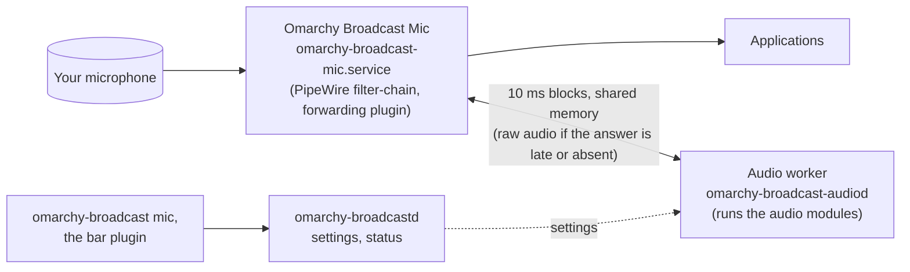

# Setting up the Omarchy Broadcast Mic

"Omarchy Broadcast Mic" is an optional virtual microphone: your microphone with background noise removed, which any application can select like a hardware microphone. The processing is done by **audio modules**, loadable like the video effects ([modules.md](../modules.md#audio-modules)); the module that ships is a CPU one, with two engines (DeepFilterNet, the default, and RNNoise), so it needs no GPU and no vendor SDK. Other engines, including GPU ones, can be installed as further modules and appear as further providers of the same stage, with no change to this setup. The design and the reasons are in [ADR-0029](../adr/0029-audio-modules-mic-host-and-worker.md).

The microphone is independent of the virtual camera: neither needs the other, and the camera daemon is only the control panel of the microphone (it is not in the audio path). **Whatever stops, you keep a microphone**: if a module, the worker or the daemon stops, applications that chose "Omarchy Broadcast Mic" keep receiving your microphone's own audio, unprocessed, and get the processed audio again when the part is back. It is never silent because of an effect.

There are two ways to run the microphone, and only one at a time:

- **The microphone with audio modules** (this page, up to [Troubleshooting](#troubleshooting)): settings (on and off, the microphone, the engine, the strength), several providers, status. Recommended.
- **The filter-chain units** of [ADR-0014](../adr/0014-mic-noise-removal-filter-chain.md): one fixed engine per unit, no settings, no worker. A supported lightweight alternative, described in [The lightweight alternative](#the-lightweight-alternative-the-filter-chain-units).

Both create a source with the same name, so they exclude each other: each unit declares `Conflicts=` with the others, and `omarchy-broadcast mic on` refuses, naming the unit, while an ADR 0014 unit is running.

## How it works



- The **mic host** is a small PipeWire process that creates the source. It runs no effect: a forwarding plugin hands each 10 ms of audio to the worker and plays the result back, or your microphone's own audio when the result is not there.
- The **audio worker** runs the modules. It starts when an application starts recording from the source and exits after 30 seconds without sound, which also frees a GPU module's memory. It runs in its own unit, so restarting the daemon does not stop it, and its crash does not stop the microphone.
- The **daemon** is where you control it: `omarchy-broadcast mic`, the settings tree and the bar. It writes your settings to a file the worker reads, so the microphone works as you set it with the daemon down.

The processing adds a delay: 10 ms to hand the audio to the worker and back (20 ms when a stage runs on a GPU), plus the engine's own: about 10 ms for RNNoise and about 30 ms for DeepFilterNet. `omarchy-broadcast mic` shows the total in force.

## Requirements

- PipeWire with WirePlumber 0.5 (the default on Omarchy).
- A systemd user session.
- Nothing else for the CPU module: DeepFilterNet and RNNoise are built into it, with no model files and no LADSPA package.

## Install

Packaging installs everything and **enables nothing**. Choose one route.

### From the Arch package

The package installs:

- the mic host's PipeWire configuration, `/usr/share/omarchy-broadcast/pipewire/omarchy-broadcast-mic.conf`, and its unit `omarchy-broadcast-mic.service` (whose `ExecStart=` names that configuration by absolute path);
- the forwarding plugin, `/usr/lib/ladspa/libomarchy_broadcast_mic.so`, which the configuration finds by name;
- the worker, `/usr/bin/omarchy-broadcast-audiod`, with its units `omarchy-broadcast-audiod.service` and `omarchy-broadcast-audiod.socket` and the D-Bus activation file `br.com.dias.OmarchyBroadcast.AudioWorker.service`;
- the CPU voice module and its manifest in `/usr/lib/omarchy-broadcast/modules` and `modules.d`, and the third-party licence notices.

Building the package fetches the DeepFilterNet source from its upstream repository (a git dependency pinned by commit), so `makepkg` needs network access.

### With `scripts/install-user.sh --audio`

From the repository root, `scripts/install-user.sh --audio` ([daemon.md](daemon.md#per-user-install-from-a-checkout)) builds and installs the same parts without root, under `~/.local`:

- the worker in `${XDG_BIN_HOME:-~/.local/bin}`;
- the plugin, the mic host's configuration (with the plugin's absolute path) and the module's library and manifest under `${XDG_DATA_HOME:-~/.local/share}/omarchy-broadcast/`;
- the units in `${XDG_DATA_HOME:-~/.local/share}/systemd/user/` and the activation file in `${XDG_DATA_HOME:-~/.local/share}/dbus-1/services/`.

It enables nothing and prints the next steps. `--audio` and `--mic` (the ADR 0014 units) are alternatives: the script refuses both in one run. `scripts/install-user.sh --uninstall` removes what it installed; it refuses while a mic unit is enabled, so turn the microphone off first (see [Undo](#undo)). The DeepFilterNet source is fetched once, so the first build needs network access.

## Turn it on

```sh
omarchy-broadcast mic on
```

This enables and starts `omarchy-broadcast-mic.service`: the source "Omarchy Broadcast Mic" exists now, and comes back at every login until you turn it off. It needs the daemon (the command starts it by D-Bus activation); without the daemon, run `systemctl --user enable --now omarchy-broadcast-mic.service`. If an ADR 0014 unit is running, `mic on` refuses and names it; stop it first with `systemctl --user disable --now omarchy-broadcast-mic@rnnoise.service` (or `@deepfilter`).

```sh
omarchy-broadcast mic
```

```text
Microphone: passthrough
Consumers:  0
Latency:    0.0 ms
```

With nothing recording, the state is `passthrough`: the worker is not running and nothing needs processing. When an application records from "Omarchy Broadcast Mic" the worker starts, the state goes to `starting` while the engine loads (the audio is the raw microphone meanwhile), then `active`:

```text
Microphone: active
Consumers:  1
Provider:   mic-denoise: br.com.dias.voice-cpu
Latency:    40.0 ms
```

The states:

| State | Meaning |
|---|---|
| `off` | The mic host is not running. There is no "Omarchy Broadcast Mic" source |
| `passthrough` | It runs and the audio passes unchanged: processing is off, nothing records, or no stage is on or able to run |
| `starting` | An engine is loading or warming up; the audio is your microphone's own until it is ready |
| `active` | The audio is processed |
| `error` | Stages are on but none could run; `Error:` says why; the audio is your microphone's own |

## Using it

"Omarchy Broadcast Mic" appears as an ordinary microphone. Either select it in the application (the input device setting of the meeting, recording or chat program), or make it the default microphone:

```sh
omarchy-broadcast mic default            # Use as default microphone
omarchy-broadcast mic restore-default    # go back to the microphone that was the default
```

Making it the default is an explicit action; nothing turns it into the default by itself. What `mic default` does:

1. It remembers which microphone is the default now.
2. It pins the capture side of the Omarchy Broadcast Mic to the microphone you chose ([Choosing the microphone](#choosing-the-microphone)), or to the one that was the default, so that it never captures from itself.
3. It makes the Omarchy Broadcast Mic the default, so that applications that follow the default use it.

`mic restore-default` makes the remembered microphone the default again and removes the pin. `mic off` does that first, when the Omarchy Broadcast Mic is the default, before it stops the microphone, so applications move to a live microphone as it goes. Making it the default is safe: the capture side and the output side of the node share one link group, which WirePlumber never links to each other.

The source is mono at 48 kHz. A stereo microphone is downmixed. `wpctl status` lists the source under **Filters**, not under Sources, because WirePlumber groups filter-chain nodes there; applications list it as an ordinary input named "Omarchy Broadcast Mic".

### Choosing the microphone

By default the capture side follows the system's default microphone. To use one particular microphone, choose it:

```sh
omarchy-broadcast settings          # lists the microphones as the options of mic.input.device
omarchy-broadcast mic device alsa_input.usb-...      # or `mic device default`
omarchy-broadcast mic default       # applies the choice: pins the capture side to it
```

The choice is stored (`[mic] device`, the microphone's PipeWire `node.name`); it is the target the pin gets when `mic default` runs, and choosing another microphone while the Omarchy Broadcast Mic is the default (and the mic host runs) moves the pin at once, without remembering the Omarchy Broadcast Mic as the "previous" default; while it is not the default, the choice only applies to the next `mic default`. The pin is saved by WirePlumber, so it survives restarts of the mic host, the worker and WirePlumber; a microphone that is unplugged and plugged again is a new PipeWire object, so run `mic default` again if the capture side does not follow it. The microphone list never includes the Omarchy Broadcast Mic's own nodes.

## Noise removal and its settings

The settings are in the settings tree, which `omarchy-broadcast settings` shows and the bar's Mic page draws (a client that is a separate project; it needs the daemon's revision 13 interface):

| Setting | What it does |
|---|---|
| `mic.input.enabled` ("Noise and echo processing") | The master switch. Off, the microphone's audio passes unchanged, at the same delay: never muted |
| `mic.input.device` ("Input device") | The microphone captured (above) |
| `mic.input.make_default`, `mic.input.restore_default` | The actions behind `mic default` and `mic restore-default` |
| `mic.noise.enabled` ("Noise removal") | Noise removal on or off |
| `mic.noise.strength` ("Strength", 0 to 100 %) | How much noise goes. One control for every provider of noise removal: each engine maps it its own way. 100 % is the strongest. Applies live, with no break in the sound |
| `mic.cpu.engine` ("Engine") | `deepfilternet` (the default) or `rnnoise`. Reloads the engine; the audio stays raw for the moment the new one loads |

```sh
omarchy-broadcast settings set mic.noise.strength 70
omarchy-broadcast settings set mic.cpu.engine rnnoise
omarchy-broadcast settings set mic.input.enabled off     # raw audio through the same source
```

A module installed later adds its own settings to the same page (a switch and a strength for room echo removal, for instance), and a setting that cannot be changed now is shown with the reason.

### Choosing the engine

| | RNNoise | DeepFilterNet |
|---|---|---|
| Strength | Light on the CPU; steady noise such as fans and hiss | Non-stationary noise such as keyboards and voices in the background; less damage to speech; non-speech sound is kept |
| Weakness | A voice-activity gate mutes what it does not classify as voice (ambience, music, keyboard between words); weaker on keyboards; can clip the onset of words | Heavier on the CPU |
| Delay of the engine | About 10 ms | About 30 ms |
| `mic.noise.strength` | A mix of the processed and the original sound, with the original delayed to match | The limit on how many decibels of noise are taken away, from a light touch at 0 % (about 1 dB) to no limit at 100 %; 25 % is about 3 dB, 50 % about 10 dB, 75 % about 30 dB |

DeepFilterNet is the default because it keeps the voice and removes noise from under it; choose RNNoise when the CPU matters more, for instance on a laptop battery. For measured CPU figures of the two engines see [ADR-0014](../adr/0014-mic-noise-removal-filter-chain.md); the module runs the same engines. Compare by ear with your own microphone and room.

### Configuration

The `[mic]` keys are in [config.example.toml](../config.example.toml); the panel and `omarchy-broadcast config set mic.<key> VALUE` change all but `force_conflicts`:

| Key | Default | Meaning |
|---|---|---|
| `enabled` | `true` | The master switch above |
| `device` | `"default"` | The microphone captured, a PipeWire `node.name` |
| `pipeline_depth` | `0` | Blocks of 10 ms between the microphone and the processed audio, 0 to 4; 0 chooses by device (1 on the CPU, 2 when a stage runs on a GPU). More tolerates a late block at the cost of delay |
| `idle_exit_s` | `30` | Seconds without sound before the worker exits and frees its memory (and a GPU); 0 never exits |
| `gpu_policy` | `"always"` | When a GPU module may be used: `always`, `with-camera` (only in a microphone session that starts while the camera runs) or `never`. A stage the GPU may not run runs on the best CPU module that offers it. A level meter alone never wakes the GPU |
| `force_conflicts` | `false` | Run effects that their modules declare as excluding each other, together. For testing; set in a file |

Which module provides a stage is chosen as for video: by rank, by the backend profile (`omarchy-broadcast modules profile battery` prefers a CPU module over a GPU one) and by pin (`omarchy-broadcast modules pin mic-denoise MODULE`). `omarchy-broadcast modules` lists the audio modules with their stages next to the video ones.

## When something stops

| What stops | What you get |
|---|---|
| The daemon (stopped, crashed, restarted) | Nothing changes: the microphone and the worker keep going with the settings in force |
| The worker, or a module (crash, hang, too slow) | Your microphone's own audio within a few milliseconds, then processed audio again when the worker is back (systemd restarts it, and a connection to its socket starts it) |
| A module that crashes the worker twice in a row | It is disabled, with the reason in `omarchy-broadcast modules`, and the microphone stays raw or on another provider until you enable it again: `omarchy-broadcast modules enable ID` |
| A stage that fails | The stage is dropped and the rest of the chain runs |
| Processing switched off | Raw audio, never silence |
| An engine still loading (the first seconds after an application starts recording, or after changing the engine) | Raw audio, then a short crossfade to the processed audio |
| `omarchy-broadcast mic off` | The previous default microphone is restored first, then the source goes |

## Troubleshooting

Logs:

```sh
journalctl --user -u omarchy-broadcast-mic.service                     # the mic host and its plugin
journalctl --user -u omarchy-broadcast-audiod.service -u omarchy-broadcast-audiod.socket   # the worker
journalctl --user -u omarchy-broadcastd                                # the daemon
```

| Symptom | Cause | Fix |
|---|---|---|
| `mic on` says an ADR 0014 unit is running | The filter-chain units create the same source | `systemctl --user disable --now omarchy-broadcast-mic@rnnoise.service omarchy-broadcast-mic@deepfilter.service`, then `mic on` |
| The unit `omarchy-broadcast-mic.service` fails to start | Often the forwarding plugin or the configuration is not found: the unit fails on purpose, so a missing plugin is visible instead of leaving a source with no effect behind it | Read the mic host's log; check that `libomarchy_broadcast_mic.so` is in `/usr/lib/ladspa` (package) or at the path in the installed configuration (`install-user.sh`) |
| "Omarchy Broadcast Mic" is not in the application's list | The mic host is not running (`omarchy-broadcast mic` says `off`), or the application read its device list before the source existed | `omarchy-broadcast mic on`; reopen the application's input settings or restart it |
| The state stays `passthrough` while an application records | That application is not recording from "Omarchy Broadcast Mic" (it uses the hardware microphone), processing is off, or the worker could not start | Select the source in the application; check `settings` for `mic.input.enabled` and `mic.noise.enabled`; read the worker's log |
| The state is `error` | The stages that are on could not run; the `Error:` line says why | Fix what it names, or turn the stage off |
| The audio is raw for a moment, then processed | The engine was loading, or a block was late | Nothing to fix. If it repeats, raise `pipeline_depth` or check the load on the CPU |
| The worker does not start after a crash loop | systemd stops restarting a unit that failed five times in a minute, and the socket fails with it | `systemctl --user reset-failed omarchy-broadcast-audiod.service omarchy-broadcast-audiod.socket`, then `systemctl --user start omarchy-broadcast-audiod.socket` (or `mic off` and `mic on`) |
| The source exists but is silent | No hardware source is available, or the capture side is pinned to a microphone that is gone | `wpctl status`; `pw-link -l` to see whether `omarchy-broadcast-mic.capture` has an input link; run `mic restore-default` or choose another microphone with `mic device` and run `mic default` |
| Two "Omarchy Broadcast Mic" entries | An ADR 0014 unit and the mic host both run (a stale process) | Stop the one you do not want |
| The voice sounds clipped or pumping | The reduction is too strong | Lower `mic.noise.strength`, or use the other engine |
| High CPU while recording | DeepFilterNet is the heavier engine | `settings set mic.cpu.engine rnnoise`, or lower the load another way |
| A module is `disabled` | It crashed the worker twice in a row | Read the worker's log, then `omarchy-broadcast modules enable ID` |

## What it touches

- **PipeWire and WirePlumber.** Only on your explicit actions: `mic default` writes WirePlumber's default-source setting (`default.configured.audio.source` in its `default` metadata) and sets the target of the capture stream, which WirePlumber stores in its own saved state for that stream (restore-stream). `mic restore-default`, and `mic off` when the Omarchy Broadcast Mic is the default, write the default back and delete the target. Nothing else is written to WirePlumber, and your own WirePlumber configuration files are never touched.
- **Files.** `config.d/50-panel.toml` (the daemon's managed drop-in, with `[mic]`), the daemon's state file (the previous default microphone and the module settings), `audio-settings.json` and `audio-modules-crash.json` in the state directory, the worker's socket in `$XDG_RUNTIME_DIR/omarchy-broadcast/`, and the installed units, plugin and module. The worker holds audio in memory only; these processes store and send no audio.
- **The GPU.** A GPU module is loaded only while an application records from the source (a level meter does not count) and the policy allows it; the worker exits after the idle time and releases it.

## Undo

```sh
omarchy-broadcast mic off        # restores the previous default microphone, stops and disables the unit
```

Without the daemon: change the default microphone back (`wpctl set-default ID` or the desktop's audio settings), then `systemctl --user disable --now omarchy-broadcast-mic.service`. Then remove the files according to the route:

- Arch package: `sudo pacman -R omarchy-broadcast-git` removes the daemon too; the microphone files alone are not removable separately. Leaving the unit disabled is enough.
- `install-user.sh --audio`: `scripts/install-user.sh --uninstall`.

---

# The lightweight alternative: the filter-chain units

[ADR-0014](../adr/0014-mic-noise-removal-filter-chain.md)'s units stay supported for anyone who wants a fixed engine with no worker, no settings and no daemon. A PipeWire `filter-chain` hosts a LADSPA noise-suppression plugin and exposes the result as the same source, "Omarchy Broadcast Mic". It runs on the CPU only and is independent of `omarchy-broadcastd`. It is **mutually exclusive** with the microphone with audio modules above: `omarchy-broadcast mic on` refuses while one of these units runs, and starting either kind of unit stops the other (`Conflicts=`).

Two engines are available, each with its own configuration file: RNNoise (the default, light on CPU) and DeepFilterNet (higher quality, more CPU); see [Choosing the engine](#choosing-the-engine-of-the-units). Each runs as its own process, started by one instance of the systemd user unit `omarchy-broadcast-mic@.service`. Both create a source with the same name, so run one at a time.

The configuration files and the unit are in the repository's `dist/` directory (`dist/pipewire/` and `dist/systemd/`). There are three ways to install them; each installs both engines' configurations and the unit, and none enables anything.

## Requirements of the units

- PipeWire with WirePlumber 0.5 (the default on Omarchy).
- A systemd user session.
- At least one LADSPA plugin package. The Arch package lists both as optional dependencies.

```sh
sudo pacman -S noise-suppression-for-voice   # RNNoise engine (default)
sudo pacman -S deepfilternet-ladspa          # DeepFilterNet engine
```

`noise-suppression-for-voice` installs `/usr/lib/ladspa/librnnoise_ladspa.so`; `deepfilternet-ladspa` installs `/usr/lib/ladspa/libdeep_filter_ladspa.so`. The configurations were written against `noise-suppression-for-voice` 1.21 and `deepfilternet-ladspa` 0.5.6.

## Install the units

Choose one of the three routes.

### From the Arch package

The package installs the configurations as `/usr/share/omarchy-broadcast/pipewire/omarchy-broadcast-mic-rnnoise.conf` and `omarchy-broadcast-mic-deepfilter.conf`, and the unit as `/usr/lib/systemd/user/omarchy-broadcast-mic@.service`. Those directories are not on PipeWire's configuration search path, so the packaged unit names the configuration by absolute path:

```
ExecStart=/usr/bin/pipewire -c /usr/share/omarchy-broadcast/pipewire/omarchy-broadcast-mic-%i.conf
```

The package enables nothing. Install the plugin package (above), then follow [Enable an instance](#enable-an-instance).

### With `scripts/install-user.sh --mic`

From the repository root, `scripts/install-user.sh --mic` (see [daemon.md](daemon.md#per-user-install-from-a-checkout)) also installs, without root:

- the configurations in `${XDG_DATA_HOME:-~/.local/share}/omarchy-broadcast/pipewire/`;
- the unit as `${XDG_DATA_HOME:-~/.local/share}/systemd/user/omarchy-broadcast-mic@.service`, with `ExecStart=` pointing at that absolute configuration path.

It enables nothing. `scripts/install-user.sh --uninstall` removes these files; it refuses while an instance is enabled, so disable it first (see [Undo the units](#undo-the-units)).

### Manually, from a checkout

Keep the file names: the unit looks the configuration up by name. PipeWire searches `~/.config/pipewire`, `/etc/pipewire` and `/usr/share/pipewire`. Run the commands from the repository root.

```sh
# the engine or engines you want:
install -Dm644 dist/pipewire/omarchy-broadcast-mic-rnnoise.conf    ~/.config/pipewire/omarchy-broadcast-mic-rnnoise.conf
install -Dm644 dist/pipewire/omarchy-broadcast-mic-deepfilter.conf ~/.config/pipewire/omarchy-broadcast-mic-deepfilter.conf

# the unit (once):
install -Dm644 dist/systemd/omarchy-broadcast-mic@.service ~/.config/systemd/user/omarchy-broadcast-mic@.service
systemctl --user daemon-reload
```

Installing both configurations side by side is fine; only the running instance matters.

### Which unit wins

systemd uses the first unit it finds: one in `~/.config/systemd/user` shadows one in `~/.local/share/systemd/user`, which shadows one in `/usr/lib/systemd/user`. To tune a packaged configuration, copy it to `~/.config/pipewire` and override `ExecStart` with a drop-in, which makes PipeWire look the file up by name:

```sh
install -Dm644 /usr/share/omarchy-broadcast/pipewire/omarchy-broadcast-mic-rnnoise.conf ~/.config/pipewire/
systemctl --user edit omarchy-broadcast-mic@.service
```

with this content in the editor:

```
[Service]
ExecStart=
ExecStart=/usr/bin/pipewire -c omarchy-broadcast-mic-%i.conf
```

## Enable an instance

```sh
systemctl --user enable --now omarchy-broadcast-mic@rnnoise.service
```

Use `omarchy-broadcast-mic@deepfilter.service` for the DeepFilterNet engine. The unit is bound to `pipewire.service`: it stops with PipeWire and is started again whenever PipeWire starts, so it survives `systemctl --user restart pipewire`. Starting it stops `omarchy-broadcast-mic.service` (the microphone with audio modules) if that runs, and the other way round.

## Using the units' source

"Omarchy Broadcast Mic" appears as an ordinary microphone. Either:

- select it in the application (the input device setting of the meeting, recording or chat program); or
- make it the default input. Find its id, then set it:

```sh
wpctl status                 # under Audio > Filters, find "omarchy-broadcast-mic  [Audio/Source]" and its id
wpctl set-default <id>
```

Making it the default is safe. The filter-chain puts its capture side and its output side in one `node.link-group`, and WirePlumber never links two nodes of the same link group. The capture side therefore does not loop back onto its own output; it follows the best hardware microphone instead. Because the capture side follows the default source, it also moves with the microphone chosen in the desktop's audio settings.

The source is mono at 48 kHz. A stereo microphone is downmixed.

## Choosing the engine of the units

RNNoise is the default: it costs little CPU, which matters on a laptop battery. Its voice-activity gate mutes everything it does not classify as voice (ambience, music, keyboard between words), so a room with no one speaking comes out as silence. Choose DeepFilterNet when you want higher quality, noise removed from under speech, or non-speech sound kept (for example an instrument), and have CPU to spare: it is a neural model that removes noise from inside speech and lowers the noise floor instead of gating. Listening tests found both acceptable.

| | RNNoise | DeepFilterNet |
|---|---|---|
| Strength | Low CPU and memory; steady noise such as fans and hiss | Non-stationary noise such as keyboards and voices in the background; less damage to speech; non-speech sound is kept |
| Weakness | Mutes non-speech sound (VAD gate); weaker on keyboards; can clip the onset of words | More CPU and memory |
| Latency | 10 ms frames | Algorithmic latency of at least 20 ms, per the upstream documentation |
| CPU while recording | About 2.4 % of one core | About 21.5 % of one core |
| Memory | About 14 MB | About 155 MB once a recorder has connected (the model loads then) |
| Package | `noise-suppression-for-voice` | `deepfilternet-ladspa` |

The CPU and memory figures were measured on an Intel Core Ultra 9 275HX with PipeWire 1.6.9, from the process's own CPU time over 30 s of continuous recording. With nothing recording from the source, both use effectively no CPU. The latency values are from the upstream documentation and were not measured. Compare by ear with your own microphone and room.

`wpctl status` lists the source under **Filters**, not under Sources, because WirePlumber groups filter-chain nodes there. Applications list it as an ordinary input device named "Omarchy Broadcast Mic".

## Switching engines

```sh
systemctl --user disable --now omarchy-broadcast-mic@rnnoise.service
systemctl --user enable --now omarchy-broadcast-mic@deepfilter.service
```

Both engines use the node name `omarchy-broadcast-mic`, so applications that remember their input by name keep it across the switch.

## Tuning the units

Edit the copy in `~/.config/pipewire` (for a packaged or `--mic` install, see [Which unit wins](#which-unit-wins)), then restart the instance:

```sh
systemctl --user restart omarchy-broadcast-mic@rnnoise.service   # or @deepfilter
```

### RNNoise

- `"VAD Threshold (%)"` (0 to 99, shipped 50): frames whose voice probability is below it are muted. Raise it to remove more noise; lower it if speech is cut.
- `"VAD Grace Period (ms)"` (0 to 1000, shipped 200): how long the output stays open after voice was last detected. Raise it if word endings are cut.
- `"Retroactive VAD Grace (ms)"` (0 to 200, shipped 0): opens the output this far back in time so the start of a word gets through, at the cost of that much added latency.

The shipped values are those recommended by the plugin's README.

### DeepFilterNet

`"Attenuation Limit (dB)"` is the maximum noise attenuation, 0 to 100 dB. The shipped value, 100, means no limit (the plugin's default). Lower values leave some of the noise and sound more natural: about 18 to 24 dB for medium reduction, 6 to 12 dB for light reduction. The other plugin controls are listed, commented out, in the file with their ranges and defaults.

## Pinning one microphone with the units

By default the capture side follows the default source. To use one particular microphone regardless of the default, find its `node.name`:

```sh
wpctl inspect <id>           # look for node.name
```

Then, in the `capture.props` block of the configuration, uncomment `target.object` and set it:

```
target.object = "alsa_input.usb-..."
```

Restart the instance.

## Undo the units

Disable the instances first (both engines):

```sh
systemctl --user disable --now omarchy-broadcast-mic@rnnoise.service omarchy-broadcast-mic@deepfilter.service
```

Then remove the files, according to the route:

- Arch package: `sudo pacman -R omarchy-broadcast-git` removes the daemon too; the microphone files alone are not removable separately. Leaving the instances disabled is enough.
- `install-user.sh --mic`: `scripts/install-user.sh --uninstall`.
- Manual install:

```sh
rm ~/.config/systemd/user/omarchy-broadcast-mic@.service ~/.config/pipewire/omarchy-broadcast-mic-*.conf
systemctl --user daemon-reload
```

Remove a drop-in made with `systemctl --user edit` with `systemctl --user revert omarchy-broadcast-mic@.service`.

## Troubleshooting the units

| Symptom | Cause | Fix |
|---|---|---|
| The unit fails to start | Often a missing plugin; see the log | `journalctl --user -u 'omarchy-broadcast-mic@*'` |
| The log says a plugin cannot be loaded | The LADSPA package is not installed. The unit fails on purpose: the filter module has no `nofail` flag, so a missing plugin is visible instead of leaving a silent or missing source | Install `noise-suppression-for-voice` or `deepfilternet-ladspa`, then start the unit again |
| "Omarchy Broadcast Mic" is not in the application's list | The unit is not running, or the application read its device list before the source existed | `systemctl --user status 'omarchy-broadcast-mic@*'`; reopen the application's input settings or restart it |
| The source exists but is silent | No hardware source is available, or the capture side is not linked to one | `wpctl status` to check that a microphone exists and is the default; `pw-link -l` to see whether `omarchy-broadcast-mic.capture` has an input link. If you pinned `target.object`, check the name |
| Two "Omarchy Broadcast Mic" entries | Two instances are running (both engines, or a stale process) | Disable one: `systemctl --user disable --now omarchy-broadcast-mic@<engine>.service` |
| The voice sounds clipped or pumping | The reduction is too strong | DeepFilterNet: lower the attenuation limit. RNNoise: lower the VAD threshold or raise the grace period |
| CPU use while idle | The capture side is passive, so the microphone is not opened while nothing records from the source | Nothing to fix. If the microphone is open with no recorder, check which application is reading "Omarchy Broadcast Mic" or the hardware source |
